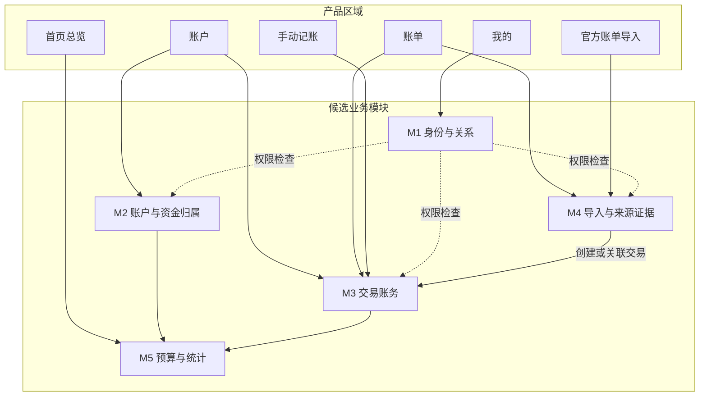
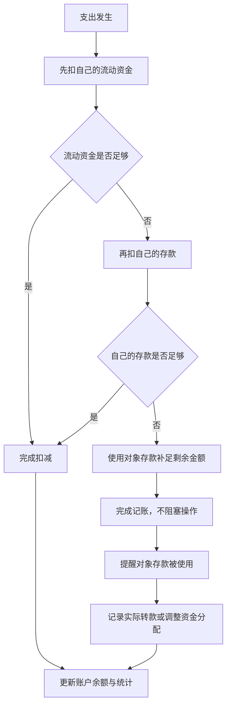
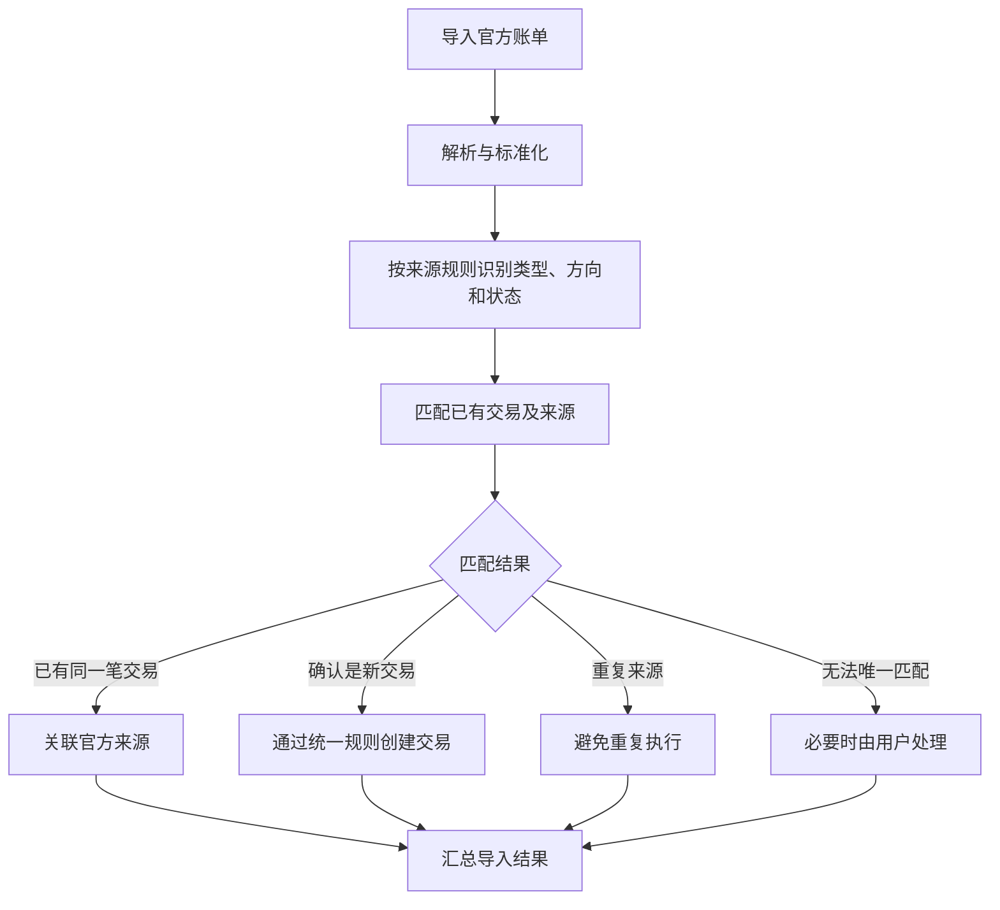

# 星账｜核心业务规则讨论记录

**版本：** v0.3  
**阶段：** 业务规则梳理中  
**状态：** 讨论记录，尚未冻结  
**用途：** 汇总已有讨论、标记业务规则状态，并为后续业务规则审阅提供依据  
**范围：** 产品业务行为与业务流程；不涉及数据库 Schema、API 契约或代码实现

---

## 0. 阅读说明

本文使用三种状态：

- **【已确认】**：用户已经明确选择或认可的业务规则。
- **【暂定】**：当前讨论形成的候选规则，仍需进一步核实或确认。
- **【待讨论】**：尚未决定，不得自行补充为确定规则。

本文是阶段性讨论记录，不代表业务规则已经冻结。业务规则须经用户审阅并明确确认后，才能进入下一阶段。

## 一、产品目标与范围

### 1.1 核心目标

星账需要解决三个问题：

1. 清楚了解自己有多少钱，以及资金的归属人和性质。
2. 通过便捷的日常记账记录资金变化。
3. 定期导入微信、支付宝官方账单，补全记录并核对交易，减少遗漏和重复入账。

### 1.2 核心产品原则

- 记账操作尽量简单，避免不必要的逐笔确认。
- 账务结果必须准确，不能为了方便而掩盖错误。
- 手动记账和官方账单导入遵循统一的账务规则。
- 账户总额、资金归属、交易记录和统计结果应保持一致。
- 复杂的识别、匹配和计算由系统处理；只有真正无法确定的情况才要求用户介入。
- 双人使用是产品的基础要求，不应依赖虚拟的共同账户来表达双方的实际资金。

### 1.3 当前产品区域

| 产品区域 | 用户主要任务 |
|---|---|
| 首页总览 | 查看总资金、本月花销、日均花销、环比变化、存款、流动资金和预算剩余额度 |
| 账户 | 创建、命名账户，查看账户资金，调整资金归属和性质 |
| 账单 | 查询、筛选、编辑、保存和删除交易，查看退款关联 |
| 记账与导入 | 手动记账、官方账单导入；截图记账暂缓实现 |
| 我的 | 关系绑定、个人设置及相关权限 |

## 二、候选业务模块及职责

模块是业务职责的划分，不等同于产品页面，也不代表必须建立独立服务。

### M1：身份与关系

负责用户身份、关系绑定、成员关系和访问权限。

### M2：账户与资金归属

负责账户创建、命名、初始余额，以及账户内资金归属人与资金性质的分配。

### M3：交易账务

负责收入、支出、退款、转账、交易编辑和删除，以及相应的资金变化规则。

### M4：导入与来源证据

负责官方账单解析、字段标准化、来源识别、重复导入处理，以及官方记录与已有交易的匹配。

### M5：预算与统计

负责预算、月度支出、日均花销、环比变化、存款、流动资金等统计口径。

### 模块协作原则【已确认方向】

- 手动记账和官方账单导入使用统一的交易处理规则。
- M4 负责理解外部来源和判断匹配关系，不独立实现第二套交易保存逻辑。
- M5 根据统一的账户、资金归属和交易结果计算统计，不维护另一套独立余额。
- 产品页面可以调用多个业务模块；一个业务模块也可以服务多个产品页面。

## 三、账户与资金归属规则

### 3.1 初始余额【已确认】

新建账户时允许设置初始余额，因为用户首次使用星账时，账户中可能已经有资金。

初始余额：

- 作为账户的记账起点。
- 不计为普通收入。
- 不计为普通支出。
- 后续余额根据初始资金及之后的资金变化计算。

【待讨论】初始余额的起算日期，以及导入更早的历史账单时如何避免重复计算。

### 3.2 资金归属与性质【已确认方向】

账户表示资金存放在哪里；归属人表示钱属于谁；资金性质表示钱属于存款还是流动资金等类别。这些概念不能简单合并成一个概念。

用户可以在账户编辑页面重新分配资金的归属人与性质。

【已确认】采用方案 B：

- 底层记录必要的资金分配调整。
- 资金重新分配不计为收入、支出或普通转账。
- 当前资金分配可以变化。
- 历史交易不因当前分配变化而被反向改写。

【待讨论】允许哪些归属人与资金性质的组合，以及资金分配金额的约束。

### 3.3 普通支出与普通收入的默认分配【已确认】

**普通支出：**

1. 优先扣除自己的流动资金。
2. 自己的流动资金不足时，再扣除自己的存款。
3. 自己的流动资金和存款仍不足时，允许继续完成记账，并按既定顺序使用对象的存款补足剩余金额；前提是实际账户有足够余额。

**普通收入：**

- 默认增加到自己的流动资金。

以上规则针对普通收入与普通支出，不代表退款也使用同一套分配方式。

### 3.4 使用对象存款后的提醒【已确认方向】

当一笔支出在扣完自己的流动资金和存款后，仍需使用对象的存款：

- 系统先完成记账，不要求用户中途确认。
- 系统按实际扣减金额更新对应资金份额。
- 记账完成后提醒用户：对象的存款有一部分被用于本次支出。
- 提醒不阻塞记账，也不强迫用户当场处理。

提醒应提供后续处理的方向：

1. **记录实际转款：** 双方确实发生资金转移时，记录真实转款；内部转账不计为收入或消费。
2. **调整资金归属或存款分配：** 当需要修正资金份额、且确实不对应一笔实际转款时，调整分配；不能凭空增加账户总余额。

【待讨论】提醒出现的具体时机、是否允许稍后处理、提醒如何再次查看，以及两种处理方式的具体操作规则。

### 3.5 余额修正【已确认方向】

不单独设计复杂的余额核对功能。

发现差异时，优先检查并修正对应的交易、退款、转账或漏记记录。不能为了让余额对上，就随意伪造一笔消费或直接覆盖余额。

## 四、交易账务规则

### 4.1 交易类型

目前讨论的核心类型包括：

- 收入
- 支出
- 转账
- 退款

这些类型具有不同的业务含义，不能只根据金额增加或减少来判断。

### 4.2 内部转账【已确认】

内部转账属于交易账务的一部分，不单独建立转账业务模块。

例如，微信零钱转入银行卡 ¥1,000：

- 转出账户减少 ¥1,000。
- 转入账户增加 ¥1,000。
- 不计为收入。
- 不计为消费。

如有手续费，应根据真实业务含义单独处理。

【待讨论】转账的完整关联规则、手续费处理及特殊账户之间的转账。

### 4.3 退款【已确认方向；分配方式待讨论】

退款属于正常账务业务，需要与原交易建立关联，并按照统一规则影响账户余额和统计。退款不是简单的普通收入。

【待讨论】当前候选方案是：退款优先恢复原交易实际扣减的资金份额，而不是像普通收入一样默认全部进入自己的流动资金。该方案尚未冻结，需要结合部分退款、多次退款、原交易使用了对象存款等情况进一步确认。

还需讨论：
- 部分退款、多次退款如何处理。
- 退款无法匹配原交易时如何处理。
- 退款对资金归属的恢复规则。

### 4.4 编辑交易【已确认方向】

发现交易类型、金额或其他字段填写错误时，优先修改原交易，而不是无条件新增一笔替代记录。

修改后，账户余额和统计应按照统一账务规则重新计算。

### 4.5 删除交易【已确认】

- 用户可以直接删除交易。
- 不额外设计用户可见的作废流程或回收站。
- 删除后，该交易不再参与正常的余额和统计计算。
- 删除后重新导入官方账单，应允许重新创建对应交易。

【待讨论】删除涉及退款、转账或来源关联的交易时，如何正确处理相关关系。

## 五、官方账单导入规则

### 5.1 官方来源的作用【已确认方向】

微信和支付宝官方账单是对应平台、账户及导出范围内的权威交易来源。

系统应优先使用官方字段和确定性规则识别交易信息，而不是让 AI 重新猜测已经明确的内容。

需要区分：

- 原始来源字段。
- 标准化后的交易信息。
- 星账内部的交易类型。
- 来源记录的交易状态与星账账务处理规则。

官方账单提供交易依据，但不代表解析后的结果必然正确。

### 5.2 导入流程【已确认方向】

1. 检查文件格式和导入范围。
2. 解析官方字段。
3. 标准化交易信息。
4. 根据来源字段和确定性规则识别交易类型、金额方向及状态。
5. 与星账已有交易匹配。
6. 根据匹配结果决定关联、创建或跳过。
7. 汇总导入结果。

### 5.3 交易匹配与重复处理【已确认方向】

- 同一笔交易已经通过手动记账创建：关联官方来源，不重复入账。
- 确认是新交易：通过统一账务规则创建。
- 同一来源已经处理过：避免重复执行。
- 无法唯一匹配：只有必要时才要求用户处理。

【已确认】退款和转账是正常交易类型，不应一律作为异常。

【已确认】不建设复杂的异常管理中心。

### 5.4 官方来源与手动记录不一致【暂定】

当前方案：

- 不静默覆盖已有手动记录。
- 如果可以确认是同一笔交易，允许关联来源。
- 如果重要字段存在差异，由用户检查并修正。
- 只有无法安全确定的情况，才要求用户介入。

【待讨论】具体匹配条件、金额差异判断及自动处理的安全边界。

### 5.5 删除后重新导入【已确认】

重复导入和删除后重导入是不同的情况：

- 重复导入同一来源，不重复创建交易。
- 用户删除交易后，再次导入该来源，允许重新创建交易。
- 系统不能因为历史上处理过来源记录，就永久阻止交易重新入账。

## 六、双人使用与关系规则

双人使用属于星账的基础业务要求，不应等到产品后期才考虑。

目前已经明确的方向：

- 双方可以查看和记录各自有权访问的资金与交易。
- 账户仍然对应实际存在的账户，而不是创建脱离实际资金的虚拟共同账户。
- 账户内资金可以分别属于不同归属人。
- 资金的归属人、保管关系和资金性质不能混为一谈。

【待讨论】

- 双方各自能够查看和修改哪些账户、交易及资金分配。
- 关系绑定、解除关系后的数据访问规则。
- 账户归属人与实际保管人的区别及其适用规则。
- 删除交易、修改资金归属等操作的权限边界。

## 七、首页统计与预算规则

首页需要展示：

- 总资金。
- 本月花销。
- 平均每天花销。
- 相比上个月的花销变化幅度。
- 存款。
- 流动资金。
- 本月支出计划及剩余额度。

【已确认方向】这些数字必须来自统一的账务事实与资金分配结果，不应由不同页面分别维护。

【待讨论】

- 总资金的准确含义。
- 存款与流动资金的统计口径。
- 本月花销如何处理退款和转账。
- 日均花销的统计天数。
- 环比变化的比较周期。
- 预算剩余额度的计算方式。
- 负债类账户是否纳入总资金及如何展示。

## 八、业务流程图

### 8.1 产品区域与业务模块

### 8.2 资金变化与不足提醒

说明：此流程以实际账户有足够余额为前提。资金不足时使用对象存款的规则已形成明确方向；提醒的具体交互和后续处理细节仍待讨论。

### 8.3 官方账单导入

## 九、待讨论问题清单

本节专门保留尚未解决的问题。后续逐项讨论后更新，不在本版本中擅自确定答案。

### 9.1 账户与资金归属

- [ ] 初始余额的起算日期与历史账单导入范围如何协调？
- [ ] 哪些归属人与资金性质的组合允许存在？
- [ ] 资金分配总额应如何与账户余额保持一致？
- [ ] 实际账户余额不足时如何处理？
- [ ] 普通收入、退款及其他资金流入的分配规则是否不同？
- [ ] 资金分配调整是否存在其他限制？
- [ ] 使用对象存款后的提醒如何展示、稍后如何再次查看？
- [ ] 记录实际转款与调整资金分配的具体业务边界是什么？

### 9.2 交易账务

- [ ] 部分退款、多次退款如何处理？
- [ ] 退款无法匹配原交易时如何处理？
- [ ] 退款是否优先恢复原交易实际扣减的资金份额？
- [ ] 删除原交易时，关联退款如何处理？
- [ ] 转账涉及的两个账户及手续费如何处理？
- [ ] 交易编辑涉及多个账户或资金份额时如何保持一致？
- [ ] 交易状态对余额和统计有什么影响？

### 9.3 官方账单导入

- [ ] 微信与支付宝分别使用哪些字段和规则进行匹配？
- [ ] 金额、时间、商户或交易类型不一致时如何判断？
- [ ] 哪些状态的官方记录应计入正式账务？
- [ ] 多次导入、部分导入及删除后重导入如何协调？
- [ ] 官方来源与手动记录冲突时，哪些情况可以自动关联？
- [ ] 如何处理官方文件中存在但星账尚未支持的交易类型？

### 9.4 双人使用与关系

- [ ] 双方分别可以查看和修改哪些数据？
- [ ] 如何处理账户归属人与实际保管人不同的情况？
- [ ] 解除关系后，账户与交易的访问规则是什么？
- [ ] 哪些操作需要限制权限？

### 9.5 首页统计与预算

- [ ] 总资金、存款和流动资金的精确定义是什么？
- [ ] 本月花销如何处理退款、转账和特殊交易？
- [ ] 日均花销和环比变化采用什么计算口径？
- [ ] 预算剩余额度如何计算？
- [ ] 负债类账户如何参与统计？

### 9.6 其他边界

- [ ] 手续费、提现、充值等特殊交易如何分类？
- [ ] 金额精度和舍入规则是什么？
- [ ] 账户余额不足、负债或异常金额如何处理？
- [ ] 截图记账能力验证后，是否需要补充新的业务规则？

## 十、业务规则冻结的验收标准

本阶段只有在以下条件满足后，才能进入下一阶段：

- [ ] 核心用户操作都有明确的业务规则。
- [ ] 收入、支出、退款、转账和资金分配调整的语义明确。
- [ ] 官方账单导入、匹配、去重及删除后重导入的规则明确。
- [ ] 双人使用与资金归属规则明确。
- [ ] 首页统计和预算的计算口径明确。
- [ ] 关键边界条件已讨论，不存在未标记的重大规则缺口。
- [ ] 通过具体业务案例检查规则之间是否冲突。
- [ ] 用户审阅并明确同意冻结。

**本文件当前状态：业务规则讨论记录，不是最终冻结稿。**

下一步继续逐项讨论第九节的问题，更新本文，直到业务规则完整、明确并经用户确认。届时再进入逻辑数据模型设计。
