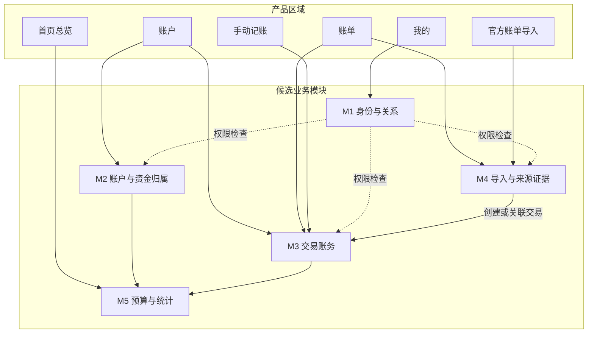
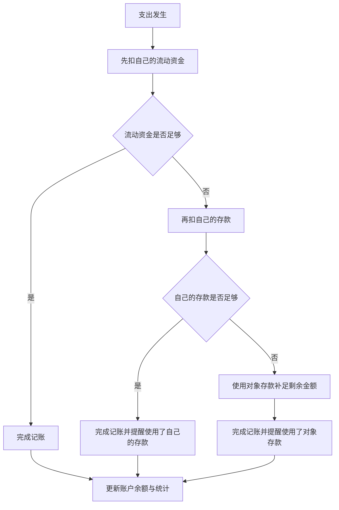
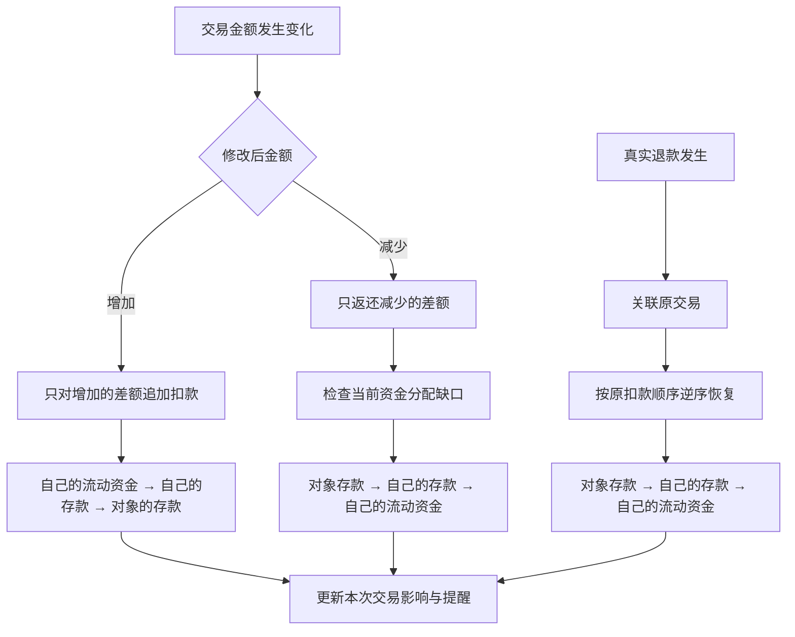
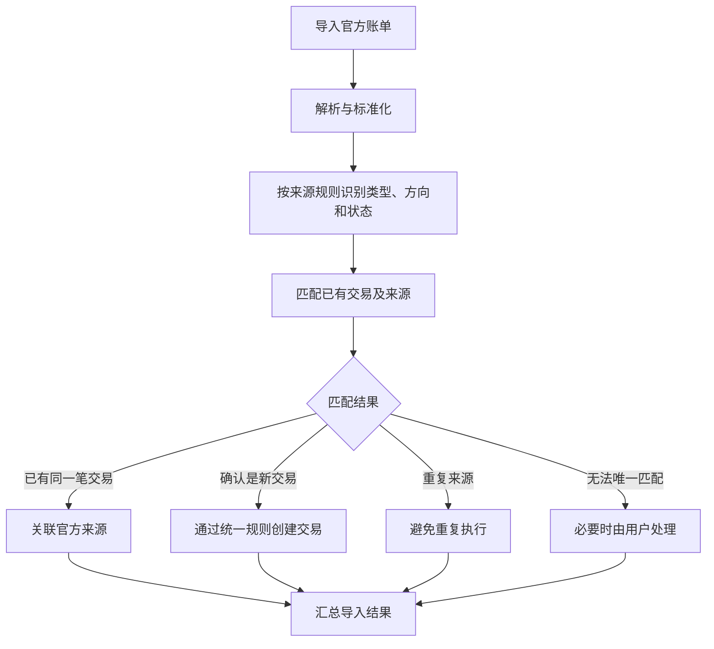

# 星账｜核心业务规则（已冻结）

**版本：** v2.5  
**阶段：** 业务规则已冻结  
**状态：** 已冻结；后续仅在真实场景、数据模型推演或实现验证发现具体矛盾时，进行最小范围修订  
**用途：** 作为逻辑数据模型、API 契约、工程模块设计与开发验收的业务基线  
**范围：** 产品业务行为与业务流程；不在本文件中决定数据库 Schema、API 字段或代码实现

---

## 0. 阅读说明

本版目标是收敛已有决定，不继续扩展低频问题。

- **【已确认】/【已确认方向】**：保留此前讨论中已明确选择或认可的规则。
- **【开发阶段验证】**：需要结合微信、支付宝真实文件或运行测试确认；不作为重新讨论整套业务流程的理由。
- **【暂缓】**：当前产品范围不处理，除非后续真实需求证明必须支持。
- 本文件经用户确认后进入正式冻结状态；后续进入逻辑数据模型设计。

本文中的场景检查是基于规则的桌面一致性推演，不代表软件已经实现或通过运行测试。

## 一、产品目标与范围

### 1.1 核心目标

星账需要解决三个问题：

1. 清楚了解自己有多少钱，以及资金的归属人和性质。
2. 通过便捷的日常记账记录资金变化。
3. 定期导入微信、支付宝官方账单，补全记录并核对交易，减少遗漏和重复入账。

### 1.2 核心产品原则

- 记账操作尽量简单，避免不必要的逐笔确认。
- 账务结果必须准确，不能为了方便而掩盖错误。
- 手动记账和官方账单导入遵循统一的账务规则。
- 账户总额、资金归属、交易记录和统计结果应保持一致。
- 复杂的识别、匹配和计算由系统处理；只有真正无法确定的情况才要求用户介入。
- 双人使用是产品的基础要求，不应依赖虚拟的共同账户来表达双方的实际资金。

### 1.3 当前产品区域

| 产品区域 | 用户主要任务 |
|---|---|
| 首页总览 | 查看总资金、本月花销、日均花销、环比变化、存款、流动资金和预算剩余额度 |
| 账户 | 创建、命名账户，查看账户资金，调整资金归属和性质 |
| 账单 | 查询、筛选、编辑、保存和删除交易，查看退款关联 |
| 记账与导入 | 手动记账、官方账单导入；截图记账暂缓实现 |
| 我的 | 关系绑定、个人设置及相关权限 |

## 二、候选业务模块及职责

模块是业务职责的划分，不等同于产品页面，也不代表必须建立独立服务。

### M1：身份与关系

负责用户身份、关系绑定、成员关系和访问权限。

### M2：账户与资金归属

负责账户创建、命名、初始余额，以及账户内资金归属人与资金性质的分配。

### M3：交易账务

负责收入、支出、退款、转账、交易编辑和删除，以及相应的资金变化规则。

### M4：导入与来源证据

负责官方账单解析、字段标准化、来源识别、重复导入处理，以及官方记录与已有交易的匹配。

### M5：预算与统计

负责预算、月度支出、日均花销、环比变化、存款、流动资金等统计口径。

### 模块协作原则【已确认方向】

- 手动记账和官方账单导入使用统一的交易处理规则。
- M4 负责理解外部来源和判断匹配关系，不独立实现第二套交易保存逻辑。
- M5 根据统一的账户、资金归属和交易结果计算统计，不维护另一套独立余额。
- 产品页面可以调用多个业务模块；一个业务模块也可以服务多个产品页面。

## 三、账户与资金归属规则

### 3.1 初始余额与记账起始日期【已确认】

每个账户分别设置自己的**初始余额和记账起始日期**。不同账户可以在不同日期开始纳入余额计算。

- 初始余额作为该账户记账起始日期的资金起点，不计为普通收入或普通支出。
- 交易日期早于该账户记账起始日期：正常保存为历史交易，可在账单中查询和筛选，也可用于历史消费统计，但不影响该账户余额或资金分配。
- 交易日期等于或晚于该账户记账起始日期：按对应交易类型和统一资金规则正常影响该账户余额与资金分配。
- 导入官方账单时，不因交易发生在该账户记账起始日期之前而拒绝保存；应保留完整的来源与交易记录，但不将这类历史交易计入该账户起始日期之后的余额变动。
- “不影响余额”不等于“忽略记录”或“跳过导入”。

因此，记账起始日期用于划分每个账户的“历史记录”与“影响余额的交易”，而不是限制账单可记录的日期范围。

### 3.2 实际账户、资金归属与性质【已确认】

账户列表按照真实存在的资金账户管理，例如银行卡、微信零钱、支付宝余额等；不创建脱离实际账户的“情侣共同账户”。

三个概念分别表达：

- **账户：** 钱实际存放在哪里。
- **资金归属人：** 这笔钱属于谁。
- **资金性质：** 这笔钱是流动资金还是存款。

一个实际账户可以同时包含不同归属人、不同资金性质的资金份额。对任一账户而言，当前允许的组合是：

1. 账户持有人的流动资金。
2. 账户持有人的存款。
3. 绑定对象的存款（仅绑定后可用）。

不把绑定对象的流动资金分配到另一方持有的账户中。比如，你的银行卡可以存放你的流动资金、你的存款，以及对象交由你保管的存款；不会把对象日常使用的流动资金也划到你的银行卡名下。

**对象的存款选项只在双方完成绑定后出现。** 未绑定时，用户只管理自己的资金份额；绑定后，账户编辑页面才允许把账户内部分资金标记为对象的存款。

用户可以在账户编辑页面手动调整资金归属人与资金性质：

- 底层记录必要的资金分配调整。
- 资金重新分配不计为收入、支出或普通转账。
- 当前资金分配可以变化。
- 历史交易不因当前分配变化而被反向改写。

**账户总额与资金分配必须保持一致：**

- 账户总额表示该实际账户当前纳入星账余额计算的总金额。
- 账户内各资金份额的金额之和必须等于账户总额。
- 例如，账户总额为 ¥5,000，其中自己的流动资金 ¥1,000、自己的存款 ¥3,000、对象的存款 ¥1,000，三部分合计必须为 ¥5,000。
- 将 ¥500 从自己的存款调整为自己的流动资金，只改变资金性质分配，不改变账户总额。
- 资金归属与性质调整不能凭空增加或减少账户里的钱。
- 账户总额的变化应来自初始余额的设置或修正、以及真实交易等相应账务变化；不能通过单纯修改资金分配来改变总额。

### 3.3 普通支出与普通收入的默认分配【已确认】

**普通支出：**

1. 优先扣除自己的流动资金。
2. 自己的流动资金不足时，再扣除自己的存款。
3. 自己的流动资金和存款仍不足时，使用对象的存款补足剩余金额；前提是实际账户有足够余额。

**普通收入：**

- 默认增加到自己的流动资金。

这套扣减顺序是统一的资金分配原则。真实退款与“修改交易金额后产生的差额返还”是两种不同情况，分别按第四节规则处理。

### 3.4 使用存款后的提醒【已确认方向】

只要一笔支出使用了存款，就在记账完成后提醒，不阻塞记账：

- **使用自己的存款：** 提醒用户本次使用了多少自己的存款，帮助关注存款变化；是否补回由用户自行决定。
- **使用对象的存款：** 提醒对象的存款有一部分被用于本次支出，并提示可后续记录实际转款或调整资金分配。
- **同时使用双方存款：** 可以合并为一条提醒，分别列出各自使用的金额，避免重复打扰。

提醒不意味着系统擅自认定用户欠自己或对象的钱，也不要求用户当场处理。

后续处理需区分：
1. **记录实际转款：** 双方确实发生资金转移时，记录真实转款；内部转账不计为收入或消费。
2. **调整资金归属或存款分配：** 需要修正资金份额、且不对应实际转款时，调整分配；不能凭空增加账户总余额。

提醒的具体视觉样式暂不设计；先保证提醒信息准确、可理解。

### 3.5 余额修正【已确认方向】

不单独设计复杂的余额核对功能。

发现差异时，优先检查并修正对应的交易、退款、转账或漏记记录。不能为了让余额对上，就随意伪造一笔消费或直接覆盖余额。

### 3.6 统一资金变动原则【已确认方向】

资金分配与交易事实分开处理：

- **交易事实**记录真实发生的金额、类型、时间等信息。
- **资金分配**根据交易事实和统一规则，决定各归属人、各资金性质分别变化多少。
- 用户修改交易事实时，由系统处理对应的资金变化，不要求用户手动拆分每一笔金额。
- 不因修改一笔历史交易而自动重算后续所有交易的资金分配；若个别资金归属需要调整，用户可以手动修改资金性质或归属。

统一资金优先级：

- **需要扣减资金时：** 自己的流动资金 → 自己的存款 → 对象的存款。
- **需要返还资金或补足存款缺口时：** 对象的存款 → 自己的存款 → 自己的流动资金。

两类操作需要区分：
- **修改交易金额：** 比较修改前后的金额，只处理差额。金额增加时按扣减顺序追加扣款；金额减少时检查当前资金分配，优先补对象存款的缺口，再补自己的存款，最后补流动资金。
- **真实发生的退款：** 按原交易实际扣款顺序的逆序恢复资金份额，详见 4.3。

当前业务规则以账户可用资金足够完成支出为前提；余额不足或透支场景不纳入当前产品设计，不为其增加专门流程。

## 四、交易账务规则

### 4.1 交易类型

目前讨论的核心类型包括：

- 收入
- 支出
- 转账
- 退款

这些类型具有不同的业务含义，不能只根据金额增加或减少来判断。

### 4.1.1 首期负债账户范围【已确认】

第一版不单独建立花呗、信用卡等负债账户，也不追踪这些账户的欠款余额。

- 花呗或信用卡产生的真实消费仍需保留为交易记录，并计入相应消费统计，不能因为没有负债账户而漏记消费。
- 对应还款流水不能再次作为一笔消费重复计入统计。
- 官方账单中还款记录如何映射到已管理的现金账户余额，在导入实现阶段依据微信、支付宝官方文件的实际字段和交易语义确定；本规则不因此扩大为负债账户管理功能。

### 4.2 内部转账【已确认】

内部转账属于交易账务的一部分，不单独建立转账业务模块。

- 只有**流动资金**可以直接参与转账。
- 如果需要转出的资金当前属于存款，用户先手动将其调整为流动资金，再执行转账。
- 转出账户减少相应金额，转入账户增加相应金额。
- 内部转账不计为收入，也不计为消费。

手续费等少见情况暂不扩展设计；遇到真实需求时再补充。

### 4.3 真实退款【已确认】

真实退款属于正常账务业务，应关联原交易，不能简单当作普通收入处理。

退款按照原交易实际扣款顺序的**逆序**恢复资金份额：

1. 对象的存款。
2. 自己的存款。
3. 自己的流动资金。

部分退款和多次退款都沿用同一规则：每次只恢复尚未退回的原扣款份额，不重复恢复已返还的金额。

例如，原消费依次扣除了自己的流动资金 ¥100、自己的存款 ¥500、对象的存款 ¥100；退款 ¥200 时，先恢复对象的存款 ¥100，再恢复自己的存款 ¥100。

【开发阶段验证】退款无法唯一匹配原交易时，结合微信、支付宝真实账单验证具体匹配证据；实现不得把退款静默关联到错误交易或静默丢弃该来源记录。

【待决策 R1，不属于 v2.5 已冻结规则】用户提出手动退款先保存真实资金变化、以后再由官方账单补关联的方案。当前 v2.5 仍要求退款创建时关联原消费；是否放宽此约束、未关联期间如何表示账户到账金额与资金份额，必须在物理 Schema 前明确，不得由实现人员自行推定。审查记录见 [跨文档一致性与退款闭环审查](CONSISTENCY_AUDIT_2026-10-24.md)。

### 4.4 编辑交易【已确认】

发现交易类型、金额或其他字段填写错误时，直接修正原交易，不要求用户删除后重新记账。

- 修改金额时，只处理修改前后产生的差额：增加金额按扣减顺序追加扣款；减少金额按当前资金分配的返还优先级处理，先补对象存款缺口，再补自己的存款，最后补流动资金。
- 不自动重算后续所有交易的资金分配。
- 如果用户认为某笔资金的归属或性质需要进一步调整，可以手动修改资金分配。
- **修改交易类型时：** 撤销这笔交易原有的账务影响，再按新类型的业务规则重新处理同一笔交易；余额和统计同步更新。不删除重建，也不自动重算后续交易。
- **改为转账时：** 必须明确转出账户和转入账户；只有流动资金可以直接转账。如果资金当前属于存款，用户须先手动调整为流动资金，系统不得擅自改变资金性质。

修改交易金额产生的差额返还，与商家真实退款不同：前者按当前资金缺口优先级处理，后者按原交易扣款顺序的逆序恢复。

### 4.5 删除交易【已确认】

- 用户可以直接删除交易，不额外设计用户可见的作废流程或回收站。
- 删除后，该交易不再参与正常的余额和统计计算。
- 删除一笔消费时，与它关联的退款记录一并删除。
- 删除后重新导入官方账单，应允许重新创建对应记录。

这项规则优先保证操作简单；不额外设计复杂的退款解除关联或孤立退款处理流程。该条按当前 v2.5 的“退款已关联原消费”前提编写，不代表已经定义了未关联退款的暂存与资金分配规则；后者属于待决策 R1。

## 五、官方账单导入规则

### 5.1 官方来源的作用【已确认方向】

微信和支付宝官方账单是对应平台、账户及导出范围内的权威交易来源。

系统应优先使用官方字段和确定性规则识别交易信息，而不是让 AI 重新猜测已经明确的内容。

需要区分：

- 原始来源字段。
- 标准化后的交易信息。
- 星账内部的交易类型。
- 来源记录的交易状态与星账账务处理规则。

官方账单提供交易依据，但不代表解析后的结果必然正确。

### 5.2 导入流程【已确认方向】

1. 检查文件格式和导入范围。
2. 解析官方字段。
3. 标准化交易信息。
4. 根据来源字段和确定性规则识别交易类型、金额方向及状态。
5. 与星账已有交易匹配。
6. 根据匹配结果决定关联、创建或跳过。
7. 创建或关联交易时，根据交易日期与账户记账起始日期判断是否影响余额；起始日期之前的交易仍正常保存，但不改变余额和资金分配。
8. 汇总导入结果。

### 5.3 交易匹配与重复处理【已确认方向】

- 同一笔交易已经通过手动记账创建：关联官方来源，不重复入账。
- 确认是新交易：通过统一账务规则创建。
- 同一来源已经处理过：避免重复执行。
- 无法唯一匹配：只有必要时才要求用户处理。

【已确认】退款和转账是正常交易类型，不应一律作为异常。

【已确认】不建设复杂的异常管理中心。

### 5.4 官方来源与手动记录不一致【暂定】

当前方案：

- 不静默覆盖已有手动记录。
- 如果可以确认是同一笔交易，允许关联来源。
- 如果重要字段存在差异，由用户检查并修正。
- 只有无法安全确定的情况，才要求用户介入。

【开发阶段验证】具体匹配字段、金额差异阈值与自动处理边界，使用真实官方文件验证；不得静默覆盖手动记录，也不得将不确定匹配伪装成确定匹配。

### 5.5 删除后重新导入【已确认】

重复导入和删除后重导入是不同的情况：

- 重复导入同一来源，不重复创建交易。
- 用户删除交易后，再次导入该来源，允许重新创建交易。
- 系统不能因为历史上处理过来源记录，就永久阻止交易重新入账。

## 六、双人使用与关系规则

双人使用属于星账的基础业务要求，不应等到产品后期才考虑。

目前已经明确的方向：

- 双方可以查看彼此的账户、资金情况和交易记录。
- 绑定后，账户页面和账单页面增加查看对方数据的入口；对方的数据只提供查看，不显示新增、编辑、删除等操作。
- 每个人仍然可以正常管理自己的账户与交易。
- 不单独设计复杂的“访客模式”或多层角色体系；以登录身份和双方绑定关系决定是否能查看对方数据。
- 查看权限不等于修改权限：后端也必须拒绝修改对方数据的请求，不能只依赖前端隐藏操作按钮。
- 账户仍然对应实际存在的账户，而不是创建脱离实际资金的虚拟共同账户。
- 账户内资金可以分别属于不同归属人。
- 资金的归属人、保管关系和资金性质不能混为一谈。

当前范围明确不考虑解绑流程，不为解绑增加产品入口或额外业务规则。

【数据模型设计事项】数据模型需区分实际账户持有人/保管关系与资金归属人。字段和关联方式在逻辑数据模型阶段落实，不改变已确认的资金分配、首页展示和查看/编辑权限规则。

## 七、首页统计与预算规则

首页需要展示：

- 总资金。
- 本月花销。
- 平均每天花销。
- 本月预计花销。
- 与上月相比的日均花销变化率。
- 存款。
- 流动资金。
- 本月支出计划及剩余额度。

【已确认规则】首页展示方式按是否绑定区分：

- **未绑定时：** 首页展示自己的流动资金和自己的存款。
- **绑定后：** 首页直接展示双方的财务情况，四类资金都在首页同屏可见：自己的流动资金、自己的存款、对象的流动资金、对象的存款。不需要点击或跳转到对方页面才能看到。
- 双方资金按归属人和资金性质区分；账户实际由谁持有或保管，不改变资金归属。
- 绑定后首页直接呈现双方信息，不把对象的资金藏在单独入口里，也不把双方资金混成一个无法区分归属的数字。

例如，双方资金分别为自己的流动资金 ¥1,000、自己的存款 ¥3,000、对象的流动资金 ¥800、对象的存款 ¥1,200，首页直接展示这四类金额。

所有首页统计必须来自统一的账务事实与资金分配结果，不应由不同页面分别维护。

【已确认规则】本月花销按原消费发生的月份归属。退款关联原交易后，抵减原消费所在月份的花销，不计入退款实际发生月份的花销。

例如：10 月消费 ¥300，11 月收到该笔交易的 ¥100 退款，则 10 月花销修正为 ¥200，11 月不因这笔退款而减少本月花销。原消费月份的历史统计允许随关联退款而更新。

内部转账不计为收入或消费。

【已确认规则】本月日均花销 = 本月截至今天的花销 ÷ 本月已经过去的自然日数（包含今天）。没有发生消费的日期也计入天数。

例如，本月截至 10 日的花销为 ¥1,000，则日均花销为 ¥1,000 ÷ 10 = ¥100/天。退款按原消费月份归属，因此退款关联后也会相应修正原消费月份的日均花销。

【已确认规则】首页增加“本月预计花销”和“日均花销变化率”两个指标；具体 UI 排列与视觉呈现留到 UI 设计阶段确定。

- 上月日均花销 = 上月实际花销 ÷ 上月自然日总数。
- 本月日均花销 = 本月截至今天的花销 ÷ 本月已过去的自然日数（包含今天）。
- 日均花销变化率 =（本月日均花销 − 上月日均花销）÷ 上月日均花销 × 100%。同时可展示每天多花或少花的金额。
- 本月预计花销 = 本月日均花销 × 本月自然日总数。这是按当前消费速度进行的估算，不是月底实际花销的保证。
- 上述计算沿用已确认的退款归属规则：退款关联原消费后，修正原消费所在月份的花销，并据此更新对应月份的日均、变化率和预测结果。
- 这些消费指标按当前用户自己的消费计算，与个人预算口径一致；对象的消费不占用当前用户的预算。是否在首页另行展示对象的消费统计，留待 UI 设计阶段决定，不将双方消费混合进当前用户的个人指标。

【已确认规则】预算按个人分别管理，不共用同一份预算。每个人设置自己的月度预算；对象的消费不占用当前用户的预算。双方绑定后可以查看对方的财务情况，但不因此合并预算。

预算计算仍遵循已确认的交易统计规则：退款关联原消费后抵减原消费月份的花销，内部转账不计入消费。

【已确认规则】预算未超支时，展示剩余预算金额；一旦超出个人月度预算，改为用红色明确提示“已超支 ¥X”，其中 X 为本月花销减去个人预算的差额。不要求将负数作为剩余额度展示。退款关联原消费后，按修正后的原消费月份花销重新计算是否超支及超支金额。

【范围说明】不为“上月日均花销为 0”这一特殊情况增加单独处理逻辑；该边界不作为本期业务规则冻结或开发的阻塞项。

## 八、业务流程图

### 8.1 产品区域与业务模块

### 8.2 支出扣减与存款提醒

说明：提醒不阻塞记账；只要使用了存款就提醒。当前业务流程以账户可用资金足够完成支出为前提，不扩展余额不足或透支处理流程。

### 8.4 金额修正与真实退款

说明：修改金额只处理差额，不自动重算后续所有交易；真实退款则依据原交易尚未恢复的扣款份额逆序恢复。

### 8.3 官方账单导入

## 九、非阻塞项与开发阶段验证

本节用于安排后续工作，不再逐项向用户追加问题。未完成的验证项按真实开发路径处理。

### 9.1 进入数据模型设计时落实

- 区分实际账户持有人/保管关系、资金归属人、资金性质三种概念。
- 账户内资金份额之和必须等于账户当前总额；分配调整不得凭空改变账户总额。
- 支持同一交易记录事实与其资金分配结果分层表达；修改交易时只处理本次交易的账务影响，不自动重算后续交易。
- 金额精度与舍入规则须在数据模型/API 设计中明确，避免金额累计误差。
- 退款与原消费的关联关系、来源外部原单 ID 与星账内部交易 ID 的区别必须在逻辑模型中明确；是否支持未关联退款及待分配金额属于 R1，物理 Schema 前必须决策。
- 第一版不建立花呗、信用卡等负债账户或追踪欠款余额；真实消费必须进入消费统计，还款不得再次计为消费。数据模型需能表达这两种记录的不同账务影响，具体字段/类型在模型设计阶段确定，不重新扩大产品范围。

### 9.2 官方账单导入实现时验证

- 微信、支付宝文件中稳定的交易标识、金额、时间、商户、状态和交易类型字段。
- 将既定匹配原则映射为确定性规则；相同来源重复导入不重复入账，用户删除后允许重新导入。
- 官方记录的成功、失败、关闭或处理中等状态如何从真实字段识别。
- 退款无法唯一匹配原交易时的匹配证据、候选呈现和重试策略；不能错误关联或静默丢弃。
- **R1（业务决策，物理 Schema 前置）：** 是否允许手动退款在没有原消费 ID 时先保存，以及待关联期间账户余额、资金份额与统计如何表示。不能将其笼统归类为普通的导入解析细节。
- **R3（领域边界）：** 微信“转账退回”必须与消费退款区分；具体来源字段和原转账关联方式由真实账单验收。
- 官方来源与手动记录的重要字段不一致时，按既定原则保留手动记录并让用户检查。
- 暂未支持的官方交易类型必须有明确结果，不得静默漏记。
- 信用消费与还款的真实官方字段映射，确保消费统计正确且还款不重复计为消费。

来源字段解析、订单号规范化和匹配候选的精确规则属于实现验证，不要求现在穷举所有官方账单边界。R1 会改变退款可空关联和资金份额守恒规则，因此必须在物理 Schema 与退款 API 定稿前决定；R3 必须在宣称微信官方账单导入完整验收前决定。其他无关的账户、普通收入/支出设计可以继续。

### 9.3 暂缓，不阻塞本期

- 截图记账的专门业务规则与视觉模型能力验证。
- 不在首期受支持官方样例和明确产品范围内的手续费、提现、充值等低频变体的扩展规则。已在受支持的微信/支付宝样例中出现的提现方向、零手续费和账户角色等情况属于导入正确性要求，不能以“低频特殊交易”为由暂缓。
- 余额不足或透支场景。
- 上月日均花销为零时的变化率特殊处理。
- 解绑流程与复杂角色体系。
- 没有真实需求支撑的复杂或罕见交易组合。

## 十、关键业务场景一致性推演

以下仅核对规则之间能否连贯运行，不代表代码测试或功能已经实现。

| 场景 | 输入条件 | 预期结果 | 推演结论 |
|---|---|---|---|
| 初始余额与起始日期 | 账户初始余额 ¥5,000，起始日期为 10 月 1 日；9 月 29 日有一笔 ¥20 消费 | 交易仍保存、可查询并参与其所属月份的消费统计；不改变该账户起始日期后的余额和资金分配 | 通过 |
| 账户资金分配 | 账户总额 ¥5,000，份额为自己的流动资金 ¥1,000、自己的存款 ¥3,000、对象存款 ¥1,000 | 份额合计必须等于 ¥5,000；把 ¥500 从自己的存款调整为流动资金后，总额仍为 ¥5,000 | 通过 |
| 普通支出扣款 | 自己流动资金 ¥1,000、自己存款 ¥500、对象存款 ¥200；支出 ¥1,200 | 先扣自己的流动资金 ¥1,000，再扣自己的存款 ¥200；不动用对象存款，并提醒使用了自己的存款 | 通过 |
| 支出使用对象存款 | 自己流动资金 ¥100、自己存款 ¥100、对象存款 ¥500；支出 ¥300 | 三类资金各扣 ¥100；记账完成后提醒使用了双方存款，分别展示金额 | 通过 |
| 部分退款 | 原消费依次扣自己的流动资金 ¥100、自己的存款 ¥500、对象存款 ¥100；退款 ¥200 | 先恢复对象存款 ¥100，再恢复自己的存款 ¥100；退款抵减原消费月份的花销，不抵减退款发生月份的花销 | 通过 |
| 修改交易金额 | 支出从 ¥100 改为 ¥130，或从 ¥130 改为 ¥80 | 增加 ¥30 按扣款顺序追加；减少 ¥50 按当前资金缺口优先级返还；不自动重算后续交易 | 通过 |
| 修改交易类型 | 原支出 ¥500 被改为账户间转账 | 撤销原支出的账务影响，再按转账规则处理；明确转出/转入账户，只能直接转移流动资金；转账不计消费 | 通过 |
| 删除消费及退款 | 删除一笔有退款关联的消费 | 同时删除关联退款；再次导入官方来源时允许重新创建对应记录 | 通过 |
| 手动记账与官方导入 | 手动已有同一笔交易，随后导入对应官方账单；之后再次导入同一来源 | 关联官方来源，不重复创建交易；重复来源不重复入账 | 规则通过；精确匹配字段在导入实现时验证 |
| 首页统计与预算 | 本月预算 ¥3,000，按退款归属修正后的本月花销为 ¥3,200 | 显示红色“已超支 ¥200”；对象消费不占用当前用户预算；内部转账不计消费 | 通过 |
| 绑定后的首页和权限 | 双方已绑定 | 首页同屏展示双方四类资金；双方可查看对方账户与账单，但不能编辑对方数据；后端必须拒绝越权写入 | 通过 |
| 花呗/信用卡消费及还款 | 第一版不追踪负债余额，但官方来源中有真实消费和还款 | 消费进入消费统计；还款不能再次计为消费；如何表达两者不同的余额影响由数据模型落实 | 业务目标明确；模型表达待落实 |

### 推演结论

- 已覆盖的核心规则之间，当前未发现必须通过重新讨论产品范围才能解决的直接矛盾。
- 花呗/信用卡消费与还款的记录方式是数据模型需要明确表达的约束，不等于重新引入负债账户。
- 导入字段、状态与无法匹配退款的具体处理属于真实文件驱动的开发验证，不作为业务规则冻结的阻塞项。
- 以上是规则一致性推演，不应被描述为软件测试通过或功能已实现。

## 十一、冻结结论与后续步骤

### 冻结结论

用户已明确确认冻结。本文件 **v2.5** 为星账当前业务规则基线。

- 已确认的业务规则不得在后续数据模型、API 或工程拆分阶段被无理由重开。
- 微信/支付宝字段映射、导入状态识别和匹配候选算法属于开发阶段验证，不阻塞本次冻结；但 R1（未关联退款的业务状态与资金分配）及 R3（转账退回的领域类型）是本次冻结后提出的待决策项，不能伪装成已经由 v2.5 决定。
- 截图记账、低频手续费、余额不足/透支、解绑及上月日均为零的特殊处理暂不纳入本期。
- 若真实样例或实现测试发现规则之间存在具体冲突，必须指出复现条件、受影响规则和最小修正方案，再针对该问题变更版本。

### 后续阶段

本文件 v2.5 继续作为已冻结的业务规则基线。逻辑数据模型、API 契约、工程模块边界和实施计划已分别建立候选文档：

- LOGICAL_DATA_MODEL.md：实体、关系、数据归属与账务不变量。
- API_CONTRACT.md：前后端调用约定、权限、错误和原子性要求。
- ENGINEERING_MODULE_BOUNDARIES.md：工程职责、依赖方向和账务写入边界。
- IMPLEMENTATION_PLAN.md 与 ROADMAP.md：待决策事项、开发顺序与验收标准。

下一步不重写已冻结的业务规则，而是先处理文档明确标记的实现前置项，再确定技术方案并设计物理 Schema。若真实样例或测试发现具体规则冲突，必须指出复现条件、受影响规则和最小修正方案，再针对该问题变更版本。

**本次冻结范围：** 冻结业务规则并为后续数据模型和接口设计提供基线。关键场景已完成桌面一致性推演，但不代表代码或产品功能已通过运行测试。
