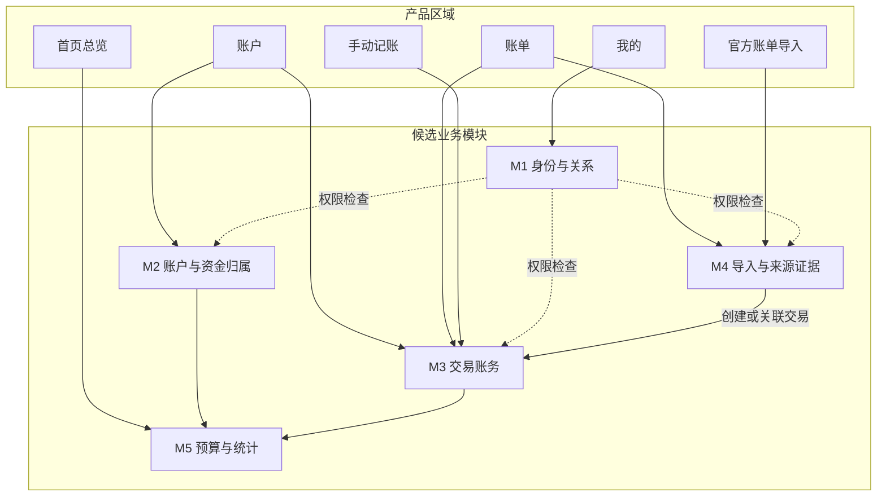
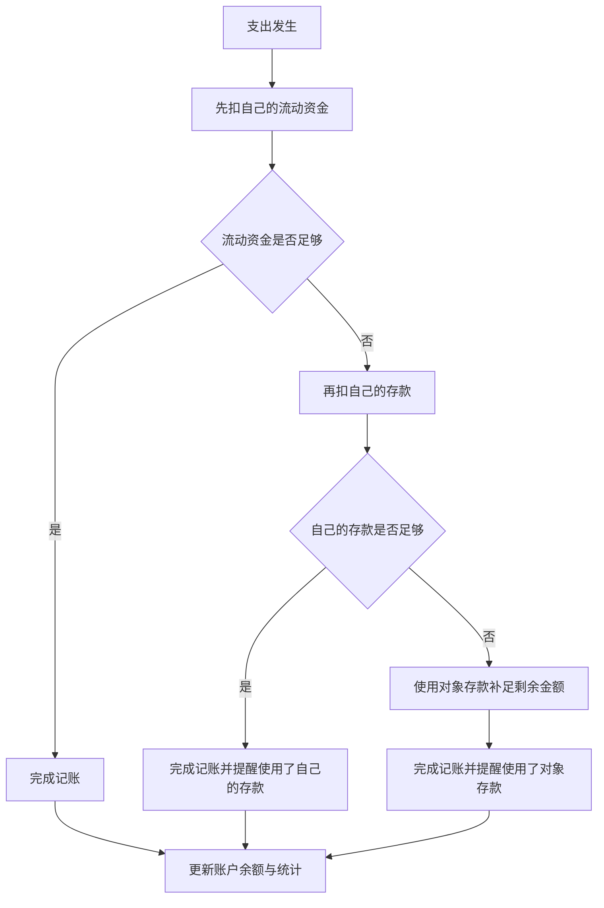
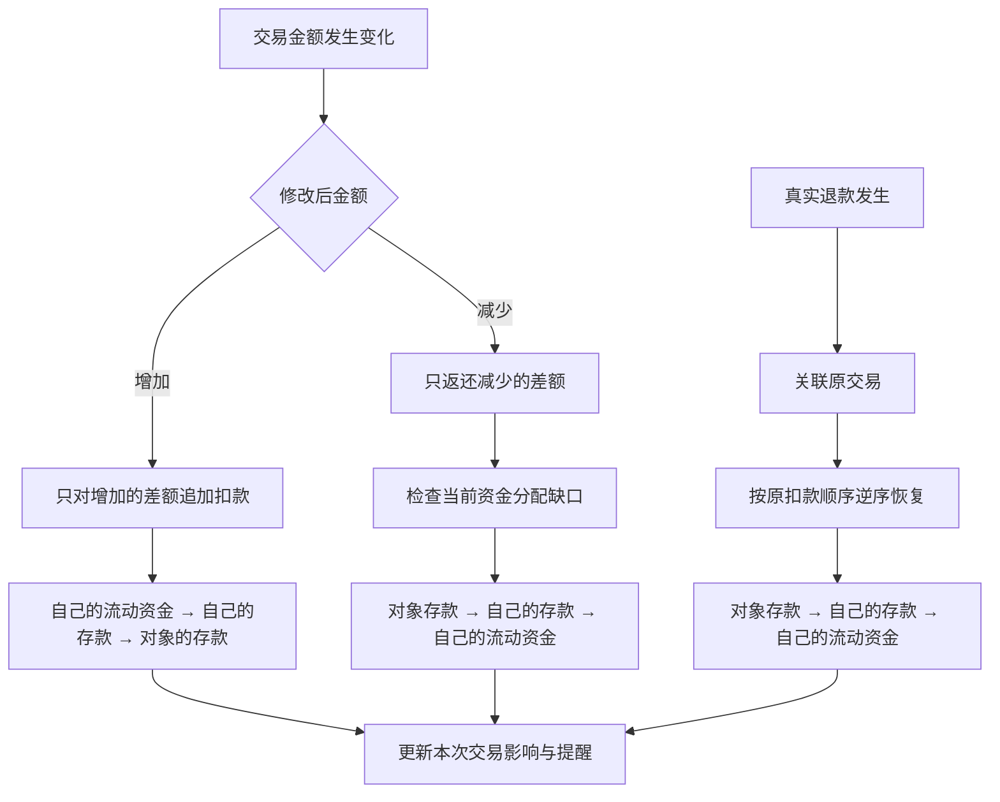
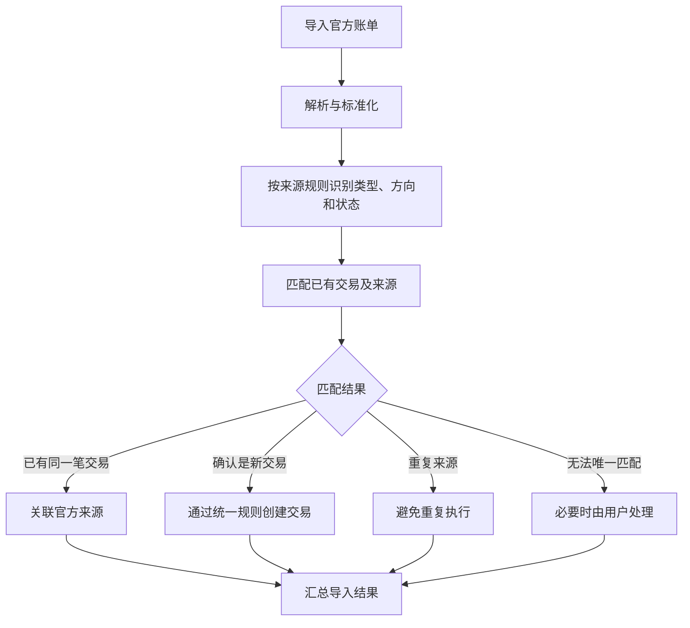

# 星账｜核心业务规则讨论记录

**版本：** v1.4  
**阶段：** 业务规则梳理中  
**状态：** 讨论记录，尚未冻结  
**用途：** 汇总已有讨论、标记业务规则状态，并为后续业务规则审阅提供依据  
**范围：** 产品业务行为与业务流程；不涉及数据库 Schema、API 契约或代码实现

---

## 0. 阅读说明

本文使用三种状态：

- **【已确认】**：用户已经明确选择或认可的业务规则。
- **【暂定】**：当前讨论形成的候选规则，仍需进一步核实或确认。
- **【待讨论】**：尚未决定，不得自行补充为确定规则。

本文是阶段性讨论记录，不代表业务规则已经冻结。业务规则须经用户审阅并明确确认后，才能进入下一阶段。

## 一、产品目标与范围

### 1.1 核心目标

星账需要解决三个问题：

1. 清楚了解自己有多少钱，以及资金的归属人和性质。
2. 通过便捷的日常记账记录资金变化。
3. 定期导入微信、支付宝官方账单，补全记录并核对交易，减少遗漏和重复入账。

### 1.2 核心产品原则

- 记账操作尽量简单，避免不必要的逐笔确认。
- 账务结果必须准确，不能为了方便而掩盖错误。
- 手动记账和官方账单导入遵循统一的账务规则。
- 账户总额、资金归属、交易记录和统计结果应保持一致。
- 复杂的识别、匹配和计算由系统处理；只有真正无法确定的情况才要求用户介入。
- 双人使用是产品的基础要求，不应依赖虚拟的共同账户来表达双方的实际资金。

### 1.3 当前产品区域

| 产品区域 | 用户主要任务 |
|---|---|
| 首页总览 | 查看总资金、本月花销、日均花销、环比变化、存款、流动资金和预算剩余额度 |
| 账户 | 创建、命名账户，查看账户资金，调整资金归属和性质 |
| 账单 | 查询、筛选、编辑、保存和删除交易，查看退款关联 |
| 记账与导入 | 手动记账、官方账单导入；截图记账暂缓实现 |
| 我的 | 关系绑定、个人设置及相关权限 |

## 二、候选业务模块及职责

模块是业务职责的划分，不等同于产品页面，也不代表必须建立独立服务。

### M1：身份与关系

负责用户身份、关系绑定、成员关系和访问权限。

### M2：账户与资金归属

负责账户创建、命名、初始余额，以及账户内资金归属人与资金性质的分配。

### M3：交易账务

负责收入、支出、退款、转账、交易编辑和删除，以及相应的资金变化规则。

### M4：导入与来源证据

负责官方账单解析、字段标准化、来源识别、重复导入处理，以及官方记录与已有交易的匹配。

### M5：预算与统计

负责预算、月度支出、日均花销、环比变化、存款、流动资金等统计口径。

### 模块协作原则【已确认方向】

- 手动记账和官方账单导入使用统一的交易处理规则。
- M4 负责理解外部来源和判断匹配关系，不独立实现第二套交易保存逻辑。
- M5 根据统一的账户、资金归属和交易结果计算统计，不维护另一套独立余额。
- 产品页面可以调用多个业务模块；一个业务模块也可以服务多个产品页面。

## 三、账户与资金归属规则

### 3.1 初始余额与记账起始日期【已确认】

每个账户分别设置自己的**初始余额和记账起始日期**。不同账户可以在不同日期开始纳入余额计算。

- 初始余额作为该账户记账起始日期的资金起点，不计为普通收入或普通支出。
- 交易日期早于该账户记账起始日期：正常保存为历史交易，可在账单中查询和筛选，也可用于历史消费统计，但不影响该账户余额或资金分配。
- 交易日期等于或晚于该账户记账起始日期：按对应交易类型和统一资金规则正常影响该账户余额与资金分配。
- 导入官方账单时，不因交易发生在该账户记账起始日期之前而拒绝保存；应保留完整的来源与交易记录，但不将这类历史交易计入该账户起始日期之后的余额变动。
- “不影响余额”不等于“忽略记录”或“跳过导入”。

因此，记账起始日期用于划分每个账户的“历史记录”与“影响余额的交易”，而不是限制账单可记录的日期范围。

### 3.2 实际账户、资金归属与性质【已确认】

账户列表按照真实存在的资金账户管理，例如银行卡、微信零钱、支付宝余额等；不创建脱离实际账户的“情侣共同账户”。

三个概念分别表达：

- **账户：** 钱实际存放在哪里。
- **资金归属人：** 这笔钱属于谁。
- **资金性质：** 这笔钱是流动资金还是存款。

一个实际账户可以同时包含不同归属人、不同资金性质的资金份额。当前允许的组合为：

1. 自己的流动资金。
2. 自己的存款。
3. 对象的存款。

不设置“对象的流动资金”这一组合。

**对象的存款选项只在双方完成绑定后出现。** 未绑定时，用户只管理自己的资金份额；绑定后，账户编辑页面才允许把账户内部分资金标记为对象的存款。

用户可以在账户编辑页面手动调整资金归属人与资金性质：

- 底层记录必要的资金分配调整。
- 资金重新分配不计为收入、支出或普通转账。
- 当前资金分配可以变化。
- 历史交易不因当前分配变化而被反向改写。

**账户总额与资金分配必须保持一致：**

- 账户总额表示该实际账户当前纳入星账余额计算的总金额。
- 账户内各资金份额的金额之和必须等于账户总额。
- 例如，账户总额为 ¥5,000，其中自己的流动资金 ¥1,000、自己的存款 ¥3,000、对象的存款 ¥1,000，三部分合计必须为 ¥5,000。
- 将 ¥500 从自己的存款调整为自己的流动资金，只改变资金性质分配，不改变账户总额。
- 资金归属与性质调整不能凭空增加或减少账户里的钱。
- 账户总额的变化应来自初始余额的设置或修正、以及真实交易等相应账务变化；不能通过单纯修改资金分配来改变总额。

### 3.3 普通支出与普通收入的默认分配【已确认】

**普通支出：**

1. 优先扣除自己的流动资金。
2. 自己的流动资金不足时，再扣除自己的存款。
3. 自己的流动资金和存款仍不足时，使用对象的存款补足剩余金额；前提是实际账户有足够余额。

**普通收入：**

- 默认增加到自己的流动资金。

这套扣减顺序是统一的资金分配原则。真实退款与“修改交易金额后产生的差额返还”是两种不同情况，分别按第四节规则处理。

### 3.4 使用存款后的提醒【已确认方向】

只要一笔支出使用了存款，就在记账完成后提醒，不阻塞记账：

- **使用自己的存款：** 提醒用户本次使用了多少自己的存款，帮助关注存款变化；是否补回由用户自行决定。
- **使用对象的存款：** 提醒对象的存款有一部分被用于本次支出，并提示可后续记录实际转款或调整资金分配。
- **同时使用双方存款：** 可以合并为一条提醒，分别列出各自使用的金额，避免重复打扰。

提醒不意味着系统擅自认定用户欠自己或对象的钱，也不要求用户当场处理。

后续处理需区分：
1. **记录实际转款：** 双方确实发生资金转移时，记录真实转款；内部转账不计为收入或消费。
2. **调整资金归属或存款分配：** 需要修正资金份额、且不对应实际转款时，调整分配；不能凭空增加账户总余额。

提醒的具体视觉样式暂不设计；先保证提醒信息准确、可理解。

### 3.5 余额修正【已确认方向】

不单独设计复杂的余额核对功能。

发现差异时，优先检查并修正对应的交易、退款、转账或漏记记录。不能为了让余额对上，就随意伪造一笔消费或直接覆盖余额。

### 3.6 统一资金变动原则【已确认方向】

资金分配与交易事实分开处理：

- **交易事实**记录真实发生的金额、类型、时间等信息。
- **资金分配**根据交易事实和统一规则，决定各归属人、各资金性质分别变化多少。
- 用户修改交易事实时，由系统处理对应的资金变化，不要求用户手动拆分每一笔金额。
- 不因修改一笔历史交易而自动重算后续所有交易的资金分配；若个别资金归属需要调整，用户可以手动修改资金性质或归属。

统一资金优先级：

- **需要扣减资金时：** 自己的流动资金 → 自己的存款 → 对象的存款。
- **需要返还资金或补足存款缺口时：** 对象的存款 → 自己的存款 → 自己的流动资金。

两类操作需要区分：
- **修改交易金额：** 比较修改前后的金额，只处理差额。金额增加时按扣减顺序追加扣款；金额减少时检查当前资金分配，优先补对象存款的缺口，再补自己的存款，最后补流动资金。
- **真实发生的退款：** 按原交易实际扣款顺序的逆序恢复资金份额，详见 4.3。

当前业务规则以账户可用资金足够完成支出为前提；余额不足或透支场景不纳入当前产品设计，不为其增加专门流程。

## 四、交易账务规则

### 4.1 交易类型

目前讨论的核心类型包括：

- 收入
- 支出
- 转账
- 退款

这些类型具有不同的业务含义，不能只根据金额增加或减少来判断。

### 4.2 内部转账【已确认】

内部转账属于交易账务的一部分，不单独建立转账业务模块。

- 只有**流动资金**可以直接参与转账。
- 如果需要转出的资金当前属于存款，用户先手动将其调整为流动资金，再执行转账。
- 转出账户减少相应金额，转入账户增加相应金额。
- 内部转账不计为收入，也不计为消费。

手续费等少见情况暂不扩展设计；遇到真实需求时再补充。

### 4.3 真实退款【已确认】

真实退款属于正常账务业务，应关联原交易，不能简单当作普通收入处理。

退款按照原交易实际扣款顺序的**逆序**恢复资金份额：

1. 对象的存款。
2. 自己的存款。
3. 自己的流动资金。

部分退款和多次退款都沿用同一规则：每次只恢复尚未退回的原扣款份额，不重复恢复已返还的金额。

例如，原消费依次扣除了自己的流动资金 ¥100、自己的存款 ¥500、对象的存款 ¥100；退款 ¥200 时，先恢复对象的存款 ¥100，再恢复自己的存款 ¥100。

【待讨论】退款无法匹配原交易时的处理方式。

### 4.4 编辑交易【已确认方向】

发现交易类型、金额或其他字段填写错误时，直接修正原交易，不要求用户删除后重新记账。

- 修改金额时，只处理修改前后产生的差额：增加金额按扣减顺序追加扣款；减少金额按当前资金分配的返还优先级处理，先补对象存款缺口，再补自己的存款，最后补流动资金。
- 不自动重算后续所有交易的资金分配。
- 如果用户认为某笔资金的归属或性质需要进一步调整，可以手动修改资金分配。
- 交易类型改变时，账户余额与统计应按新类型的业务含义更新；转账仍受“只有流动资金可转账”的规则约束。

修改交易金额产生的差额返还，与商家真实退款不同：前者按当前资金缺口优先级处理，后者按原交易扣款顺序的逆序恢复。

### 4.5 删除交易【已确认】

- 用户可以直接删除交易，不额外设计用户可见的作废流程或回收站。
- 删除后，该交易不再参与正常的余额和统计计算。
- 删除一笔消费时，与它关联的退款记录一并删除。
- 删除后重新导入官方账单，应允许重新创建对应记录。

这项规则优先保证操作简单；不额外设计复杂的退款解除关联或孤立退款处理流程。

## 五、官方账单导入规则

### 5.1 官方来源的作用【已确认方向】

微信和支付宝官方账单是对应平台、账户及导出范围内的权威交易来源。

系统应优先使用官方字段和确定性规则识别交易信息，而不是让 AI 重新猜测已经明确的内容。

需要区分：

- 原始来源字段。
- 标准化后的交易信息。
- 星账内部的交易类型。
- 来源记录的交易状态与星账账务处理规则。

官方账单提供交易依据，但不代表解析后的结果必然正确。

### 5.2 导入流程【已确认方向】

1. 检查文件格式和导入范围。
2. 解析官方字段。
3. 标准化交易信息。
4. 根据来源字段和确定性规则识别交易类型、金额方向及状态。
5. 与星账已有交易匹配。
6. 根据匹配结果决定关联、创建或跳过。
7. 创建或关联交易时，根据交易日期与账户记账起始日期判断是否影响余额；起始日期之前的交易仍正常保存，但不改变余额和资金分配。
8. 汇总导入结果。

### 5.3 交易匹配与重复处理【已确认方向】

- 同一笔交易已经通过手动记账创建：关联官方来源，不重复入账。
- 确认是新交易：通过统一账务规则创建。
- 同一来源已经处理过：避免重复执行。
- 无法唯一匹配：只有必要时才要求用户处理。

【已确认】退款和转账是正常交易类型，不应一律作为异常。

【已确认】不建设复杂的异常管理中心。

### 5.4 官方来源与手动记录不一致【暂定】

当前方案：

- 不静默覆盖已有手动记录。
- 如果可以确认是同一笔交易，允许关联来源。
- 如果重要字段存在差异，由用户检查并修正。
- 只有无法安全确定的情况，才要求用户介入。

【待讨论】具体匹配条件、金额差异判断及自动处理的安全边界。

### 5.5 删除后重新导入【已确认】

重复导入和删除后重导入是不同的情况：

- 重复导入同一来源，不重复创建交易。
- 用户删除交易后，再次导入该来源，允许重新创建交易。
- 系统不能因为历史上处理过来源记录，就永久阻止交易重新入账。

## 六、双人使用与关系规则

双人使用属于星账的基础业务要求，不应等到产品后期才考虑。

目前已经明确的方向：

- 双方可以查看彼此的账户、资金情况和交易记录。
- 绑定后，账户页面和账单页面增加查看对方数据的入口；对方的数据只提供查看，不显示新增、编辑、删除等操作。
- 每个人仍然可以正常管理自己的账户与交易。
- 不单独设计复杂的“访客模式”或多层角色体系；以登录身份和双方绑定关系决定是否能查看对方数据。
- 查看权限不等于修改权限：后端也必须拒绝修改对方数据的请求，不能只依赖前端隐藏操作按钮。
- 账户仍然对应实际存在的账户，而不是创建脱离实际资金的虚拟共同账户。
- 账户内资金可以分别属于不同归属人。
- 资金的归属人、保管关系和资金性质不能混为一谈。

当前范围明确不考虑解绑流程，不为解绑增加产品入口或额外业务规则。

【待讨论】

- 账户归属人与实际保管人的区别及其适用规则。

## 七、首页统计与预算规则

首页需要展示：

- 总资金。
- 本月花销。
- 平均每天花销。
- 相比上个月的花销变化幅度。
- 存款。
- 流动资金。
- 本月支出计划及剩余额度。

【已确认规则】首页“我的总资金”只统计归属于当前用户自己的资金，不包含对象的存款。计算口径为自己的流动资金 + 自己的存款；对象的存款单独区分，不混入个人总额。

例如，账户合计 ¥5,000，其中自己的流动资金 ¥1,000、自己的存款 ¥3,000、对象的存款 ¥1,000，则首页“我的总资金”为 ¥4,000，而不是 ¥5,000。双方绑定后仍可查看对象的账户和交易，但查看对方数据不改变个人资金总额的归属口径。

所有首页统计必须来自统一的账务事实与资金分配结果，不应由不同页面分别维护。

【已确认规则】本月花销按原消费发生的月份归属。退款关联原交易后，抵减原消费所在月份的花销，不计入退款实际发生月份的花销。

例如：10 月消费 ¥300，11 月收到该笔交易的 ¥100 退款，则 10 月花销修正为 ¥200，11 月不因这笔退款而减少本月花销。原消费月份的历史统计允许随关联退款而更新。

内部转账不计为收入或消费。

【待讨论】

- 存款与流动资金的首页展示口径。
- 日均花销的统计天数。
- 环比变化的比较周期。
- 预算剩余额度的计算方式。
- 负债类账户是否纳入总资金及如何展示。

## 八、业务流程图

### 8.1 产品区域与业务模块

### 8.2 支出扣减与存款提醒

说明：提醒不阻塞记账；只要使用了存款就提醒。当前业务流程以账户可用资金足够完成支出为前提，不扩展余额不足或透支处理流程。

### 8.4 金额修正与真实退款

说明：修改金额只处理差额，不自动重算后续所有交易；真实退款则依据原交易尚未恢复的扣款份额逆序恢复。

### 8.3 官方账单导入

## 九、待讨论问题清单

本节专门保留尚未解决的问题。后续逐项讨论后更新，不在本版本中擅自确定答案。

### 9.1 账户与资金归属

- [x] 每个账户分别设置初始余额和记账起始日期；该账户起始日期之前的交易正常保存和展示，但不影响该账户余额或资金分配。
- [x] 资金归属与性质组合固定为自己的流动资金、自己的存款、对象的存款；对象存款选项只在绑定后出现。
- [x] 账户内各资金份额的金额之和必须等于账户总额；单纯调整资金归属或性质不得改变账户总额。
- [x] 余额不足或透支场景不纳入当前产品设计，不作为业务规则冻结的阻塞项。
- [ ] 资金分配调整还有哪些必要限制？

### 9.2 交易账务

- [ ] 退款无法匹配原交易时如何处理？
- [ ] 交易类型变更的必要限制与提示是什么？
- [ ] 交易状态对余额和统计有什么影响？

手续费等低频边界暂不展开，除非会影响核心账务正确性或实际开发遇到相关问题。

### 9.3 官方账单导入

- [ ] 微信与支付宝分别使用哪些字段和规则进行匹配？
- [ ] 金额、时间、商户或交易类型不一致时如何判断？
- [ ] 哪些状态的官方记录应计入正式账务？
- [ ] 多次导入、部分导入及删除后重导入如何协调？
- [ ] 官方来源与手动记录冲突时，哪些情况可以自动关联？
- [ ] 如何处理官方文件中存在但星账尚未支持的交易类型？

### 9.4 双人使用与关系

- [x] 绑定后双方可以查看彼此的账户、资金情况与交易记录；查看对方数据时不提供新增、编辑、删除操作。
- [x] 双方各自正常管理自己的账户与交易。
- [x] 不单独设计复杂访客模式；后端依据登录身份与绑定关系拒绝修改对方数据的请求。
- [x] 当前范围不考虑解绑流程。
- [ ] 账户归属人与实际保管人不同的情况如何表达。

### 9.5 首页统计与预算

- [x] 首页“我的总资金”只统计自己的流动资金与自己的存款；对象的存款单独区分，不计入个人总额。
- [ ] 存款和流动资金的首页展示口径是什么？
- [x] 退款关联原交易后，抵减原消费所在月份的花销；内部转账不计入消费。
- [ ] 特殊交易的统计口径是否有当前必须处理的情形？
- [ ] 日均花销和环比变化采用什么计算口径？
- [ ] 预算剩余额度如何计算？
- [ ] 负债类账户如何参与统计？

### 9.6 暂缓讨论的边界

以下事项暂不作为业务规则冻结的阻塞项；当真实需求或测试证明必须处理时再补充：

- 手续费、提现、充值等低频特殊交易的细分规则。
- 复杂或罕见的交易组合。
- 截图记账能力验证后才会出现的特定规则。

金额精度等直接影响核心账务正确性的规则，仍需在进入实现前明确；余额不足或透支场景不纳入当前产品设计。

## 十、当前推进计划：只补核心缺口

### 已确定，可作为后续设计依据

- 交易事实与资金分配分为两层。
- 普通支出扣减顺序：自己的流动资金 → 自己的存款 → 对象的存款。
- 普通收入默认进入自己的流动资金。
- 只要支出使用存款，就在记账后提醒；提醒不阻塞记账。
- 需要返还或补足存款缺口时，优先补对象存款，再补自己的存款，最后补流动资金。
- 真实退款按原交易实际扣款顺序的逆序恢复；部分退款和多次退款沿用同一规则。
- 修改交易金额只处理差额，不自动重算后续所有交易；如需调整资金归属，允许手动修改。
- 只有流动资金可以直接转账；存款须先手动调整为流动资金。
- 删除消费时，一并删除关联退款；后续可通过官方账单重新导入。
- 手动记账与官方账单导入使用统一的交易处理规则。
- 不为低频边界提前建设复杂流程。

### 必须补充后才能冻结的核心缺口

- 存款、流动资金及预算的核心统计口径。
- 官方账单匹配已有手动交易的最低必要规则，以及无法匹配退款的处理方式。

### 暂缓

截图记账的专门业务规则、低频手续费等边界，以及尚无真实需求支撑的复杂流程，暂不阻塞业务规则冻结。

## 十一、业务规则冻结的验收标准

业务规则达到可开发程度即可冻结，不追求覆盖所有理论场景。冻结前需要：

- [ ] 核心用户操作都有明确且相互一致的业务规则。
- [ ] 收入、支出、退款、转账和资金分配调整的语义明确。
- [ ] 官方账单导入、匹配、去重及删除后重导入的核心规则明确。
- [ ] 双人使用与资金归属的基本权限规则明确。
- [ ] 首页关键统计和预算口径明确。
- [ ] 关键核心路径通过具体数字案例检查。
- [ ] 用户审阅并明确同意冻结。

**本文件当前状态：业务规则讨论记录，不是最终冻结稿。**

下一步优先补齐“必须补充”的核心缺口；不要反复讨论已经确认的规则，也不要把暂缓事项扩展成新工作包。业务规则冻结后进入逻辑数据模型设计。
