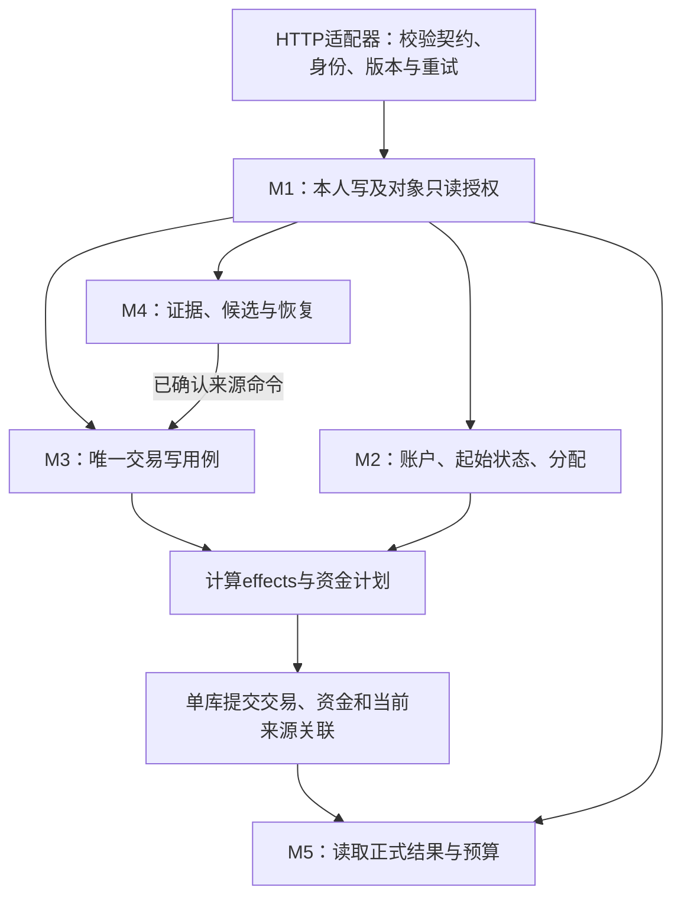

# 星账｜模块边界与导入字段

本文落实[业务规则](BUSINESS_RULES_DISCUSSION.md)，字段承载见[逻辑模型](LOGICAL_DATA_MODEL.md)，HTTP表达见[API契约](API_CONTRACT.md)。不创建新的业务模块或独立服务。

## 1. M1–M5责任与依赖

| 模块 | 输入 | 输出 | 禁止 |
|---|---|---|---|
| M1 身份与关系 | 已验证会话、资源归属、绑定凭据 | 当前用户、只读/写权限 | 不替他人写账，不把资金归属当写权限 |
| M2 账户与资金归属 | 账户初始状态、手动分配、账户查询 | Account、份额、派生存款基准/缺口 | 不任意覆盖余额，不解析Excel |
| M3 交易账务 | 已授权账户、合法交易命令、当前资金与版本、官方来源证明 | Transaction、effects、movements、提醒/失败 | 不解析文件、不猜来源，不接受无来源手动refund |
| M4 导入与来源证据 | 文件、本人profile、映射、已存在来源/交易 | 原始观察、规范化候选、来源关系、逐行结果/核对项；调用M3 | 不写第二套资金算法，不关联退款原消费 |
| M5 预算与统计 | 已保存交易、有效资金记录、查询月份/当前日期 | 个人净花销、预算、四类资金视图 | 不创建账务、不维护独立余额 |

API适配层只调应用用例；应用用例验证权限并协调模块与业务提交边界；模块只依赖Repository/Unit of Work接口，不绑定HTTP、数据库SDK或客户端。共享资金规则只计算计划，无文件、网络或系统时钟副作用；当前时间由用例传入。先模块化单体，不搭事件总线或通用工作流引擎。Unit of Work只指一次业务提交边界，不要求为此增加框架或单独封装类。

M4→M3交接命令包含合法type/semantics、整数金额、带时区记账时间、已授权Account、分类/商户/备注、refund字段和自己的SourceRecord。M3返回已保存transaction_id/effects/资金结果；M4来源关联与M3账务在同一次全成/全败操作中完成。M5只读正式结果。

## 2. 原子边界

一笔创建/编辑/删除：Transaction、effects、movements、当前来源关联要么一起成功，要么一起失败。内部转账两端一起成功/失败；M2初始状态与受影响历史/有效状态一起成功/失败；删除核对手动交易与关闭核对项一起成功/失败。

文件解析/原始观察可先保留，单行资金失败不等于来源读取失败。批次允许部分行成功，结果必须守恒，不能把保留证据说成入账。来源身份唯一与份额守恒是业务约束；写入采用单库原生事务及并发控制；有重复执行风险的POST使用24小时幂等键，资源变更比较目标版本。无需新增外部组件。不允许前端直写余额。

## 3. M4文件级事实与识别范围

| 事实 | 微信 | 支付宝 | 输出 |
|---|---|---|---|
| 平台/表头 | 标题与交易时间+交易类型等列 | 标题与交易时间+交易分类等列 | platform、表头行号；不写死18/24行 |
| 导出账号 | 昵称，无不可变账号ID | 文件头账号标识，另含姓名 | metadata快照、profile候选；不以昵称/姓名作唯一身份 |
| 起止范围/全量类型 | 起止时间、全部账单 | 起止时间、全部 | declared_from/to、export_type |
| 导出时间 | 有 | 有，可能早于声明范围终点 | exported_at、effective_to=min(declared_to,exported_at) |
| 声明/实读数 | 有 | 有 | 全部行读出后核对，不能过滤后才对数 |
| 汇总金额 | 有 | 有，官方提示统计口径可不同 | 保留展示，不把累加相等作为通用成功条件 |
| 时间 | 文件说明UTC+08:00 | 本轮按平台本地北京时间解释 | +08:00 RFC3339；不是把无时区Excel时间当UTC |

金额转整数分；单号清理首尾空白（兼容末尾制表符及字面量\\t），不转数字，不截断退款单号。保留完整raw_fields与原值，不让规范化覆盖证据。仅人民币XLSX是当前可验证格式；其他文件形态unsupported，不假装已适配。

## 4. 逐字段去向

### 微信11列

| 原列 | 规范化证据 | 用途/边界 |
|---|---|---|
| 交易时间 | source_occurred_at | 默认occurred_at，原始时间只读 |
| 交易类型 | source_kind | 组合识别type与refund_kind，不直接当内部分类 |
| 交易对方 | counterparty | merchant候选，充值提现银行卡线索 |
| 商品 | description | note/分类候选；可能仅是商户单号文字 |
| 收/支 | source_direction | 方向证据；中性“/”不是无交易 |
| 金额(元) | amount_minor | 普通收支实际变动；转账两端按类型解释 |
| 支付方式 | raw_method、canonical_method_key、account_hint | 实际账户映射；提现时银行卡是目标端 |
| 当前状态 | source_status、有效性 | 已存入零钱补账户；累计退款不造流水 |
| 交易单号 | official_transaction_id | profile内稳定身份 |
| 商户单号 | merchant_order_id | 辅助证据，可空/重复，不作唯一键 |
| 备注 | source_note、可选fee_hint | 原文保留；带费转账unsupported |

### 支付宝12列

| 原列 | 规范化证据 | 用途/边界 |
|---|---|---|
| 交易时间 | source_occurred_at | 默认occurred_at，补时区 |
| 交易分类 | category_hint | 映射内部category_code，不单独判断退款 |
| 交易对方 | counterparty | merchant候选 |
| 对方账号 | counterparty_account | 辅助证据，不是本人的Account |
| 商品说明 | description | 商品/退款/还款语义，保留原文 |
| 收/支 | source_direction | 不计收支不等于没有实际流入 |
| 金额 | amount_minor | 按用户确认取实际金额，不另扣优惠 |
| 收/付款方式 | raw_method、canonical_method_key、discount_tags | 剥离支付红包后找实际账户 |
| 交易状态 | source_status、有效性 | 等待确认收货可为已支付；退款成功识别refund |
| 交易订单号 | official_transaction_id | 保留完整文本与退款后缀，不找原消费 |
| 商家订单号 | merchant_order_id | 非主键 |
| 备注 | source_note | 原文保留，可空 |

M4保管源身份、原始字段、状态、优惠、渠道键和判定证据；M3保管正式交易事实及用户编辑。source_summaries可以有多个来源，不能把来源和Transaction合成一行后互相覆盖。

## 5. 确定性规则与停止条件

1. 按档案映射实际账户，已存入零钱可规范化零钱键；状态与渠道冲突needs_review，不默认所有空值为零钱。
2. 支付红包仅优惠；微信普通红包收发照正常方向分类。亲情卡、花呗/信用等不支持，来源仍保留。
3. 微信退款按交易类型识别，转账-退款为transfer_return，其余明确商户退款为merchant_refund；支付宝退款成功为商户退款。未知状态不按字符串随便当成功，needs_review。
4. 原消费状态已退款仍为expense；每个独立退款行各自金额只入一次。等待收货保留支出，失败/关闭ineffective。
5. 微信普通转账先保留方向和已知账户，角色未确定needs_review。无费充值银行卡→零钱；无费提现零钱→银行卡；两端映射齐全才提交transfer。备注费>0的转账unsupported，不能把总扣款当净到账。
6. 分类字典：food（餐饮美食）、shopping（日用百货/服饰装扮/家居家装/数码电器）、transport（交通出行）、education（教育培训）、health（医疗健康）、entertainment（文化休闲/运动户外）、utilities（充值缴费）、other（其余）。微信无可靠规则用other。分类不是收入/支出/退款类型。
7. 稳定SourceRecord关联优先；新来源与既有交易同北京时间日、类型、实际账户/方向和金额一致则给同事件候选，确认后关联。不要因单候选就静默认定，也不要因取消退款原消费关联就取消普通来源核对。
8. 当前来源有交易且重要事实未变→duplicate_existing；无交易→可重新处理。旧导出不能盖新导出，同时间冲突待选择有效观察；用户编辑不回写源字段。
9. 可创建行按occurred_at、official_transaction_id文本排序执行；行号仅用于证据定位。来源关联失败与资金写入一起回滚。
10. 七类行结果守恒；M4处理阶段和明细通过现有导入结果页展示，不新建异常中心。

## 6. 不从文件猜的信息

真实Account ID来自M2；来源档案及用户归属由M1/M4确认；资金份额与存款基准由M2提供；既有交易ID来自M3。同银行卡可跨平台，缺少平台归属不能生成缺失核对。手动银行卡账单可明确source_account_profile_id，余额账户可由已确认映射确定。

核对资格采用V1保守规则：结构/账号/范围不明或任何unsupported/needs_review/failed行时，本batch不自动做缺失核对，其他可处理行正常进行。核对项不是来源行，也不产生资金。

## 7. 真实样本事实与工程边界

已读取微信169行、支付宝169行。亲情卡99行、花呗相关24行不支持，共123行；纳入215行：支出146、收入3、独立退款13、普通转账角色候选46、充值提现6、关闭1。

退款12条来自微信、1条支付宝；10条商户退款合计1486.26元默认抵减，3条转账退回220元默认不抵减。微信0.44+0.26只合计0.70；29条已存入零钱可确定零钱线索。支付宝优惠示例实际银行卡扣款40.79元，不建立红包账户。

6条充值提现中3条充值、3条提现；其中2条提现有非零服务费，1条提现费为0。本期2条明确unsupported，4条无费内部转账候选可在两端映射确定后入账。当前不能把银行卡/微信零钱名称当已经绑定Account。

以上是输入事实与参考流程验证，不是已部署服务验收。实验脚本及当前运行结果统一记入[实施计划](IMPLEMENTATION_PLAN.md)，不另保留过程报告/版本流水。

## 8. 程序中的数据依赖与提交位置

当前参考程序只有parse_file、ImportReference、Ledger和stats，没有HTTP适配器。下图规定未来实现职责，不把参考脚本当成已有服务器。

解析可以先保存观察；每个可执行来源单独调用同一M3用例。账务与来源当前关联共同提交；不通过服务端HTTP回调自己的手动创建接口，不用人工POST创建refund。GET只取快照；预算写只归M5，不触发账务重算。

| 实际信息 | 读取与规范化 | 契约出口和下游依赖 |
|---|---|---|
| 支付宝66行渠道农业银行储蓄卡(2372)&闪购支付红包，40.79元 | account_evidence保留银行卡线索，discount_tags保留优惠，amount_minor=4079 | ImportRow.evidence/candidate；映射确认实际Account后M3扣4079分；不建立优惠账户 |
| 微信支付方式/，状态已存入零钱 | 状态补微信零钱渠道证据；账户ID仍须映射 | candidate.account_id未定可为null；needs_review不扣款；确认后ordinary income |
| 微信32/33行退款0.44/0.26，累计状态0.70 | 两个完整官方单号分别44/26分，merchant_refund，默认affects_spending=true | M4内部命令refund_inflow；各自到账，M5共抵减70分；不传原消费ID |
| 来源时间与用户编辑日期 | source_occurred_at只读；occurred_at可编辑 | source_summaries保留原文时间；M3按账户起始日判断effects；M5按可编辑月份统计 |
| 官方单号、来源档案、导出时间 | profile加完整单号为来源身份；新旧观察比较 | source_record_id/source_version；稳定关联去重，重导保留用户编辑 |
| 未知实际账户、转账角色、资金归属 | 分别由M2账户、用户确认角色、既有份额提供 | 不从merchant、红包、尾号或文件昵称猜ID/归属；缺失时停止在候选 |
| 覆盖范围与全批结果 | 导出时刻截断范围；七类结果守恒 | coverage决定是否生成reconciliation_items；核对结果不混入来源行数 |

入站HTTP命令不接受派生accounting_semantics；M3从合法type计算。参考脚本当前账户/来源ID均为虚构映射；真实文件只能提供证据，不能证明真实用户权限或线上余额。

渠道映射闭环：Evidence.canonical_method_keys保留全部规范键；Candidate.canonical_method_key用于单账户，from_canonical_method_key/to_canonical_method_key用于已明确内部转账两端，未明确角色/账户线索时为null。客户端从导入结果取键，结合listAccounts让本人选择Account，再putMapping并resolveImport(resume)。文件头原始信息在本人ImportBatch.source_metadata展示，不能成为客户端授权依据。
