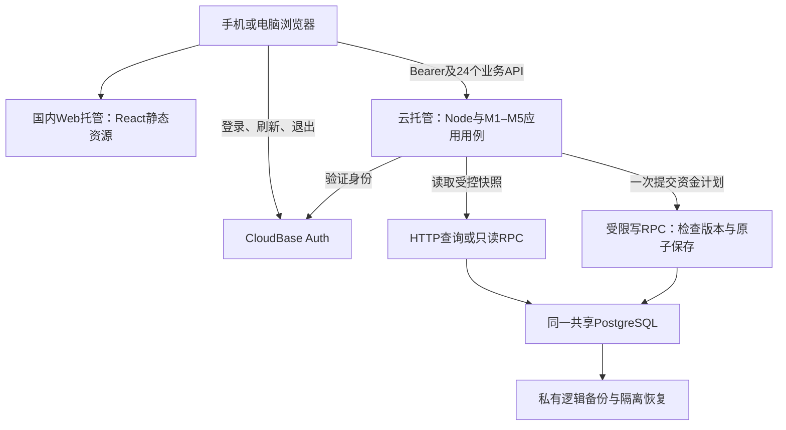

# 星账｜实施计划与验证

本文件只保留当前状态、实施顺序和当前验证结果，不堆叠版本日志。[业务规则](BUSINESS_RULES_DISCUSSION.md)决定行为，[模块边界](ENGINEERING_MODULE_BOUNDARIES.md)决定责任，[模型](LOGICAL_DATA_MODEL.md)和[API](API_CONTRACT.md)表达同一契约。

## 1. 当前状态

已有六份核心设计文档及一个可运行的内存参考验证脚本；没有生产前后端、HTTP路由、数据库迁移或已部署应用。不能将文档或参考模型通过说成产品已实现。

M1–M5始终指业务模块。以下阶段用A–F编号，不与业务模块混用。当前文档范围已收敛；技术组合已选定；持久化事务、真实鉴权与客户端仍需工程落实，不留下互相矛盾的业务备选稿。

## 2. 开发阶段

| 阶段 | 范围 | 验收出口 |
|---|---|---|
| A 工程选型与骨架 | 客户端、认证、数据库/事务、部署、开源许可；业务边界映射实际目录 | 移动/桌面共用契约；身份和事务可验证，不先建大量空目录 |
| B 最小闭环 | M1身份上下文、M2账户初始状态、M3普通收支、M5最小总览 | 初始5000、支出25.80、收入10，交易/余额/份额一致；按选定重试保护验证行为；失败不留半笔账 |
| C 交易生命周期 | M2分配/基准与起始状态；M3编辑删除、内部转账、独立退款；M5统计预算 | 当前份额非负、回补可计算、跨起始日安全、日期/抵减一致；无手动refund后门 |
| D 官方导入 | M4解析/证据/profile/映射、逐行结果、恢复/重导、必要匹配与核对，调用M3 | 真实文件逐行结果守恒；补映射可继续；删除保留来源后新操作可恢复；不支持行不造账 |
| E 双人首发能力 | M1绑定凭据闭环、对象账户/账单只读、四类资金同屏 | 前后端均拒绝写对象数据；个人预算独立，来源原文不随只读账单开放 |
| F 产品验收 | 手机核心体验、桌面一致性、权限/事务/并发/同步/部署 | 登录→账户→记账→查询→导入→处理结果真实可运行；只标实际通过部分 |

M1权限从阶段A/B贯穿；E不是后期补丁。技术方案见§7，未验证的云端能力不写成已完成。截图、负债、费用转账与解绑不纳入本次首发实现。

每个实现任务只指定一个主责模块、依赖接口、允许修改范围、输入样例和验收结果；跨模块原子事务由应用用例协调，不另造保存入口。资金规则与AccountFundMovement仅归M2，M3复用资金规则；M4的来源实体不进入M3，M5不进入写入成功条件。初始状态修正与交易删除由用例协调，模块不互相回调或直写。

现有Ledger仍是行为参考模型，不是生产模块实现。本轮明确设计归属与提交依赖，不为文档边界把参考脚本拆成框架或新增服务；生产落地按模块边界验收。

## 3. 当前流程验证

2026-10-24运行现有[参考脚本](../experiments/verify_import_recognition.py)，使用两份用户官方XLSX、固定北京时间时钟和虚构本人Account映射。原文件只读，不上传仓库，不写真实账户。

**104项参考规则/流程检查通过。** 它们检验的是文档行为、请求/响应示例和内存参考实现，不是生产实现、鉴权安全或数据库事务验收。版本/重试保护检验的是选定契约的参考语义，并未在生产实现。参考模型未保存手动分配的完整时间日志，因此含这类调整的起始重建会安全拒绝；生产实现需从有效movements重建，不能照搬该限制冒充全部支持。

部分规范（真实token、资源版本并发、持久化、分页、核对项持久生命周期、来源观察人工选择、客户端操作）仍须阶段A–F实现后运行验证。

### 3.1 经典动作

| 动作 | 验证输入/断言 |
|---|---|
| 支出跨三份额 | 流动100、本人存款100、对象存款100，支出250→剩对象存款50 |
| 独立退款回补 | 再退款120→补对象50、本人70，不需要原消费ID |
| 手动分配调整 | 同步改变基准与当前份额，回补上限可计算，不维护另一目标余额 |
| 支出金额减少 | 仅处理差额，先补当前缺口，再加流动资金 |
| 编辑退款抵减 | 账户/份额不变，净花销变化 |
| 改退款日期 | 不跨起始日保留份额计划；跨起始日切换历史/有效影响 |
| 类型变更 | 支出→内部转账→收入，保留交易ID；禁止普通类型改refund、refund改普通收入 |
| 起始状态修正 | 本账户重建历史/有效影响，其他账户不变；不安全重建整体拒绝 |
| 安全/不安全删除 | 删除仅撤销自身；资金已被使用时整笔拒绝并恢复快照 |
| 并发与非法输入 | 旧version、0/负金额、布尔金额、字符串false、未来日期、源时间写入均拒绝 |
| 本人与对象 | 虚构他人Account/profile无法进入写命令；真实身份验证仍未实现 |
| 转账 | 两端等额、不同账户、仅流动，起始日两端独立；平台转出可明确为支出 |
| 补映射恢复 | 同一官方退款先needs_review，补映射后使用原来源创建 |
| 退款来源关联 | 来源只连同一refund，禁止连原expense；同事件候选只提示，确认新事件才创建 |
| 删除后重导 | SourceRecord保留、transaction为空，新键导入恢复，不被来源存在或文件相同阻止 |
| 重试与用户编辑 | 同键不重复执行；新键重导保留用户日期/抵减；同键不同内容拒绝 |
| 状态观察 | 旧导出不覆盖较新事实，同时间冲突待处理；关闭来源后来有效可首次创建 |
| 原子写入 | 模拟来源关联失败，交易和余额回滚，来源观察可保留 |
| 统计算术 | 月花销3200/第20天→日均160、预测4960；预算3000→超支200；不提前舍入日均 |
| 负净花销 | 净额可负，预算剩余可大于预算；跨月抵减与零分母有确定输出 |
| 缺失核对资格 | 银行卡仅Account不够；明确profile且范围支持才可核对；已有来源/导出后时段不误判 |

请求边界检查覆盖：创建请求必填/条件字段与错误结构、整数金额/未知字段/缺时区拒绝、退款空改动不增版本、旧版本不能绕过空改动校验、PATCH省略/false/null区分、来源时间只读。并未验证实际HTTP头、真实超时或数据库提交；这些依赖工程实现。

### 3.2 真实字段信息流

读取338行、保留微信11列/支付宝12列原始字段；时间全部补+08:00。亲情卡/花呗相关123行不支持；另2条非零费用提现不支持，不与普通优惠支付混淆。

| 平台 | 参考模型创建 | 已关联 | 重复 | 不支持 | 不生效 | 待处理 | 失败 | 合计 |
|---|---:|---:|---:|---:|---:|---:|---:|---:|
| 微信 | 118 | 0 | 0 | 2 | 0 | 49 | 0 | 169 |
| 支付宝 | 44 | 0 | 0 | 123 | 1 | 1 | 0 | 169 |
| 总计 | 162 | 0 | 0 | 125 | 1 | 50 | 0 | 338 |

创建仅指虚构Account和内存参考模型的动作。待处理50条中46条是微信转账角色未定，4条为同日同类型/账户/金额的同事件候选（微信3、支付宝1），没有强行合并或冒充“识别率100%”。13条退款均可形成合法refund_inflow命令；本批次存在不支持/待处理，故不自动生成缺失手动交易核对项。

已验证依赖：源单号→profile命名空间→渠道键→Account→类型/语义→M3命令→effects/资金计划→M5统计；尚未绑定真实账户，不从文件猜资金归属。四条无费充值提现可形成内部转账候选；带费两条停止在unsupported。

## 4. 工程实现后必须补的验证

- 用真实认证上下文验证对象只读、batch/source/profile/mapping/account/transaction的归属与相互关联，不能只相信参考模型的虚构owner。
- 对来源唯一约束、并发请求、幂等键生命周期、事务回滚、同文件解析复用和删除重导进行真实数据库验证。
- 对全部HTTP请求/响应、严格字段类型、分页、资源版本、profile选择和resolution刷新结果跑实际接口测试。
- 验证完整/不完整文件、覆盖范围与核对项保留/删除/后续匹配生命周期；原始信息不在只读对象接口泄露。
- 在手机与桌面走同一条用户路径，不因单元/参考验证通过就跳过可用性验收。

参考命令（输入路径由使用者提供，报告存仓库外；契约开发校验另需PyYAML、jsonschema、openapi-spec-validator，不是应用运行依赖）：

```bash
python3 experiments/verify_import_recognition.py --wechat /private/wechat.xlsx --alipay /private/alipay.xlsx --report /private/validation.md --validate-openapi
```

文档、参考模型与实际产品是三层证据。后续仅将本节替换为新的真实状态，不新增重复审查报告或版本流水。


## 5. 完整契约与能力结论

当前24个操作已全部形成行为描述、严格OpenAPI和按M1–M5划分的Mermaid调用图；不再保留两个接口试点或待选D1–D3分支。新增的唯一业务入口是生成绑定凭据，补上原有绑定流程的缺口。登录/刷新/退出属于待选认证SDK；没有伪造本仓库已有的认证API。

选定单库原生事务/并发控制、必要POST幂等键及资源版本比较。它们分别处理半笔账、结果未知的重复提交、旧页面覆盖，不是用额外服务掩盖资金模型问题。新增复杂度限同库请求记录及清理、资源条件更新；不引入Redis、MQ、分布式锁、队列、工作流平台或能力开关。触发概率尚无生产数据。

## 6. 全量契约验证与实现边界

已完成参考规则/流程、OpenAPI结构及真实字段可表达性的摸底。脚本将重复结构样本与人工拼装投影累计为检查次数，不能据此评估业务完成度；接口名出现在图中也不证明调用流程正确。参考脚本仍含待收敛的手写请求校验，不能作为生产契约执行器。本轮技术选型不扩充这套校验，后续验证以真实HTTP、数据库保存与失败状态为证据。

OpenAPI 3.1标准校验、请求/响应示例的JSON Schema校验、非法字段/组合反例、24项接口与流程覆盖、六份核心文档链接及真实338行信息流均由现有参考脚本和契约校验验证。详见脚本输出；不把结构验证当成HTTP集成测试。

验收重点：4079分银行卡支出不重复减红包；44/26分退款独立入账和抵减；微信零钱状态推断需真实映射；补映射后resume继续；退款编辑不关联原消费；空改动不增版本；安全撤销和跨起始日变更不破坏资金。原始文件与个人明细不提交仓库。

后续工程必须按这份完整契约落地所有24个操作，使用真实数据库、鉴权和客户端验证事务故障、同时支出、并发版本、幂等过期与重放、分页快照、绑定凭据消费、导入恢复及对象只读。当前仓库只有参考程序，没有路由/数据库可供端到端验收。


## 7. 当前选定技术组合与最小验证

### 7.1 已选方案与冻结范围

业务规则、M1–M5及24个公开API仍以`524f2da`为冻结基线；本节记录用户选定的开发起点，不再将原生直连PG/MySQL升级作为默认路线。这是新项目，不需要兼容旧系统、迁移旧账本或维护双数据库适配。是否可用取决于能否实现既定行为，不取决于能否照搬原生连接写法。

| 部分 | 当前选择 | 对本项目的理由与代价 |
|---|---|---|
| 前端 | React + TypeScript + Vite，响应式Web | 复用账户/账单/导入交互，静态构建可国内托管；TS不代替网络输入校验。首版无需SSR，后续安卓仍复用API，不预先开发原生端 |
| 后端 | Node.js + Express，模块化单体 | M1–M5在一个应用中编排，减少服务和语言种类；权限、错误与账务仍需明确实现，不由框架自动保证 |
| 数据库 | 现有CloudBase共享PostgreSQL | 复用已有资源，保留关系、唯一约束和原生事务能力；接受没有TCP直连的实际访问方式，不默认升级独享 |
| 数据库访问 | 后端使用HTTP API + RPC | 查询走受控HTTP/RPC；跨表账务通过一次RPC中的数据库事务提交，不能用多次HTTP CRUD拼成事务 |
| 认证 | CloudBase Auth | 托管登录与token生命周期；M1仍负责本人/对象权限，不自建密码库，不信任浏览器提供的user_id |
| 部署 | CloudBase云托管 + Web静态托管 | 国内运行同一Node应用与Web构建产物；需验证网关、冷启动、上传限制和费用。浏览器运行不依赖海外CDN/字体或GitHub数据存储 |
| 自动化验证 | 单元测试、API契约测试、数据库集成测试 | 分别验证纯资金规则、实际HTTP行为、真实RPC原子性/并发/权限；按风险选择代表场景，不以累计检查次数衡量完成度 |

Node建议使用24 LTS，具体前后端依赖在建立骨架时锁定版本；不增加pg/mysql2运行时驱动、Redis、MQ、分布式锁、常驻Python服务或另一套同步服务。Python实验仅作真实字段参考。

### 7.2 前后端、认证与数据库关系



多端同步就是同一身份通过同一API读写同一云端账本，保存后/切回页面时重新查询。首版不做离线合并、WebSocket订阅或本地数据库文件同步。认证数据与业务数据不做跨服务事务；认证sub映射到内部User。浏览器不得直接写资金表或调用内部账务提交RPC，数据库不另开绕过24个业务API的客户端入口。

### 7.3 共享PG怎样实现既定账务边界

官方确认PostgREST RPC可在单次函数调用的数据库事务内执行多表操作，异常可回滚。[S1][S2] 因此HTTP访问不等于没有事务；不能在Node里发BEGIN、再用几个独立HTTP请求模拟一条原生数据库连接。

1. 应用用例验证身份、请求及来源资格，取得一致的相关状态与版本。资金快照必须和版本一致；不得将互不一致的多次读取直接拼成“当前余额”。
2. M3处理交易生命周期，调用M2的唯一TypeScript资金规则生成计划。M4解释来源，M5独立查询；不把Excel处理或整套业务算法搬进PL/pgSQL。
3. 后端一次调用受限RPC。RPC先处理幂等重放，再在同一数据库事务中锁定/检查相关账户、交易和来源版本，核验必要权限、计划守恒与非负约束，然后保存交易/effects、资金变动、当前来源关联和完成结果。
4. 读取到计算期间若发生并发写入，旧计划不得提交；按既有契约返回冲突。事务结束后不能把SQL行锁“保留”给下一次HTTP请求。所有资金写入口必须更新同一账户控制版本，转账按固定账户顺序处理两端。
5. 多表保存任一步失败，整次账务RPC回滚；函数不得吞掉错误后返回成功。文件观察可先保存，导入每个可执行行独立提交，不能把整份文件处理放进长事务。

这里的版本是内部并发条件，不能要求用户补传新公共字段；外部If-Match、幂等键与错误结构保持不变。RPC是持久化边界，不新增业务模块；不要创建可由客户端传SQL、任意表名或任意owner的“万能执行器”。M2的资金计划算法仍只有一份，数据库只执行必要的提交前防护和原子保存。

写RPC的EXECUTE/表GRANT/RLS及后端调用身份需要配套设计并实测。若使用SECURITY DEFINER，显式限定调用角色、资源归属、search_path和对象引用；不能因为后端已经验token就把特权RPC公开给任意登录用户。[S1] 单次RPC的原子性并不自动证明以上权限和并发控制已经实现。

### 7.4 约束与实际成本

| 已定约束 | 选型必须兑现的条件 |
|---|---|
| 资金不为负、一次保存全成/全败 | 真实写RPC内验证版本并一次提交；原生约束和锁保护所有写入口 |
| 官方来源稳定去重 | 数据库unique(profile,完整官方单号)，并发冲突不留下交易或资金残片 |
| 10MiB/10000行XLSX同步导入 | 真实网关、Node解析、逐行RPC及响应都必须在上限内完成；不能默改契约或默认引入异步队列 |
| 本人写、对象只读、原文私有 | API权限与数据库表/RPC权限共同验证，日志不保存token、完整单号或raw_fields |
| 国内可用、维护能力有限 | 国内托管并打包运行时资源；一个后端服务；顺序SQL迁移，同时管理数据库函数与授权 |

个人版资源点模式公开价为19.9元/月、40000点，实际订单/计费模式以控制台为准。[S3] 云托管费用不能据此视为已全包：限制页明确CPU/MEM按量计费及超限按量要求；以现有环境能力项和账单核实。[S4] 总成本为现有套餐续费 + 适用项目超额用量 + 套餐外计算/网络费 + 私有备份/日志 + 额外测试环境 + 域名费用，不重复计入两边，不承诺固定19.9元。

云函数错误文档列6MB请求体，云托管限制页列包体20M、超时60秒。[S4][S5] 当前选择云托管有明确的上传理由，但10000行逐次RPC的网络耗时仍未验证；这是一项真实可行性关卡，不用“数据量小”跳过。不得默认Node进程内缓存就是账务真相，也不以本地执行耗时代替云端耗时。

初始可采用缩容到0、适度日志保留，不持续轮询数据库；接受冷启动并实测。若体验需要常驻实例，再依据实际新增费用决定，不自动开启持续收费资源。套餐资源耗尽、网关配置和域名HTTPS均是部署事项，业务代码不能掩盖停服。

### 7.5 本地、测试、正式部署的差异

| 项目 | 本地开发 | 隔离云测试 | 正式部署 |
|---|---|---|---|
| 数据访问 | 本地PG可用于调试SQL，但集成测试通过PostgREST/RPC路径调用同一批函数；不能用直连pg替代所选访问方式验收 | 共享PG、实际HTTP API/RPC、相同迁移和权限 | 同一路径，独立正式数据与受控后端身份 |
| 应用 | Vite代理 + 同一Node应用；Node版本固定 | 同一构建产物/镜像，测网关和冷启动 | 只发布已验证版本，保留稳定镜像 |
| 身份 | 测试Auth；假身份仅限隔离单元测试 | 两个真实测试用户，测token失效及跨用户访问 | 正式Auth，禁用本地绕过 |
| 数据与网络 | 合成/脱敏数据；localhost需对应允许来源 | 独立数据库、认证与日志权限；测真实限额和费用 | 私有账本、国内HTTPS域名；前端不得携带管理密钥 |

SQL函数和权限迁移同应用代码一起进Git，不能仅靠控制台手工点击而无可复现记录。本地没有平台网关和相同JWT机制，故本地通过不代表云端授权通过。没有便宜的隔离云环境时先做本地验证，测试不得写正式账本；额外环境是否收费要单列。

### 7.6 备份、恢复与维护

共享实例没有原生TCP直连时，不将pg_dump当成可用备份方案；本轮尚未证明现有套餐的平台级回档、完整导出和恢复能力，不能承诺“平台会自动备份”。PG与文档型数据库备份机制也不同。[S6]

选定验证方向：经受控HTTP/RPC或管理端导出业务表，并在Git保存表结构、SQL函数和权限迁移。导出须有一致快照或明确的暂停写入窗口；分页逐表导出不天然一致。恢复到独立库，检查资金记录、来源关联、版本、幂等状态和用户sub映射；没有验证恢复的导出不算备份完成。

拟定自用目标为每日加密逻辑备份、保留7份，RPO≤24小时、RTO≤4小时；这是恢复目标，待验证后才能承诺。数据备份留在私有位置，源码仓库与浏览器下载目录不作公开账单备份。镜像回滚不自动撤销数据库迁移，破坏性变更前先完成可恢复备份。

### 7.7 三类验证分别放在哪里

| 验证类型 | 验证对象/位置 | 要发现的问题 |
|---|---|---|
| 单元测试 | M2纯资金函数及必要的解析函数，不连数据库 | 支出扣减顺序、退款回补、金额/date解释等规则错误 |
| API契约测试 | 实际Node HTTP入口及响应，对照openapi.yaml | 严格类型、只读字段、权限响应、If-Match/幂等语义、错误结构不一致 |
| 数据库集成测试 | 实际HTTP/RPC访问路径、真实PG及权限配置 | 一次RPC回滚、并发旧计划、来源唯一、幂等结果与账务不同步、绕过API写入 |

测试使用明确输入和独立预期结果，不从同一Schema自动生成对象再以“通过次数”证明业务正确。当前Python实验不是生产请求校验器，也不扩充另一套白名单。技术选定不等于以上实现及验证已经完成。

### 7.8 下一步最小验证与六项标准

| 步骤 | 实际动作与通过条件 |
|---|---|
| 1 最小写入与回滚 | 隔离库部署最小业务表、读快照/写入RPC及受限权限；Node通过HTTP/RPC写25.80元支出：5000→4974.20。在来源关联保存前注入异常，核对交易/资金/当前关联/幂等完成结果均无半笔保存 |
| 2 并发与重试 | 两个独立HTTP请求同时从100元支出80元，只能一笔成功、剩20元；重试同键不重复；同来源并发不重复；旧If-Match返回412；读后发生写入的旧资金计划不能提交 |
| 3 权限与多端 | 手机/电脑同账号保存后刷新可见；第二用户不能写本人账本；浏览器普通token不能直接调用提交RPC或写表；错误/过期token拒绝 |
| 4 导入及云限制 | 真正经过所选解析/提交路径处理两份338行文件；用合成数据验证10000行、接近10MiB及超限拒绝。记录冷/热耗时和内存；超60秒或网关拒绝则该上限尚未兑现，不暗改契约 |
| 5 恢复与用量 | 导出到私有备份并恢复到隔离库，核对资金/来源/用户映射；查看实际计费项与用量。备份不可恢复或费用未知时，不能说已满足正式使用条件 |

六项选型标准的当前状态：组件选择与理由、职责关系、环境差异、成本组成及最小验证方案已明确；真实并发/权限、同步导入上限、完整备份恢复与实际月费仍待以上验证。本轮只记录已选开发起点，没有部署、写数据库或升级套餐。无需兼容旧系统，也不把技术实现手段冻结成业务规则。

### 官方依据

- [S1 RPC与多表原子写入、权限边界](https://docs.cloudbase.net/database/postgresql/rpc)
- [S2 数据库函数与异常回滚](https://docs.cloudbase.net/database/postgresql/functions)
- [S3 个人版资源点计费FAQ](https://docs.cloudbase.net/quick-start/resource-point)
- [S4 云托管大小/超时/计费限制](https://docs.cloudbase.net/run/limitation)
- [S5 请求体限制](https://docs.cloudbase.net/error-code/EXCEED_MAX_PAYLOAD_SIZE)
- [S6 数据库备份机制区别](https://docs.cloudbase.net/database/backup)
- [认证与token验证](https://docs.cloudbase.net/api-reference/webv3-pg/authentication)；[当前用户接口](https://docs.cloudbase.net/http-api/auth/user-me)
