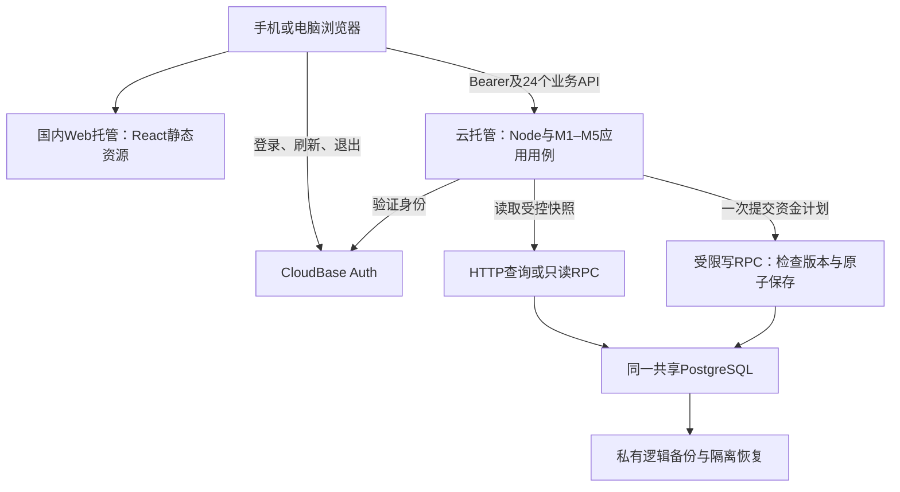

# 星账｜实施计划与验证

本文件维护当前状态、路线入口、技术选择与验证结果；阶段交付、依赖和任务入口统一见[阶段交付与依赖](PHASE_DELIVERIES_AND_DEPENDENCIES.md)。[业务规则](BUSINESS_RULES_DISCUSSION.md)决定行为，[模块边界](ENGINEERING_MODULE_BOUNDARIES.md)决定责任，[模型](LOGICAL_DATA_MODEL.md)和[API](API_CONTRACT.md)表达同一契约。

## 1. 当前状态

已有六份核心设计文档、参考验证脚本，以及首条账务与双人只读增量的前后端、HTTP路由和`writter-dev`迁移。P0逐卡文档整理方案尚未执行，已撤下；尚无已部署应用、完整24操作或产品验收。不能将文档、参考模型或本地HTTP通过说成完整产品已实现。

M1–M5始终指业务模块。以下工程阶段用Phase 0–7编号，不与业务模块混用。当前文档范围已收敛；技术组合已选定；持久化事务、真实鉴权与客户端仍需工程落实，不留下互相矛盾的业务备选稿。

## 2. V1整体工程路线

### 2.1 开发原则与范围

先核对施工依据与隔离输入，再验证关键技术；随后按完整用户链路建立可重复运行的工程和功能。每轮以页面操作、服务端行为、真实保存结果与检查证据共同退出；不按代码量、文档量或断言次数衡量。阶段是风险与交付门槛。内部表、RPC、函数和UI组件仅在其首次使用的增量中定稿；已有总设计中的具体结构作为候选输入。

当前选定技术见§7，不重新开展全栈选型。第一版国内响应式Web、多端读取同一云端账本，安卓以后再议。冻结业务、24个API和M1–M5职责不因任务拆分而变化；截图、负债、带费转账、解绑及账户删除不在V1范围。不兼容旧系统、不迁移旧账本。

### 2.2 八个阶段与退出条件

阶段的目录位置、施工顺序、功能链路、验证、产物和接收标准统一维护于[具体开发计划P0–P7](PHASE_DELIVERIES_AND_DEPENDENCIES.md#7-开发计划箭头只表示施工依赖)。本文件§2.6记录各阶段是否实际完成。

### 2.3 阶段依赖与硬门槛

各种依赖的供给方、领取检查和阻塞点见[依赖领取](PHASE_DELIVERIES_AND_DEPENDENCIES.md#9-公开api首次交付与设计追踪)，阶段上下游见[Mermaid阶段关系](PHASE_DELIVERIES_AND_DEPENDENCIES.md#7-开发计划箭头只表示施工依赖)。

### 2.4 24个公开API的实现归属

唯一分配清单见[公开API交付归属](PHASE_DELIVERIES_AND_DEPENDENCIES.md#9-公开api首次交付与设计追踪)，接口结构和行为仍以API契约为准。

### 2.5 文档与目标工程结构

原六份核心Markdown保留入口路径；按实际读取或重复维护的证据决定是否拆分正文，拆分时保留旧入口并确保正文只在一处维护。本文件提供路线入口和实际进度，阶段设计提供候选施工路径。当前迭代在§2.6领取，设计只细化该轮实际要交付的内容。

| 内容 | 当前或未来落点 | 维护规则 |
|---|---|---|
| 产品与业务依据 | 现有BUSINESS_RULES_DISCUSSION、PRODUCT_FUNCTION_MAP、LOGICAL_DATA_MODEL、API_CONTRACT | 冻结行为；新需求先改对应依据，其他文件引用，不平行重写 |
| 工程边界与执行规则 | ENGINEERING_MODULE_BOUNDARIES；必要时建立根目录AGENTS | 模块责任由边界文档维护；AGENTS只记录稳定的仓库操作和Git规则 |
| 阶段交付与依赖 | PHASE_DELIVERIES_AND_DEPENDENCIES | 提供P0–P7候选路径与验收样例；内部细节在对应增量以实测定稿 |
| 机器契约 | 根目录openapi.yaml | 唯一结构来源；packages/contracts将来承载由其生成的类型/必要适配，不手工复制另一份规格 |
| 当前迭代 | 本文件§2.6及对应代码/检查结果 | 写清目标、依赖、改动位置和可执行验收；只有实际需要独立交接时才另写任务说明 |
| 验证证据 | 与代码相邻的单元测试；按需tests/contract、integration、e2e | 用可执行测试和实际运行结果证明，不把测试摘要改成新业务规则；个人原始账单/报告不提交 |
| 历史 | Git历史 | 不预建archive、不把每个小任务归档成新MD；确有不可替代的说明价值才保留 |

目标目录按首次真实用途建立，不一次创建空壳：

| 路径 | 用途与首次需要的阶段 |
|---|---|
| README.md、AGENTS.md | 开发入口与简短AI规则，Phase 0 |
| package.json及锁文件 | 统一启动/构建/检查入口，Phase 2 |
| apps/web、apps/api | Web与模块化后端，Phase 2；M1–M5在API内部，不拆五个服务 |
| packages/contracts | 契约生成类型/必要共享内容，在Phase 2确认确实复用后建立 |
| experiments/p1/migrations、db/migrations | P1实验专用SQL在前者；P2将已验证的可复用结构、RPC和授权接入后者，后续业务迁移有序扩展 |
| tests/contract、integration、e2e | 到对应验证首次需要时建立；纯函数单元测试可与模块同目录 |
| scripts | 出现实际可复用命令时建立；不迁移现有参考实验来冒充生产代码 |

PG函数和授权先跟随有序迁移管理，不同时在db/functions维护另一份可编辑函数正文。以后若文件太长需要拆分，届时明确唯一来源与迁移如何引用。docs/product、engineering是职责分类，不是本轮必须迁移的目录；结构变动只有在减少查找成本时才执行，并同步引用。

### 2.6 阶段控制与当前进度

阶段状态用未开始、进行中、已验收；同时记录证据与阻塞事实。AI自行调查并修复实现错误、失败的测试和常规工具问题，然后重跑相关检查。遇到业务规则冲突、技术路线需要改变、费用/权限边界不明或不可逆资源操作时，保留现场并向用户给出证据、方案与需要作出的决定。继续独立可做的工作，不要求用户逐张启动任务。

验收分别注明产物已实现、实际测试通过、云端真实行为已验证，记录对应提交SHA和检查摘要。失败的检查不会改写成通过；缺少真实环境的验证明确保持待验。

| 阶段 | 当前状态 | 尚欠什么 |
|---|---|---|
| Phase 0 | 进行中 | 只使用`writter-dev`；独立本地PG恢复目标已实用；确认是资源点模式，云托管可用套餐点数的候选路线需核实关闭超限按量时的开通条件 |
| Phase 1 | 进行中 | 事务/回滚/并发/幂等、真实会话与Web→本地API→PG已验证；17表真实导出→独立本地PG逐行恢复通过。云端托管、平台Auth与完整替换环境恢复待验 |
| Phase 2 | 进行中 | 干净检出安装/构建/测试、独立API运行包、健康探针和401已实跑；请求校验读取唯一OpenAPI，24路由一致；云端通信待验 |
| Phase 3 | 进行中 | 登录、账户与关系页面已写；浏览器登录、开户及刷新读回已实测；邀请、绑定和对象只读已在真实令牌本地HTTP验证，正式托管仍未验收 |
| Phase 4 | 进行中 | 三份额开户/调整及四种交易维护、期初重建已实现并在真实PG/HTTP验证；退款回补、抵减与原始时间已接通，继续全流程验收 |
| Phase 5 | 进行中 | 两份原件各169行本地复测通过；手机合成文件的档案、映射、不支持保留与刷新通过。亲情卡/花呗不支持；10000行和云端链路仍待验 |
| Phase 6 | 进行中 | M5统计预算与分页筛选已接通；320/390触摸视口中预算保存刷新等页面检查通过。iOS真机及正式入口未验 |
| Phase 7 | 进行中 | 独立运行包、手机页面、Linux镜像构建/隔离运行、加密快照与17表独立本地恢复已通过。正式开通被自动审批拦下；平台完整恢复、正式备份保管与线上验收待完成 |

当前交付顺序按最小可验收增量推进：

1. **环境与约束领取。**在隔离分支确认业务资料入口及冲突清单；定位CloudBase隔离环境、SQL/RPC管理权限、两名测试身份、独立恢复目标与私有样本。未知值记为首次使用时的阻塞，不编造实值。P0以可执行的P1验证输入退出。
2. **平台实证。**用合成数据验证真实Auth、受限访问、事务回滚、并发与幂等、最小Web→API链路、独立目标恢复；记录请求与数据库前后对照。P1未通过的能力不得写为已经可用。
3. **第一条可用增量。**在通过的访问方式上，交付登录→创建含初始份额的实际账户→手动支出→刷新读取一致结果。该增量首次实际使用的迁移、内部函数、RPC、页面和测试在此定稿；同时保留更细的P2–P4阶段验收门槛。
4. **后续增量。**按依赖交付绑定/对象只读，账户维护及交易编辑删除，官方文件及来源生命周期，统计预算与全站体验；P5/P6的真实样本及24个操作覆盖门槛保留。
5. **发布增量。**全流程回归、正式部署、独立恢复核对和维护交接，满足P7退出条件。

当前M5首页统计、个人月预算、查询参数及干净检出已完成，17表应用数据已独立恢复，两份真实原件本地复测已通过。手机浏览器触摸视口全流程和Linux容器已通过下述范围的检查；剩余验收包括未测上限、正式入口、平台完整恢复与iOS真机。继续遵守现有套餐、不新增付费环境或升级套餐的边界。三份额M2共用受限PG资金函数已验证，不保留未接入运行的TS副本。

**最新发布准备（2026-10-28，候选`0.1.0-rc.1`）。**手机验证器位于`tools/recovery/verify-mobile.mjs`，在真实React→本机Express→原迁移PGlite上完成登录成功/失败、开户刷新、资料/份额/期初修改、支出编辑刷新删除、合成官方导入的档案/映射/不支持保留、预算保存刷新及退出，共9条路径、320/390宽度16个布局样本。截图检查修复小屏导航需要横滑、按钮挤压和交易卡片拥挤。Auth仅在独立Vite实例别名为测试替身；私有env禁读、浏览器外部请求阻断，CloudBase调用0，不代表真实Auth或iOS真机验收。

公开仓库标准`ubuntu-24.04`上，Docker多阶段实际构建、非root/只读文件系统/无外部网络/0.25CPU和512MiB运行通过；Web/指纹资源/固定健康、未登录API401、私有路径404、测试Auth替身未入镜像、SIGTERM退出码0已检查。[成功运行](https://github.com/AsteriaAnna/ledger-final/actions/runs/40705023724)对应`cf14bc3`。首轮脚本误将未登录未知API预期写成404，现按鉴权先行的既有行为改为401后通过，未修改接口。基础镜像固定为此次实际使用的digest，后续源上下文带提交SHA和逐文件摘要；公开契约及迁移未改变。

正式部署只读确认：个人版、资源点模式、`EnableOverrun=false`，到期2026-11-05 23:59:59且不自动续费；用户名密码登录开启。旧后端`sl-backend-dev`到期2026-11-02 20:51:40，不能作为长期正式配置。用量工具返回13模块，但不包含独立PG模块，不能把结果当完整剩余额度。远程MCP没有`tcbr:CreateCloudRunEnv`权限（request `1b5e58a4-a780-4baa-8c26-140c5b63c348`）；本机插件账号登录可用，已绑定唯一`writter-dev`，但`manageCloudRun initEnv Standard`被自动审批因持久变更及运行资源点风险拒绝。之后只读确认仍unopened，没有绕过拒绝、改套餐或开超限按量。正式密钥、来源域名、双人账号及线上发布需开通获准后继续，不伪造网址。

维护工具新增AES-256-GCM密封、独立恢复Key、拒绝覆盖、错误Key/篡改拒绝及任意合法快照的本地17表恢复；共用`lib/snapshot.mjs`避免与旧合成演练复制恢复逻辑。已有合成快照加密/解密字节一致、16迁移/17表结构权限和逐行恢复、恢复后写入/幂等通过，CloudBase数据调用0。每日备份/7份保留/离线Key/首份正式备份及平台Auth恢复仍是维护安排，尚未实际投入运行，P7不标通过。

**2026-10-28最新用户约束：当前只有两人低频使用，不按大量订单或高并发系统设计；后续数据验证不得消耗CloudBase资源点。**解析、资金/来源/权限逻辑、恢复和容量验证使用本地数据库与本地替身，不再创建云端合成夹具、执行远端验证SQL/RPC、登录探针、云端压测或为验证轮询平台。原先“小范围云端合成测试”的计划不再自动执行；历史实测记录保留，但不代表授权继续测试。不得把测试改称正常使用规避约束。本地结果不能冒充网关、共享PG或云端Auth实测，未测能力继续标待验。真实使用的正常耗点与验证预算分开；不新增常驻/并发资源、队列或第二套服务，不自动改变24操作和上传契约。

当前轻量运行增量在`feat/lightweight-release-20261028`，基于`ee9b0c9`。新增可选Web/API同源运行：只提供本次构建的首页与assets，不设全路径网页回退；账本及首页不缓存，指纹资源可缓存，原API鉴权/404保留。不改业务规则、公开OpenAPI、数据迁移或客户端PG访问边界。导入写入等待从12秒调整为45秒，普通读取仍12秒，不新增自动写重试，也不把10000行上限算作通过。部署文件独立在`cloudbase/deploy`，Docker上下文排除私有配置、备份和临时文件，运行阶段仅API生产依赖与非root用户。

前后端构建、22项API针对性测试及24路由集合检查通过。纯本地HTTP→原迁移PG链路验证开户10000分、支出2580、同键重试后仍仅1笔、刷新余额7420；两人绑定后对象读取为只读、代写404，预算5000剩余2420，12份HTTP请求响应符合原契约。Auth/网关为显式本地替身，未读私有环境文件，非本机/非模拟网关请求会被阻断；CloudBase网络调用0。独立同源发布包重新安装生产依赖并实际启动，网页/资源/健康与401、私有路径404检查通过。未启动真实SDK浏览器登录，本机无Docker/Podman，镜像构建、Linux运行和平台路由待验；没有调用CloudBase、部署或变更费用设置。

原件复测增量在`test/official-originals-20261028`，基于`9dc76a6`。用户授权只读两份私有XLSX，不扩展亲情卡、花呗等V1外规则；未支持或角色/同事件不明的记录继续保留。生产解析器直接读原件，经本机multipart上传、档案确认、虚构账户映射和原迁移RPC在本地PG保存。微信28762字节、169行/11列：created118、needs_review49、unsupported2；支付宝32387字节、169行/12列：created44、needs_review1、unsupported123、ineffective1。合计338行守恒、失败0、入账162；50条待处理和125条不支持均无交易关联，两个批次不自动生成缺失核对项。

逐字段独立核对原始单元格与持久证据、整数分、完整文本单号与字面制表符；Excel日期按无时区日历字段的既有持久字符串表示比较。验证同键不另建批次、新键重导不重记、用户备注与来源原始时间保留、微信44/26分退款合计70分、退款删除后重导恢复，以及虚构余额与独立交易加减总和一致。36份原件实际本机HTTP请求响应通过原OpenAPI；提取共享本地网关替身后，原双人链路12份HTTP回归也通过。原件SHA在读取前后相等，个人原文/单号/账户线索及捕获只留私有忽略目录，不写Git。CloudBase网络调用0，无云端SQL/迁移/登录或资源点消耗；未修改生产解析器、业务规则或公开契约，不能据此标云端时限或手机体验已验收。

初始状态修正沿用原阶段设计的V19及重建顺序：保存手动分配原指令和稳定执行顺序，按新opening重放本账户当前交易与指令；初始日之后的记录生效，之前的交易历史化、指令保留但无当前movement。迁移`20261027200000`已应用（`task-cb80e8302cfd42cd`），实测发现查询别名冲突后，用新迁移`20261027200001`修复（`task-014b04354943418a`），未改写已应用迁移历史。首次元数据迁移已先核实旧effects/adjustment均为0；若发现旧事件会主动拒绝，要求有依据的回填，不能猜首次顺序。

`tests/integration/opening-state-replay.sql`真实PG通过：V19的400/400→600/400元结果、无法重放中间分配时旧行全保留、空改动/旧版本、日期后移停用再提前启用、同时间稳定顺序、编辑后当前事实重放、对象存款基准/写权限及其他账户不变。测试自动回滚全部合成夹具。9项API针对性测试、前后端构建、10份实际HTTP成功/错误契约校验及PUT跨域预检通过，Vite仍有原有SDK大包提示；公开OpenAPI请求/响应和24操作集合未改变。

浏览器验证初始状态从600/500改为700/500元，当前份额由500/400变为600/400；无法重放的1000/0输入返回409、表单保留输入，取消并整页刷新后初始700/500与当前600/400仍在，控制台无错误。双人Auth及业务/账户/绑定/资金/原指令记录已精确清理；测试主体、账户和指令读回为0，Auth删除成功2人。新RPC仅后端角色可调用，普通用户不可读指令表。CloudBase Run未开通或部署，独立恢复仍缺目标；未新增环境或变更套餐，P1/P7仍未通过。

收入增量在隔离分支`feat/manual-income-20261027`，基于初始状态修正分支`fdfc5c7`继续。沿用24操作与现有交易模块，收入只加本人流动资金、不回补存款缺口；金额/账户修改或删除先完整撤销自身旧影响，旧收入已被使用时连调高金额也拒绝。收入/支出互换保持交易ID，安全撤回再记入新类型。仅改备注等资料不变更账户版本；初始状态重建复用相同资金分派。内部RPC改为通用交易命名，未维护另一套收入路由或资金副本。官方来源账户资料仍待M4，非空来源关联与refund/transfer尚不支持，不能将当前实现算作完整交易接口。

迁移`20261027210000_income_lifecycle`已在`writter-dev`应用并校验历史（`task-1f23fea85cc040dc`）。首次应用因重放条件内CASE表达式语法失败、整体未生效；核实旧RPC仍在、新RPC不存在后修复未应用文件，重试成功。三个真实PG套件`three-share-funds.sql`、`opening-state-replay.sql`、`income-lifecycle.sql`集中执行通过且自动回滚夹具，覆盖收入不回补、跨账户/类型切换、历史化再启用、已花收入撤回拒绝、失败完整回滚、重放与安全整数上限。10项API测试及前后端构建通过；16份真实Auth令牌HTTP成功/错误请求响应通过未改动OpenAPI校验，包含幂等、旧版本、非法退款、收入编辑与安全删除。新通用RPC仍仅后端角色可调用，资金辅助函数仅函数属主可调用。

浏览器已实测收入20.50元→修改25.75元→整页刷新，账单仍为+25.75元，账户余额125.75元，控制台无警告/错误。浏览器删除动作自动化超时，未将其计为通过；删除业务已由真实HTTP和PG验证，夹具随后按精确主体由管理端清理。临时登录已退出，Auth删除成功1人，业务主体/账户/交易/effects/movements/分配指令读回均为0。本轮未部署新应用、增资源或改套餐；原有Vite SDK大包提示保留。

内部转账增量在`feat/internal-transfer-20261028`，基于收入分支`4293c58`。转账只在两个不同的本人账户间移动本人流动资金，存款/存款基准不变；两端独立判断起始日，不能因一端历史化而丢弃整笔事实。金额/账户或类型变更先安全撤销旧影响再记入新事实；到账已花掉时整笔拒绝，源端也回滚。日期修改仅处理跨越各自起始日的端，不跨日时保留资金计划。期初修正只重放本账户这一端，不改对端余额、版本或交易事实。页面新增/编辑共用`TransactionAccounts`，沿用原M3 API和受限资金函数，无额外公开操作。

迁移`20261028090000`（`task-abd6cfc781ef473f`）和`20261028090001`（`task-c7ac91dad30a4b71`）已应用并核对历史。首次真实测试发现旧effects全局顺序唯一约束阻止两端共享同一首次顺序，整组测试已回滚；后续迁移改为账户内唯一并替换冗余索引，未改写已应用历史。随后四组真实PG套件集中通过：原三份额/期初/收入回归，以及`tests/integration/internal-transfer.sql`的流动不足不挪存款、两端等额/归属、对象只读与拒写、四种历史/有效组合、日期保留计划、类型/账户切换、已花到账撤销拒绝、单端期初重建、目标超限不留半笔交易/幂等行。所有PG夹具自动回滚。

11项API测试及前后端构建通过；30份真实Auth令牌HTTP请求响应通过未改动OpenAPI校验，包含三个同键并发只产生一笔转账、不同内容冲突、混合字段拒绝、版本冲突、转账/收入互换及完整删除。元数据核对确认入口RPC仍仅后端角色可调用，新辅助函数仅属主可执行。浏览器验证110元转账因本人流动不足返回错误并保留输入，改为20.50元后保存、编辑25.75元、整页刷新后账单/方向和174.25/35.75元两端余额一致，控制台无警告/错误。测试会话退出、临时Auth删除成功1人，业务及资金夹具清理后读回为0；未增资源、改套餐或部署应用，SDK大包提示仍在。

M4增量在`feat/official-import-20261028`，基于转账分支`2acba6f`。生产解析器位于`apps/api/src/modules/imports`，原始字段/文件头、来源档案/映射、稳定来源、每次观察、核对项分别保存。私有M3官方资格入口不接收Excel或SourceRecord实体，统一复用M2资金处理；普通API不能新建refund或改变退款类型。来源和交易关联与资金同事务，逐行失败通过子事务回滚，其他行继续；GET不继续入账，初次未建账主体读取导入返回404而不做隐式建账。

迁移`20261028110000`已应用（`task-7cb97c0bb63b4b25`）；`20261028110001`（`task-6c67e9bb61fa44c8`）补显式行决策后重新计算全批覆盖资格。四组旧PG回归和独立退款资金用例通过：先补对象缺口、再补本人、基准不动；仅抵减不动资金，金额安全撤回重记，日期计划与期初重放正确，删除不级联其他退款。21个已接入操作中的M4/退款真实HTTP捕获41+23份通过原OpenAPI校验，覆盖同文件幂等、重导保留编辑、删除恢复、更新/旧导出、同时间冲突、部分失败后恢复、同事件关联与明确新事件、钱包隔离、核对项幂等/复用/不安全删除整体拒绝。测试中的旧导出决策先返回409，按新鲜观察测试终态禁止操作后通过，未将409改成422绕过检查。

16项本地针对性测试及前后端构建通过。解析不固定表头行，金额转整数分、官方单号只接受文本，原始数值/字段和字面制表符保留；超10MiB、超10000行及实际解压超64MiB在持久化前拒绝。支付宝优惠只作证据，未知状态/账户冲突/带费转账不记账。请求校验直接读取唯一`openapi.yaml`，不是重写一套M4 JSON结构。前端上传沿用持久的请求意图键，新增导入页、来源档案选择、映射自动resume、角色/同事件/来源变化确认、核对保留删除；交易页支持来源原始时间及退款抵减编辑。

浏览器已完成真实登录→选择合成XLSX→读取→确认已有档案→1行2.50元收入入账→整页刷新仍显示已入账，控制台无警告/错误。测试会话退出，临时Auth删除成功1人；主体、账务和新增来源/批次/观察/映射/核对夹具已精确清理。运行依赖升级AJV/YAML，Vite更新到7.3.7；审计仍报告ExcelJS间接uuid中度提示，实查其仅以无参数v4生成格式ID，不触发该公告的v3/v5/v6调用路径，未强制降级解析器。发布前的干净安装会继续核对锁文件和依赖。

环境只读核对确认`writter-dev`仍为个人版、共享PG、`EnableOverrun=false`；现有静态域名根路由禁用，不能当已发布地址。当前用量接口报告的数据截至较早日期，不能据此编造剩余额度。未改套餐、新增环境或开通CloudRun。M4当轮尚欠正式托管、完整独立恢复和两份真实原件；后续原件本地复测结果见本节当前增量，不能继续按“缺原件”领取任务。

M5增量在`feat/overview-budget-20261028`，基于官方导入分支`c41eb3e`。迁移`20261028120000_overview_budget_queries`已应用（`task-dbb854d007bd4b17`）。当前可见账户按资金归属汇总，跨持有账户不误算；本人净花销按可编辑发生日和退款抵减计算，收入与转账不混入。当前月截到北京时间今天，历史月取整月；预测以未提前舍入的日均计算，负净花销、零上月分母和预算剩余/超支按原规则输出。预算独立按本人月份保存，支持未来月、版本并发和同值不增版本。读取新用户统计和预算不创建业务主体。

账单/账户列表接入PG键集分页，账单筛选包括类型、日期、两端账户、分类和字面关键词；游标签名绑定本人、查看对象与筛选条件，不能挪用。公开参数从原OpenAPI读取并维持上限100，前端账户下拉会读完分页，账单明确加载下一页。API401或会话失效回到登录；未知结果的POST意图键保留，重新登录同一用户后可原键重试，不把会话恢复当成新记账。

真实PG回滚用例覆盖固定日期的负净额、跨持有人资金、上月/预测精度、预算版本和未来月，以及键集同时间排序、对象只读和字面百分号查询；36份真实Auth令牌HTTP请求/响应通过原OpenAPI校验。18项API与2项前端针对性测试、前后端构建和24路由集合检查通过。前端会话重试单测使用SDK替身，不冒充真实过期Token集成测试。浏览器真实登录验证当前/历史统计、当前预算保存刷新、2027-09未来预算保存、账单筛选与清空；控制台无警告/错误。临时会话退出、Auth删除成功1人，业务主体/账户/交易/预算读回均为0。截图留私有`tmp/overview-budget.png`，不含真实账务。下一步是干净检出、部署能力与费用核对、完整独立恢复；P1/P7仍未通过。

发布准备增量在`chore/release-readiness-20261028`，基于M5分支`d7a5a57`。无私有配置的干净检出完成npm ci、前后端构建、18项API/2项前端测试与24路由检查。随后清除后端未经验证的Web SDK运行时凭据分支，API明确要求私有后端Key，生产另需稳定游标签名；修复Auth暂时503/限频被误判为会话过期。相关API19项测试通过。独立API包可重新安装仅运行依赖并启动，健康200/未登录401及缺配置拒绝启动通过，包内只有空配置样例，无私有配置。

恢复演练首次夹具输入不符邀请格式，单个DO整体回滚，读回用户0；修正预算/官方状态等夹具后先本地验证，再集中写入一组云端合成数据。单条只读SELECT导出17张应用表的一致快照，连同迁移摘要、结构/函数/权限指纹及重放序列。恢复核对发现平台默认给旧表的service_role额外权限；迁移`20261028130000_rpc_only_table_access`（`task-871b6838697f4714`）已应用，移除应用表/序列直接授权，仅保留受限RPC。当前后端Key实测统计、来源读取和收入同键重放正常；直表授权读回0。

云端新快照在独立本地PGlite PostgreSQL应用16份应用迁移并恢复17表；数据逐行、约束、索引、RLS、函数定义和角色授权全部一致。PostgreSQL18额外目录化的NOT NULL表达归一化后比较，字段可空性仍核对。两账户独立预期200/13555分、净花销1245分正确，恢复后新收入及幂等重试、序列递增通过。云端夹具精确清理，主体/账户/交易/来源/批次/预算读回0，无平台Auth新账号。此为应用业务逻辑恢复，不能标成平台Auth、存储、托管或完整替换环境恢复通过。

部署容量复核已纠正上轮费用判断：管理端回读个人版`EnvDeductionMode=credits`、`EnableOverrun=false`；[2026-10-26资源点价格表](https://cloud.tencent.com/document/product/876/127357)与[计费FAQ](https://docs.cloudbase.net/run/faq/fee)明确云托管按套餐→资源包→按量抵扣，不能再据冲突的旧限制页断言必需套餐外付费。当前优先核实现有点数CloudRun、关闭超限按量、最小0/最大1实例的路线，未开通或改费用开关。[函数6MB入站](https://docs.cloudbase.net/error-code/EXCEED_MAX_PAYLOAD_SIZE)仍不能覆盖所有合法10MiB文件，但不是代码包大小限制。

本地实际测得Web全构建约1.07MiB，API带生产依赖ZIP约11.36MiB/解压39.55MiB；169/1000/10000行合成XLSX约22KiB/95KiB/0.887MiB，其PG JSON约0.225/1.327/13.28MiB。169/1000行本地PG全部入账0.445/6.327秒，不含云端网络和共享资源；10000行未测入账。实现是一批一次HTTP RPC、内部逐行子事务；复核时发现的统一12秒等待已在上述轻量运行增量按导入45秒/普通读取12秒调整，60秒入口及10000行真实处理仍未验收。完整证据和候选方案统一见[运行维护的容量复核](OPERATIONS.md#设计契约与实际体积复核)。原契约尚未修改，原件本地项已完成；真实开通、手机全流程和平台完整恢复仍待验，P1/P5/P6/P7保持进行中。

### 2.7 P1输入状态（领取时更新）

此处记录本项目当前执行环境能实际验证的输入，不复制密钥或私人文件。2026-10-26用户决定只使用`writter-dev`作为星账V1的开发与合成数据实验环境，不再操作`xingzhang-dev`。官方Tencent CloudBase连接已通过OAuth绑定`writter-dev-d0g7h1prq4ce60665`；之前返回`Transport closed`的是另一个自建CloudBase连接，两者不是同一插件。

| P1首次使用 | 当前可核实内容 | 尚需核实的输入与完成动作 |
|---|---|---|
| 本地执行与提交 | Node 24.15.0、npm 11.12.1；新隔离分支`feat/first-ledger-slice-20261026`基于P1草稿分支。根工作区锁定React/Vite、Express/TS与Web SDK 3.10.4；API/前端构建及3项资金/输入测试通过 | 仍需干净检出复现和云端运行；当前受限Windows环境Vite依赖预构建失败，构建产物可由本地preview提供 |
| 隔离数据库与RPC（P1.1–P1.3） | 首链路事务/幂等、对象只读及后续M1–M5迁移均已在现有共享PG验证。最新`20261028130000`移除应用表/序列直接授权，现有后端Key仍经受限RPC读写；夹具已清空 | 正式运行凭据注入和轮换仍待真实部署验证，不保留无Key的SDK猜测路径 |
| 认证与最小托管（P1.4） | 临时用户经Web SDK登录后，官方`/auth/v1/user/me`返回200；其直接查询账表和调用写入RPC均返回403。真实令牌经本地API完成开户、支出、邀请、绑定和对象只读；双方同一绑定关系由PG独立读回确认。浏览器另完成登录、开户、支出、刷新读回。测试账号已删除，环境超限按量仍关闭；本轮未部署新应用 | 托管入口受费用/10MiB上传冲突阻塞，正式后端Key注入待验 |
| 导出与独立恢复（P1.5） | 单条管理端只读SQL导出17表一致快照，独立本地PG恢复后逐行、结构/函数/权限、版本/来源/幂等/序列相等，继续读写成功，详见§2.6与恢复工具 | Auth凭据、存储对象、托管/密钥及完整替换环境恢复不在本次业务演练内；RPO/RTO仍待验 |
| 套餐与用量 | `writter-dev`为预付费个人版，本周期至2026-11-05 23:59:59，不自动续费；已按官方`ModifyEnvExtra`关闭`EnableOverrun`并用环境详情回读为`false`，状态正常。账号实际剩余额度API权限不足，不能据套餐示例推算 | 后续数据验证只在本地，不消耗资源点；不购买、不变配、不启用超限按量 |
| 真实官方样本（P5） | 用户已指定两份私有原件，正式解析器/本机HTTP/原PG迁移复测各169行通过；原件不入仓库，未上传云端 | 原件本地项已完成；手机交互、未测上限和平台链路仍单列待验，不新增V1外规则 |

旧资源清理的历史记录保留在本分支先前提交；星账后续只用`writter-dev`。此次PG探针全部为合成数据，结果来自真实管理端SQL读回，详见[实验结果](../experiments/p1/RESULTS.md)；探针对象已按版本化迁移清理，迁移历史和平台系统对象保留。管理端执行的`SELECT`函数实际有写入副作用，因此后续生产权限验证必须使用真实普通用户和受限后端，不能从SQL分类为`read_only`推断安全。官方依据：[超限按量开关](https://cloud.tencent.com/document/product/876/137192)、[资源配额](https://docs.cloudbase.net/solutions/cloudbase-for-platforms/quota)、[PG RPC](https://docs.cloudbase.net/database/postgresql/rpc)。

历史内存Ledger是行为参考，不是当前生产模块。M1–M5现有实现与验证范围以§2.6为准；模块文档继续约束跨模块提交，参考实验通过不替代各阶段退出证据。

## 3. 当前流程验证

2026-10-24运行现有[参考脚本](../experiments/verify_import_recognition.py)，使用两份用户官方XLSX、固定北京时间时钟和虚构本人Account映射。原文件只读，不上传仓库，不写真实账户。

**104项参考规则/流程检查通过。** 它们检验的是文档行为、请求/响应示例和内存参考实现，不是生产实现、鉴权安全或数据库事务验收。版本/重试保护检验的是选定契约的参考语义，并未在生产实现。参考模型未保存手动分配的完整时间日志，因此含这类调整的起始重建会安全拒绝；生产实现需从有效movements重建，不能照搬该限制冒充全部支持。

部分规范（真实token、资源版本并发、持久化、分页、核对项持久生命周期、来源观察人工选择、客户端操作）仍须Phase 0–7实现后运行验证。

### 3.1 经典动作

| 动作 | 验证输入/断言 |
|---|---|
| 支出跨三份额 | 流动100、本人存款100、对象存款100，支出250→剩对象存款50 |
| 独立退款回补 | 再退款120→补对象50、本人70，不需要原消费ID |
| 手动分配调整 | 同步改变基准与当前份额，回补上限可计算，不维护另一目标余额 |
| 支出金额减少 | 仅处理差额，先补当前缺口，再加流动资金 |
| 编辑退款抵减 | 账户/份额不变，净花销变化 |
| 改退款日期 | 不跨起始日保留份额计划；跨起始日切换历史/有效影响 |
| 类型变更 | 支出→内部转账→收入，保留交易ID；禁止普通类型改refund、refund改普通收入 |
| 起始状态修正 | 本账户重建历史/有效影响，其他账户不变；不安全重建整体拒绝 |
| 安全/不安全删除 | 删除仅撤销自身；资金已被使用时整笔拒绝并恢复快照 |
| 并发与非法输入 | 旧version、0/负金额、布尔金额、字符串false、未来日期、源时间写入均拒绝 |
| 本人与对象 | 虚构他人Account/profile无法进入写命令；真实身份验证仍未实现 |
| 转账 | 两端等额、不同账户、仅流动，起始日两端独立；平台转出可明确为支出 |
| 补映射恢复 | 同一官方退款先needs_review，补映射后使用原来源创建 |
| 退款来源关联 | 来源只连同一refund，禁止连原expense；同事件候选只提示，确认新事件才创建 |
| 删除后重导 | SourceRecord保留、transaction为空，新键导入恢复，不被来源存在或文件相同阻止 |
| 重试与用户编辑 | 同键不重复执行；新键重导保留用户日期/抵减；同键不同内容拒绝 |
| 状态观察 | 旧导出不覆盖较新事实，同时间冲突待处理；关闭来源后来有效可首次创建 |
| 原子写入 | 模拟来源关联失败，交易和余额回滚，来源观察可保留 |
| 统计算术 | 月花销3200/第20天→日均160、预测4960；预算3000→超支200；不提前舍入日均 |
| 负净花销 | 净额可负，预算剩余可大于预算；跨月抵减与零分母有确定输出 |
| 缺失核对资格 | 银行卡仅Account不够；明确profile且范围支持才可核对；已有来源/导出后时段不误判 |

请求边界检查覆盖：创建请求必填/条件字段与错误结构、整数金额/未知字段/缺时区拒绝、退款空改动不增版本、旧版本不能绕过空改动校验、PATCH省略/false/null区分、来源时间只读。并未验证实际HTTP头、真实超时或数据库提交；这些依赖工程实现。

### 3.2 真实字段信息流

读取338行、保留微信11列/支付宝12列原始字段；时间全部补+08:00。亲情卡/花呗相关123行不支持；另2条非零费用提现不支持，不与普通优惠支付混淆。

| 平台 | 参考模型创建 | 已关联 | 重复 | 不支持 | 不生效 | 待处理 | 失败 | 合计 |
|---|---:|---:|---:|---:|---:|---:|---:|---:|
| 微信 | 118 | 0 | 0 | 2 | 0 | 49 | 0 | 169 |
| 支付宝 | 44 | 0 | 0 | 123 | 1 | 1 | 0 | 169 |
| 总计 | 162 | 0 | 0 | 125 | 1 | 50 | 0 | 338 |

创建仅指虚构Account和内存参考模型的动作。待处理50条中46条是微信转账角色未定，4条为同日同类型/账户/金额的同事件候选（微信3、支付宝1），没有强行合并或冒充“识别率100%”。13条退款均可形成合法refund_inflow命令；本批次存在不支持/待处理，故不自动生成缺失手动交易核对项。

已验证依赖：源单号→profile命名空间→渠道键→Account→类型/语义→M3命令→effects/资金计划→M5统计；尚未绑定真实账户，不从文件猜资金归属。四条无费充值提现可形成内部转账候选；带费两条停止在unsupported。

## 4. 工程实现后必须补的验证

- 用真实认证上下文验证对象只读、batch/source/profile/mapping/account/transaction的归属与相互关联，不能只相信参考模型的虚构owner。
- 对来源唯一约束、并发请求、幂等键生命周期、事务回滚、同文件解析复用和删除重导进行真实数据库验证。
- 对全部HTTP请求/响应、严格字段类型、分页、资源版本、profile选择和resolution刷新结果跑实际接口测试。
- 验证完整/不完整文件、覆盖范围与核对项保留/删除/后续匹配生命周期；原始信息不在只读对象接口泄露。
- 在手机与桌面走同一条用户路径，不因单元/参考验证通过就跳过可用性验收。

参考命令（输入路径由使用者提供，报告存仓库外；契约开发校验另需PyYAML、jsonschema、openapi-spec-validator，不是应用运行依赖）：

```bash
python3 experiments/verify_import_recognition.py --wechat /private/wechat.xlsx --alipay /private/alipay.xlsx --report /private/validation.md --validate-openapi
```

文档、参考模型与实际产品是三层证据。后续仅将本节替换为新的真实状态，不新增重复审查报告或版本流水。


## 5. 完整契约与能力结论

当前24个操作已全部形成行为描述、严格OpenAPI和按M1–M5划分的Mermaid调用图，并已接入应用路由；不再保留两个接口试点或待选D1–D3分支。新增的唯一业务入口是生成绑定凭据，补上原有绑定流程的缺口。登录/刷新/退出由CloudBase Auth承接，已有实际登录与刷新读回证据；公开托管及剩余阶段门槛以§2.6为准。

选定单库原生事务/并发控制、必要POST幂等键及资源版本比较。它们分别处理半笔账、结果未知的重复提交、旧页面覆盖，不是用额外服务掩盖资金模型问题。新增复杂度限同库请求记录及清理、资源条件更新；不引入Redis、MQ、分布式锁、队列、工作流平台或能力开关。触发概率尚无生产数据。

## 6. 全量契约验证与实现边界

已完成参考规则/流程、OpenAPI结构及真实字段可表达性的摸底。脚本将重复结构样本与人工拼装投影累计为检查次数，不能据此评估业务完成度；接口名出现在图中也不证明调用流程正确。参考脚本仍含待收敛的手写请求校验，不能作为生产契约执行器。本轮技术选型不扩充这套校验，后续验证以真实HTTP、数据库保存与失败状态为证据。

OpenAPI 3.1标准校验、请求/响应示例的JSON Schema校验、非法字段/组合反例、24项接口与流程覆盖、六份核心文档链接及真实338行信息流均由现有参考脚本和契约校验验证。详见脚本输出；不把结构验证当成HTTP集成测试。

验收重点：4079分银行卡支出不重复减红包；44/26分退款独立入账和抵减；微信零钱状态推断需真实映射；补映射后resume继续；退款编辑不关联原消费；空改动不增版本；安全撤销和跨起始日变更不破坏资金。原始文件与个人明细不提交仓库。

后续工程必须按这份完整契约落地所有24个操作，使用真实数据库、鉴权和客户端验证事务故障、同时支出、并发版本、幂等过期与重放、分页快照、绑定凭据消费、导入恢复及对象只读。当前仓库只有参考程序，没有路由/数据库可供端到端验收。


## 7. 当前选定技术组合与最小验证

### 7.1 已选方案与冻结范围

业务规则、M1–M5及24个公开API仍以`524f2da`为冻结基线；本节记录用户选定的开发起点，不再将原生直连PG/MySQL升级作为默认路线。这是新项目，不需要兼容旧系统、迁移旧账本或维护双数据库适配。是否可用取决于能否实现既定行为，不取决于能否照搬原生连接写法。

| 部分 | 当前选择 | 对本项目的理由与代价 |
|---|---|---|
| 前端 | React + TypeScript + Vite，响应式Web | 复用账户/账单/导入交互，静态构建可国内托管；TS不代替网络输入校验。首版无需SSR，后续安卓仍复用API，不预先开发原生端 |
| 后端 | Node.js + Express，模块化单体 | M1–M5在一个应用中编排，减少服务和语言种类；权限、错误与账务仍需明确实现，不由框架自动保证 |
| 数据库 | 现有CloudBase共享PostgreSQL | 复用已有资源，保留关系、唯一约束和原生事务能力；接受没有TCP直连的实际访问方式，不默认升级独享 |
| 数据库访问 | 后端使用HTTP API + RPC | 查询走受控HTTP/RPC；跨表账务通过一次RPC中的数据库事务提交，不能用多次HTTP CRUD拼成事务 |
| 认证 | CloudBase Auth | 托管登录与token生命周期；M1仍负责本人/对象权限，不自建密码库，不信任浏览器提供的user_id |
| 部署 | CloudBase云托管 + Web静态托管 | 国内运行同一Node应用与Web构建产物；需验证网关、冷启动、上传限制和费用。浏览器运行不依赖海外CDN/字体或GitHub数据存储 |
| 自动化验证 | 单元测试、API契约测试、数据库集成测试 | 分别验证纯资金规则、实际HTTP行为、真实RPC原子性/并发/权限；按风险选择代表场景，不以累计检查次数衡量完成度 |

Node建议使用24 LTS，具体前后端依赖在建立骨架时锁定版本；不增加pg/mysql2运行时驱动、Redis、MQ、分布式锁、常驻Python服务或另一套同步服务。Python实验仅作真实字段参考。

### 7.2 前后端、认证与数据库关系



多端同步就是同一身份通过同一API读写同一云端账本，保存后/切回页面时重新查询。首版不做离线合并、WebSocket订阅或本地数据库文件同步。认证数据与业务数据不做跨服务事务；认证sub映射到内部User。浏览器不得直接写资金表或调用内部账务提交RPC，数据库不另开绕过24个业务API的客户端入口。

### 7.3 共享PG怎样实现既定账务边界

官方确认PostgREST RPC可在单次函数调用的数据库事务内执行多表操作，异常可回滚。[S1][S2] 因此HTTP访问不等于没有事务；不能在Node里发BEGIN、再用几个独立HTTP请求模拟一条原生数据库连接。

1. 应用用例验证身份、请求及来源资格，取得一致的相关状态与版本。资金快照必须和版本一致；不得将互不一致的多次读取直接拼成“当前余额”。
2. 当前经真实平台验证的实现将M2唯一资金规则保留在私有PG函数，由M3生命周期RPC统一调用，不另保留未接入运行的TypeScript算法。M4的Excel字段解析在Node；M5独立查询。逻辑模块边界和公开契约不因物理实现改变。
3. 后端一次调用受限RPC。RPC先处理幂等重放，再在同一数据库事务中锁定/检查相关账户、交易和来源版本，核验必要权限、计划守恒与非负约束，然后保存交易/effects、资金变动、当前来源关联和完成结果。
4. 读取到计算期间若发生并发写入，旧计划不得提交；按既有契约返回冲突。事务结束后不能把SQL行锁“保留”给下一次HTTP请求。所有资金写入口必须更新同一账户控制版本，转账按固定账户顺序处理两端。
5. 多表保存任一步失败，整笔账务回滚；函数不得吞掉错误后返回成功。当前导入RPC以逐行子事务隔离账务失败，其余行继续，整次调用结束后提交；不是每行独立网络请求。10000行事务时长与网关超时尚待真实云端验证，不能从小文件通过推断全上限可用。

这里的版本是内部并发条件，不能要求用户补传新公共字段；外部If-Match、幂等键与错误结构保持不变。RPC是持久化边界，不新增业务模块；不要创建可由客户端传SQL、任意表名或任意owner的“万能执行器”。M2的资金计划算法仍只有一份，数据库只执行必要的提交前防护和原子保存。

写RPC的EXECUTE/表GRANT/RLS及后端调用身份需要配套设计并实测。若使用SECURITY DEFINER，显式限定调用角色、资源归属、search_path和对象引用；不能因为后端已经验token就把特权RPC公开给任意登录用户。[S1] 单次RPC的原子性并不自动证明以上权限和并发控制已经实现。

### 7.4 约束与实际成本

| 已定约束 | 选型必须兑现的条件 |
|---|---|
| 资金不为负、一次保存全成/全败 | 真实写RPC内验证版本并一次提交；原生约束和锁保护所有写入口 |
| 官方来源稳定去重 | 数据库unique(profile,完整官方单号)，并发冲突不留下交易或资金残片 |
| 10MiB/10000行XLSX同步导入 | 真实网关、Node解析、逐行RPC及响应都必须在上限内完成；不能默改契约或默认引入异步队列 |
| 本人写、对象只读、原文私有 | API权限与数据库表/RPC权限共同验证，日志不保存token、完整单号或raw_fields |
| 国内可用、维护能力有限 | 国内托管并打包运行时资源；一个后端服务；顺序SQL迁移，同时管理数据库函数与授权 |

个人版资源点模式公开价为19.9元/月、40000点，实际订单/计费模式以管理端和当前价格表为准。[S3] 2026-10-28复核时，更新于10月26日的价格表明确云托管CPU/内存抵扣套餐资源点，计费FAQ同样说明套餐优先；旧限制页“CPU/MEM不包含在套餐”与此冲突，不能作为资源点环境必须额外付费的结论。总量仍需计入数据库、流量、认证、日志等，不把40000点当作当前剩余值，不自动启用超限按量、购买资源包或升级套餐。最新测量、价格依据与方案见运行维护文档。

云函数错误文档列6MB请求体，云托管限制页列包体20M、超时60秒。[S4][S5] 当前选择云托管有明确的上传理由，但10000行整批RPC处理时间仍未验证；导入写入等待已调整为45秒，普通读取12秒，仍须与真实运行时限协调，不是10000个逐行网络请求。不得默认Node进程内缓存就是账务真相，也不以本地执行耗时代替云端耗时。

初始可采用缩容到0、适度日志保留，不持续轮询数据库；接受冷启动并实测。若体验需要常驻实例，再依据实际新增费用决定，不自动开启持续收费资源。套餐资源耗尽、网关配置和域名HTTPS均是部署事项，业务代码不能掩盖停服。

### 7.5 本地、测试、正式部署的差异

| 项目 | 本地开发 | 隔离云测试 | 正式部署 |
|---|---|---|---|
| 数据访问 | 本地PG可用于调试SQL，但集成测试通过PostgREST/RPC路径调用同一批函数；不能用直连pg替代所选访问方式验收 | 共享PG、实际HTTP API/RPC、相同迁移和权限 | 同一路径，独立正式数据与受控后端身份 |
| 应用 | Vite代理 + 同一Node应用；Node版本固定 | 同一构建产物/镜像，测网关和冷启动 | 只发布已验证版本，保留稳定镜像 |
| 身份 | 测试Auth；假身份仅限隔离单元测试 | 两个真实测试用户，测token失效及跨用户访问 | 正式Auth，禁用本地绕过 |
| 数据与网络 | 合成/脱敏数据；localhost需对应允许来源 | 独立数据库、认证与日志权限；测真实限额和费用 | 私有账本、国内HTTPS域名；前端不得携带管理密钥 |

SQL函数和权限迁移同应用代码一起进Git，不能仅靠控制台手工点击而无可复现记录。本地没有平台网关和相同JWT机制，故本地通过不代表云端授权通过。没有便宜的隔离云环境时先做本地验证，测试不得写正式账本；额外环境是否收费要单列。

### 7.6 备份、恢复与维护

共享实例没有原生TCP直连时，不将pg_dump当成可用备份方案；本轮尚未证明现有套餐的平台级回档、完整导出和恢复能力，不能承诺“平台会自动备份”。PG与文档型数据库备份机制也不同。[S6]

选定验证方向：经受控HTTP/RPC或管理端导出业务表，并在Git保存表结构、SQL函数和权限迁移。导出须有一致快照或明确的暂停写入窗口；分页逐表导出不天然一致。恢复到独立库，检查资金记录、来源关联、版本、幂等状态和用户sub映射；没有验证恢复的导出不算备份完成。

拟定自用目标为每日加密逻辑备份、保留7份，RPO≤24小时、RTO≤4小时；这是恢复目标，待验证后才能承诺。数据备份留在私有位置，源码仓库与浏览器下载目录不作公开账单备份。镜像回滚不自动撤销数据库迁移，破坏性变更前先完成可恢复备份。

### 7.7 三类验证分别放在哪里

| 验证类型 | 验证对象/位置 | 要发现的问题 |
|---|---|---|
| 单元测试 | M2纯资金函数及必要的解析函数，不连数据库 | 支出扣减顺序、退款回补、金额/date解释等规则错误 |
| API契约测试 | 实际Node HTTP入口及响应，对照openapi.yaml | 严格类型、只读字段、权限响应、If-Match/幂等语义、错误结构不一致 |
| 数据库集成测试 | 实际HTTP/RPC访问路径、真实PG及权限配置 | 一次RPC回滚、并发旧计划、来源唯一、幂等结果与账务不同步、绕过API写入 |

测试使用明确输入和独立预期结果，不从同一Schema自动生成对象再以“通过次数”证明业务正确。当前Python实验不是生产请求校验器，也不扩充另一套白名单。技术选定不等于以上实现及验证已经完成。

### 7.8 下一步最小验证与六项标准

| 步骤 | 实际动作与通过条件 |
|---|---|
| 1 最小写入与回滚 | 隔离库部署最小业务表、读快照/写入RPC及受限权限；Node通过HTTP/RPC写25.80元支出：5000→4974.20。在来源关联保存前注入异常，核对交易/资金/当前关联/幂等完成结果均无半笔保存 |
| 2 并发与重试 | 两个独立HTTP请求同时从100元支出80元，只能一笔成功、剩20元；重试同键不重复；同来源并发不重复；旧If-Match返回412；读后发生写入的旧资金计划不能提交 |
| 3 权限与多端 | 手机/电脑同账号保存后刷新可见；第二用户不能写本人账本；浏览器普通token不能直接调用提交RPC或写表；错误/过期token拒绝 |
| 4 导入及云限制 | 真正经过所选解析/提交路径处理两份共338行文件；用合成数据验证10000行、接近10MiB及超限拒绝。记录冷/热耗时和内存；超60秒或网关拒绝则该上限尚未兑现，不暗改契约 |
| 5 恢复与用量 | 导出到私有备份并恢复到隔离库，核对资金/来源/用户映射；查看实际计费项与用量。备份不可恢复或费用未知时，不能说已满足正式使用条件 |

六项选型标准的当前状态：组件选择与理由、职责关系、环境差异、成本组成及最小验证方案已明确；真实并发/权限、同步导入上限、完整备份恢复与实际月费仍待以上验证。本轮只记录已选开发起点，没有部署、写数据库或升级套餐。无需兼容旧系统，也不把技术实现手段冻结成业务规则。

### 官方依据

- [S1 RPC与多表原子写入、权限边界](https://docs.cloudbase.net/database/postgresql/rpc)
- [S2 数据库函数与异常回滚](https://docs.cloudbase.net/database/postgresql/functions)
- [S3 个人版资源点计费FAQ](https://docs.cloudbase.net/quick-start/resource-point)
- [S4 云托管大小/超时/计费限制](https://docs.cloudbase.net/run/limitation)
- [S5 请求体限制](https://docs.cloudbase.net/error-code/EXCEED_MAX_PAYLOAD_SIZE)
- [S6 数据库备份机制区别](https://docs.cloudbase.net/database/backup)
- [认证与token验证](https://docs.cloudbase.net/api-reference/webv3-pg/authentication)；[当前用户接口](https://docs.cloudbase.net/http-api/auth/user-me)
