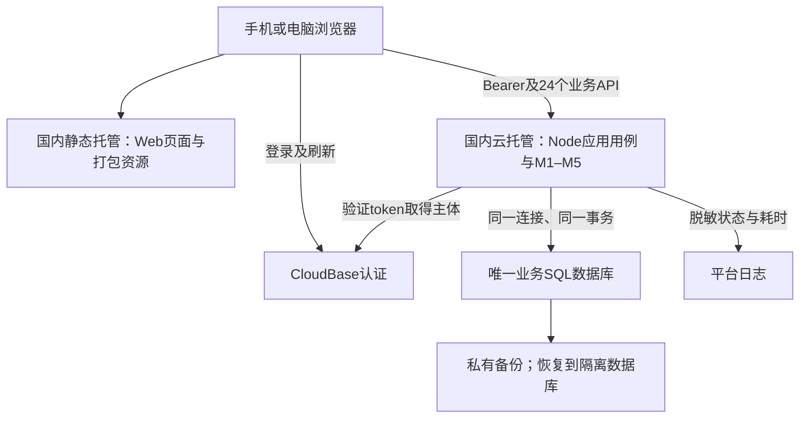

# 星账｜实施计划与验证

本文件只保留当前状态、实施顺序和当前验证结果，不堆叠版本日志。[业务规则](BUSINESS_RULES_DISCUSSION.md)决定行为，[模块边界](ENGINEERING_MODULE_BOUNDARIES.md)决定责任，[模型](LOGICAL_DATA_MODEL.md)和[API](API_CONTRACT.md)表达同一契约。

## 1. 当前状态

已有六份核心设计文档及一个可运行的内存参考验证脚本；没有生产前后端、HTTP路由、数据库迁移或已部署应用。不能将文档或参考模型通过说成产品已实现。

M1–M5始终指业务模块。以下阶段用A–F编号，不与业务模块混用。当前文档范围已收敛；技术选型、持久化事务、真实鉴权与客户端仍需工程落实，不留下互相矛盾的业务备选稿。

## 2. 开发阶段

| 阶段 | 范围 | 验收出口 |
|---|---|---|
| A 工程选型与骨架 | 客户端、认证、数据库/事务、部署、开源许可；业务边界映射实际目录 | 移动/桌面共用契约；身份和事务可验证，不先建大量空目录 |
| B 最小闭环 | M1身份上下文、M2账户初始状态、M3普通收支、M5最小总览 | 初始5000、支出25.80、收入10，交易/余额/份额一致；按选定重试保护验证行为；失败不留半笔账 |
| C 交易生命周期 | M2分配/基准与起始状态；M3编辑删除、内部转账、独立退款；M5统计预算 | 当前份额非负、回补可计算、跨起始日安全、日期/抵减一致；无手动refund后门 |
| D 官方导入 | M4解析/证据/profile/映射、逐行结果、恢复/重导、必要匹配与核对，调用M3 | 真实文件逐行结果守恒；补映射可继续；删除保留来源后新操作可恢复；不支持行不造账 |
| E 双人首发能力 | M1绑定凭据闭环、对象账户/账单只读、四类资金同屏 | 前后端均拒绝写对象数据；个人预算独立，来源原文不随只读账单开放 |
| F 产品验收 | 手机核心体验、桌面一致性、权限/事务/并发/同步/部署 | 登录→账户→记账→查询→导入→处理结果真实可运行；只标实际通过部分 |

M1权限从阶段A/B贯穿；E不是后期补丁。技术选型前不把具体供应商写成既定事实。截图、负债、费用转账与解绑不纳入本次首发实现。

每个实现任务只指定一个主责模块、依赖接口、允许修改范围、输入样例和验收结果；跨模块原子事务由应用用例协调，不另造保存入口。资金规则与AccountFundMovement仅归M2，M3复用资金规则；M4的来源实体不进入M3，M5不进入写入成功条件。初始状态修正与交易删除由用例协调，模块不互相回调或直写。

现有Ledger仍是行为参考模型，不是生产模块实现。本轮明确设计归属与提交依赖，不为文档边界把参考脚本拆成框架或新增服务；生产落地按模块边界验收。

## 3. 当前流程验证

2026-10-24运行现有[参考脚本](../experiments/verify_import_recognition.py)，使用两份用户官方XLSX、固定北京时间时钟和虚构本人Account映射。原文件只读，不上传仓库，不写真实账户。

**104项参考规则/流程检查通过。** 它们检验的是文档行为、请求/响应示例和内存参考实现，不是生产实现、鉴权安全或数据库事务验收。版本/重试保护检验的是选定契约的参考语义，并未在生产实现。参考模型未保存手动分配的完整时间日志，因此含这类调整的起始重建会安全拒绝；生产实现需从有效movements重建，不能照搬该限制冒充全部支持。

部分规范（真实token、资源版本并发、持久化、分页、核对项持久生命周期、来源观察人工选择、客户端操作）仍须阶段A–F实现后运行验证。

### 3.1 经典动作

| 动作 | 验证输入/断言 |
|---|---|
| 支出跨三份额 | 流动100、本人存款100、对象存款100，支出250→剩对象存款50 |
| 独立退款回补 | 再退款120→补对象50、本人70，不需要原消费ID |
| 手动分配调整 | 同步改变基准与当前份额，回补上限可计算，不维护另一目标余额 |
| 支出金额减少 | 仅处理差额，先补当前缺口，再加流动资金 |
| 编辑退款抵减 | 账户/份额不变，净花销变化 |
| 改退款日期 | 不跨起始日保留份额计划；跨起始日切换历史/有效影响 |
| 类型变更 | 支出→内部转账→收入，保留交易ID；禁止普通类型改refund、refund改普通收入 |
| 起始状态修正 | 本账户重建历史/有效影响，其他账户不变；不安全重建整体拒绝 |
| 安全/不安全删除 | 删除仅撤销自身；资金已被使用时整笔拒绝并恢复快照 |
| 并发与非法输入 | 旧version、0/负金额、布尔金额、字符串false、未来日期、源时间写入均拒绝 |
| 本人与对象 | 虚构他人Account/profile无法进入写命令；真实身份验证仍未实现 |
| 转账 | 两端等额、不同账户、仅流动，起始日两端独立；平台转出可明确为支出 |
| 补映射恢复 | 同一官方退款先needs_review，补映射后使用原来源创建 |
| 退款来源关联 | 来源只连同一refund，禁止连原expense；同事件候选只提示，确认新事件才创建 |
| 删除后重导 | SourceRecord保留、transaction为空，新键导入恢复，不被来源存在或文件相同阻止 |
| 重试与用户编辑 | 同键不重复执行；新键重导保留用户日期/抵减；同键不同内容拒绝 |
| 状态观察 | 旧导出不覆盖较新事实，同时间冲突待处理；关闭来源后来有效可首次创建 |
| 原子写入 | 模拟来源关联失败，交易和余额回滚，来源观察可保留 |
| 统计算术 | 月花销3200/第20天→日均160、预测4960；预算3000→超支200；不提前舍入日均 |
| 负净花销 | 净额可负，预算剩余可大于预算；跨月抵减与零分母有确定输出 |
| 缺失核对资格 | 银行卡仅Account不够；明确profile且范围支持才可核对；已有来源/导出后时段不误判 |

请求边界检查覆盖：创建请求必填/条件字段与错误结构、整数金额/未知字段/缺时区拒绝、退款空改动不增版本、旧版本不能绕过空改动校验、PATCH省略/false/null区分、来源时间只读。并未验证实际HTTP头、真实超时或数据库提交；这些依赖工程实现。

### 3.2 真实字段信息流

读取338行、保留微信11列/支付宝12列原始字段；时间全部补+08:00。亲情卡/花呗相关123行不支持；另2条非零费用提现不支持，不与普通优惠支付混淆。

| 平台 | 参考模型创建 | 已关联 | 重复 | 不支持 | 不生效 | 待处理 | 失败 | 合计 |
|---|---:|---:|---:|---:|---:|---:|---:|---:|
| 微信 | 118 | 0 | 0 | 2 | 0 | 49 | 0 | 169 |
| 支付宝 | 44 | 0 | 0 | 123 | 1 | 1 | 0 | 169 |
| 总计 | 162 | 0 | 0 | 125 | 1 | 50 | 0 | 338 |

创建仅指虚构Account和内存参考模型的动作。待处理50条中46条是微信转账角色未定，4条为同日同类型/账户/金额的同事件候选（微信3、支付宝1），没有强行合并或冒充“识别率100%”。13条退款均可形成合法refund_inflow命令；本批次存在不支持/待处理，故不自动生成缺失手动交易核对项。

已验证依赖：源单号→profile命名空间→渠道键→Account→类型/语义→M3命令→effects/资金计划→M5统计；尚未绑定真实账户，不从文件猜资金归属。四条无费充值提现可形成内部转账候选；带费两条停止在unsupported。

## 4. 工程实现后必须补的验证

- 用真实认证上下文验证对象只读、batch/source/profile/mapping/account/transaction的归属与相互关联，不能只相信参考模型的虚构owner。
- 对来源唯一约束、并发请求、幂等键生命周期、事务回滚、同文件解析复用和删除重导进行真实数据库验证。
- 对全部HTTP请求/响应、严格字段类型、分页、资源版本、profile选择和resolution刷新结果跑实际接口测试。
- 验证完整/不完整文件、覆盖范围与核对项保留/删除/后续匹配生命周期；原始信息不在只读对象接口泄露。
- 在手机与桌面走同一条用户路径，不因单元/参考验证通过就跳过可用性验收。

参考命令（输入路径由使用者提供，报告存仓库外；契约开发校验另需PyYAML、jsonschema、openapi-spec-validator，不是应用运行依赖）：

```bash
python3 experiments/verify_import_recognition.py --wechat /private/wechat.xlsx --alipay /private/alipay.xlsx --report /private/validation.md --validate-openapi
```

文档、参考模型与实际产品是三层证据。后续仅将本节替换为新的真实状态，不新增重复审查报告或版本流水。


## 5. 完整契约与能力结论

当前24个操作已全部形成行为描述、严格OpenAPI和按M1–M5划分的Mermaid调用图；不再保留两个接口试点或待选D1–D3分支。新增的唯一业务入口是生成绑定凭据，补上原有绑定流程的缺口。登录/刷新/退出属于待选认证SDK；没有伪造本仓库已有的认证API。

选定单库原生事务/并发控制、必要POST幂等键及资源版本比较。它们分别处理半笔账、结果未知的重复提交、旧页面覆盖，不是用额外服务掩盖资金模型问题。新增复杂度限同库请求记录及清理、资源条件更新；不引入Redis、MQ、分布式锁、队列、工作流平台或能力开关。触发概率尚无生产数据。

## 6. 全量契约验证与实现边界

已完成参考规则/流程、OpenAPI结构及真实字段可表达性的摸底。脚本将重复结构样本与人工拼装投影累计为检查次数，不能据此评估业务完成度；接口名出现在图中也不证明调用流程正确。参考脚本仍含待收敛的手写请求校验，不能作为生产契约执行器。本轮技术选型不扩充这套校验，后续验证以真实HTTP、数据库保存与失败状态为证据。

OpenAPI 3.1标准校验、请求/响应示例的JSON Schema校验、非法字段/组合反例、24项接口与流程覆盖、六份核心文档链接及真实338行信息流均由现有参考脚本和契约校验验证。详见脚本输出；不把结构验证当成HTTP集成测试。

验收重点：4079分银行卡支出不重复减红包；44/26分退款独立入账和抵减；微信零钱状态推断需真实映射；补映射后resume继续；退款编辑不关联原消费；空改动不增版本；安全撤销和跨起始日变更不破坏资金。原始文件与个人明细不提交仓库。

后续工程必须按这份完整契约落地所有24个操作，使用真实数据库、鉴权和客户端验证事务故障、同时支出、并发版本、幂等过期与重放、分页快照、绑定凭据消费、导入恢复及对象只读。当前仓库只有参考程序，没有路由/数据库可供端到端验收。


## 7. 技术选型依据与候选结论

### 7.1 冻结范围与证据边界

2026-10-24以提交`524f2da6ad119a3a5d0df813191a05ba872a7cff`为业务/契约冻结基线：M1–M5、资金规则、独立退款、来源身份及24个公开API不因选型而调整。技术发现不能满足契约时，先说明阻塞，不能暗改上传上限、改成异步导入或让前端绕过API。当前只完成选型研究；下列最小验证尚未执行，没有购买、升级、部署或修改云资源。

新增用户约束：首版响应式Web、国内网络可使用、同一用户多端共用云端账本，安卓后续再议；已购腾讯云开发个人版可优先复用。未给出具体月度预算上限，不将19.9元套餐价当作项目总成本上限。不使用GitHub保存账务数据。

| 已定条件 | 技术必须满足什么 | 现有依据 |
|---|---|---|
| M2唯一资金规则、M3交易生命周期、M4证据 | 一个后端模块化单体；跨模块共用一次数据库事务，不分成微服务 | 模块边界§1–2、模型§4 |
| 一笔账全成/全败，份额非负 | 原生跨表事务、账户级数据库并发控制；不能只在前端检查 | 业务规则§3–4 |
| 来源去重、预算/映射唯一 | 数据库唯一约束；旧页面条件更新；POST幂等记录与账务同库 | API§1、模型§1/8 |
| 24个API与严格金额/时间 | 保留HTTP方法、错误结构、If-Match及幂等语义；只维护一套结构定义 | API与openapi.yaml |
| 官方XLSX同步导入，10MiB/10000行 | 整条上传链路接受文件及multipart开销；限时内完成；原始证据仅本人访问 | API uploadImport、模块边界§3–7 |
| 对象只读、私人账本 | 后端验证认证身份与资源归属，不能凭浏览器user_id或仅靠页面隐藏 | 业务规则§2 |
| 国内Web、多端同步 | 页面、脚本、字体、认证与API均无运行时海外必需依赖；云库为唯一正式数据源 | 本轮用户约束 |
| 维护能力有限 | 少量服务、可迁移数据、可恢复备份；不增加Redis、MQ、分布式锁 | 现有技术边界 |

多端同步指设备登录同一身份，通过同一API读取最新云端数据；保存后刷新、切回页面时刷新即可。首版不增加离线账本合并、WebSocket订阅或另一个同步服务。两端同时修改仍按冻结的资源版本行为处理。

### 7.2 查到的CloudBase能力及不能直接推断的事项

以下均为2026-10-24公开官方资料；不是用户账号实际配置的读数。当前会话没有可读取腾讯云账号的连接工具。

| 项目 | 官方资料与本项目判断 |
|---|---|
| 个人版价格 | 资源点FAQ列19.9元/月、40000点，超额1000点=1元；这是相应计费模式的公开价格，用户实际订购模式、续费价和包含项待控制台核对。[S1] |
| PostgreSQL | 平台提供关系型PG，但官方MCP资料进一步区分SHARED仅SDK/网关与DEDICATED私网TCP直连。通用连接指南并不证明每个共享实例都有host/port。必须确认实际实例和可用访问路径。[S2][S3] |
| MySQL | 官方FAQ说明部分HTTP/SDK事务限制需使用原生MySQL连接解决。已有传统环境可能可用，新PG环境不能假定同时有MySQL；核对实际RuntimeBackends及连接资格。[S2][S4] |
| 上传及耗时 | 云函数错误文档列其他类型请求体6MB；云托管限制页列请求包体20M、超时60s。故云函数默认路径不能承接10MiB契约；云托管是更合理候选，但仍须验证网关、multipart开销与同步10000行。[S5][S6] |
| 云托管费用 | 资源点资料与云托管限制页的套餐/按量表述不能简单合并：限制页明确CPU/MEM不含套餐、需开启超限按量。以所购环境的计费能力项为准，估算必须单列，不宣称个人版已全包。[S1][S6] |
| 身份 | 官方认证提供密码等登录方式；后端可携带用户token调用认证的当前用户接口验证并取得sub。具体账号开通/找回通道、环境模式和SDK需配套验证；不自建密码库，不拿API Key替代用户身份。[S7] |
| 国内正式入口 | 静态托管可承载SPA；正式域名/HTTPS及备案条件独立于框架选型。默认测试域名不作为长期入口承诺；需核对地域、域名资质和备案资源资格。[S8] |

### 7.3 比较三个合理组合

三组统一采用响应式React + TypeScript + Vite、Node.js后端、CloudBase认证，避免同时更换语言/前端/数据库导致比较失焦；Vue同样可满足页面需求，当前没有业务证据证明必须选React。真正影响资金安全、费用和维护的是数据库访问方式及部署。

| 组合 | 部署和数据库 | 资金一致性实现 | 开发/维护与成本风险 | 判断 |
|---|---|---|---|---|
| A：原生连接PG | CloudBase静态托管 + 云托管Node/Express + 可TCP直连的托管PostgreSQL + CloudBase认证 | 用pg同一连接BEGIN/COMMIT；原生唯一约束、行锁、条件更新；M1–M5同库 | 应用逻辑集中在TS；数据库仍需迁移/备份管理。若要CloudBase独享PG或另购托管PG，产生额外固定/运行费用，个人版未证明覆盖 | 架构首选；必须先核对直连资格、网络和月度报价，不能直接批准升级 |
| B：已有MySQL复用 | 同一Web/Node/云托管/认证 + 用户已有或明确可开通的MySQL InnoDB原生连接 | mysql2同一连接事务、唯一约束、行锁/条件更新；逻辑模型可表达 | 不维护PG/MySQL双适配；仅最终选一套。可降低重新购库成本，但需确认实际版本、SQL约束、内网接入及计费；不是把HTTP SDK当事务连接 | 若现有环境确实已有合格MySQL且A新增费用明显，这是务实备选，并非业务降级 |
| C：共享PG网关/RPC | 同一Web/Node/云托管/认证 + CloudBase共享PG，经受控SQL函数/RPC完成一次原子写入 | 不能分多次HTTP请求拼事务；单次数据库函数内完成版本检查、唯一约束及全部保存 | 有机会复用共享资源；额外维护SQL函数、权限和本地RPC一致性。若依赖把资金算法再写一份SQL，违背M2唯一规则；资格/部署及故障回滚尚待证明 | 仅作为预算受限时的验证候选，当前不选为默认；不为省套餐费隐藏开发成本 |

**建议：采用A的逻辑栈，暂不锁死收费数据库产品；先只读确认既有环境。已有合格MySQL时优先比较B的实际总价，而不是为PG名字强行升级。若只有共享PG且预算无法接受直连实例，再单独验证C的一次原子提交是否可行。** A/B/C均未通过云端实测，不把推荐写成已落地。NoSQL不是没有事务，但当前关系约束、联表核对与跨模块提交没有使用它的优势；SQLite/PGlite不作为本地替代云库，否则容易让本地事务表现与云端不同。

### 7.4 推荐组件各自为何存在

| 组件 | 选择理由 | 代价及限制 |
|---|---|---|
| React + TypeScript | 账户/账单/导入结果有重复交互与条件状态，组件复用有价值；前后端共用语言便于维护 | TS不能验证网络输入；React不自动带来安卓原生应用，也不保证比Vue更优 |
| Vite构建SPA | 登录后的工具型页面目前没有SEO/SSR需求，静态产物可放国内托管，后端只承担API | 路由、请求状态和错误提示要明确实现；不用“无需SSR”推断全栈框架都必须运行服务器。[S9] |
| Node.js 24 LTS + Express 5 | HTTP路由/中间件与模块边界清楚，一套TS实现账务和导入；云托管容器可固定运行时 | 自己负责异步错误、上传限额、权限和事务，不靠框架自动保证正确。依赖锁定具体版本，不追随latest自动升级。[S10] |
| pg，或最终选择MySQL后的mysql2 | 原生连接让应用用例明确掌握同一连接/事务；先用参数化SQL和顺序迁移，不引入ORM自动同步表结构 | SQL与迁移要人工审查；不做两套数据库兼容层。pg事务不能把各SQL分派给pool.query随机连接。[S11] |
| Ajv 2020结构校验 | 对应OpenAPI 3.1的JSON Schema能力，HTTP边界复用契约组件，避免另一套手写字段白名单 | 结构校验不能判断本人权限、资金是否足够。关闭隐式类型转换/删除未知字段；禁止金额字符串和布尔自动变成整数。响应校验优先放接口测试，不每层重复检查。[S12] |
| CloudBase认证 | 复用托管登录/令牌能力，不自行处理密码哈希、找回和令牌签发 | 认证只回答是谁；M1仍负责账本和对象权限。验证失败401，认证服务不可用不能伪装成“密码错”或信任客户端sub |
| CloudBase静态托管/云托管 | 国内承载页面与标准HTTP服务；同一个Node程序在本地与容器运行，减少云函数专有入口 | 网络、网关、冷启动、60秒和额外计算费需验证。先一个服务，不按M1–M5拆五个容器 |

XLSX库在实现M4前用当前两份文件确认完整单号、日期、金额和原始列保留，暂不为“已有Python脚本”增加一个常驻Python服务。脚本是字段参考，不是要逐行翻译的生产账务实现。首版不选AI识别供应商、不采购OCR或消息队列。

### 7.5 组件关系与唯一数据源



图中的业务数据库不等于认证服务内部存储：只把认证sub映射到内部User ID，不跨认证服务与账务数据库做“共同事务”。认证提供商的自动REST数据库入口不得绕过业务API：业务表不授予浏览器写权限，也不默认开放直接读取。云端应用账号限业务schema权限，迁移另用受控账号。以后安卓仍调用同一身份和业务API，不同步本地数据库文件。

### 7.6 数据库怎样承担资金安全

以下是选型必须通过的技术证据，不新增业务规则，也不提前提交全套表DDL。

| 要求 | 原生SQL连接方案及失败判定 |
|---|---|
| 交易/资金/来源一起成功 | 应用用例取得一个连接，事务内交给各模块保存；故障全部ROLLBACK。不是三个模块各自commit |
| 同时支出不超扣 | 事务内锁定已有Account控制行，再计算有效movements与M2资金计划；转账按Account ID固定顺序锁两端，所有资金写入口遵守同一协议。不靠进程内锁，不新存第二份可写余额 |
| 正确金额与守恒 | 整数分，SQL整数/精确数值类型；驱动大整数转换显式处理，不盲转Number或使用小数累加。跨记录份额非负/合计守恒由锁内规则保证，不能宣称一个CHECK即可约束跨表SUM |
| 来源唯一 | unique(profile,完整官方单号)；发生并发唯一冲突时整笔回滚，再按已有来源结果处理；尾号/商户单号不替代主键 |
| 旧页面防覆盖 | 资源version条件更新及受影响行数检查，按契约映射412/409；不能只在读取后比较一次 |
| 请求结果未知重试 | 同库唯一幂等作用域，账务与完成结果一起提交；进行中/同键不同体按契约处理；不以长事务覆盖整个文件解析过程 |
| 导入部分成功 | 文件解释在账务事务外；每个可执行行独立事务。10000行不是一个持锁超长事务，也不是绕过M3批量直写 |

PostgreSQL具备相应原生能力，但只有程序使用正确的连接、锁与写入顺序，才保证这些行为；数据库品牌本身不保证业务正确。[S11][S13]

### 7.7 本地、测试、生产差异

| 方面 | 本地开发 | 隔离云测试 | 未来正式部署 |
|---|---|---|---|
| 数据库 | Docker/本机安装最终选定数据库，主版本与云端一致；不用SQLite替身 | 同种实例/访问路径，脱敏或合成数据 | 私有正式账本；所有模块同库 |
| 后端 | 同一Node应用；构建后运行方式与容器一致 | 同一镜像及迁移，实测网络/认证/网关 | 发布已验证镜像，保留上一稳定版本 |
| 前端 | Vite开发代理；localhost是独立允许来源 | HTTPS测试域名、安全域名白名单 | 国内HTTPS域名、备案与证书；静态资源全部本地打包 |
| 认证 | 连测试认证环境；本地假身份仅可辅助单元检查 | 两个真实测试身份，过期/错误token与跨用户访问 | 正式认证配置；不带本地绕过开关 |
| 存储/密钥 | 本地环境文件不入Git；无需保存原账单副本 | 隔离DB、认证及日志，测试后清理数据 | 原始证据私有；上传临时文件处理后清理，不放静态目录 |
| 限制 | 本机速度不代表云端，不会遇到相同冷启动 | 实测20M/60秒整链路、连接上限和收费 | 监测耗时、错误与费用；不靠本地通过推断云端通过 |

不为省一个测试环境而让测试写真实账本。额外云测试环境可能单独订阅/计费；无法在已有套餐内隔离时，先本地验证，临时云测试成本列入报价，不默认免费。容器磁盘不是持久数据库。临时测试环境停掉计算后，数据库/存储也可能继续收费。

### 7.8 成本、备份与维护

公开能确认的价格只有相应个人版基价；没有用户控制台计费模式、直连数据库报价和真实用量，不能给出“全套每月19.9元”的结论。

月总额按不重复计费的两篮子估算：**套餐订阅 + 纳入资源点项目的超额费 + 套餐外按量/单独实例费 + 域名等年费摊销**。资源点模式下，适用项目超额费= max(适用项目总点数−套餐额度−可用资源包,0)/1000元。按量资源是否纳入点数须看账号能力项，不能同时计入两边。

| 成本项 | A 原生PG | B 原生MySQL | C 共享PG |
|---|---|---|---|
| 已购个人版 | 若继续复用，已有有效期内无需重复订阅；续费按实际订单 | 同A | 同A |
| 业务数据库 | 若需独享升级/另购PG，新增报价是主要决策项 | 已有库时看增量用量；未有库时同样需开通报价 | 按共享计算/存储及网关用量；不是永久免费 |
| Node计算 | 云托管CPU/内存、冷启动/保活、网络费用独立核对 | 同A | 同A |
| 其他 | 静态流量、认证实际通道、私有备份、日志保留、可能的公网出口/NAT、额外测试环境及域名 | 同A | 另计SQL函数维护和排障时间 |

工作量按任务描述，不编造报价：A需要一次容器/数据库内网与迁移配置；B另需确认InnoDB版本、精确数值/时间及原生连接；C额外设计与调试原子RPC、SQL函数权限和等价本地调用，维护难度最高。前端登录表单、24个API和M1–M5实现是三组共同工作，不能算作某方案“零开发”。

节省用量的初始策略：无业务时允许缩容到0（接受并测冷启动），不默认开最小常驻实例；小连接池按实例数×池大小核对上限；不持续轮询数据库做健康检查；日志记录request_id、操作、结果码和耗时，不记录token、完整银行单号或raw_fields。若实际体验要求常驻，再用账单判断是否值得付费。

备份：先验证所选PG/MySQL实例的备份频率、保留期、恢复目标和权限；不能把NoSQL“每天自动备份7天”承诺套在PG上。[S14] 推荐目标为每天一次加密逻辑备份保留7份、每周一份保留4份，存私有备份位置，数据库之外保留一份受控副本；这是待实施策略，非已开通能力。A/B可用pg_dump/pg_restore或mysqldump/恢复工具，C需先证明共享实例有可用、完整的导出/恢复路径。[S15]

拟定首发恢复目标：RPO≤24小时、RTO≤4小时，仅作小规模自用目标，须恢复演练后才能承诺。认证账号与业务数据分开备份，保存认证主体映射；不要把平台auth/storage系统schema未经支持地整体覆盖。代码Git提交不是账务备份；镜像回滚也不自动撤销数据库迁移，破坏性DDL前先备份。

### 7.9 可实际执行的最小验证

不先开发24个API，也不重复增加上千个结构检查。按下面顺序执行，前一关失败就停在该处说明原因；本节是方案，尚未运行。

| 关卡 | 最小动作与证据 | 通过/否决标准 |
|---|---|---|
| P0 资源与报价，只读 | 查看现有EnvId/地域、套餐计费模式、RuntimeBackends、PG TenantType、MySQL版本、直连地址资格、备份设置、云托管计费及可用网关；记录脱敏结果和A/B增量月价 | 有可用单库事务路径且报价可接受才进入原生连接方案；共享PG无TCP时不能用本地pg成功冒充通过。不升级、不创建付费资源 |
| P1 本地最小真实写入 | 用最终数据库与Node建最小账户/交易/effect/movement/来源/幂等测试表，使用未来M2/M3实际函数；POST一笔25.80元支出、GET余额；在保存来源关联前注入异常 | 初始5000元→4974.20；故障时交易/资金/当前来源关联全无变化。金额校验在HTTP，资金规则在M2，原子性观察在DB |
| P2 并发与重试 | 两个独立连接同时从100元扣80元；同来源双提交；同键重试；旧If-Match编辑 | 并发只能一笔扣款、剩20；同来源不重复；同键返回原结果；旧版本412且无写入。真实SQL和结果作证据，不数断言数量 |
| P3 云端最小纵向流程 | 临时隔离环境部署一个Node服务和一个登录/账户/记账页面；手机/电脑同账号写后刷新，第二身份尝试读写；错误/过期token测试 | 新数据两端一致；未授权按401/403/404边界处理；浏览器不能直接写业务库；国内网络下静态资源/认证/API全部可达 |
| P4 上传边界与预算 | 对实际338行执行解析+逐行真实DB写入（与正式M4同路径）；另用无隐私合成数据验证10000行、接近10MiB文件及超限拒绝；记录冷/热耗时、峰值内存与账单用量 | 通过真实网关、multipart与60秒限制，留有明显余量；上限内合法文件不能在网关提前拒绝。若不满足，选型尚不合格，不暗改冻结契约或加队列 |
| P5 备份恢复 | 备份最小账本，恢复到独立库，核对交易/资金/来源身份/版本及用户映射；查看实际费用明细 | 恢复后行为一致，能列出完整月费公式与实测用量；无法恢复或成本未明不能声称满足六项标准 |

P1–P5只在需要创建/升级收费资源、产生新的持续费用前提交具体资源与报价供选择；当前研究不执行这些操作。若P0核对后仍缺账号材料，只需要脱敏环境详情与费用项，不需要用户提供密码/密钥或重新上传账单。

### 7.10 按用户六项标准自检

| 标准 | 本轮结果 |
|---|---|
| 每项技术有明确理由 | 已说明组件用途、代价与不选择项；React是建议，不伪装成业务必选 |
| 数据库支持资金/事务/唯一/并发 | 原生SQL方案有明确实现路径；实际实例资格与P1/P2未验证，不能判定已通过 |
| 前后端、数据库、认证关系清楚 | 已画明：浏览器→业务API→业务SQL，认证独立验证，禁止客户端绕写 |
| 本地/测试/部署差异 | 已列数据库版本、认证、隔离、网络、限额、存储及收费差异 |
| 成本/难度/备份维护 | 已列总额组成和策略；实际套餐及数据库新增报价待P0，恢复待P5 |
| 最小验证可执行 | 已给P0–P5的输入、观察位置、通过条件；未把计划当执行结果 |

当前应推进P0核对，然后在A/B中做最终选择；只有前端/语言建议可以先稳定，数据库实例、套餐升级与部署收费不能凭公开宣传提前冻结。

### 官方依据

- [S1 资源点计费FAQ](https://docs.cloudbase.net/quick-start/resource-point)
- [S2 实际后端与PG实例形态](https://docs.cloudbase.net/ai/cloudbase-ai-toolkit/mcp-tools)
- [S3 PostgreSQL连接方式](https://docs.cloudbase.net/database/postgresql/connecting-to-postgresql)
- [S4 MySQL事务访问限制](https://docs.cloudbase.net/database/configuration/db/tdsql/faq)
- [S5 云函数请求体限制](https://docs.cloudbase.net/error-code/EXCEED_MAX_PAYLOAD_SIZE)
- [S6 云托管大小、超时与计费限制](https://docs.cloudbase.net/run/limitation)
- [S7 PG模式认证与当前用户验证](https://docs.cloudbase.net/api-reference/webv3-pg/authentication)；[认证当前用户接口](https://docs.cloudbase.net/http-api/auth/user-me)
- [S8 国内静态托管与域名](https://docs.cloudbase.net/recipes/add-hosting-vue)；[CloudBase备案能力更新](https://docs.cloudbase.net/changelog/)
- [S9 React官方构建SPA说明及权衡](https://react.dev/learn/build-a-react-app-from-scratch)
- [S10 Node版本状态](https://nodejs.org/en/about/previous-releases)；[Express 5要求](https://expressjs.com/en/starter/faq/)
- [S11 node-postgres事务必须使用同一连接](https://node-postgres.com/features/transactions)
- [S12 Ajv JSON Schema支持](https://ajv.js.org/json-schema.html)；[类型转换行为](https://ajv.js.org/coercion.html)
- [S13 PostgreSQL锁](https://www.postgresql.org/docs/17/explicit-locking.html)；[约束边界](https://www.postgresql.org/docs/16/ddl-constraints.html)
- [S14 不同数据库的备份边界](https://docs.cloudbase.net/database/backup)
- [S15 PostgreSQL导出工具](https://www.postgresql.org/docs/current/app-pgdump.html)；[CloudBase PG实例与用量](https://docs.cloudbase.net/database/postgresql/database-management)
