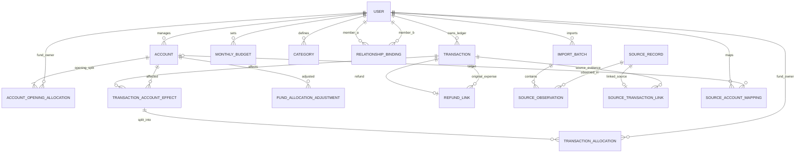
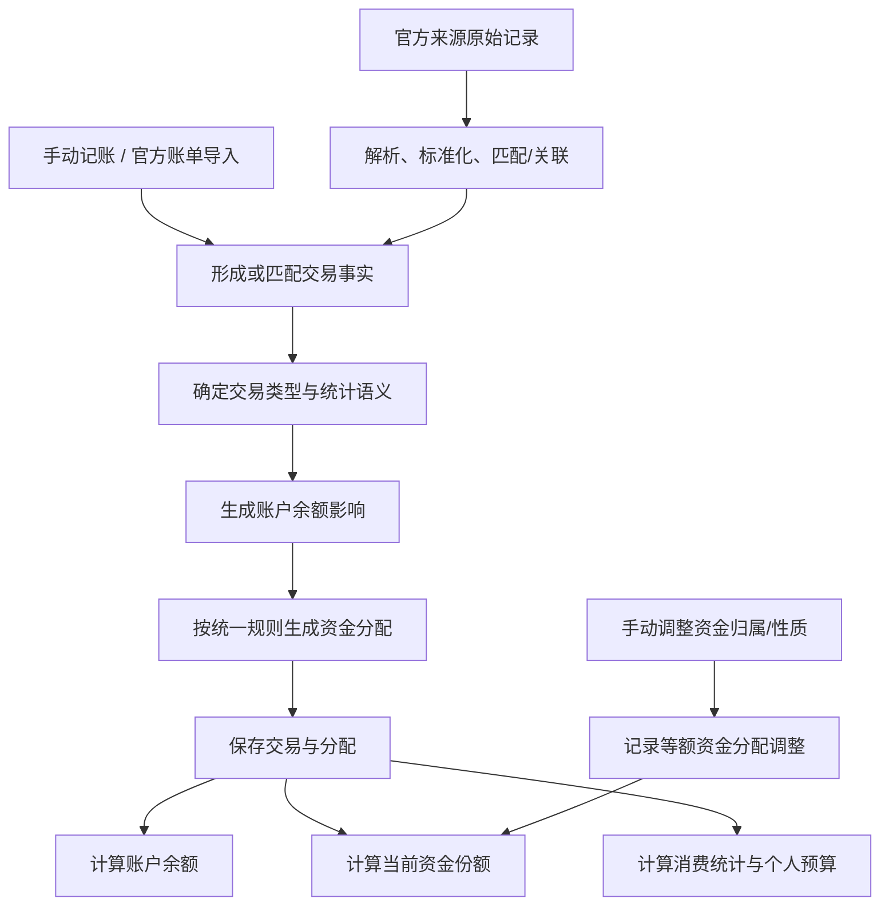

# 星账｜逻辑数据模型

**版本：** v0.1  
**阶段：** 逻辑模型设计稿  
**状态：** 候选模型，待审阅  
**业务基线：** [核心业务规则 v2.5（已冻结）](BUSINESS_RULES_DISCUSSION.md)  
**范围：** 定义业务实体、关系、数据归属与关键不变量；不定义物理数据库 DDL、API 契约或技术栈。

## 1. 设计原则

1. 交易事实、账户余额影响、资金分配和官方来源证据分开表达，但通过明确关系连接。
2. 账户余额与资金份额是可推导结果，不是多套可独立编辑的真相。
3. 账户持有人、实际保管人、资金归属人和资金性质是不同概念；保管人身份不自动授予编辑权限。
4. 交易所属个人账本决定谁管理该交易、该笔消费进入谁的个人统计；资金分配单独记录实际扣用了谁的哪类资金。
5. 官方来源是交易证据，不是第二笔交易。重复导入不能重复入账；删除交易后来源证据保留，但不得永久阻止重新导入。
6. 第一版不建立花呗/信用卡负债账户，不做截图识别专属模型，不设计解绑和余额不足流程。
7. 金额使用最小货币单位的整数（人民币以分为单位），避免浮点误差；第一版不处理多币种换算。

## 2. 核心实体关系图

此图表达逻辑关系，不代表最终表名或数据库实现。

## 3. 实体职责

| 实体 | 核心字段/概念 | 职责 |
|---|---|---|
| User | 用户 ID、认证主体、显示名称 | 身份与个人数据归属 |
| RelationshipBinding | 两个用户、绑定时间、状态 | 决定绑定后是否可只读查看对方数据 |
| Account | 账户持有人、可选实际保管人、名称、类型、初始余额、记账起始日期 | 表示银行卡、微信零钱、支付宝余额、现金等实际账户 |
| AccountOpeningAllocation | 账户、资金归属人、资金性质、金额 | 拆分账户初始余额 |
| Transaction | 个人账本归属、类型、时间、金额、商户/说明、分类、统计语义/支付来源 | 记录交易事实 |
| TransactionAccountEffect | 交易、账户、流入/流出、金额 | 记录交易对实际账户余额的影响 |
| TransactionAllocation | 账户影响、资金归属人、资金性质、金额 | 记录该次交易如何使用/返还资金份额 |
| FundAllocationAdjustment | 账户、调整前/后资金份额、金额、操作人、时间 | 记录手动调整归属或性质；不改变账户总额 |
| RefundLink | 退款交易、原消费交易 | 关联退款与原消费，支持多次部分退款 |
| MonthlyBudget | 用户、月份、预算金额 | 保存个人预算，不与对象共用 |
| Category | 所属用户、分类名称 | 账单分类与筛选 |
| ImportBatch | 发起用户、来源平台、文件指纹、导入范围、时间 | 记录一次官方账单导入 |
| SourceAccountMapping | 来源平台/账户标识、模式、目标账户（可空） | 记住来源渠道与实际账户的对应关系 |
| SourceRecord | 来源平台、来源账户、稳定外部 ID（如有）、标准化字段、来源状态 | 表示逻辑上的官方来源记录，可关联一笔星账交易 |
| SourceObservation | 导入批次、来源记录、行号、原始字段 | 保留每次导入的原始证据 |
| SourceTransactionLink | 来源记录、交易、匹配方式、匹配依据、关联时间 | 显式表达来源与交易的当前关联 |

一个交易可以关联多个来源证据；一个来源记录最多关联一笔交易。删除交易时解除关联并保留来源记录，后续导入可重新创建或关联交易。

## 4. 关键关系与规则

### 4.1 账户、持有人与资金份额

- 账户持有人决定账户属于哪个个人账本；实际保管人是描述信息，不因此获得编辑权限。
- 账户内资金份额由“资金归属人 + 资金性质”识别。
- 当前允许的份额组合：账户持有人的流动资金、账户持有人的存款、绑定对象的存款。
- 绑定前不能分配对象存款；不允许把对象的流动资金放在另一方持有的账户中。
- 初始资金分配金额之和必须等于初始余额。手动调整资金份额必须在同一账户内等额移动，不改变账户总额。
- 不提供账户删除操作。

### 4.2 交易事实、账户影响、资金分配

- 普通收入通常有一个账户流入影响，默认分配为当前账本用户的流动资金。
- 普通支出通常有一个账户流出影响，按冻结的扣款顺序生成资金分配。
- 内部转账有等额的转出、转入两项账户影响，只允许流动资金参与；转入侧保留转出侧的资金归属人和流动性质，不计收入或消费。
- 受管理账户的交易影响必须归属于该账户持有人所在的个人账本；内部转账两端必须是同一用户账本内的账户，不能借普通交易写操作绕过对方账本的只读权限。
- 真实退款有账户流入影响，并关联原消费；按原交易实际扣款顺序逆序恢复资金份额。
- 交易日期早于某账户的记账起始日期时，交易仍保留并参与相应历史消费统计，但不影响该账户起始日期之后的余额和资金分配。
- 修改交易金额或类型时，只重新处理该笔交易的账户影响和资金分配，不自动重算后续交易。
- 删除消费时一并删除关联退款；来源证据保留，但解除与已删除交易的关联。

### 4.3 信用消费与还款

第一版不建立负债账户，但必须区分交易统计和现金账户影响：

- 花呗/信用卡消费计入消费统计，但发生时不应错误扣减星账管理的现金账户。
- 对应还款减少实际付款账户余额，但不能再次计入消费。
- 因此交易事实与账户影响不是严格一对一：信用消费可以有消费统计影响而没有受管理现金账户影响；还款可以有现金流出影响而没有消费统计影响。
- 逻辑模型为交易保留内部的“特殊语义/支付来源”分类：信用消费属于消费统计，但没有现金账户流出；信用还款减少付款账户余额，但不计为消费。它不是负债账户，也不要求建立欠款余额表。
- 内部转账仍是两项等额账户影响；信用还款属于外部结算型现金流出，可只有一项受管理账户流出影响。这样既不把还款当作消费，也不伪造一个并不存在的受管理负债账户。
- 具体官方字段映射在导入实现阶段验证。

### 4.4 官方来源与去重

- 导入批次记录文件和处理范围；来源记录/观察保留原始证据；星账交易才进入账务。
- 有可靠稳定外部 ID 时，可按“平台 + 来源账户 + 外部 ID”识别同一来源。
- 没有可靠 ID 时，不得仅凭金额、日期、商户相同就静默认定为同一笔。
- 已关联的来源重复导入不创建第二笔交易；删除交易时解除当前关联，但不能永久阻止重新导入。
- 来源账户映射只用于减少重复选择，不直接产生账务。
- 来源状态保留在来源层；具体状态识别结合微信、支付宝真实文件验证。

## 5. 余额、份额与统计的计算边界

**账户当前余额 = 初始余额 + 记账起始日期当日及之后的账户流入影响 − 同期账户流出影响。**

**资金份额当前金额 = 初始分配 + 累计流入分配 − 累计流出分配 + 手动分配调整净额。**

关键约束：

1. 账户初始分配之和等于初始余额。
2. 当前资金份额之和等于账户当前余额。
3. 对影响余额的账户交易影响，其资金分配金额合计必须与该账户影响金额相等。
4. 手动分配调整不改变账户总额。
5. 退款必须关联原消费；累计退款不能重复恢复已退份额或超过原消费剩余可退金额。
6. 个人消费统计和预算按交易所属个人账本计算，不按资金归属份额决定；对象消费不占用当前用户预算。
7. 退款关联原消费后修正原消费月份；内部转账和信用还款不重复计为消费。
8. 绑定对象只能查看对方数据，后端必须拒绝对方账本的新增、编辑和删除。
9. 金额使用整数最小货币单位，不能用浮点数保存货币金额。
10. 内部转账必须有两项等额账户影响，资金归属人和资金性质保持一致；外部信用还款可以只有一项现金流出影响，但必须标记为非消费结算。

## 6. 关键数据流

手动记账和官方导入共用同一套交易与资金分配规则。来源解析不直接修改余额；首页统计不维护独立账务。

## 7. 模型边界与验证风险

| 项目 | 当前处理 | 验证时机 |
|---|---|---|
| 实际保管人与账户持有人不同 | 分开记录；保管人不因此获得写权限 | 账户编辑与权限设计时 |
| 信用消费与还款 | 用不同的交易统计语义与账户影响表达，不建立负债账户 | 微信/支付宝真实账单适配时 |
| 退款关联到记账起始日期前的原消费 | 数据关系可表达；如何分配退款到当前资金份额需等真实案例出现后判断 | 真实样例或测试出现时 |
| 无稳定外部交易 ID | 不使用弱指纹静默合并 | 导入适配器开发时 |
| 跨双方个人账本转账 | 不通过一次普通写操作直接修改对方账本；若确有需求，再设计显式关联关系 | 只有出现明确需求时 |
| 初始余额修正审计 | V1 保证初始余额和初始分配同步修正；不额外建设审计 UI | 有明确验收需求时 |

## 8. 本阶段不做的事

- 不写物理数据库 DDL、索引或 RLS SQL。
- 不定义 API 路由、请求/响应 Schema 和错误码。
- 不设计前端页面与视觉样式。
- 不实现 OCR、视觉模型或截图上传。
- 不自动重算所有历史交易的资金分配。

## 9. 下一步

1. 审阅本逻辑数据模型 v0.1，检查实体是否重复、关系是否缺失，以及关键不变量是否能表达已冻结业务规则。
2. 只针对具体实体或关系做最小修正，不重开已冻结的产品范围。
3. 模型确认后再定义 API 契约；契约确认后再拆工程模块与开发任务。

**说明：** 本文是逻辑模型设计稿，不是已实现的数据库，也不代表代码或产品功能已经通过运行测试。
