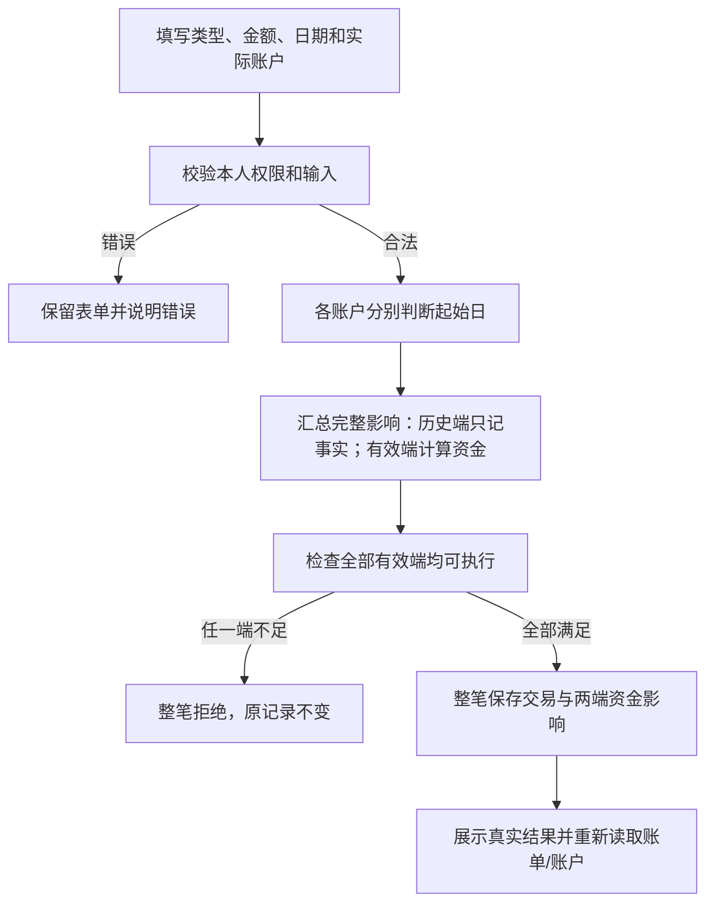
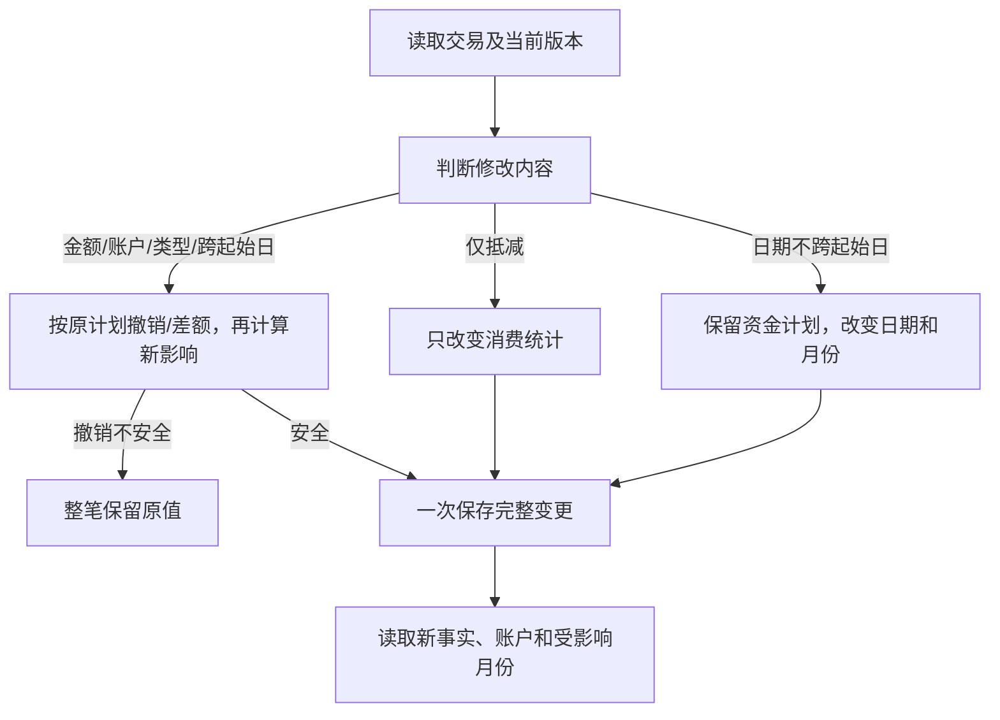
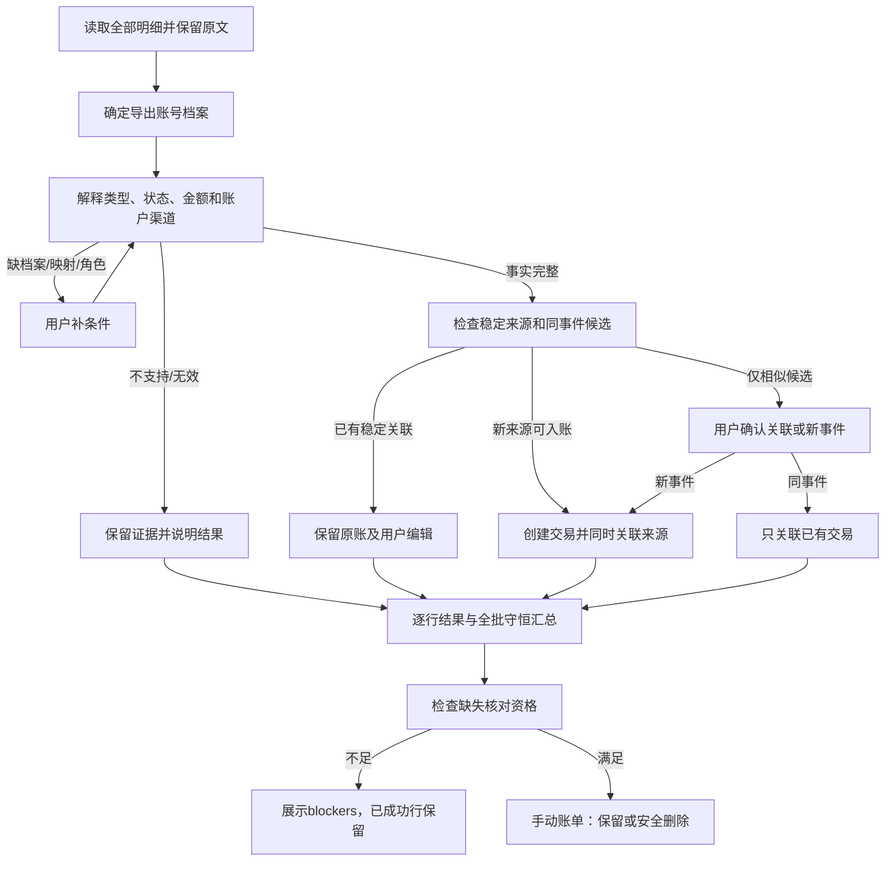
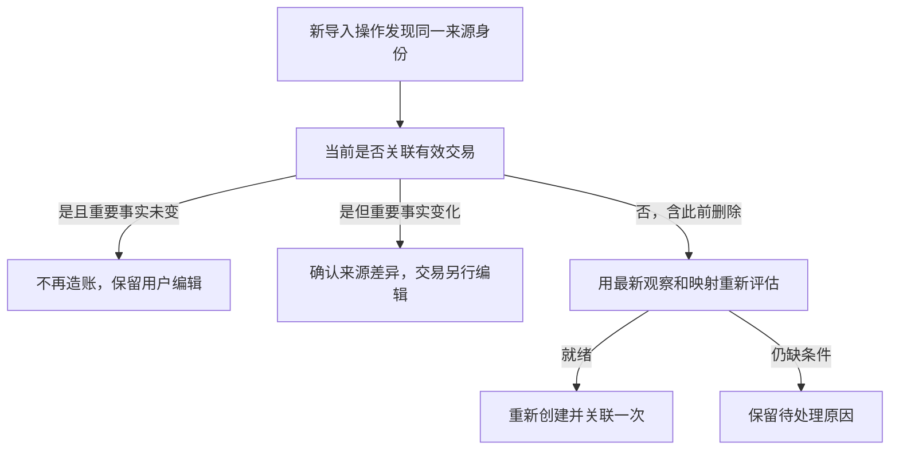
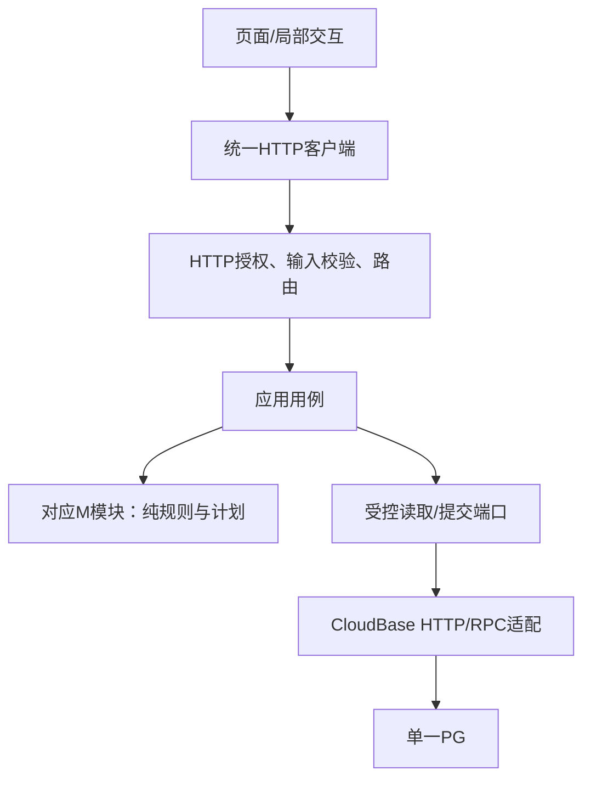
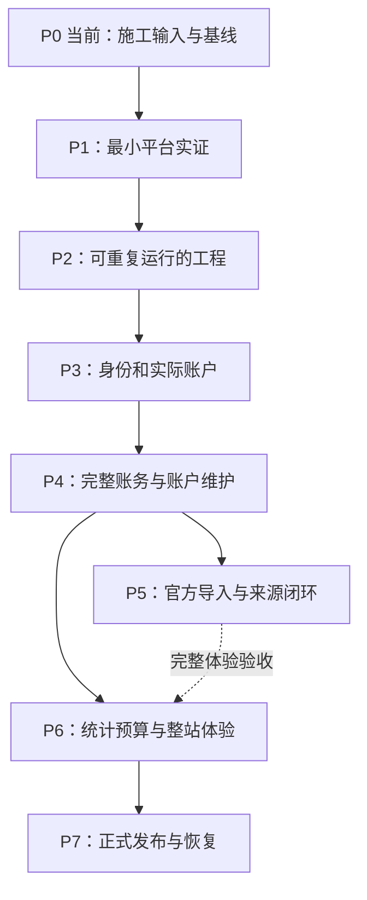

# 星账｜业务、交互与工程总设计暨施工说明

本次确定的深度：功能、页面交互、内部函数、物理数据结构、RPC输入输出、施工顺序和测试预期；视觉配色与精细样式后置。本文是待实施设计，当前P0进行中，尚无正式应用。实际完成状态只登记在[实施计划§2.6](IMPLEMENTATION_PLAN.md#26-阶段控制与当前进度)。

**三个层次分别阅读：**§1只回答“业务拥有哪些功能”；§2–3回答“用户操作后发生什么”；§4–6回答“代码与数据怎样实现”；§7回答“按什么顺序施工”；§8规定证据与测试。业务以[业务规则](BUSINESS_RULES_DISCUSSION.md)为准，页面依据[产品功能](PRODUCT_FUNCTION_MAP.md)，外部结构以[OpenAPI](../openapi.yaml)和[API契约](API_CONTRACT.md)为准，模块与实体分别遵守[模块边界](ENGINEERING_MODULE_BOUNDARIES.md)和[逻辑模型](LOGICAL_DATA_MODEL.md)。本文补内部实现决定，不改变24个公开操作与冻结业务。

## 1. 业务与功能归属全景

这张图只有两种节点：业务M与功能F。**所有连线只表示“包含/负责”，不表示调用顺序或开发依赖。**页面、API、数据库、P阶段均不放入这张图。M编号继续沿用现有业务模块；F编号在本文用于追踪用户功能，不表示施工先后。

```mermaid
flowchart TB
  Ledger["星账 V1：看清钱、记账、用官方账单补全和核对"]
  Ledger --> M1["M1 身份与关系"]
  Ledger --> M2["M2 实际账户与资金归属"]
  Ledger --> M3["M3 交易生命周期"]
  Ledger --> M4["M4 官方导入与来源证据"]
  Ledger --> M5["M5 统计与个人预算"]
  M1 --> F01["F01 登录、会话恢复和退出"]
  M1 --> F02["F02 生成邀请、确认绑定、本人写与对象只读"]
  M2 --> F03["F03 创建/查看实际账户与初始三类份额"]
  M2 --> F04["F04 修改账户资料和修正起始状态"]
  M2 --> F05["F05 同账户份额分配、存款基准与缺口"]
  M3 --> F06["F06 手动收入、支出、无费内部转账"]
  M3 --> F07["F07 筛选/详情、编辑和安全删除"]
  M3 --> F08["F08 官方独立退款、到账、日期及抵减调整"]
  M4 --> F09["F09 文件读取、原文保留、来源账号档案"]
  M4 --> F10["F10 渠道映射、普通转账角色和同事件确认"]
  M4 --> F11["F11 就绪行入账、逐行结果、补条件继续"]
  M4 --> F12["F12 来源去重、观察更新、删除后重导和编辑保护"]
  M4 --> F13["F13 覆盖资格、缺失核对、保留或删除手动账单"]
  M5 --> F14["F14 双方当前资金、个人月花销、日均与预测"]
  M5 --> F15["F15 个人月预算、剩余与超支"]
```



M2拥有资金算法，F06/F08向M2申请资金计划；M4确认官方来源后才可发起F08；M5读取正式账务。以上是功能协作，具体先后放在§3。全部功能共享：本人写、对象只读；金钱整数分；北京时间；版本冲突保护；必要POST幂等；一次账务提交完整成功/失败。跨平台银行卡是同一实际Account的可确认映射，不额外产生共同账户。

## 2. 页面结构和可执行交互

页面组件在`apps/web/src/pages/`。使用Hash路由，保证静态托管刷新不会因服务端缺少子路径重写而404。`App.tsx`负责五个固定区域：首页`#/home`、账户`#/accounts`、账单`#/transactions`、导入`#/imports`、我的`#/me`。手机底部导航，桌面侧栏；登录状态恢复完成前只显示加载，未登录进入我的。所有金额输入用十进制文本转换成整数分，后端返回值再格式化显示。

### F01–F02 我的：身份和关系

`MyPage.tsx`分“当前身份”“关系绑定”两区。未登录显示CloudBase Auth已配置的登录入口；登录失败留在入口并说明失败原因，成功后回此前意图页面；退出清理当前用户缓存与表单中的敏感内容。Auth负责签发/刷新/退出，不新增业务登录API。

首次开放使用前，由管理员运行§7的用户初始化命令，把两名已经在Auth开通的用户映射为内部User；客户端不得上传sub或user_id决定身份，GET不得顺便建User。未初始化身份显示“账本尚未开通”并停在我的；这是明确的自用开通流程，不依赖未知的平台注册回调。

登录后`getRelationship`：未绑定显示“生成邀请”和“输入邀请”两入口。生成调用`createBindingInvitation`，显示凭据、10分钟有效期和复制按钮；用户自行分享，新邀请替代旧邀请。接收方输入后确认调用`bindRelationship`；成功重读关系、账户范围和首页。凭据过期/已消费/双方已有绑定按照API失败留在当前区域。绑定后展示对象身份与“查看对象账户/账单”跳转；该页面不提供解绑动作。对象读写权限由服务端复核。

### F03–F05 账户：列表、创建、详情和维护

`AccountsPage.tsx`顶部本人/对象切换，列表显示名称、类型、余额、保管方和只读标识；空列表有本人“新增实际账户”。列表查询`listAccounts`，游标随视图变化清空。对象视图不可创建。

`AccountForm.tsx`在`#/accounts/new`创建：名称、account_type、保管方、起始日期、初始余额、初始份额；绑定后才允许对象保管/对象存款。份额输入区只有本人流动、本人存款、对象存款，显示“已分配/初始余额”；起始日默认北京时间今天，可选过去日期。点击保存时校验并调用`createAccount`，201后转`#/accounts/{id}`并GET重读；创建失败保留输入及同一未完成意图。

`AccountDetailPage.tsx`依次显示当前余额/三类份额、存款基准与缺口、起始状态、保管信息。本人有三个独立编辑入口：资料修改→`patchAccount`；初始状态修正→`putOpeningState`；份额分配→`adjustFunds`。打开前读`getAccount`获取opening_state和ETag；分配表单选择合法from/to及金额，保存后总余额不变。资料表单不接受余额。起始状态修正保存前说明会重判该账户历史/有效交易影响；409时保持原记录并显示无法安全重建。对象详情使用同样读取结构，只呈现查看内容。

### F06–F08 账单：查询、新建、编辑、退款与删除

`TransactionsPage.tsx`顶部本人/对象，筛选含起止日期、类型、实际账户、分类、关键词，调用`listTransactions`；每次筛选变化清除旧cursor。列表包含历史账单，点选进入`#/transactions/{id}`。本人“记一笔”打开`TransactionForm.tsx`；对象视图仅看详情。

创建表单类型为income/expense/transfer，账户选择来自本人`listAccounts`，分类来自`listCategories`。收支填写金额、北京时间、单账户、分类、商户、备注；转账填写两个不同本人账户和金额等契约字段。可选来源档案用于手动银行卡账单的未来核对：复用已有本人导入批次中已确认的profile，当前无可用档案时可留空；若用户要明确档案，按钮“先导入确认档案”保留当前草稿并进入导入，取得本人的已确认profile后返回草稿。另设备没有本机批次导航记录时也走此路径，不能凭空编造ID或增加档案管理API。保存`createTransaction`后展示服务端notices与account_changes，返回详情并重读涉及账户。动用存款提示金额，不二次确认阻断已成功保存。

详情`getTransaction`展示类型、金额、账户/转账两端、记账日期、分类、商户/备注、当前有效/历史影响、本人来源摘要。官方refund额外展示到账账户、refund_kind、affects_spending、只读官方原时间；编辑仍用同一表单，不能修改refund类型/子类型或将普通交易改为refund。

编辑加载最新ETag，提交`patchTransaction`：缺省字段保持，允许的null仅用于清空手动声明profile。成功重读详情/账户/affected_months；412先展示旧页面已过期，点击“加载最新内容”后用户重新决定，不自动覆盖。删除先展示“仅删除此笔及资金影响、官方来源保留”再调用`deleteTransaction`；成功回列表，409不安全时保留详情。删除消费不连带独立退款，GET已删交易返回404。

### F09–F13 导入：一个批次贯穿到底

`ImportPage.tsx`负责`#/imports`上传及`#/imports/{batchId}`结果。上传区选XLSX，可选已知profile；上传使用multipart而不是JSON/base64。超过10MiB或10000行拒绝且不入账。上传期间显示“正在读取和处理”；同步API未完成前不能伪造服务器阶段百分比或后台任务。收到结果后展示返回的逐行phase与真实结果。

批次结果固定五区：①文件头与声明/实读数；②档案选择；③七类结果汇总；④逐行结果/原因/允许动作；⑤覆盖资格与独立缺失核对区。`getImport`的rows_cursor与reconciliation_cursor分别翻页，汇总始终全批。刷新只读，用户点击“继续处理”才提交resume。保留当前batchId，使用户重新登录或返回页面后可重读同批次；最近批次ID只作为该用户本机导航历史，后台仍授权。

档案未定时根据profile_candidates选择已有项，或输入create_label创建；使用profile_version提交`select_source_profile`。缺映射行从Evidence/Candidate读取规范键，`listMappings`展示现有映射，`listAccounts`选实际账户；`putMapping`成功后客户端自动提交同batch的resume。普通转账角色只给收入/支出/内部转账，按角色补足单账户或双账户。所有按钮由allowed_actions决定，逐行请求携带observation_id和expected_source_version。

同事件候选展示候选账单关键信息，用户选择关联或明确创建新事件；单候选也要确认。`accept_source_change`确认有效来源观察但不改已有交易，页面随后提供进入交易编辑的入口。每次确认成功重新GET当前批次；409先刷新版本，不能以旧观察覆盖当前来源。失败行显示reason和缺少条件，允许补条件后的resume；unsupported/ineffective不伪装为入账成功。

核对区先显示reconciliation_eligible及blockers。不具资格说明原因；具资格时列手动交易、金额/日期与“保留已核对”“删除此账单”。提交`reviewReconciliation`带该项expected_version；保留只变核对状态，删除安全撤销账务并原子关闭该项。结果计数与来源行数分开。

### F14–F15 首页：当前资金与月份消费明确分区

`HomePage.tsx`顶部月份选择限当前/过去，默认北京时间当前月。上区标题固定“当前资金”，显示本人流动/存款，绑定后并列对象流动/存款；按fund_owner汇总双方账户，代管不改归属。下区显示所选月支出、抵减退款、净花销、日均、完整上月日均/变化、预测和预算剩余/超支。空预算显示“未设置”，零分母变化率显示“—”，净花销可以负，历史月份不伪装历史余额。

`BudgetForm.tsx`从首页“设置预算”打开，月份可选未来；先getBudget读取version或null，新建expected_version=0，修改用已有version，putBudget成功后重读预算及适用overview。退款改日期/抵减后仅重算受影响月份使用额，不改budget_minor。

### 所有页面共享的状态机

页面状态固定为initial_loading、ready、submitting、validation_error、version_conflict、unknown_write_result、read_failed。按钮提交期间防重复；字段错误保留表单；401恢复会话后再确认原意图。必要POST把method/path/规范化payload摘要/Idempotency-Key保存在当前用户私有本地意图记录中，用户完成或明确取消后清理；未知结果不能换新key自动重做。已确认写成功但GET失败显示“已保存，读取失败”，按钮只重试GET。退出账号清除私有意图载荷，不把A的意图交给B；重新进入时提示未确认操作由本人核查，服务器来源唯一/版本保护仍在。

## 3. 业务流程：箭头只表示业务先后或分支

### 3.1 记一笔支出或转账



### 3.2 编辑和退款



### 3.3 官方文件补全与继续



### 3.4 重导生命周期



这四图不表达数据库调用或开发阶段。§4定义谁调用谁，§7另画开发依赖。
## 4. 代码边界、函数与接口接线

### 4.1 文件职责固定

`apps/web/src/App.tsx`与`router.ts`组装§2路由；`pages/`只组装该页读取与动作；`features/m1`至`m5`保存表单/局部状态；`api/client.ts`唯一执行HTTP；`auth/session.ts`唯一操作Auth；`state/write-intents.ts`管理幂等意图；`components/AsyncState.tsx`展示统一状态。`packages/contracts/src/generated.ts`从根OpenAPI生成，`index.ts`只导出类型与operation映射，Web/API共同引用。

`apps/api/src/server.ts`只监听端口，`app.ts`组装中间件/路由；`http/auth.ts`核身份，`validation.ts`校验输入，`routes/m1.ts`至`m5.ts`把operation交给同名用例，`errors.ts`将DomainError转换成契约状态和code/message。`application/m1.ts`至`m5.ts`负责用例顺序；`modules/m1/identity.ts`、`m2/funds.ts`、`m2/accounts.ts`、`m3/transactions.ts`、`m4/parser.ts`、`m4/normalize.ts`、`m4/sources.ts`、`m4/reconcile.ts`、`m5/statistics.ts`持有业务计算。`infrastructure/auth.ts`、`database.ts`、`commit.ts`、`log.ts`负责外部I/O。纯规则模块不导入Express、CloudBase、SQL客户端或浏览器。



本图只表达代码调用层次，功能归属看§1，施工顺序看§7。

### 4.2 通用类型与24个公开用例

使用`openapi-typescript`从OpenAPI生成`operations`/`components`类型，Node API的transform将integer节点映射为bigint、非整数number保留number，解析后的类型与无损边界保持一致；`OperationInput<O>`由该操作的path/query/header/body组成，multipart的file在入站读取后转换为`UploadFile`，不改变线上multipart形态；`OperationSuccess<O>`只取该操作200/201响应。`RequestContext`来自服务端核验，客户端不得构造。

```ts
type ID = string; // 线上仍是不透明字符串，内部生成UUID
type Minor = bigint; // 所有内部金额计算是整数分
type Revision = bigint;
type ISODate = string;
type Instant = string;
type RequestContext = Readonly<{
  actorId: ID; requestId: string; now: Instant;
  idempotencyKey?: string; ifMatch?: Revision;
}>;
type UploadFile = Readonly<{
  privateTempPath: string; byteLength: number; sha256: string;
}>;
type DomainError = Readonly<{
  status: 400 | 401 | 403 | 404 | 409 | 412 | 413 | 422 | 428 | 500;
  code: string; message: string;
}>;
type HttpSuccess<T> = Readonly<{status: 200 | 201; data: T; etag?: string}>;
```

线上整数继续是JSON数字，不能改成数字字符串。SQL金钱用整数numeric，内部用bigint；JSON读写采用lossless-json的数值适配，保存原始数值精度，只有分页limit等已有上限值可转number。`validation.ts`生成运行时校验：结构/引用由Ajv2020处理，整数节点的type/minimum/maximum/const检查由lossless数值适配执行并保留原约束，拒绝字符串和布尔冒充数字。生成器输出字段到整数检查器的映射，测试覆盖安全整数边界和额外字段；业务端不接收尚未校验的JSON。这个适配不新增公开上限。[生成器依据](https://openapi-ts.dev/node)、[无损JSON依据](https://github.com/josdejong/lossless-json)。

所有应用用例签名固定为`operation(ctx: RequestContext, input: OperationInput<"operation">): Promise<OperationSuccess<"operation">>`；错误抛DomainError，不返回半成品成功。函数名直接复用以下operationId，禁止在路由层另写业务逻辑：

- `application/m1.ts`：`getRelationship`、`createBindingInvitation`、`bindRelationship`，分别接F02状态/生成/确认。
- `application/m2.ts`：`listAccounts`、`getAccount`、`createAccount`接F03；`patchAccount`、`putOpeningState`接F04；`adjustFunds`接F05。
- `application/m3.ts`：`listTransactions`、`getTransaction`、`patchTransaction`、`deleteTransaction`接F07；`createTransaction`、`listCategories`接F06，编辑同样服务F08。
- `application/m4.ts`：`uploadImport`、`getImport`接F09/F11；`listMappings`、`putMapping`接F10；`resolveImport`接F09–F12六种动作；`reviewReconciliation`接F13。
- `application/m5.ts`：`getOverview`接F14；`getBudget`、`putBudget`接F15。

HTTP方法、路径、schema、header、返回状态全部由根OpenAPI驱动注册与测试；§9列首次交付阶段。本清单只有24个公开操作。

### 4.3 M1内部函数

```ts
verifySession(token: string): Promise<{subject: string; displayName: string}>;
findUserBySubject(subject: string): Promise<UserRow | null>;
readAccess(actorId: ID, ownerId: ID, binding: BindingRow | null): 'write' | 'read' | 'none';
planInvitation(actorId: ID, tokenHash: string, now: Instant): InvitationPlan;
planBinding(actorId: ID, invitation: InvitationRow, members: UserRow[], now: Instant): BindingPlan;
```

令牌使用加密安全随机字节生成，数据库存token摘要；成功原响应包含明文邀请，因此幂等结果中此响应必须私有且有24小时保留控制。生成时作废本人旧邀请；绑定时锁两User按ID排序，再锁邀请，核对到期/未消费/双方未绑定，插入关系与两成员唯一约束并消费邀请，原子返回。GET映射查不到用户时返回契约允许的不可用身份错误，不创建数据。管理员`provision-user.mjs`读取受信Auth管理API确认subject后建User；输入客户端随意给的sub不得直接开通。

### 4.4 M2资金与M3交易的内部合同

```ts
type Share = Readonly<{ownerId: ID; kind: 'liquid' | 'savings'}>;
type ShareAmount = Readonly<{share: Share; amount: Minor}>;
type AccountState = Readonly<{
  id: ID; holderId: ID; partnerId: ID | null; openingDate: ISODate;
  version: Revision; fundsRevision: Revision;
  shares: readonly ShareAmount[]; savingsBaselines: readonly ShareAmount[];
}>;
type FundDelta = Readonly<{accountId: ID; share: Share; delta: Minor}>;
type FundOperation =
  | {kind: 'expense'; amount: Minor}
  | {kind: 'income'; amount: Minor}
  | {kind: 'replenish'; amount: Minor}
  | {kind: 'transfer_out' | 'transfer_in'; amount: Minor}
  | {kind: 'allocate'; from: Share; to: Share; amount: Minor}
  | {kind: 'reverse'; previous: readonly FundDelta[]};
type FundPlan = Readonly<{
  deltas: readonly FundDelta[];
  baselineDeltas: readonly FundDelta[];
  notices: readonly SpendingNotice[];
}>;
planFunds(state: AccountState, operation: FundOperation): FundPlan;
summarizeFunds(movements: readonly MovementRow[], asOf: Instant): AccountState;
classifyEffect(occurredAt: Instant, openingDate: ISODate): 'applied' | 'historical_only';
planCreate(facts: TransactionFacts, states: readonly AccountState[], now: Instant): TransactionPlan;
planPatch(current: TransactionSnapshot, patch: TransactionPatch, states: readonly AccountState[], now: Instant): TransactionPlan;
planDelete(current: TransactionSnapshot, states: readonly AccountState[]): TransactionPlan;
planOpeningChange(input: OpeningState, snapshot: OpeningSnapshot, now: Instant): OpeningPlan;
```

`UserRow/InvitationRow/BindingRow/MovementRow`是§5对应表的行；`TransactionFacts`是校验后的四种交易封闭联合，账户是实际ID，金额Minor；`TransactionPatch`继承公开白名单并经当前交易类型校验。`SpendingNotice`投影到OpenAPI Notice。`TransactionSnapshot`含当前交易、两端effects、本交易当前movements及关联来源版本；`TransactionPlan`固定字段为`transaction: TransactionRow | null`、`deleteTransactionId: ID | null`、`replaceEffects: EffectRow[]`、`removeEffectIds: ID[]`、`fundPlans: FundPlan[]`、`affectedMonths: string[]`、`unchanged: boolean`；M3只携带调用M2所得资金计划，M2把它物化为FundWritePlan；用例负责汇合，M3不直接保存movements。含替换行时必须带其原资源版本，创建新行必须用新ID，RPC核对删除集合只属于本次目标。它不含原始文件或ImportBatch。用例将各模块计划组成§6的提交DTO。

**planFunds精确分支：**expense依次消耗本人流动/本人存款/对象存款，缺额即整体报不足；income只加本人流动；replenish按对象存款缺口→本人存款缺口→本人流动；transfer_out只能扣本人流动，transfer_in只加本人流动；allocate给from负delta、to正delta并同步存款基准净额；reverse逐份额取原计划相反数并检查结果非负。所有分支先在内存计算完整结果，再一次性返回；不得先写一份额再发现另一份额不足。M2物化支出差额计划时，用“本交易原有效movements＋此次delta”按account/effect/份额合并为替换集合，不能只保存差额而丢掉原影响；净额须等于新effect，零净行移除，其他交易行保持。

**planPatch精确分支：**相同字段空改动返回unchanged；仅affects_spending只改交易；仅日期且两端历史/有效状态不变，保留份额计划只改生效时间；同账户同状态的支出金额变更只算正差额expense或负差额replenish；其余改金额/账户/类型/历史状态先reverse原有效计划，再按新事实create。任何逆向后非负不成立立即失败。后续其他交易不因本交易编辑重算。refund始终保留原type/refund_kind，独立创建入口只接受经用例验证的官方资格。

**起始状态重建的顺序固定：**读取本账户的全部有效当前交易effects以及不可变的手动分配指令；新的opening作为起点；按`effective_at, replay_order`重放新起始日及以后的本账户事件。交易日期取当前记账时间，手动分配日期取当时操作时间；起始日前的交易effects为historical_only，分配指令保留但不生成新起始日后的movements。转账仅重算本账户这一端，另一端保持原状；同时间以首次执行分配的replay_order稳定排序，编辑保留原序号。某一前缀资金不足、份额非法或不满足守恒时返回OPENING_STATE_RECALCULATION_CONFLICT，旧状态全部保留。成功一次替换本账户opening/当前movements和effects状态。普通交易编辑绝不调用此全账户重建函数。

`application/m3.ts`另导出`createFromOfficial(ctx, facts, verifiedOrigin, snapshot): Promise<Mutation>`。`verifiedOrigin`是模块私有品牌类型，只有`application/m4.ts`在核验owner/profile/source/version/当前关联后可创建；M3收到的是资格与明确交易事实，不读来源实体。调用直接在同进程内发生，不HTTP回调手动创建路由。

### 4.5 M4内部函数与恢复动作

```ts
parseOfficialFile(file: UploadFile): Promise<ParsedFile>;
normalizeRow(platform: 'wechat' | 'alipay', raw: RawObservation): NormalizedEvidence;
resolveProfile(header: SourceMetadata, profiles: readonly ProfileRow[]): ProfileDecision;
resolveAccounts(evidence: NormalizedEvidence, mappings: readonly MappingRow[], accounts: readonly AccountState[]): AccountDecision;
compareObservation(current: SourceRow | null, incoming: RawObservation): ObservationDecision;
findEventCandidates(candidate: Candidate, transactions: readonly TransactionSnapshot[]): readonly ID[];
planSourceAction(source: SourceRow, observation: ObservationRow, action: Resolution, now: Instant): SourceDecision;
processReadyRow(ctx: RequestContext, observationId: ID, lease: RequestLease): Promise<RowResult>;
computeCoverage(batch: BatchRow, rows: readonly RowResult[]): Coverage;
planReconciliation(coverage: Coverage, profiles: readonly ProfileRow[], manualTransactions: readonly TransactionSnapshot[], existing: readonly ReconciliationRow[]): ReconciliationPlan;
```

`ParsedFile`包含platform、文件头、exported_at/声明范围/数量、所有行的原始值、行号；`NormalizedEvidence`包含OpenAPI Evidence/Candidate、完整official_transaction_id、观察指纹和原因码；`ProfileDecision/AccountDecision/ObservationDecision/SourceDecision`均为可区分的`ready | needs_review | unsupported | ineffective | duplicate | conflict`联合，必须带理由，ready才有完整所需ID；HTTP投影仍用公开七类disposition。没有完整单号的行保留观察并needs_review，不能创建空字符串SourceRecord。

`processReadyRow`读取一致快照→确认合法候选/来源版本→调用M3/M2→组成来源关联计划→单次提交。按候选occurred_at与完整单号排序，默认逐行顺序执行。单行失败保留原因，其他行继续；内部提交序号保护超时后重复执行。

`resolveImport`先校验整请求参数与授权，再进入动作：select_source_profile比较profile_version并选/建档案后处理就绪行；resume处理当前就绪来源；set_transfer_role存合法类型与账户后处理本行；create_transaction明确新事件；link_existing_transaction核同日/实际账户方向/最终类型/金额后只关联；accept_source_change只换有效来源事实/观察与版本，已存在交易不变。旧观察不得覆盖新事实；每个动作都持久化决定而不改raw_fields。来源重要事实改变时旧决定需复核。

缺失核对严格使用完整批次结果与覆盖终点min(声明终点,导出时间)，任一unsupported/needs_review/failed阻止自动生成；已有关联来源的交易排除，银行卡无profile声明排除。核对项unique(profile,transaction)，重叠批次复用；删除调用M3并在同事务删除/关闭核对项；后续匹配来源将pending/kept项结案。

### 4.6 M5与读取函数

```ts
calculateSpending(transactions: readonly TransactionFacts[], month: string, today: ISODate): SpendingMetrics;
calculateBudget(budget: Budget | null, spent: Minor): BudgetMetrics | null;
projectFunds(actorId: ID, partnerId: ID | null, states: readonly AccountState[]): OverviewFunds;
encodeCursor(scope: CursorScope, last: SortKey): string;
decodeCursor(raw: string, expectedScope: CursorScope): SortKey;
```

M5计算公式严格引用业务§6；金额和分母用整数/有理数，最后一步按分四舍五入，变化率四位小数。负值按绝对值四舍五入后恢复符号，不使用JavaScript Math.round对负半值产生非对称结果。来源/未提交候选不进入统计。游标用服务端HMAC签名，绑定actor/view/filter/排序；交易`occurred_at DESC,id DESC`，账户`created_at DESC,id DESC`，导入行`row_number ASC,id ASC`，核对项`created_at ASC,id ASC`；游标不可信时422。
## 5. 物理数据库设计

以下是**目标结构规格**，SQL实现按§7分阶段创建，不在P1一次部署全库。所有表在`public`使用`sl_`前缀；身份/关联主键为UUID，公开仍序列化为不透明字符串。金额列numeric且CHECK为整数；时间timestamptz，业务日按Asia/Shanghai转换。`version`为公开资源版本；账户`funds_revision`为内部快照并发版本，资金变化统一递增。余额、当前份额、基准、缺口来自有效movements，不建立可写余额列。

下面`?`表示SQL NULL，其他列必须NOT NULL；FK users等简写均指public.sl_users(id)等对应sl_表；PK/UK/FK/索引与约束必须实现，不是可选建议。JSONB列有明确内部类型，不接客户端任意键直接覆盖。

### 5.1 M1与M2

```text
sl_users
  id uuid PK; auth_subject text UK; display_name text; created_at timestamptz
sl_bindings
  id uuid PK; created_at timestamptz
sl_binding_members
  user_id uuid PK FK users; binding_id uuid FK bindings
  UNIQUE(binding_id,user_id); 每个binding恰两成员，由绑定RPC校验
sl_invitations
  id uuid PK; inviter_id uuid FK users; token_hash text UK
  expires_at timestamptz; consumed_by uuid? FK users; consumed_at timestamptz?
  revoked_at timestamptz?; created_at timestamptz
  部分唯一索引(inviter_id) WHERE consumed_at IS NULL AND revoked_at IS NULL
sl_accounts
  id uuid PK; holder_user_id uuid FK users; custodian_user_id uuid FK users
  name text; account_type text; opening_date date
  version bigint DEFAULT 1; funds_revision bigint DEFAULT 1; created_at timestamptz
  CHECK name长度1..80、account_type符合Account枚举、两version>=1
  INDEX(holder_user_id,created_at DESC,id DESC)
sl_fund_adjustments                 // 手动分配指令的物理辅助存档，所有权M2
  id uuid PK; account_id uuid FK accounts
  from_owner_id uuid FK users; from_type text
  to_owner_id uuid FK users; to_type text
  amount_minor numeric; effective_at timestamptz; replay_order bigint UK
  CHECK amount_minor>0且为整数、from/to不相同、type为liquid/savings
sl_movements
  id uuid PK; account_id uuid FK accounts; fund_owner_id uuid FK users
  fund_type text; signed_amount_minor numeric; reason text
  operation_group uuid; effect_id uuid? FK effects; effective_at timestamptz
  CHECK 金额为整数、fund_type为liquid/savings
  CHECK reason为opening/manual_allocation/transaction
  CHECK transaction有effect_id，其他reason没有effect_id
  INDEX(account_id,fund_owner_id,fund_type,effective_at)
  INDEX(effect_id); INDEX(operation_group)
```

`sl_fund_adjustments`保存可重放的原指令，不是另一份余额；每次手动分配保存一个指令和一负一正两个movements。账户初始分配只以opening movements保存，读取opening_state按reason汇总；起始余额是该组金额之和。允许零余额账户保留合法的零opening行；其他资金变动不写无意义零行。资金记录仅表达当前有效影响；交易编辑替换本交易相关行，删除移除对应行；手动指令保留以支持起始日重建。replay_order由同一数据库sequence分配并持久保存，不依赖Node当前时间打破同秒先后。

所有跨表条件在受限RPC锁内校验：holder必须actor、custodian是本人或绑定对象、对象份额只能savings、每个份额>=0、分配等额、每个账户余额等于份额合计。SQL CHECK不能可靠表达跨行合计，因此这些条件使用锁内检验及必要的延迟约束触发器，不能写成查询其他行的CHECK。[PostgreSQL约束依据](https://www.postgresql.org/docs/current/ddl-constraints.html)。

### 5.2 M3交易与effects

```text
sl_transactions
  id uuid PK; owner_id uuid FK users; type text; accounting_semantics text
  amount_minor numeric; occurred_at timestamptz; category_code text
  merchant text; note text; source_account_profile_id uuid? FK profiles
  refund_kind text?; affects_spending boolean?; version bigint DEFAULT 1
  replay_order bigint UK; created_at timestamptz
  CHECK amount_minor>0且整数、version>=1、type/category符合契约
  CHECK ordinary对应income/expense，internal_transfer对应transfer，refund_inflow对应refund
  CHECK refund有合法refund_kind和非空affects_spending；其他type二者均NULL
  INDEX(owner_id,occurred_at DESC,id DESC)
  INDEX(owner_id,type,occurred_at DESC,id DESC)
sl_effects
  id uuid PK; transaction_id uuid FK transactions; account_id uuid FK accounts
  role text; signed_amount_minor numeric; status text
  UNIQUE(transaction_id,role); UNIQUE(transaction_id,account_id)
  CHECK role为primary/from/to；status为applied/historical_only；金额非零整数
  INDEX(account_id,transaction_id)
```

账户ID从effects反投影到Transaction的account_id/from_account_id/to_account_id，不在交易表冗余存第二组可独立修改的账户关系。RPC校验普通收支/refund恰一个effect，transfer恰两个相反等额effect且不同账户；signed_amount按类型/角色一致。applied effect的movements合计等于其金额，historical_only没有movements；交易owner与两账户holder相同。退款不存原消费ID。

删除交易先锁定并清空所有当前来源关联且递增source版本、处理核对关联，再删除movements/effects/transaction；观察和HTTP幂等结果保留，GET交易404。外键不使用跨业务域自动级联替代用例行为。

### 5.3 M4来源与批次

```text
sl_profiles
  id uuid PK; owner_id uuid FK users; platform text; label text
  account_fingerprint text?; metadata jsonb; created_at timestamptz
  CHECK platform为wechat/alipay；INDEX(owner_id,platform)
sl_mappings
  id uuid PK; owner_id uuid FK users; profile_id uuid FK profiles
  canonical_method_key text; account_id uuid FK accounts; version bigint DEFAULT 1
  UNIQUE(profile_id,canonical_method_key); INDEX(account_id)
sl_batches
  id uuid PK; owner_id uuid FK users; platform text; file_hash text
  private_file_ref text?; source_metadata jsonb; profile_id uuid? FK profiles
  profile_version bigint DEFAULT 0; exported_at timestamptz?
  declared_from timestamptz?; declared_to timestamptz?; export_type text
  declared_record_count integer?; parsed_record_count integer
  structural_complete boolean; status text; created_at timestamptz
  CHECK status为completed/needs_review/failed；数量>=0；profile_version>=0
  INDEX(owner_id,created_at DESC,id DESC); INDEX(owner_id,file_hash)
sl_sources
  id uuid PK; profile_id uuid FK profiles; official_transaction_id text
  current_observation_id uuid? FK observations
  current_transaction_id uuid? FK transactions
  current_facts jsonb; decision jsonb; version bigint DEFAULT 1
  UNIQUE(profile_id,official_transaction_id); CHECK official_transaction_id非空; INDEX(current_transaction_id)
sl_observations
  id uuid PK; batch_id uuid FK batches; row_number integer
  source_id uuid? FK sources; exported_at timestamptz?; content_hash text
  raw_fields jsonb; evidence jsonb; candidate jsonb
  phase text; disposition text; reason_codes jsonb; result_transaction_id uuid?
  UNIQUE(batch_id,row_number); INDEX(source_id,exported_at)
  CHECK phase/disposition取ImportRow枚举；row_number>=1
sl_reconciliations
  id uuid PK; profile_id uuid FK profiles; transaction_id uuid FK transactions
  first_batch_id uuid FK batches; last_batch_id uuid FK batches
  status text; version bigint DEFAULT 1; created_at timestamptz
  UNIQUE(profile_id,transaction_id)
  CHECK status为pending_confirmation/kept_manual/matched_to_source
  INDEX(profile_id,created_at,id)
```

循环外键sources↔observations在两表建立后用ALTER添加，写事务内先观察，再来源，再更新观察source_id；首个观察及来源关联在同一提交中保证一致。`current_facts`类型是规范化来源事实（完整单号、时间、金额、方向/类型、状态、渠道），`decision`只保存已确认角色/实际账户/选择的同事件等处理决定；raw_fields永久保留原值。`result_transaction_id`是观察当次结果的历史ID，允许交易删除后仍可定位历史结果，不能被用作当前来源关联；当前关联只读sources.current_transaction_id。

钱包跨profile限制在映射RPC中锁目标account并查询已有关联profile；银行卡允许用户确认复用。映射改动及账户类型改动使用相同账户锁，保证并发下类型兼容。mapping/profile/source/observation/batch/transaction/account的本人归属与交叉关系全部复验。当前来源一个最多关联一笔有效交易，一交易允许多个来源，因而current_transaction_id不能建立全局唯一索引。

summary与coverage从本批次全部observations及核对项计算，分页不改变全批数。profile_candidates、candidate_transaction_ids、allowed_actions由查询时结合当前权限/版本派生；GET不写入这些值。保存的candidate是当次规范化快照，已变动的来源以当前source及版本决定动作。删除核对手动交易时原子删除相关核对项，响应返回deleted、version=null；已匹配来源的项不能再删除。

### 5.4 M5与技术状态

```text
sl_budgets
  owner_id uuid FK users; month date; budget_minor numeric; version bigint DEFAULT 1
  PRIMARY KEY(owner_id,month)
  CHECK month为月首、budget_minor>=0且整数、version>=1
sl_requests
  id uuid PK; actor_id uuid FK users; method text; path text; key_digest text
  payload_hash text; state text; fence bigint; lease_until timestamptz?
  response_status integer?; response_headers jsonb?; response_body jsonb?
  created_at timestamptz; expires_at timestamptz
  UNIQUE(actor_id,method,path,key_digest)
  CHECK state为running/completed；completed必须有完整响应且无有效租约
sl_request_steps
  request_id uuid FK requests; step_key text; result jsonb; committed_at timestamptz
  PRIMARY KEY(request_id,step_key)
sl_schema_migrations
  filename text PK; sha256 text; applied_at timestamptz
```

requests/steps为HTTP重试与导入崩溃恢复技术状态，不是业务工作流或第二份账务。对普通单提交操作，最终响应与账务同事务保存；导入每行在同次账务事务保存`request_steps`，整请求完成时保存当时的完整分页/汇总响应，同键返回该快照而非当前查询。维护脚本`prune-requests.mjs`只清理已完成且expires_at已过期记录，先删steps再删requests；已完成保留24小时后可清理，未完成只能按租约/fence恢复或明确处理，不能按时间直接删掉仍可提交的请求。

所有表默认拒绝浏览器角色直接读写；受限后端角色只有必要只读/写RPC EXECUTE；管理角色用于迁移和用户开通/备份。SQL函数限定search_path、全限定对象名及actor授权，PUBLIC撤销EXECUTE。P1实际验证平台角色配置，无法成立即暂停该路线，不能回退为浏览器直写。

## 6. RPC与跨模块一次提交

### 6.1 读取端口

`read_snapshot(p_actor_id uuid,p_scope jsonb) returns jsonb`只读，scope为固定联合：`account(ids)`、`transaction(id)`、`opening(account_id)`、`import_row(observation_id)`、`overview(month)`。参数不能传任意表/SQL。函数使用LANGUAGE SQL STABLE，以单一SELECT及其CTE取得所需状态和对应版本，保证同一次MVCC快照，不用多次独立SELECT拼接；opening返回全部当前effects、手动分配指令与账户；import_row返回本人batch/profile/source/映射/账户/候选交易；overview同一快照含关系、资金、当月/上月交易和预算。列表由对应read函数使用相同授权与签名游标。

```ts
type Expected = Readonly<{
  accounts: readonly {id: ID; version: Revision; fundsRevision: Revision}[];
  transactions: readonly {id: ID; version: Revision}[];
  sources: readonly {id: ID; version: Revision; linkedTransactionId: ID | null}[];
  mappings: readonly {id: ID; version: Revision}[];
  reconciliations: readonly {id: ID; version: Revision}[];
}>;
type RequestLease = Readonly<{requestId: ID; fence: Revision}>;
type CommitEnvelope = Readonly<{
  command: 'create_account' | 'patch_account' | 'replace_opening' | 'allocate'
    | 'create_transaction' | 'patch_transaction' | 'delete_transaction'
    | 'post_import_row' | 'link_source' | 'delete_reconciled_transaction';
  actorId: ID; expected: Expected;
  request?: RequestLease; stepKey?: string;
  accountPlan?: AccountWritePlan;
  transactionPlan?: TransactionPlan;
  fundPlan?: FundWritePlan;
  sourcePlan?: SourceLinkPlan;
  reconciliationPlan?: ReconciliationWritePlan;
}>;
```

具体保存DTO固定如下；Row字段与§5同名，日期/金额经边界转换，不增加任意扩展字段。

```ts
type AccountWritePlan =
  | {kind: 'create'; row: AccountRow}
  | {kind: 'patch'; id: ID; next: Pick<AccountRow, 'name' | 'account_type' | 'custodian_user_id'>}
  | {kind: 'opening'; id: ID; openingDate: ISODate};
type FundWritePlan = Readonly<{
  scope: 'transaction' | 'opening' | 'allocation'; scopeId: ID;
  removeMovementIds: readonly ID[]; insertMovements: readonly MovementRow[];
  insertAdjustment: FundAdjustmentRow | null;
}>;
type SourceLinkPlan = Readonly<{
  links: readonly {
    sourceId: ID; observationId: ID;
    fromTransactionId: ID | null; toTransactionId: ID | null;
  }[];
}>;
type ReconciliationWritePlan = Readonly<{
  actions: readonly {id: ID; action: 'matched_to_source' | 'delete'}[];
}>;
```

source和核对集合必须包含本交易涉及的全部当前关联；删除一交易有多来源时全部解除。`Expected.sources/reconciliations`与计划数组一一匹配，缺失期望版本则拒绝。FundWritePlan的scopeId在transaction时为交易ID、opening时为账户ID、allocation时为分配指令ID；RPC检查删除/插入范围，不能借一个scope改其他交易或账户。开户的opening也使用opening scope。

计划不是任意JSON写表器：`AccountWritePlan`只含创建/修改的合法账户字段及opening；`TransactionPlan`只含本次目标交易/effects及删除集合；`FundWritePlan`只含目标账户opening/本交易/本次分配对应movement行及手动指令；`SourceLinkPlan`只含来源当前关联变更集合；`ReconciliationWritePlan`只含目标核对项关闭/删除集合。具体行字段由§5列固定，JSON Schema按这些封闭结构编写，拒绝额外字段；每种command只能携带规定组合，RPC再检查计划范围与actor。

### 6.2 写RPC固定执行顺序

`commit_ledger(p_envelope jsonb) returns jsonb`由受限后端调用，顺序固定：

1. 若有request，锁其记录检查payload/已完成响应；completed直接重放，running必须匹配fence且租约有效，重复stepKey返回步骤原结果。
2. 按所有将读写的账户ID排序锁账户；再按交易ID、来源ID、核对项ID排序锁对应行。重读锁内版本与归属。读快照与计算期间发生变化则拒绝旧计划，不能拿旧份额继续保存。
3. 比较对外If-Match与资源版本，缺失428、过期412；内部funds_revision/source/mapping等冲突按该操作已有409语义返回，不把内部字段加到公共请求。
4. 检查command的合法写集合：普通创建无客户端refund，官方创建来源资格完整；所有交易/effects/资金行同owner，current来源不会悬空；锁定并复验必要mapping/profile关系及版本。
5. 在事务内计算计划应用后的每个份额/余额/基准，检查非负、effect/movements守恒、转账两端、同账户分配净额0；检查来源身份唯一、当前关联条件及核对状态。
6. 按依赖顺序写交易/effects/movements/来源关联/核对状态，账户每次实际资金变更递增version和funds_revision一次；资料修改只增version。交易/source等实际变化各增一次；合法空改动仍先校验版本，随后不增版本、不写资金。
7. 在锁内生成该操作的确定响应投影；普通请求将状态/ETag/body与账务同事务标completed；导入行把对应step结果同事务保存，整批完成另封存请求响应。提交后再向HTTP发送，发送失败只记结果未知。
8. 任一步异常整次事务回滚并映射为已有错误码；禁止函数吞异常返回成功。测试注错钩子只在隔离实验版本，不部署生产函数。

RPC只防护计划合法性和保存一致性，扣减/回补算法只在TypeScript M2。跨行锁和约束设计依据[PostgreSQL锁](https://www.postgresql.org/docs/current/explicit-locking.html)；部署在共享PG后必须实际验证，不能以文档当成证据。

### 6.3 其他写入口与幂等

`write_identity(p_actor,p_action,p_payload,p_request)`只允许issue_invitation/bind；`write_mapping(p_actor,p_payload)`只接MappingPut；`write_budget(p_actor,p_month,p_payload)`只接BudgetPut；`write_import_evidence(p_actor,p_action,p_payload,p_request)`只允许create_batch/select_profile/save_observation/accept_source_change/save_decision/finish_request；`write_reconciliation(p_actor,p_payload,p_request)`只处理keep_manual。删除核对账单走commit_ledger。全部有各自封闭schema、owner/版本检查及事务，不开放任意SQL入口。

`claim_request(actor,method,path,key_digest,payload_hash)`在短事务里建立running、fence和租约；同键不同payload报409，completed重放，未过期running报REQUEST_IN_PROGRESS。租约到期接管时递增fence，旧worker的后续写入全部被拒。`renew_request(request_id,fence)`续租；每次写入验证fence。`complete_request_failure(request_id,fence,status,body)`仅供受限后端在确认业务回滚后封存确定失败响应；网络结果未知时先查询请求状态，不能封存为失败。规范化JSON补该接口默认值、稳定排序，multipart用文件sha256加规范化profile；不把字段顺序当不同请求。

导入崩溃后只在同key请求重新到达时续做原意图：已存在stepKey重放，未完成行重新读快照并执行；不创建后台队列。参数/权限错误发生在任何业务变更之前；执行阶段行失败记录在观察/step中，合法批次仍按契约返回当前行结果。失败尝试的completed业务错误可以封存以保持同键原结果；未知网络结果不能改写为已失败。保留原HTTP状态/正文/ETag，重放先于资源版本检查。

**固定读写后验：**创建/编辑/删除交易后重新GET交易（删除应404）、账户及受影响月份；提交成功不依赖M5查询成功。所有新增写入口必须更新同一账户控制版本；映射类型兼容检查与账户资料变更使用共同账户锁。
## 7. 开发计划：箭头只表示施工依赖

下图只有P阶段。功能已在§1定义，具体实现已在§2–6锁定，下面的阶段步骤负责把它们按可运行顺序交付。实线是开工依赖，虚线是整体验收依赖。当前P0，后续节点均为计划。



### 7.1 固定安装和命令

Node固定24系列，P0记录实际小版本和npm版本；首次安装解析到的依赖版本用`--save-exact`写清单并提交唯一根锁文件，之后全新检出只运行npm ci。创建根`package.json`（private=true、workspaces为apps/web、apps/api、packages/contracts）、两个应用清单（private=true，API type=module），以及contracts清单后运行：

```bash
npm install --save-exact --workspace apps/web react react-dom lossless-json
npm install --save-dev --save-exact --workspace apps/web vite @vitejs/plugin-react typescript @types/react @types/react-dom
npm install --save-exact --workspace apps/api express ajv ajv-formats yaml lossless-json
npm install --save-dev --save-exact --workspace apps/api typescript @types/node @types/express
npm install --save-dev --save-exact typescript openapi-typescript @playwright/test
npx playwright install chromium webkit
npm ls --all
```

P5再安装`npm install --save-exact --workspace apps/api exceljs busboy`及`@types/busboy`开发类型，分别处理XLSX和限流multipart；解析器须通过真实两种文件。Auth/HTTP访问使用P1实际验证的适配方式，SDK包名/版本在P1实测后按相同版本安装；不猜平台环境ID、认证配置或管理端地址。[npm安装依据](https://docs.npmjs.com/cli/v11/commands/npm-install/)、[重复安装依据](https://docs.npmjs.com/cli/v11/commands/npm-ci/)、[Vite](https://vite.dev/guide/)、[Playwright](https://playwright.dev/docs/browsers)。

创建`scripts/run-tests.mjs`、`preflight.mjs`、`migrate.mjs`、`verify-cloud.mjs`、`generate-contracts.mjs`、`provision-user.mjs`、`backup.mjs`、`restore.mjs`、`verify-data.mjs`、`deploy.mjs`。根package.json必须提供以下命令（先实现对应脚本，再执行，不把命令不存在视为通过）：

```json
{
  "contracts:generate": "node scripts/generate-contracts.mjs",
  "preflight": "node scripts/preflight.mjs",
  "typecheck": "npm run typecheck --workspaces",
  "build": "npm run build --workspaces",
  "dev:web": "npm run dev --workspace apps/web",
  "dev:api": "npm run build --workspace apps/api && npm run start --workspace apps/api",
  "db:migrate": "node scripts/migrate.mjs",
  "users:provision": "node scripts/provision-user.mjs",
  "test:unit": "node scripts/run-tests.mjs unit",
  "test:contract": "node scripts/run-tests.mjs contract",
  "test:integration": "node scripts/run-tests.mjs integration",
  "test:e2e": "node scripts/run-tests.mjs e2e",
  "verify:cloud": "node scripts/verify-cloud.mjs",
  "backup": "node scripts/backup.mjs",
  "restore": "node scripts/restore.mjs",
  "verify:data": "node scripts/verify-data.mjs",
  "deploy": "node scripts/deploy.mjs"
}
```

contracts workspace的build/typecheck只校验生成声明和类型辅助；API build编译`tsc -p tsconfig.json`到dist，start运行`node dist/server.js`；Web build先tsc --noEmit再vite build，dev为vite。开发端口Web5173、API3000；Vite代理`/api`到本机3000。contracts生成先于类型/构建，CI执行生成后检查Git无意外类型差异。测试TS由`tsconfig.tests.json`编译到`artifacts/test-build`；unit/contract/integration由Node测试运行器执行，e2e由Playwright执行。`run-tests`接收`--phase Pn`，只选该阶段及其必需上游用例，发现零用例或缺必需ID必须失败；不能以skip替代缺失云环境。

`apps/api/.env.example`列PORT、APP_ENV、WEB_ORIGIN、CLOUDBASE_ENV_ID、PG_HTTP_BASE_URL、CURSOR_HMAC_SECRET_REF、BACKEND_CREDENTIAL_REF；`apps/web/.env.example`只列VITE_API_BASE_URL及Auth公开环境标识。管理角色/备份路径/测试身份/真实账单通过私有环境文件提供，例文件不含密钥。环境名称test/production通过配置映射到实际目标，所有写脚本启动时输出非敏感目标并核对用途；production不接受默认目标。

## P0

**交付目标：**指定提交、唯一设计入口与可领取的P1运行条件。业务范围是全项目设计定位，尚不实现F功能。

1. **P0.1 固定版本。**运行git status --short --branch、git rev-parse HEAD；在指定基线上建阶段分支，保护已有改动；README指向本说明和实施计划进度。根AGENTS记录按步骤执行、明确路径提交、遇失败保留现场并报告。交付D1。
2. **P0.2 整理资料入口。**保留六份原入口及旧章节锚点；API通用/M1–M5正文分别定位到docs/api/COMMON.md、M1_IDENTITY.md、M2_ACCOUNTS.md、M3_TRANSACTIONS.md、M4_IMPORTS.md、M5_OVERVIEW.md，官方字段正文定位docs/import/OFFICIAL_FIELDS.md。原文逐段核对、OpenAPI不改、链接可达。交付D2；本文引用原入口继续有效。
3. **P0.3 登记实值。**实施计划增加P1输入登记：源码SHA、node/npm版本、隔离CloudBase环境及地域、PG HTTP/RPC地址、SQL部署管理途径、后端受限角色、两名Auth身份、私有测试文件、私有导出和独立恢复目标、托管/日志权限、允许的资源费用范围。待提供项写首次阻塞的P1步骤，不能把未知填为可用。交付D3。
4. **P0.4 核对可开工。**只核对资料与授权证据、node/npm版本、输入定位；确认P1.1将运行的环境与管理/受限角色不同。登记产物SHA及文档检查结果，D4交接P1。真实建表/RPC/托管实证在P1进行。

## P1

**交付目标：**证明§6的访问、原子性、幂等与权限可在实际共享PG成立。使用合成数据和实验对象，不把实验通过说成业务已实现。

1. **P1.1 环境前检。**创建`experiments/p1/preflight.mjs`读取P0私有配置，验证目标为隔离环境、SQL管理可用、受限后端和普通用户的实际权限可区分。执行`node experiments/p1/preflight.mjs`；缺项或目标不符退出非零。
2. **P1.2 最小SQL。**`experiments/p1/migrations/001_probe.sql`建立带probe前缀的账户/份额、交易/effect、来源关联、请求记录与快照/提交函数，按§6顺序保存。文件内包含GRANT/REVOKE和清理SQL；通过已确认管理途径部署，不假设TCP连接。`fixtures.json`固定账户A500000分、两个用户和来源ID。
3. **P1.3 原子与并发。**创建`experiments/p1/run.mjs`支持`--case atomicity|concurrency|idempotency`；支出2580后497420，关联前注错则所有本次业务行和完成结果为零；10000同时支8000仅一次成功余额2000；旧快照不能提交；模拟响应丢失后同key重放，模拟租约过期旧fence不得写。用例V01–V03。
4. **P1.4 实际身份和托管。**`run.mjs --case auth`验证有效/无效/过期token、普通用户直调写RPC/写表被拒、受限角色无任意表写权限；`--case deploy`用最小静态页请求Node再读PG，保存冷/热时长和原始脱敏错误。验证管理员可按Auth subject初始化User，确保以后GET无需建用户。V04。
5. **P1.5 小数据恢复。**`run.mjs --case restore`按一致快照或明确停写窗口导出私有数据，独立目标恢复SQL/权限和数据，核对用户映射、资金、来源、版本、幂等结果以及恢复后权限。V05。记录选择的真实平台接口、payload、SDK版本、迁移方法和恢复方式，交P2直接复用。

**接收条件：**P1-D1为原子/并发/幂等证据，D2为真实Auth/托管，D3为已恢复比对结果。若受限角色、同步RPC或恢复能力不成立，停在失败编号并报告平台返回，不改变业务契约或偷偷放宽权限。

## P2

**交付目标：**安装后可运行同一Web/API，类型/契约、日志、迁移和测试有可执行入口。建立后续所有功能的代码容器。

1. **P2.1 初始化工程。**创建§7.1清单并运行安装命令；创建API app/server/tsconfig，Web index.html/main/App/router/vite.config/tsconfig，contracts生成器。记录解析版本；运行contracts:generate、typecheck、build和npm ls --all。缺少工作区脚本不得使用--if-present隐藏。
2. **P2.2 边界与日志。**实现http/auth、validation、errors，infrastructure/auth/database/log；按§4生成输入输出校验，固定错误正文、ETag和request_id头。建立`/healthz`进程探针，仍只有24个业务API。测试金额整数、null/省略/false、额外字段、引用联合、超大整数无损、错误脱敏。V06。
3. **P2.3 数据迁移。**实现migrate脚本的`--target test --dry-run`和实际执行；依据P1管理能力部署`001_runtime.sql`（受限角色、迁移登记；依赖User的requests/steps在002_identity创建）。检查SHA，重复执行不重复建对象，已应用文件变动应失败；实验专用SQL留experiments，正式迁移不带注错入口。V07。
4. **P2.4 测试与页面壳。**实现run-tests/verify-cloud及测试清单；Playwright配置desktop-chromium/mobile-webkit；App提供§2五导航与Hash恢复，api/client会话/错误/意图状态可测。尚未交付页面显示真实开发状态，不返回假数据。V08。
5. **P2.5 干净复现。**第二个检出执行npm ci→preflight→contracts:generate→typecheck→build→db:migrate test→两个dev命令→阶段测试→verify:cloud -- --phase P2。Web能请求真实API，云端使用相同构建。交付P2-D1可运行骨架、D2边界/迁移/测试、D3重复检出和云端证据。

## P3

**功能范围：F01、F02、F03；F04/F05仅留入口位置，实际维护在P4接入。**领取P2和两名真实身份。

1. **P3.1 身份开通。**`002_identity.sql`建users/bindings/members/invitations及requests/request_steps；实现provision-user脚本只从可信Auth管理接口确认身份并幂等开通，私有sub清单不入Git。运行users:provision -- --target test --input <私有文件>；再实现verifySession/findUserBySubject和session/MyPage。登录成功、退出清缓存、未开通身份有明确结果；GET前后User行数不变。V09。
2. **P3.2 关系。**实现§4.3、write_identity和m1三个公开用例；MyPage的生成/复制/输入/确认/状态全部接真实接口。过期/旧凭据/重复消费/已绑定/两人并发消费按契约处理，成员唯一约束证明每人只能一个绑定。V10。
3. **P3.3 账户与opening。**`003_accounts.sql`建accounts/movements基础和账户RPC；P4再加effect FK。实现summarizeFunds、createAccount和两个读取用例；AccountsPage、AccountForm、AccountDetailPage按§2创建/查看。初始存款基准与份额一致，不计收入；同key仅创建一次。V11。
4. **P3.4 权限与双端。**接本人/对象视图、read_only和不可见404；两真实身份在手机与电脑创建/读取同一个实际账户。未绑定partner份额拒绝，资金属于对象不授予账户写权限。运行m1.test、m2-create.test、identity-accounts.spec与verify:cloud P3。V12。

**交付：**P3-D1会话/关系，D2实际Account/opening，D3六API页面链。交P4的是已保存Account/份额、两身份权限和受限提交端口，不是虚构ID。

## P4

**功能范围：F04、F05、F06、F07及F08内部账务/编辑；真实官方来源创建在P5接入。**领取P3账户状态、P1并发证据。

1. **P4.1 纯资金。**实现m2/funds.ts全部FundOperation和单元测试，不连数据库；使用V13/V14指定份额与独立结果，确认普通收入与退款回补不同、转账仅流动、reverse非负。
2. **P4.2 交易持久化。**`004_ledger.sql`建transactions/effects/fund_adjustments、补movements外键、版本/幂等和commit_ledger；profile_id此阶段可为空，FK在P5建profile后加。实现planCreate、createTransaction、list/getTransaction/listCategories，测试单端/双端起始日和并发/回滚。V15。
3. **P4.3 手动记账页面。**实现TransactionsPage/TransactionForm/TransactionPage，接分类、实际账户、收支/双端转账、notices和保存后重读；游标和筛选按§4.6。V16。
4. **P4.4 编辑与删除。**实现planPatch/planDelete及两个公开操作；按§4.4区别差额/撤销重建/日期/抵减，保留强ETag；source解除端口已定义，P5才接真实source表。用隔离verifiedOrigin测试内部refund，不增加公开创建入口。V17/V18。
5. **P4.5 账户维护。**实现patchAccount、adjustFunds及planOpeningChange/putOpeningState，补AccountDetail三个编辑面板；手动分配指令与movement一起保存，完整支持起始重建。测试重建成功与中途不足整笔不变。V19。
6. **P4.6 HTTP及双端回归。**执行funds/transactions单测、m2-edit/m3契约、ledger集成、bookkeeping页面测试与verify:cloud P4；核对九API，交易/effects/movements与页面重读一致。P4-D1完整账务、D2内部退款、D3真实页面交P5。

## P5

**功能范围：F09–F13，接通F08官方创建并补F04/F07来源关联分支。**领取P4稳定导出类型/函数与两份169行私有XLSX。

1. **P5.1 表与文件。**`005_imports.sql`建全部M4表、循环外键和交易profile FK；安装固定ExcelJS/Busboy。multipart限制文件10MiB，先读全文件确认明细<=10000才允许任何账务写入；create_batch保存元数据和观察。parseOfficialFile/normalizeRow按官方字段规范，输入原文与规范事实分离。V20。
2. **P5.2 档案/映射。**实现resolveProfile/resolveAccounts、profile选择/创建、listMappings/putMapping；锁目标账户保证钱包profile隔离与账户类型兼容。ImportPage完成档案区、映射面板、规范键原样提交和自动resume。V21。
3. **P5.3 来源与行提交。**实现compareObservation/findEventCandidates/processReadyRow、六种resolve动作；逐行账务+关联+request_step一次提交。已明确消费直接处理，角色与弱候选按allowed_actions确认；getImport只读当前批次/独立游标/全量汇总。V22。
4. **P5.4 重导恢复。**实现观察新旧/同时间冲突、重要事实变化、删除后恢复和幂等租约恢复；P4删除用例接入真实M4关联清空。模拟进程在第N行后退出，再同key确认，不重复前N行，完成结果封存。V23/V24。
5. **P5.5 核对。**实现computeCoverage/planReconciliation/reviewReconciliation，结果页展示blockers和独立核对列表；删除调用M3一次关闭，保留只改状态。V25。
6. **P5.6 样本与限额。**两份真实文件逐行对照原文、金额、账户、disposition、交易和资金；合成10000行、接近10MiB、超过限制、文件头无法判型四组，经过真实网关→解析→RPC→同步响应。记录冷/热耗时、内存、成功/失败行及数据库结果；不合格停止交付同步上限。V26。

**交付：**P5-D1六API与M4能力，D2单批次完整交互/恢复/核对，D3真实样本与云限额证据。单元、m4契约、import-lifecycle集成、import-recovery页面和verify:cloud P5全部达标；不能用“338行总数相等”替代逐行金额与结果检查。

## P6

**功能范围：F14/F15及五页面完整旅程。**统计可从P4数据开始；完整整站验收依赖P5。

1. **P6.1 统计/预算。**`006_overview.sql`建budgets和受控查询/预算函数；实现calculateSpending/calculateBudget/projectFunds及三个公开用例。V27/V28独立验证月份、日均、预算、退款与舍入。
2. **P6.2 首页交互。**实现HomePage/BudgetForm，按§2分当前资金和所选月消费；历史overview/未来预算路径分开，预算null/零变化率/负花销正确呈现。V29。
3. **P6.3 全站状态。**按共享状态机统一五页面，检查保存成功读取失败、401恢复、412冲突、幂等未知结果、对象只读及两个导入游标。桌面Chromium与移动WebKit跑相同用例，再用真实Android/iPhone核心流程验证触摸/日期输入；浏览器模拟不冒充实机。V30。
4. **P6.4 完整验收。**两身份走登录→绑定→实际账户→分配→支出/转账→编辑/删除→文件→补条件→重导→核对→预算/统计；检查24个operationId都有UI动作或明确读取位置。P6-D1统计，D2连贯交互，D3可发布候选提交与结果。

## P7

**功能范围：全功能正式交付及维护。**领取P6候选、正式资源/域名/授权、P1恢复路径。

1. **P7.1 候选构建。**干净检出npm ci→contracts:generate→typecheck→build→全部必需测试，记录提交/锁文件/迁移/镜像和静态资源指纹。preflight --target production检查目标、认证来源、HTTPS和后台受限身份。
2. **P7.2 发布。**先db:migrate --target production --dry-run核对变更，再在本次明确发布范围内迁移/部署同一候选；deploy脚本输出目标和构建指纹。国内手机/电脑真实打开入口，跑verify:cloud P7的授权验收数据及核心权限；不以健康检查代替业务可用。
3. **P7.3 备份恢复。**backup以已验证一致导出或停写窗口保存全部表，迁移与权限来自Git；restore只接受不同于源环境的明确目标。verify:data比较§5全表关系、用户映射、有效资金/交易、来源/观察/核对、预算、版本、幂等结果和恢复后访问权限。V31。
4. **P7.4 维护交付。**README给唯一正式入口、版本、备份/恢复命令和失败定位；实测RPO/RTO与每日加密备份保留7份目标，记录实际计算/网络/存储/日志/备份费用及观测入口。镜像回退不隐含撤销迁移，破坏性回退前必须有可恢复备份。P7-D1入口，D2完整恢复，D3费用/维护证据；真实验证通过后才开放日常使用。
## 8. 验收样本、日志与退出判定

### 8.1 固定夹具与命令

所有资金数值以下均为**分**。测试时钟固定，所有账号/交易ID由隔离初始化生成并写入该次私有fixture映射，不能依赖数据库已有顺序。单元测试在`tests/unit/*.test.ts`；实际HTTP为`tests/contract/m1..m5.test.ts`；数据库为`tests/integration/*.test.ts`；页面为`tests/e2e/*.spec.ts`。预期数值手工列入fixture的expected字段，与被测实现分开，禁止调用planFunds/calculateSpending生成自己的标准答案。

`tests/manifest.json`逐个登记V01–V31、对应F编号/步骤、测试文件及必需环境。`npm run test:<类别> -- --phase Pn`选择本阶段及上游必需项；真实云阶段执行`npm run verify:cloud -- --phase Pn`。必需身份/文件/环境缺失为blocked并非passed；run-tests/verify-cloud因此返回非零。

**功能验收索引固定：**F01→V09/V30；F02→V10/V12；F03→V11/V12；F04→V19/V21；F05→V14/V19；F06→V13–V16；F07→V16–V19/V23；F08→V14/V18/V27；F09→V20/V24/V26；F10→V21/V22；F11→V01/V03/V22/V24；F12→V03/V23/V24；F13→V25；F14→V27–V30；F15→V28/V29。V01–V08与V31另作为跨功能工程门槛。

**测试落点固定：**`unit/funds.test.ts`覆盖V13/V14，`unit/transactions.test.ts`覆盖V15/V17/V18，`unit/opening.test.ts`覆盖V19，`unit/imports.test.ts`覆盖V20/V22/V24/V25，`unit/statistics.test.ts`覆盖V27/V28；`contract/m1.test.ts`至`m5.test.ts`覆盖各模块公开操作及V06共用拒绝项；`integration/atomicity.test.ts`覆盖V01–V03，`integration/permissions.test.ts`覆盖V04/V09/V10/V12，`integration/import-lifecycle.test.ts`覆盖V21–V26，`integration/restore.test.ts`覆盖V05/V31；`e2e/identity-accounts.spec.ts`覆盖V08–V12，`e2e/bookkeeping.spec.ts`覆盖V16–V19，`e2e/import-recovery.spec.ts`覆盖V21–V25，`e2e/full-journey.spec.ts`覆盖V29/V30。上述路径均相对tests；同一V在单元/集成/页面层的断言须分别记录，不能以其中一层替代另一层。V07由工程脚本验收执行，V26的真实限额部分由verify-cloud执行。

### 8.2 必须通过的独立预期

- **V01 原子失败：**500000支出2580成功后497420；同夹具在来源关联前注错，本次交易/effects/movements/当前关联/幂等完成响应全部无新增，原余额500000。
- **V02 并发：**10000同时两笔8000仅一成功，最终2000、仅一套账务；跨端转账锁顺序相同；读后被其他请求修改的旧计划不能落库。
- **V03 请求结果：**同key同payload重放原状态/正文；不同payload409；completed重放先于当前ETag；超时后不重复扣款；租约接管后旧fence写失败；导入第N行崩溃后同key恢复前N行不重复。
- **V04 云权限：**有效Auth可调用规定读写；错/过期token401；普通浏览器身份直写表/直调提交RPC失败；受限后端不能任意执行SQL；日志没有token/单号/原文。
- **V05 最小恢复：**在独立目标重放结构/权限再恢复小数据，资金/来源/用户sub/版本/幂等完成结果相同；恢复后普通身份仍无越权。
- **V06 契约边界：**每种request/response schema至少合法和非法样例；金额字符串/布尔、额外字段、非法null拒绝；省略和false不同；整数超过JS安全精度范围仍原值传输且正确校验，不静默舍入；公开operation恰24个。
- **V07 安装迁移：**干净检出npm ci+构建成功；迁移两次第二次无变更；已执行文件内容改动拒绝；指向production但缺明确目标/授权证据时不执行；零测试不得成功。
- **V08 页面壳：**五区域导航、Hash地址直接刷新、未登录转我的、会话恢复加载、请求错误显示及返回原意图页面可复现。
- **V09 身份映射：**两Auth主体由管理开通各一个User，再登录读取User行数不增加；客户端提供别人的user_id不能授权；退出后另一个身份看不到前一身份缓存。
- **V10 绑定：**新邀请使旧邀请失效；10分钟到期拒绝；凭据只消费一次；任一方已绑定拒绝；并发两次确认只有一关系，两成员无重复归属。
- **V11 开户：**100000按20000本人流动/50000本人存款/30000对象存款保存，合计100000，opening不进入收入或消费；同key只一Account；非法合计/未来起始日/重复份额422。
- **V12 权限：**未绑定对象存款拒绝；绑定后B读取A账户read_only=true，编辑403；不存在/无权资源404；B对A账单source_summaries=[]且看不到A导入批次与原文。
- **V13 扣减：**初始20000/50000/30000支出25000→0/45000/30000，notices显示本人存款5000；同初始支出80000→0/0/20000，包含双方存款动用提示。
- **V14 回补与调拨：**V13第二场景独立退款15000→0/5000/30000；相同状态普通收入15000→15000/0/20000。把本人存款5000调到流动，总额不变，存款基准同步减5000；转账30000但本人流动20000时拒绝，即使有存款也不自动调拨。
- **V15 起始日/转账：**A起始10月1日、B起始10月10日，10月5日转账1000时A端applied、B端historical_only；保存两effects，只有A有效movements；两端皆有效时等额反向，任一端失败无单边。
- **V16 读取与记账：**筛选切换清cursor；同时间按id稳定分页不重漏；手动expense/income/transfer真实保存后刷新/换设备一致；客户不能手动refund；未提供source profile的银行卡账单仍能正常保存但不作该平台缺失断言。
- **V17 编辑：**支出25000改30000只再扣5000；30000改20000按当前缺口回补10000；仅改备注或相同值不制造资金；空改动version不增但旧If-Match仍412；日期不跨起始日不改变份额，跨日起原子重判。
- **V18 撤销与退款：**收入10000后已花8000，删除该收入导致资金负值时整笔409且原交易/effects/资金不变；refund仅改affects_spending余额不变；删除消费不删refund；退款原时间/类型/子类型不可改。
- **V19 起始重建：**opening本人流动50000/存款50000；随后存款转流动10000、支出20000，结果40000/40000。将opening改为流动70000/存款50000后重建结果60000/40000；新opening不足以重放中间分配时整笔拒绝，所有旧行不变。另测新起始日晚于这些事件：交易历史化，原分配指令保留但无当前movement。
- **V20 文件字段：**两份真实文件各169行，逐行原值可追溯；支付宝优惠行金额4079而非再次扣优惠，两个微信退款44/26只入70；关闭ineffective、带费转账unsupported，未确定账户不能因名称相似自动入账。
- **V21 档案映射：**两个微信档案零钱不串账户；同银行卡经确认可跨平台复用；putMapping本身不入账，客户端随后的resume才处理；新建/修改expected_version正确，合法相同值不增version；映射与账户类型并发修改仍兼容。
- **V22 行确认：**六种Resolution动作逐个有正常与非法状态测试；单候选关联仍需用户确认；link仅关联同事件不重复写资金；accept_source_change只改来源事实，已存交易不变；unsupported/ineffective/failed不能强制create/link。
- **V23 重导：**首次创建→用户改金额/日期→新key重复导入保留编辑且不扣第二次→删除清当前关联保留观察→再次新key导入只恢复一次；同一个原key只回原响应，不能作为新恢复动作。
- **V24 观察与守恒：**旧导出不盖新观察；同导出时间冲突needs_review；无交易的失败变有效可创建；当前来源重要事实变动不静改账。七类disposition合计=实读，核对项计数另列；分页不改变全批汇总。
- **V25 核对：**合格合成batch生成可确认手动项；加入一条unsupported/needs_review/failed时停止自动核对但其他就绪行照常入账。跨平台同银行卡无profile声明不推断；保留不改钱，删除一次原子关闭；重叠批次复用，后续来源匹配结案；已匹配不能再删。
- **V26 云限额：**分别上传接近10MiB合法文件、10000行合法文件、10MiB+1字节、10001行、不可读文件；合法上限真实同步完成才通过，超限413且无入账，不可判型422。保存网关/Node/RPC分段耗时、内存和最终行结果，不能用本地耗时替代。
- **V27 跨月退款：**8月支出10000、9月商户退款3000，8月净10000、9月净-3000；退款日期改8月后8月7000；关抵减后8月10000且到账余额不变；普通income/transfer不计消费。
- **V28 精确统计：**固定2026-10-10，截至当日净10000分，日均1000，10月预测31000；9月净30000，整月日均1000，变化率0。无上月花销变化率null；100分/3天日均33、31天预测1033（中间不先舍入）；负值、历史整月、预算剩余/超支分别断言。
- **V29 首页预算：**代管对象存款归对象；对象花销不占本人预算；无预算null→expected_version0新建→版本更新；未来月预算可设但未来overview拒绝；切历史月资金区仍显示当前。
- **V30 全站恢复：**保存已成功但GET失败只重查；未知POST保留原key；401会话恢复后不换key；冲突加载最新由用户重做；两个独立导入游标不串页；桌面/移动模拟及真实双端完整旅程均有操作证据。
- **V31 全业务恢复：**§5全部业务/技术表和FK、函数、权限恢复到独立库；比较有效资金、归属、交易、来源关联/观察、核对/预算/版本/幂等状态；真实身份可读自己且不能越权，实测RPO/RTO和费用才登记达标。

### 8.3 日志与失败报告

安装、迁移、测试、部署每次建立Git忽略的`artifacts/<阶段>/<run_id>/`。`run.json`固定字段：run_id、phase、step、commit、started_at、ended_at、node_version、npm_version、target_alias、command、exit_code；`cases.json`固定case_id、feature_ids、fixture_id、expected、actual、status(pass/fail/blocked)、duration_ms、evidence_refs。保存脱敏stdout/stderr、API样例、数据库对照和页面截图；私有原文/凭据不进入Git或公开报告。

API日志固定request_id、operationId、actor摘要、状态码、duration_ms、error_code、commit_state(not_started/rolled_back/committed/unknown)。POST记录key摘要不存原key；不记token/raw_fields/完整官方单号。内部RPC日志带request/step摘要与fence，能把页面请求定位到单次提交；对外错误正文仍只有code/message。数据库确认提交但HTTP发送失败记committed，客户端结果未知；不能声称回滚。

失败报告必须包含当前步骤、已完成文件/提交、已运行命令及退出码、独立预期与实际、仍未满足的输入或规范冲突。暂停范围是失败步骤及其依赖步骤；不得自行改业务、扩大字段白名单、跳过测试或把模拟值记成真实资源。成功报告只写实际验证事实，并把产物SHA与摘要登记到实施计划§2.6。必要检查全部通过后提交干净工作区，下一步按明确依赖领取。

## 9. 公开API首次交付与设计追踪

以下只维护首次交付归属；功能含义在§1–3、代码/数据在§4–6、施工在§7、通过条件在§8。24个操作的结构始终由OpenAPI维护。

- **P3 / M1 / F02：**`getRelationship`、`createBindingInvitation`、`bindRelationship`。
- **P3 / M2 / F03：**`listAccounts`、`getAccount`、`createAccount`。
- **P4 / M2 / F04–F05：**`patchAccount`、`putOpeningState`、`adjustFunds`。
- **P4 / M3 / F06–F08：**`listTransactions`、`getTransaction`、`createTransaction`、`patchTransaction`、`deleteTransaction`、`listCategories`。
- **P5 / M4 / F09–F13：**`uploadImport`、`getImport`、`resolveImport`、`listMappings`、`putMapping`、`reviewReconciliation`。
- **P6 / M5 / F14–F15：**`getOverview`、`getBudget`、`putBudget`。

Auth会话是F01的平台适配，P3交付；F08内部退款在P4验证、P5由官方来源接入。数据表中fund_adjustments、binding_members、requests、request_steps、schema_migrations是实现既有约束的物理拆分/技术记录，不增加公开业务模块。

**施工接收依赖编号：**D01为已有业务/产品/API/模型/边界资料；D02为指定Git基线与上游产物；D03为运行版本/锁文件；D04为隔离资源与费用范围；D05为身份/权限；D06为正式账户/资金/交易能力；D07为私有真实样本与独立算例；D08为部署/一致备份/独立恢复；D09为实际结果及用户决定。P0登记，P1证实平台能力，后续按§7领取，未知实值列出首次阻塞步骤。
