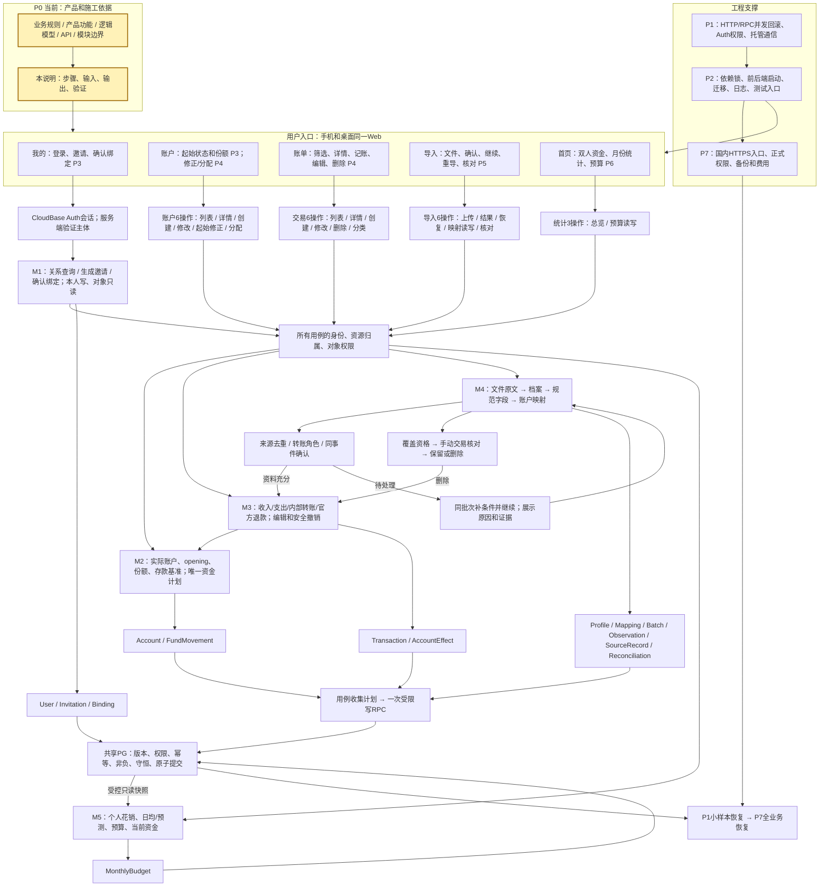
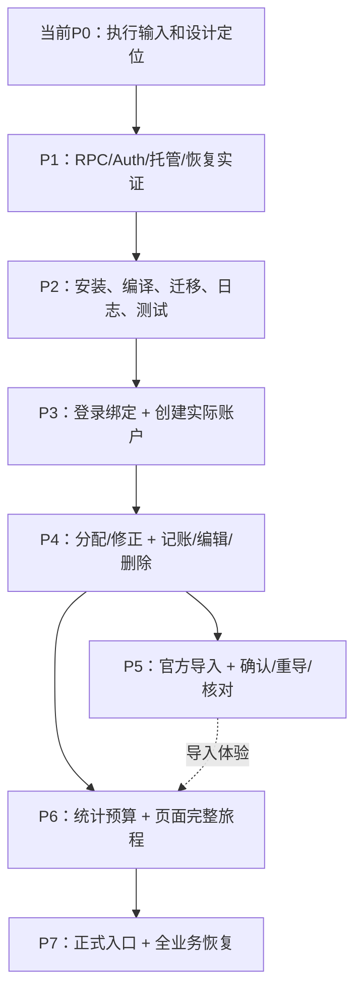

# 星账｜项目总施工说明

本说明负责把现有产品设计逐步实现为可用网页。业务行为依据[业务规则](BUSINESS_RULES_DISCUSSION.md)，页面依据[产品功能](PRODUCT_FUNCTION_MAP.md)，实体依据[逻辑模型](LOGICAL_DATA_MODEL.md)，请求/响应依据[API契约](API_CONTRACT.md)与[OpenAPI](../openapi.yaml)，模块所有权依据[模块边界](ENGINEERING_MODULE_BOUNDARIES.md)，选定技术与实际进度依据[实施计划](IMPLEMENTATION_PLAN.md)。本文的目录、命令、测试文件和环境变量是**待实现的施工约定**；只有该步骤创建并验证后才能运行，不表示仓库现在已有这些程序。当前处于P0，后续阶段均未开始。

## 1. 项目全景与固定文件位置

先读这张全景图。它同时覆盖用户入口、业务链、24个公开操作的分组、数据所有权和支撑能力。黄色表示当前P0在整理的施工依据；P3–P6标出功能首次出现的阶段。随后每阶段列出要完成的图中节点及顺序。



图中的记录框表示所有权和保存计划；M2/M3/M4通过应用用例一次提交，不能把三个箭头实现为三次独立HTTP写入。M1和预算用各自的受限写入；M5读已提交结果。查询不创建业务记录。当前在P0；其他节点是目标，不能据图声称已实现。

以下为固定的主要落点，目录随对应步骤首次创建。一个文件可再拆同目录私有辅助文件；公共入口、模块所有权和命令接口保持本说明约定。

```text
apps/web/src/
  main.tsx                    React启动
  App.tsx                     页面导航及登录状态入口
  api/client.ts               HTTP、Bearer、ETag、错误和幂等请求
  auth/session.ts             Auth登录、刷新、退出
  pages/HomePage.tsx           首页/月份/预算
  pages/AccountsPage.tsx       列表、创建入口、本人/对象切换
  pages/AccountDetailPage.tsx  详情、资料、初始状态、份额调整
  pages/TransactionsPage.tsx   列表、筛选、分页
  pages/TransactionPage.tsx    详情、创建、编辑、删除
  pages/ImportPage.tsx         上传和同批次全部结果/恢复操作
  pages/MyPage.tsx             登录及关系绑定
  components/                 已被两个页面复用的表单和状态组件
apps/api/src/
  app.ts / server.ts          Express组装 / 监听端口
  http/auth.ts                验证token并加载当前用户
  http/validation.ts          依OpenAPI校验入站请求
  http/errors.ts              输出契约code/message
  http/routes/m1.ts ... m5.ts  24操作分别接对应应用用例
  application/identity.ts     主体映射、邀请和绑定
  application/accounts.ts     创建、修改、分配和起始状态修正
  application/transactions.ts 交易创建、编辑、删除的跨模块协调
  application/imports.ts      解析、确认、恢复及核对的协调
  application/overview.ts     统计和预算查询/写入
  modules/m1/                 关系与资源授权规则
  modules/m2/funds.ts          唯一资金计划算法
  modules/m2/accounts.ts      账户规则、份额/基准读取投影
  modules/m3/transactions.ts  交易生命周期和effects
  modules/m4/parser.ts        文件/原文读取
  modules/m4/normalize.ts     官方字段到规范事实
  modules/m4/sources.ts       来源身份/观察/关联决策
  modules/m4/reconcile.ts     缺失核对资格与核对项
  modules/m5/overview.ts      统计公式及预算规则
  infrastructure/auth.ts     CloudBase服务端身份适配
  infrastructure/database.ts HTTP/RPC调用与错误转换
  infrastructure/commit.ts   各模块保存计划一次提交
  infrastructure/log.ts      脱敏结构日志
scripts/
  preflight.mjs               环境和配置前检
  migrate.mjs                 顺序迁移及校验
  check.mjs                   构建/契约/测试命令调度
  backup.mjs / restore.mjs    私有一致导出与隔离恢复
  verify-data.mjs             恢复前后完整性核对
  deploy.mjs                  已验证部署路径的单一入口
  verify-cloud.mjs            实际云路径验收
experiments/p1/               独立最小实验、夹具及运行器
experiments/p1/migrations/    仅实验专用对象和清理SQL
db/migrations/              已验收后可供正式工程使用的顺序SQL
tests/unit/                 规则和解析的独立算例
tests/contract/             实际HTTP的24操作
tests/integration/          真正HTTP/RPC/数据库行为
tests/e2e/                  双身份页面与完整旅程
```

实验专用表/注错入口由`experiments/p1/migrations`持有；`db/migrations`只接收经P1确认可复用的结构/函数/授权及后续业务迁移。P2明确二者的清理与接收，生产迁移不安装故障注入函数。SQL函数和授权正文随有序迁移保存。

## 2. 统一施工、命令、日志和测试约定

### 2.1 开始一个步骤

在指定基线执行`git status --short --branch`和`git rev-parse HEAD`，记录提交与现有改动；创建本阶段分支。先领取上一步交付的代码、迁移、配置名称和测试结果，再创建本步列出的文件。遇到缺失输入、规范冲突或测试失败，停止当前步骤，报告步骤编号、已改文件、实际命令/退出码、预期与实际及阻塞事实；用户明确后续范围后续做。完成步骤必须产出可检查的代码/结果，不能以“已考虑”验收。

### 2.2 固定运行环境与命令接口

沿用已选React/TypeScript/Vite、Node/Express、CloudBase Auth与共享PG HTTP/RPC。Node采用已定24系列；P0记录实际小版本与npm版本。P2采用npm workspaces，根清单列`apps/web`和`apps/api`，两应用均`private: true`，后端`type: module`；锁文件只在根目录维护。

P2创建两个应用清单后，从根目录首次安装：

```bash
npm install --save-exact --workspace apps/web react react-dom
npm install --save-dev --save-exact --workspace apps/web vite typescript @vitejs/plugin-react @types/react @types/react-dom
npm install --save-exact --workspace apps/api express ajv ajv-formats yaml
npm install --save-dev --save-exact --workspace apps/api typescript @types/node @types/express
npm install --save-dev --save-exact @playwright/test
npx playwright install chromium webkit
npm ls --all
```

实际解析版本写入清单和锁文件并完成构建兼容性检查；后续检出使用`npm ci`，不重新解析版本。契约校验采用Ajv的2020-12入口与ajv-formats，yaml读取根OpenAPI，保持components引用并从每个operation提取入站/响应schema，测试额外字段、严格类型和引用组合；禁止通过类型强转冒充运行时校验。页面测试采用Playwright，建立playwright.config.ts的桌面Chromium和移动WebKit项目，真实手机仍在阶段验收中验证。P5采用ExcelJS读取XLSX，并先通过两种真实文件头和行数据检查；执行`npm install --save-exact --workspace apps/api exceljs`后提交锁文件。Auth/数据库访问复用P1实际验证的方式；若需SDK，在P1记录包名、精确版本和实测调用，P2按该结果安装。工具验证失败按步骤停下。依据：[Ajv JSON Schema](https://ajv.js.org/json-schema.html)、[Playwright安装与浏览器](https://playwright.dev/docs/browsers)、[ExcelJS读取接口](https://github.com/exceljs/exceljs/blob/master/index.d.ts)。以上npm/Vite命令依据见[官方npm install](https://docs.npmjs.com/cli/v11/commands/npm-install/)、[npm ci](https://docs.npmjs.com/cli/v11/commands/npm-ci/)、[Vite启动](https://vite.dev/guide/)。

在P2编写脚本并给根`package.json`建立以下命令；以下是**要实现的命令合同**，编写前运行应视为缺少产物：

- `npm run preflight`：运行`scripts/preflight.mjs`，检查Node/npm、所需配置名称、环境用途；输出通过/失败及非敏感目标。
- `npm run dev:web`：调用Web workspace的Vite；开发端口5173，通过代理访问本地API。`npm run dev:api`：编译API后运行`dist/server.js`，端口3000。
- `npm run typecheck`：两个应用各执行`tsc --noEmit`；`npm run build`：Web类型检查后Vite构建，API编译到dist。
- `npm run db:migrate -- --target test`：由迁移脚本按编号及内容校验值执行；已执行且内容变化须拒绝，缺权限须报失败。`test`由配置映射真实隔离目标；`production`仅P7明确发布时可选。
- `npm run test:unit`、`npm run test:contract`、`npm run test:integration`、`npm run test:e2e`：`scripts/check.mjs`先编译测试需要的TS，按类别运行对应测试，汇总退出码；单元/HTTP测试使用[Node测试运行器](https://nodejs.org/docs/latest-v24.x/api/test.html)，页面测试由本地已锁定的Playwright执行，check.mjs转发其退出码。
- `npm run verify:cloud -- --phase Pn`：运行`scripts/verify-cloud.mjs`中本阶段真实部署用例；缺真实环境、身份或用例时必须失败，不能跳过后返回成功。

配置模板分别放`apps/api/.env.example`与`apps/web/.env.example`：API需要`PORT`、`APP_ENV`、`WEB_ORIGIN`、`CLOUDBASE_ENV_ID`、`PG_HTTP_BASE_URL`及后端凭据的私有加载位置；Web仅放`VITE_API_BASE_URL`与Auth公开环境标识。管理凭据只在迁移/部署的私有运行环境注入；具体平台字段名由P1验证结果确定，适配到这些应用配置名。真实文件、日志和备份目录通过私有路径提供。

### 2.3 必须留下的证据

安装/迁移/测试每次保存到被Git忽略的`artifacts/<阶段>/<运行号>/`：`run.json`记录阶段步骤、提交、时间、Node/npm版本、非敏感环境标识、命令、退出码和时长；`test-results.json`记录case_id、输入夹具ID、独立预期、实际值与失败原因；命令stdout/stderr经脱敏保存。测试脚本传递失败退出码，进程退出0但未运行必需用例也判失败。将实测摘要和产物提交写入实施计划§2.6，详细私有文件只引用受控位置。

API每个请求记录request_id、operationId、状态码、耗时、错误code及内部提交结果；幂等键/身份使用不可逆摘要，日志不存token、原始单号、raw_fields或完整请求体。写成功而响应丢失记为“已提交、发送结果未知”；原子失败记为“提交失败/回滚”；不能把网络超时伪报为已回滚。request_id放响应头，保持契约错误正文只有code/message。

各阶段分别验四件事：业务算例独立正确；HTTP输入/输出及权限符合契约；真实RPC持久化/并发/回滚正确；页面操作和重新读取符合预期。字段校验通过不能替代业务结果，单元测试不能替代云端验收。

### 2.4 依赖编号与领取证据

D01为已冻结业务/产品/API/模型/模块资料；D02为接收的Git基线与前步产物；D03为实测运行版本和锁文件；D04为隔离资源、访问与费用授权；D05为两名Auth身份及受限权限；D06为已验收的账户/资金快照/M3账务能力；D07为私有真实样本与独立合成预期；D08为部署与一致导出/独立恢复路径；D09为实际命令结果和变更决定。每步按其开工输入领取定位、版本和证据，未提供项记录具体阻塞动作。P0登记、P1核实，后续阶段只接收已实际验收的能力。

## 3. 阶段依赖与当前环节

P0当前准备输入；P1先验证平台能力；P2把有效方式装进可运行工程；P3–P6按用户功能逐步接通；P7发布并恢复验证。P6统计可从P4开始，完整体验等待P5。



依赖领取：P0记录源码提交、运行版本、隔离环境与HTTP/RPC地址、管理/受限身份、两名Auth测试用户、真实官方样本私有位置、恢复目标、费用授权及日志读取位置；P1逐项验证。P3领取P2可运行服务及真实身份；P4领取实际账户与资金快照；P5领取M2/M3已验收能力和官方样本；P6领取正式账务与导入结果；P7领取候选提交、正式资源/域名和私有备份目标。任何一项尚未取得，只能标明首次阻塞的步骤，不能写成已具备。

## P0

**当前施工：准备可以直接领取的源码、资料和环境。**依据六份核心文档；此阶段完成后应能确定P1第一条命令在哪里运行、向哪个隔离目标发请求。

1. **P0.1 固定起点。**记录当前分支/提交与未提交文件，从接收的基线建立工作分支；README写唯一进度入口。建立简短AGENTS，规定按本说明步骤执行、按路径提交、失败报告实际状态。
2. **P0.2 定位设计。**把API通用正文与M1–M5正文放入`docs/api/COMMON.md`及`M1_IDENTITY.md`、`M2_ACCOUNTS.md`、`M3_TRANSACTIONS.md`、`M4_IMPORTS.md`、`M5_OVERVIEW.md`；官方字段正文放`docs/import/OFFICIAL_FIELDS.md`。原入口保留章节/operation锚点并链接正文，逐段校对内容等价。核对五页面区域、M1–M5、24个operationId、实体与本说明§5的F01–F10对应关系。修复文档引用；正文归属保持唯一。业务/API字段差异先报告准确文件和字段，解决后才能向后施工。
3. **P0.3 登记输入。**在实施计划新增“P1开工输入登记”：填Node/npm实际版本、可执行路径、测试环境ID/地域、数据库HTTP地址、SQL管理路径、后端受限身份、两个Auth用户、Web/Node托管位置、私有导出目录、独立恢复目标和资源费用范围。未知值写明阻塞P1哪个编号；真实密钥仅记录加载位置。
4. **P0.4 验证领取。**执行`node --version`、`npm --version`；用所给身份发受控只读请求，确认落在指定隔离环境。验证可读取两种官方文件的私有路径并记录文件指纹/各169行事实；不把文件写入Git。汇报能启动的P1步骤及未满足的资源条件。

**交付与退出：**P0-D1为Git/执行规则，D2为可定位的业务资料，D3为环境输入，D4为实际核对结果。输入未知可以登记，但P1对应写入步骤在取得实值前不得开始。此轮只编写说明，不把这些步骤记成已执行。

## P1

**开发图中节点：受限RPC、身份验证、最小托管与小样本恢复。**领取P0-D1–D4。实验代码独立于生产应用，验证F01/F02/F03/F07/F10需要的底层能力。

1. **P1.1 写环境检查。**创建`experiments/p1/preflight.mjs`，读取P0非敏感目标与私有凭据位置，拒绝正式数据目标，分别验证管理角色可执行SQL、后端角色只能执行规定RPC。运行`node experiments/p1/preflight.mjs`；输出目标ID、每项状态、失败退出码，不输出凭据。
2. **P1.2 建最小实验。**创建`experiments/p1/migrations/001_probe.sql`和`fixtures.json`：测试用户A/B、账户、份额、交易/effects、movements、来源当前关联、幂等结果及控制版本。明确来源唯一键、份额非负检查及行锁顺序；迁移通过P0提供的管理SQL路径执行。创建`read_snapshot`和`commit_plan`实验函数：前者同一快照取状态/版本，后者收取有明确结构的计划，在同事务内检验版本/权限/守恒并保存。所有函数和授权可从SQL复现。
3. **P1.3 验证一次提交。**创建`experiments/p1/run.mjs`及`atomicity.test.mjs`。运行`node experiments/p1/run.mjs --case atomicity`：500000分账户支出2580分，成功后497420分；在保存来源关联前用实验专用注错点失败，比较交易/effects/movements/关联/幂等完成结果，全部不得留下本次写入。检查输出预期、实测及退出码。
4. **P1.4 验并发与重放。**运行`node experiments/p1/run.mjs --case concurrency`：10000分账户两个独立请求各支8000分，最终只能成功一个、余额2000；同键同请求返回原结果、同键不同请求拒绝、同来源并发只关联一次；读取后被修改的旧计划不得提交。测试初始化/清理只操作本次实验数据。
5. **P1.5 验Auth与托管。**`run.mjs --case auth`用A/B及失效token分别调用Node测试入口；核对401、非本人拒绝、浏览器token直写表/直调内部提交RPC拒绝。`run.mjs --case deploy`部署最小Web显示真实Node响应，记录浏览器来源配置、冷/热耗时和实际环境；不得用假token替代真实身份验收。
6. **P1.6 验恢复。**实现`run.mjs --case restore`：在一致快照或明确停写窗口导出小数据到私有目录；独立目标重建SQL与权限、恢复数据并逐项比对资金/来源/版本/用户映射，再用受限身份验证恢复后的权限。记录导出时刻、恢复完成时刻及实际用量。

**交付与退出：**P1-D1为atomicity/concurrency证据与SQL，D2为真实Auth/托管证据，D3为能实际恢复的导出路径。平台管理接口、RPC payload、错误返回和身份字段在本阶段按实际调用结果固定；尚未验证的值不能写进P2实现。三项全部通过后P2接收有效实现，并记录实验对象清理步骤。

## P2

**开发图中节点：Web/API工程、固定依赖、迁移、日志与测试入口。**接收P1-D1–D3及环境配置；后续业务都通过这一工程运行。

1. **P2.1 安装工程。**创建根和两个workspace清单，按§2.2安装依赖，保存根锁文件和运行版本；建立Web的`index.html`、`vite.config.ts`、`tsconfig.json`、`src/main.tsx`，API的`tsconfig.json`、`app.ts`、`server.ts`。运行`npm ls --all`和两应用编译，错误归入安装日志，不带错进入下一步。
2. **P2.2 编写脚本。**实现§2.2各根命令及环境模板。`check.mjs`按类别发现测试并拒绝零用例假通过；类型错误/测试失败传递非零退出码。测试编译输出到被忽略目录。Playwright安装后用最小页面点击/请求断言验证可运行，锁定版本；这属于测试工具验收，不是产品验收。
3. **P2.3 建HTTP和会话接线。**`app.ts`挂载`/api/v1`，HTTP层按OpenAPI拒绝额外字段、错误类型和缺失字段；`auth.ts`接P1已验证的主体核验；统一`errors.ts`及`log.ts`。内部`/healthz`只报告进程状态，不列为第25个业务API。前端`api/client.ts`统一Bearer、ETag、幂等键和code/message，区分HTTP业务失败与网络结果未知。
4. **P2.4 接真实持久化。**将已验收的HTTP/RPC方式装入`database.ts`和`commit.ts`；`migrate.mjs`实现编号顺序、校验值和目标确认，接收可复用SQL到`db/migrations`，实验专用表/注错函数仍留实验目录。运行`npm run db:migrate -- --target test`两次，第二次无重复变更；修改已执行文件校验值时应拒绝。
5. **P2.5 建页面外壳。**`App.tsx`建立首页、账户、账单、导入、我的五个固定导航，手机底部/桌面侧栏；未登录进入我的认证界面。各页面功能在P3–P6接入，尚未交付的页面只显示当前状态，不能用假余额/假交易。记录各入口组件名和页面切换行为，确保刷新路径能回到同一入口。
6. **P2.6 全新检出复现。**在第二个干净检出目录依次运行`npm ci`、`npm run preflight`、`npm run typecheck`、`npm run build`、迁移命令、两条dev命令；浏览器5173请求API3000可得真实响应。运行契约/集成基础测试和`npm run verify:cloud -- --phase P2`，用同一构建产物复验云端来源、认证和日志。

**交付与退出：**P2-D1是可安装启动工程，D2是HTTP/迁移/日志/测试入口，D3是干净检出与云端复现结果。公开业务操作仍由后续阶段逐个完成。

## P3

**开发图中节点：我的/M1、账户/M2及身份与起始资金数据。**完成F01及F02创建；接收P2工程、两个真实身份。以下按序实施，每条都先服务端保存/读取，再接页面。

1. **P3.1 身份映射。**迁移建立User与认证主体唯一约束；`infrastructure/auth.ts`只返回验证后的主体，`application/identity.ts`完成明确的用户初始化流程，GET关系查询保持只读。`auth/session.ts`实现登录/刷新/退出，`MyPage.tsx`显示会话状态；退出后清除页面私有查询状态。测试伪造user_id不能取得权限，失效token触发401。
2. **P3.2 邀请绑定。**迁移建立Invitation/Binding；实现`m1.ts`三个操作及`identity.ts`的发起/消费逻辑。我的页先查状态→发起邀请→展示凭据和有效期；接收方输入并确认→双方重新查状态。测试10分钟、单次消费、新邀请作废旧邀请、两人均未绑定、并发消费只有一次成功。
3. **P3.3 创建账户。**迁移建立Account、FundMovement和账户控制版本；`accounts.ts`生成opening计划，创建与初始份额一起提交。接`listAccounts/getAccount/createAccount`；`AccountsPage.tsx`列表空态带创建入口，表单收名称/类型/保管关系/起始日/余额/份额，`AccountDetailPage.tsx`展示完整opening_state及当前份额。测试非法未来日期、份额重复/合计不等、未绑定对象份额及同键重放。
4. **P3.4 对象只读。**账户页的本人/对象切换调用view对应查询，详情依read_only隐藏写动作，服务端仍拒绝对象写；不可见资源404、可读不可写403按契约验。用户A账户中B的存款不赋予B修改该账户的权利。
5. **P3.5 验收链。**创建`tests/contract/m1.test.ts`、`m2-create.test.ts`、`tests/integration/account-opening.test.ts`、`tests/e2e/identity-accounts.test.ts`；固定A/B身份，创建100000分账户，初始本人流动20000/本人存款50000/对象存款30000，三份额与总额一致。运行四类命令及`verify:cloud -- --phase P3`，手机/电脑刷新读回相同结果。

**交付与退出：**P3-D1身份/关系，D2账户/opening，D3真实页面六API闭环。向P4交账户ID、版本、份额和授权入口；测试值仅在隔离夹具使用。

## P4

**开发图中节点：M2唯一资金、M3账务、账户修正和账单页面。**完成F02修正、F03/F04；先为每类行为写独立算例，再按下列顺序接用例和页面。

1. **P4.1 实现资金计划。**`m2/funds.ts`只接状态、明确操作和必要原计划，返回份额变动/基准变动与错误。新建`tests/unit/funds.test.ts`：初始流动20000/本人存款50000/对象存款30000，支出25000后为0/45000/30000；同一初始状态支出80000后为0/0/20000，再独立退款15000应回补为0/5000/30000。普通收入只加本人流动，分配总额为0，转账只允许流动资金。所有金额是分。
2. **P4.2 建交易与一次提交。**迁移Transaction/Effect及与Movement的约束；`m3/transactions.ts`生成交易/effects，`application/transactions.ts`负责权限、读取一致快照、M3→M2计划、一次提交。实现`createTransaction`三种手动类型，受限RPC保存交易/effects/movements和幂等结果；官方退款内部资格入口由P4隔离样例验证，P5接真实来源。
3. **P4.3 接读取和记账页。**实现`listTransactions/getTransaction/listCategories`，接`TransactionsPage.tsx`本人/对象、日期/类型/账户等契约筛选与游标；筛选变化清旧游标。`TransactionPage.tsx`创建/详情复用，选账户和分类→保存→展示account_changes/notices→重新读列表/账户。支出动用存款要显示使用额。内部转账必须选两端；起始日前交易保存历史端并明确当前余额影响。
4. **P4.4 实现编辑和删除。**增加`patchTransaction/deleteTransaction`，编辑前获取ETag；按[业务§4.3](BUSINESS_RULES_DISCUSSION.md#43-编辑与删除)区分差额、撤销重建、仅日期、仅抵减与空改动。页面保存失败保留输入，旧版本显示冲突并重读。测试跨单端/双端起始日、转账两端、删除无法非负则全拒绝、空改动版本不变、消费删除不连带退款。P5再接来源解除分支。
5. **P4.5 接账户维护。**`application/accounts.ts`实现`patchAccount/putOpeningState/adjustFunds`，详情提供资料编辑、初始状态修正、两份额等额调拨。opening修正由用例协调M2/M3重新判断受影响effects和有效movements；不能重建则整笔409。测试份额调整不计收入/消费、基准跟随调拨、已映射钱包类型修改约束在P5集成后复验。
6. **P4.6 验收链。**增加`tests/unit/transactions.test.ts`、`tests/contract/m2-edit.test.ts`和`m3.test.ts`、`tests/integration/ledger.test.ts`、`tests/e2e/bookkeeping.test.ts`；实跑并发、同键重放、旧版本和注错，核对数据库没有半笔/单边转账。执行四类命令及`verify:cloud -- --phase P4`。仅统计尚未交付时记录affected_months，P6接首页刷新。

**交付与退出：**P4-D1正式资金/交易能力，D2内部退款，D3九API和页面。M3内部资格、计划结构、一次提交接口、错误与版本条件作为可编译类型/函数导出供P5使用。

## P5

**开发图中节点：导入页面、M4及其全部来源实体，接回M3/M2。**按F05→F06→F07→F08施工；接收P4真实账务、两份各169行官方私有样本及测试账户映射。

1. **P5.1 持久化证据。**迁移Profile/Mapping/Batch/Observation/SourceRecord/Reconciliation及唯一/版本约束；安装§2.2指定ExcelJS并验证两种实际XLSX，先实现`m4/parser.ts`，测试文件头、声明范围、实读行数、原值保留。`uploadImport`先校验体积/结构，再保存批次与逐行观察。原始文件与raw_fields仅本人可读。
2. **P5.2 规范字段。**实现`normalize.ts`，按[模块字段字典](ENGINEERING_MODULE_BOUNDARIES.md#4-逐字段去向)保留完整文本单号、北京时间、整数分、渠道键、状态和分类证据。测试优惠40.79元仍为4079分，微信两退款44/26分共70分；已存入零钱线索、亲情卡/花呗/带费转账、等待收货、关闭分别按冻结规则输出候选/不支持/无效，不在解析器写账。
3. **P5.3 档案和映射。**实现`getImport/listMappings/putMapping/resolveImport`对应分支；`ImportPage.tsx`先上传，再显示同batch结果，档案未定时选择/创建；缺账户时取规范键和listAccounts选实际Account，保存mapping后自动resume。测试两微信档案不串零钱，同一卡跨平台经确认映射，角色未明不猜两端。
4. **P5.4 自动入账及确认。**`sources.ts`判断稳定来源、角色、同事件候选；`application/imports.ts`把明确事实与已验证官方资格交M3，经M2一次提交账务和当前关联；按occurred_at及完整官方单号排序处理。页面已明确消费直接出结果，角色/同事件待定只提供allowed_actions；用户确认后继续。七类结果合计始终等于实读行数，成功行有transaction_id。
5. **P5.5 重导与恢复。**实现旧观察/冲突处理、用户编辑保留、关联为空的重新评估、同键重放与新操作重导。来源账单删除接到`application/transactions.ts`，原子清当前关联并保留观察。真实链：首次导入→编辑→重复导入不覆盖→删除→新导入只恢复一次；匹配单候选也必须确认。
6. **P5.6 缺失核对。**`reconcile.ts`按覆盖范围/身份/映射/全批结果判断资格，`reviewReconciliation`处理保留或M3删除。结果页显示blockers、独立核对游标与按钮。测试一条unsupported/needs_review/failed就阻止自动核对但可入账行照常；银行卡无档案不猜；重叠批次复用项；保留不改资金、删除和结案原子提交。
7. **P5.7 验收文件与极限。**建立`tests/unit/import-parser.test.ts`、`tests/contract/m4.test.ts`、`tests/integration/import-lifecycle.test.ts`、`tests/e2e/import-recovery.test.ts`，私有夹具通过环境路径读取。逐行核对两份各169行的金额、账户、结果和资金；真实云测试接近10MiB、10000行及超限，记录冷/热耗时、内存、网关状态与最终写入。超限413无写账；同步时限未通过时报告准确瓶颈，不擅改API形态。

**交付与退出：**P5-D1六API与来源能力，D2完整导入/恢复/核对页面，D3真实样本和限额证据。P4的来源删除、钱包映射类型约束和退款编辑在本阶段补全联测。

## P6

**开发图中节点：首页/M5、个人预算、双方当前资金及跨页面完整体验。**统计可领取P4数据开始；整体验收要接收P5所有结果。

1. **P6.1 查询模型。**迁移MonthlyBudget及owner/month唯一和版本约束；`m5/overview.ts`读取正式M3交易和M2有效资金，按[业务M5公式](BUSINESS_RULES_DISCUSSION.md#6-m5首页统计与预算)计算，时间由用例传入。实现`getOverview/getBudget/putBudget`，预算写不参与账务重算。
2. **P6.2 首页和预算。**`HomePage.tsx`默认当前月，资金区显示当前本人流动/存款及绑定后的对象流动/存款；消费区展示支出、抵减、净额、日均、上月整月日均比较、预测、预算剩余/超支。历史月份只换统计，当前资金标识保持；未来预算经getBudget/putBudget设置，overview不查询未来。
3. **P6.3 计算验收。**`tests/unit/overview.test.ts`固定时钟和独立输入：8月支出10000、9月退款3000，分别为8月10000/9月-3000；退款改到8月后8月7000；关抵减后8月10000且到账不变。另测历史/当前月天数、上月零分母null、中间不舍入、负净额、无预算和对象消费隔离。
4. **P6.4 打通页面。**五导航贯通，创建/编辑后返回可定位的列表或详情；GET失败只提供读取重试，未知写入用原幂等键确认。401恢复会话，字段错误停留表单，412/409按契约展示。账户/账单分页和导入两个游标独立，筛选变化重置游标。手机触摸、金额/日期输入及桌面宽屏分别检查。
5. **P6.5 全旅程验收。**增加`tests/contract/m5.test.ts`和`tests/e2e/full-journey.test.ts`，用A/B分别走F01–F10，列出24操作的页面调用位置；执行四类命令与`verify:cloud -- --phase P6`。读失败不可重建交易，对象无写按钮且服务端拒写；截图/日志记录实际行为。

**交付与退出：**P6-D1三API和正确统计，D2五页面连贯体验，D3完整候选提交及真实双端证据。

## P7

**开发图中节点：正式国内入口、完整恢复、费用与维护。**领取P6候选提交、P2构建方式、P1恢复路径及正式资源/域名/授权。

1. **P7.1 固定候选。**在干净检出目录`npm ci`、typecheck、build和四类测试；记录提交、镜像/静态资源指纹、迁移版本。`deploy.mjs`检查正式目标、配置名称、Auth允许来源和HTTPS，并列出本次将发布的版本。
2. **P7.2 迁移和部署。**执行经确认的`npm run db:migrate -- --target production`及`scripts/deploy.mjs`；部署同一候选构建，记录每个操作结果。国内手机/电脑打开正式入口，验证登录、账户、记账、导入及对象只读；`verify:cloud -- --phase P7`用被授权的独立验收数据，清理仅限本次验收对象。
3. **P7.3 完整备份恢复。**实现并运行`backup.mjs/restore.mjs/verify-data.mjs`，参数要求来源/独立目标/私有输出路径。先取得一致导出或停写窗口；独立目标重放迁移和权限再恢复所有业务表；比较用户sub映射、交易/effects/movements、来源观察及当前关联、核对状态、预算、版本与幂等状态。恢复后以真实受限身份跑权限与金额查询。
4. **P7.4 维护交付。**记录实际恢复耗时和数据窗口，与每日备份/保留7份/RPO24小时/RTO4小时目标对照；实际费用按计算、网络、存储、日志、备份列出观测入口及金额。README给唯一正式入口、版本、备份运行方法与回退次序；镜像回退与数据库恢复分别写明。实际失败必须保留恢复/回退现场，不标上线验收。

**交付与退出：**P7-D1正式入口和版本，D2全业务可恢复证据，D3可执行维护说明及费用事实。F01–F10在正式链路与恢复后的数据均正确，才登记正式个人账本可用。

## 4. 公开API交付归属

唯一首次实现归属如下；具体字段、响应和错误始终从[API契约](API_CONTRACT.md#2-全量操作索引)及[OpenAPI](../openapi.yaml)读取。P6对24个操作做使用位置与回归检查，不重写各阶段归属。

- **P3 / M1：**`getRelationship`、`createBindingInvitation`、`bindRelationship`。
- **P3 / M2：**`listAccounts`、`getAccount`、`createAccount`。
- **P4 / M2：**`patchAccount`、`putOpeningState`、`adjustFunds`。
- **P4 / M3：**`listTransactions`、`getTransaction`、`createTransaction`、`patchTransaction`、`deleteTransaction`、`listCategories`。
- **P5 / M4：**`uploadImport`、`getImport`、`resolveImport`、`listMappings`、`putMapping`、`reviewReconciliation`。
- **P6 / M5：**`getOverview`、`getBudget`、`putBudget`。

CloudBase Auth承接登录/刷新/退出，P3接入。P4的内部退款能力由P5官方来源调用，没有额外公开退款操作。

## 5. 功能链和业务验收依据

下面是本计划的**业务主索引**。每一条都指定用户在页面做什么、何时出现、哪几个API/模块接力、该链的具体分支及可观察的验收；精确字段和不变量继续由所链接的主责文档维护。阶段章节负责安排代码位置与施工先后；按阶段步骤读取对应链的输入。某链未通过时，不能仅因对应API有返回值便宣称该功能完成。流程中“刷新”指成功保存后重新调用读取接口；读取失败时保留已知的写入结果并单独重试读取。[统一的HTTP错误、版本和幂等语义](API_CONTRACT.md#1-通用行为)适用于全部链。

### F01 登录、邀请和只读对象（P3，P4/P6复验）

入口是`我的`登录与绑定状态。`web/src/auth`从CloudBase Auth取得会话，`web/src/api`带Bearer请求；后端`http`验token并由`m1`找到内部User，页面调用`getRelationship`。未绑定时发起人用`createBindingInvitation`取得10分钟、一次性的凭据，自行交给接收人；接收人用`bindRelationship`确认，然后双方刷新状态。绑定成功后账户与账单页才显示对象视图。写操作始终由服务端按资源归属判断，资金在本人账户属于对象不等于对象可写。规则定位：[业务M1](BUSINESS_RULES_DISCUSSION.md#2-m1身份与关系)、[产品M1调用](PRODUCT_FUNCTION_MAP.md#m1-身份与关系)、[API M1](API_CONTRACT.md#4-m1接口行为)。

验收时用A/B两个身份：邀请更新使旧凭据失效；过期、重复消费、任一方已绑定均返回契约规定的结果；B能读A获授权的账户/账单而不能编辑、删除、导入A的内容；B的账单响应没有A的原始文件、对方账号和观察字段。P3先测账户，P4账单出现后复验账单，P5导入出现后复验原文私有。

### F02 实际账户、起始日和三类份额（P3；P4补修正）

`账户`页先用`listAccounts`、`getAccount`取本人/对象视图及当前版本，创建银行卡/微信零钱/支付宝余额/现金时调用`createAccount`，把起始日期、初始余额和各份额按契约提交，页面读回opening_state、余额与归属。`m2`拥有Account和opening的movements，`application`核本人写与绑定资格，`infrastructure`持久化。P4同一详情页接`patchAccount`、`putOpeningState`、`adjustFunds`：改名称或保管关系、修正起始余额/日期、在同一真实账户内转份额，并显示回补缺口。规则定位：[业务M2](BUSINESS_RULES_DISCUSSION.md#3-m2账户与资金分配)、[模型资金真相](LOGICAL_DATA_MODEL.md#2-资金真相)、[API M2](API_CONTRACT.md#5-m2接口行为)。

验收时从零创建本人流动/本人存款份额，绑定后添加对象存款；检查合计等于真实余额、份额非负、未绑定不能有对象存款，手动分配前后账户总额不变；起始日期变更重新判定受影响交易effects并原子提交，刷新和换设备读取一致。对象账户只读，不能提供对象流动份额。初始修正/分配的业务结果在P4与F03、F04联测。

### F03 普通收入、支出、内部转账（P4）

用户在`账单`页点记账：`listCategories`取分类，`listAccounts`选本人实际账户，表单按[产品记账字段](PRODUCT_FUNCTION_MAP.md#账单与手动记账)收金额、时间、账户、分类及商户/备注；内部转账选择本人两端账户。`createTransaction`经M1权限→M3生成Transaction/effects→M2按**本人流动→本人存款→对象存款**扣减或对收入加本人流动→单次RPC保存；内部转账仅本人流动份额、两端等额且分别判起始日。`listTransactions`/`getTransaction`展示真实账单与当前版本，成功后重读受影响账户与账单。规则定位：[业务§3.1/§3.3与§4.1](BUSINESS_RULES_DISCUSSION.md#3-m2账户与资金分配)、[模型资金真相](LOGICAL_DATA_MODEL.md#2-资金真相)、[API M3](API_CONTRACT.md#6-m3接口行为)。

验收用明确初始份额构造跨份额支出，分别断言M3 effects、M2 movements及余额/份额；收入不变成退款，转账不计支出；交易早于某账户起始日只保留该端historical_only且可计消费；注错、并发、余额不足时没有半笔或单边转账。同键重试结果与钱一致，页面在保存后查询失败时不会生成第二笔。

### F04 编辑、撤销和日期变化（P4；P5来源联测）

从`listTransactions`进入`getTransaction`详情，拿到ETag后用`patchTransaction`改合法字段，或`deleteTransaction`安全撤销；刷新账单与对应账户。M3基于**本交易原effects/计划**生成变化，M2处理支出差额、普通收入/退款旧影响撤销再生成新影响、起始日前后转换与转账两端；应用用例在一次RPC中保存版本、effects和movements。官方来源账单删除时还需M4当前关联清空但观察保留；P4先验证不含来源的编辑/删除，P5联测这一支。规则定位：[业务编辑删除](BUSINESS_RULES_DISCUSSION.md#43-编辑与删除)、[模型§4–5](LOGICAL_DATA_MODEL.md#4-编辑删除和原子性)、[API M3](API_CONTRACT.md#6-m3接口行为)。

验收分别测合法空改动不增版本、旧ETag被拒、仅改日期同/跨起始日、支出增减差额、改账户、删除导致份额负值时整笔拒绝；删除一笔消费不改变独立退款。P5还要测来源关联被解除后重导可重新评估，用户对已有来源交易的编辑在重复导入后仍保留。

### F05 上传官方文件、保留证据和判断行（P5）

用户在`导入`选微信/支付宝官方XLSX并调用`uploadImport`。`m4`读取头与所有行，先保留ImportBatch/SourceObservation及raw_fields，再按[已确认字段](ENGINEERING_MODULE_BOUNDARIES.md#4-逐字段去向)解释官方单号、北京时间、金额、渠道、状态与分类，查profile和mapping，结果由`getImport`在同一个页面展示读取、标准化、账户/交易判断、正式处理四个阶段。账户/档案/角色未定的行保留证据并给下一操作；不支持亲情卡、花呗和带费转账的行说明原因。规则定位：[业务M4§5.1–5.3](BUSINESS_RULES_DISCUSSION.md#5-m4官方导入)、[产品导入步骤1–5](PRODUCT_FUNCTION_MAP.md#官方导入)、[API M4](API_CONTRACT.md#7-m4接口行为)。

验收两份各169行文件逐行对照原字段与已确定的解释；七类disposition总和分别等于各自实读数，行阶段不能替代结果；解析/不支持/待处理不会造账。退款是独立来源行，“原消费已退款”的状态不删除原支出，红包优惠不额外扣金额，未知渠道不能默认微信零钱。解析结论与实际资金分别核验。

### F06 档案、渠道与少量确认后继续处理（P5）

首次档案不明时`getImport`返回候选和profile_version，用户在本批次用`resolveImport`选/建来源档案；缺渠道映射时`listMappings`显示档案内规范渠道键并结合`listAccounts`让用户选实际Account，`putMapping`保存后`resolveImport`对原batch执行resume，无须重新上传。角色未明的普通转账在页面选择收入/支出/本人内部转账；同事件弱候选让用户确认后再关联。能执行的行由M4给M3已确认事实，M3复用M2，一次RPC同时保存账务与当前来源关联；商户退款默认抵减、转账退回默认不抵减，**退款不要求找原消费**。规则定位：[业务§5.2–5.4](BUSINESS_RULES_DISCUSSION.md#5-m4官方导入)、[产品导入步骤2–5](PRODUCT_FUNCTION_MAP.md#官方导入)、[模块§8](ENGINEERING_MODULE_BOUNDARIES.md#8-程序中的数据依赖与提交位置)。

验收两微信档案的零钱映射互不串用，同银行卡经用户确认可跨平台映射；角色确认与两端账户不全时不能假定内部转账；补映射后原batch结果刷新且成功行显示正式ID；来源关联保存失败与账务一起回滚。官方退款可从结果页创建，到账增加且按记账月份抵减；用户改日期或抵减后重查统计，原始source时间不变。

### F07 去重、重导和用户修改保护（P5）

同一来源身份是profile加**完整官方单号**。重复官方行对有效关联走`duplicate_existing`；另一个平台文件疑似同一手动交易或内部转账时，匹配仅给候选，确认后`linked_existing`；此前删除使关联为空时，新上传或resume重新评估并可`created`。同文件新上传仍是新操作，与24小时HTTP幂等键重放分开；旧观察保留，较旧导出不覆盖当前重要事实，同时间冲突或已入账来源重要事实变化交用户处理。链路仍使用`uploadImport`→`getImport`→必要时`resolveImport`，不增加新公开接口。规则定位：[业务§5.4](BUSINESS_RULES_DISCUSSION.md#54-重试重导与匹配)、[模型§5](LOGICAL_DATA_MODEL.md#5-来源生命周期)。

验收依次做：首次创建→用户编辑日期/金额→重复导入不覆盖编辑/不再扣款→删除交易但保留观察→新操作重导恢复一次；另测较旧/同时间冲突观察、同来源并发、同HTTP幂等键同/不同请求。分别检查SourceRecord当前关联、SourceObservation历史、Transaction及资金，不只看前端提示。

### F08 具备资格后核对手动账单（P5）

batch显示声明与实读数、覆盖范围、导出时间、档案、关联账户以及reconciliation_eligible与blockers。只有全量、时间/身份/映射充分且没有unsupported、needs_review、failed行时，在`getImport`结果页列出可核对的无官方来源手动交易；用户用`reviewReconciliation`保留并标记，或选择删除。保留只变核对状态；删除调用M3撤销交易并与核对项一次提交。规则定位：[业务§5.5](BUSINESS_RULES_DISCUSSION.md#55-缺失核对)、[模型§6](LOGICAL_DATA_MODEL.md#6-完整性结果和核对)、[产品导入步骤6–7](PRODUCT_FUNCTION_MAP.md#官方导入)。

验收用单独合格与不合格batch：含一条不支持/待处理/失败时展示blocker且不自动生成核对项，可处理行仍入账；银行卡手动账单无明确来源档案不猜；同一卡跨微信/支付宝不串核对；保留不改余额、删除原子撤销、重叠文件复用已有核对项、后续来源匹配能结案。核对项计数与七类来源行结果分别核算。

### F09 本人预算、双人资金与月份统计（P6）

首页用`getOverview`显示**当前**本人流动/存款，绑定后并列显示对象流动/存款；切月份只改变消费统计，资金卡仍是当前。`getBudget`/`putBudget`读取或设置本人各月预算；M5只查询M2有效movements和M3已存交易，退款只在affects_spending启用时按可编辑的occurred_at月份抵减，本人预算不合并对象消费。规则定位：[业务M5](BUSINESS_RULES_DISCUSSION.md#6-m5首页统计与预算)、[产品首页](PRODUCT_FUNCTION_MAP.md#首页)、[API M5](API_CONTRACT.md#8-m5接口行为)。

验收构造8月支出、9月退款且改到8月、关闭抵减，逐次查两月净花销/预算使用及余额；当前月与历史月日均、完整上月日均对比、零分母null、负净花销、未来月预算、空预算与舍入各有独立预期。对象的资金可见但不计本人预算；保存账务成功、统计查询失败时只重试统计读取。

### F10 完整用户旅程和交付入口（P6→P7）

从手机和电脑各走登录→绑定→创建实际账户和起始份额→普通支出及内部转账→编辑/撤销→上传真实账单→补映射/确认→重导→核对→首页预算与对象只读。P3交付第一段、P4第二段、P5导入段、P6整合导航和空/加载/失败/冲突/未知写入结果，P7在正式域名回归并做全业务隔离恢复。各页面应有可到达的入口，后台响应不能代替用户可操作页面。来源入口：[产品五个区域及调用图](PRODUCT_FUNCTION_MAP.md)、[实施计划§7部署和恢复](IMPLEMENTATION_PLAN.md#7-当前选定技术组合与最小验证)。

验收将旅程每一步对应到真实页面、公开operationId、请求结果、持久化记录及刷新后的显示；检查24个操作都有实际使用位置，401重获会话、412/409冲突重新获取资源后由用户决定、未知写结果用原幂等键确认。P7另核对正式权限与全部业务数据恢复，才把候选版本交给日常使用。
