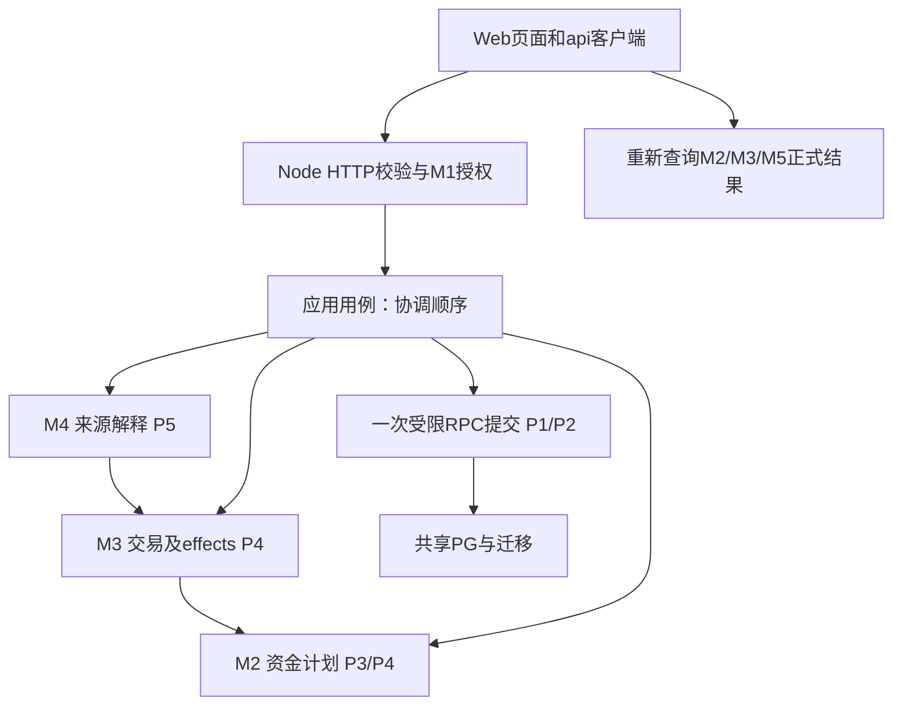
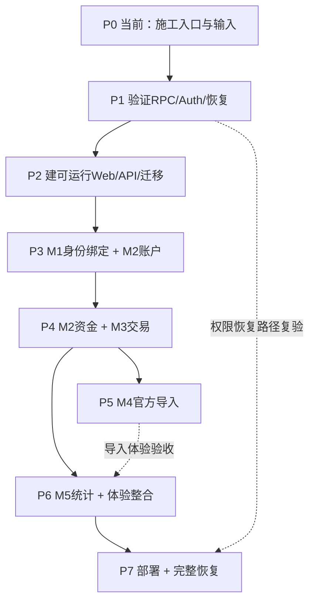
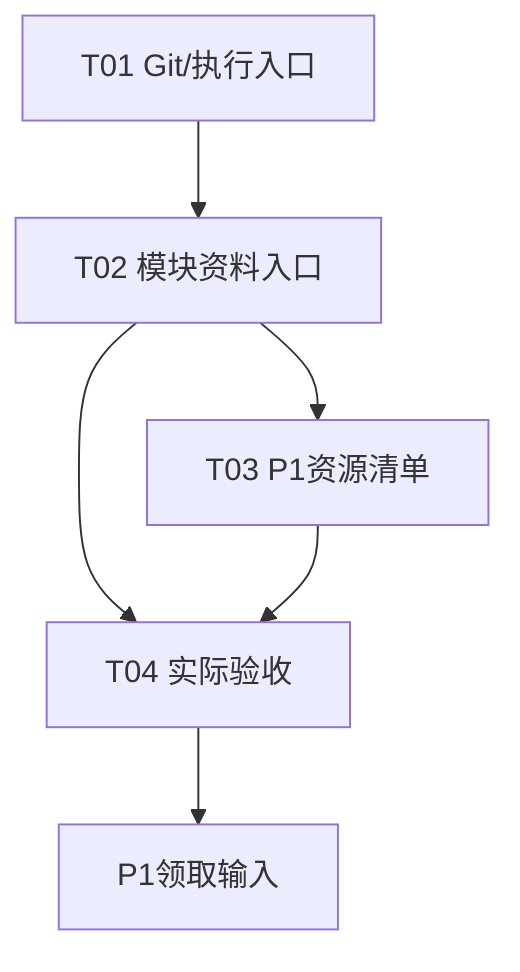
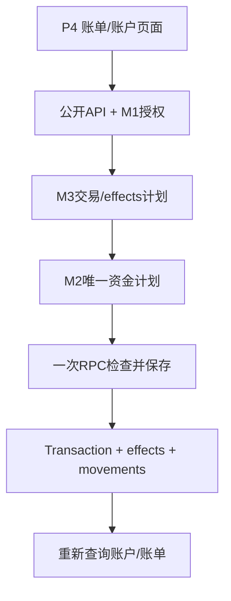
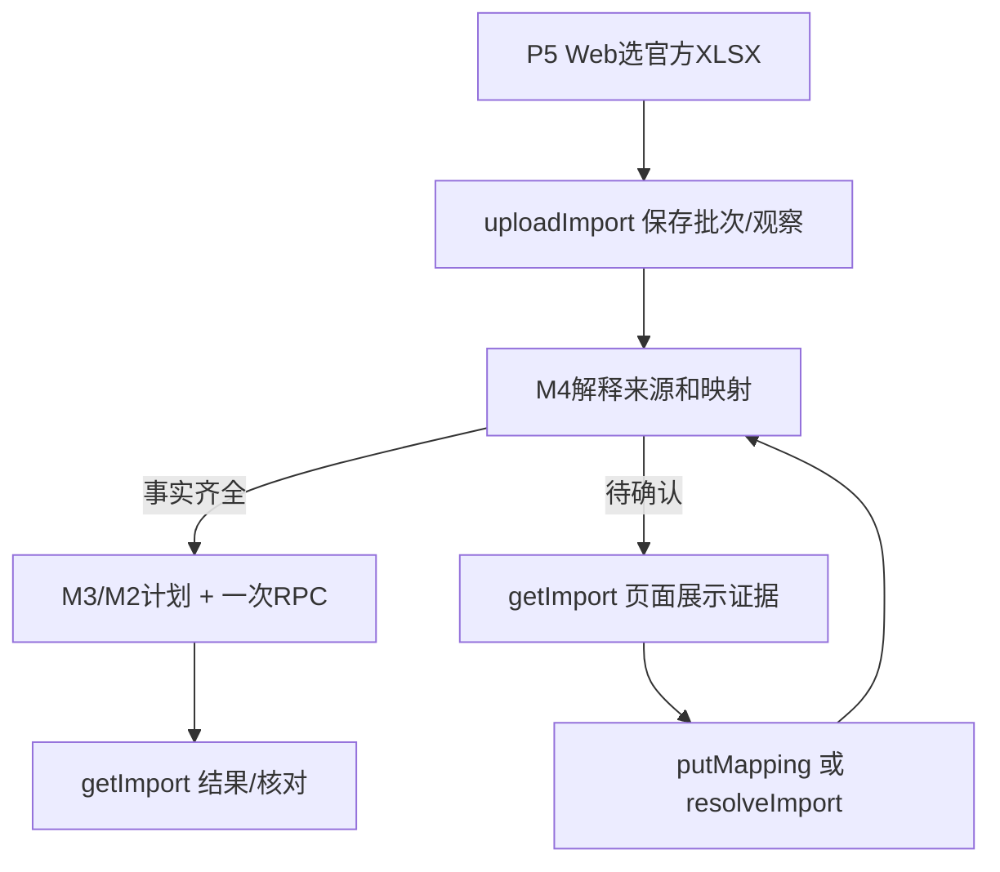

# 星账｜P0–P7 具体开发计划、交付与依赖

本计划依据[实施计划§7](IMPLEMENTATION_PLAN.md#7-当前选定技术组合与最小验证)、[产品功能](PRODUCT_FUNCTION_MAP.md)、[模块边界](ENGINEERING_MODULE_BOUNDARIES.md)、[逻辑模型](LOGICAL_DATA_MODEL.md)、[API契约](API_CONTRACT.md)和[OpenAPI](../openapi.yaml)。业务与24个公开接口以`524f2da`冻结版本为准；本计划只安排施工位置和顺序，不另写一套字段、资金公式或接口语义。实际进度只记在[实施计划§2.6](IMPLEMENTATION_PLAN.md#26-阶段控制与当前进度)。以下路径是**拟交付位置**，并非声称这些程序已经存在。当前只有设计文档、参考脚本及P0任务卡，P0进行中，P1–P7未开始。

## 1. 文件夹体系和一次请求怎样穿过它

按首次需要创建文件夹。`M1–M5`是同一Node应用内的业务模块，不是五个服务。下面列的是职责落点：具体文件名可以随代码语言习惯细分，但接收模块、依赖方向及唯一实现位置要保持；任务卡再锁定该次要新增的具体文件。生产代码从现有根目录开始，参考脚本留在`experiments/`。

```text
ledger-final/
├─ README.md / AGENTS.md           # P0：入口、执行规则
├─ openapi.yaml                    # 已有：公开HTTP结构的唯一机器契约
├─ package.json / 锁文件            # P2：统一安装、启动、构建、检查
├─ apps/
│  ├─ web/                         # P2：React、TS、Vite响应式Web
│  │  └─ src/
│  │     ├─ api/                    # P2：Bearer、请求、响应/错误、版本与幂等键
│  │     ├─ auth/                   # P3：CloudBase Auth会话
│  │     ├─ pages/                  # P3账户/我的；P4账单；P5导入；P6首页/预算整合
│  │     └─ components/             # 首次被页面复用时提取
│  └─ api/                         # P2：Node + Express模块化单体
│     └─ src/
│        ├─ http/                   # P2：路由、校验、鉴权、错误/日志出口
│        ├─ application/            # P3起：权限和跨模块用例的调用顺序
│        ├─ modules/
│        │  ├─ m1/                  # P3：身份、关系、授权
│        │  ├─ m2/                  # P3账户/起始资金；P4唯一资金计划
│        │  ├─ m3/                  # P4：交易、effects、内部退款
│        │  ├─ m4/                  # P5：文件、来源、映射、核对
│        │  └─ m5/                  # P6：只读统计和预算
│        └─ infrastructure/         # P2：Auth及CloudBase HTTP/RPC持久化适配
├─ db/migrations/                  # P1最小实验SQL；P2迁移入口；P3–P6业务迁移
├─ tests/                          # 按需出现contract、integration、e2e
├─ experiments/p1/                # P1隔离技术验证及复现命令
└─ docs/tasks/                    # P0已有任务卡；后续按阶段编写
```

`apps/web/src/api`调用公开路由；`apps/api/src/http`校验token与请求后调用`application`；用例调用所属模块，读取受控快照，最终由`infrastructure`的一次受限RPC提交本次需要的记录。资金算法只在`m2`，交易和effects只在`m3`，来源观察/关联只在`m4`，统计只在`m5`；数据库迁移持有表、约束、函数和授权的唯一SQL正文。`packages/contracts`仅在P2确实需要Web/API共享生成类型时由`openapi.yaml`生成，不另手写契约。细节以[模块边界§1–2](ENGINEERING_MODULE_BOUNDARIES.md#1-m1m5责任与依赖)和[实施计划§7.3](IMPLEMENTATION_PLAN.md#73-共享pg怎样实现既定账务边界)为准。



图中读取通过公开API，不是浏览器直接访问数据库。M4解析和保存观察可以先发生；**可执行来源行**的M4当前关联、M3交易/effects与M2资金变动在一次提交中完成。只读M5在P6查询已提交数据。P3账户起始状态和P4修正也经各自应用用例及受限提交路径。

## 2. 依赖怎样领取

以下依赖编号用于每个阶段的“开工检查”；资料、实现能力和外部资源都要有供给方与可核对证据。发现缺项即在该阶段记录实际阻塞点，由后续任务卡限定暂停及汇报行为。

- **D01 契约资料：**业务规则、产品功能、逻辑模型、模块边界、API行为和OpenAPI。按本阶段对应M模块的章节读取；24个`operationId`、请求响应形态以现有契约为准。P0整理入口，规则变更由主责文档先更新。
- **D02 Git和上游产物：**用户指定基线、干净分支、前阶段交付提交及验收记录。每阶段开始核对提交和实际文件；P0-T01提供AI执行规则，代码或文档改动不得覆盖未接收的上游产物。
- **D03 工具及可运行版本：**P1记录实际Node/CloudBase/RPC调用方式，P2锁定安装、构建、校验命令；下游复跑同一路径，不把本地直连PG当云端HTTP/RPC验收。
- **D04 隔离资源和费用授权：**用户提供可用的测试环境、实际HTTP/RPC地址、独立恢复目标及必要费用决定；P0-T03登记所需项，P1首次写入前核对环境与权限，P7领取正式资源。
- **D05 身份和权限：**用户提供两个独立测试身份；P1证实Auth与后端/数据库调用边界，P3建立内部User/绑定及资源授权；P4–P7每个新写入口复验本人写、对象只读和原文隔离。
- **D06 账务前置能力：**P1的受限RPC与并发证据→P2持久化适配→P3实际Account/份额→P4唯一M2资金计划和M3交易用例→P5导入复用。交接时给出调用位置、版本条件、原子边界与已测场景。
- **D07 样本和独立预期：**P1用合成小数据；P4用自建金额算例和隔离来源资格；P5需要两份私有官方XLSX各169行及合成边界文件；P6需要独立的跨月/退款统计预期。私有文件仅在受控环境使用，仓库不保存账单原文。
- **D08 部署与恢复：**P1实际试出一致导出/隔离恢复路径及最小托管通信，P2做可重复迁移/构建，P7领取正式域名、HTTPS、备份目标和发布版本后做完整恢复。
- **D09 验收事实与用户决定：**每项交付带代码/迁移位置、提交、命令、环境、输入、预期与实测结果及未满足条件。失败、合同冲突或资源费用变化由用户决定后续范围；文档检查、参考脚本通过、真实HTTP通过、真实云端通过分别记录。

## 3. 阶段先后与当前环节

实线为开始实现的依赖；虚线为整体验收仍需补齐的依赖。**当前环节是P0文档施工基线，P0任务卡尚未执行。**P6的M5统计可在P4之后开始，完整体验要等P5导入结果。



阶段中的页面与API和相应业务一起交付：P3做可操作的身份/账户界面，P4做实际记账页面，P5做完整导入结果与恢复页面，P6完成首页预算及跨页面体验。每阶段验收必须走到该阶段能得到的**页面→公开HTTP→正式持久化→刷新/重新查询**；P1只是技术实验，P2的通信演示不算业务闭环。

## P0

### 当前任务卡

**开工：**D01现有规格、D02固定提交与用户指定的单卡执行方式。当前任务只编排开发，不创建生产程序。

1. [P0-T01 执行与Git规则](tasks/P0-T01_EXECUTION_BASELINE.md)建立`AGENTS.md`、README入口与干净分支/提交规则；检查路径边界和暂停汇报协议。交付P0-D1给后续卡。
2. [P0-T02 文档职责与模块入口](tasks/P0-T02_DOCUMENT_ROUTING.md)保持六份原入口，按既定章节把API正文分到`docs/api/`、官方字段分到`docs/import/`；逐个核对24个接口、原有锚点和正文内容。交付P0-D2给业务实现者。
3. [P0-T03 P1输入与隔离约定](tasks/P0-T03_P1_INPUTS.md)在实施计划登记P1要领取的工具、环境、身份、费用、私有恢复目标和合成数据，未知项标具体阻塞动作。交付P0-D3给P1规划。
4. [P0-T04 验收交接](tasks/P0-T04_HANDOFF.md)核对前三项产物和提交，更新实施计划§2.6的实际验收。交付P0-D4给用户开始P1。



**退出验证：**逐个打开README→阶段→模块资料→任务卡，检查引用和原文迁移一致；T04只能依据T01–T03真实产物与测试记录验收。外部资源的实际值若待提供，T03需标明将阻塞P1哪步。本轮只调整本计划，四张任务卡的执行状态仍见实施计划§2.6。

## P1

**本阶段开发：**隔离环境证明共享PG、身份与恢复。

**开工：**P0-D1–D4，D03–D05/D07–D08对应的实际资源和授权。先确认所用云环境、数据库、受限调用身份和恢复目标确实彼此隔离。

1. 在`experiments/p1/`编写Node调用最小只读快照和写RPC的复现程序；在`db/migrations/`放实验所需最小表、唯一约束、RPC与GRANT/RLS。用HTTP/RPC在一次写入内检验版本、来源身份、份额非负和幂等完成结果；在来源关联之前注错，重读全部相关表确认回滚。这是P1-D1的第一部分。
2. 同目录增加两个并发写请求（100元同时各支出80元）、同键重试、旧版本计划、同来源并发的独立输入与预期；记录HTTP返回和数据库最终状态，检验不会产生半笔或双扣。不同网络请求不能靠Node进程内锁保证；保存可重跑命令与实际结果，完成P1-D1。
3. 用两个CloudBase Auth测试身份，验证后端核验token、无效/过期凭据、非本人资源和普通浏览器身份直调RPC/写表被拒；部署最小静态Web→Node请求→受控数据库读取，测冷/热响应与配置。交付P1-D2：身份、权限及最小部署的真实结果。该页仅证明链路，正式业务页面在P3起做。
4. 在相同小数据下实际执行一致导出（或明确停写窗口），在独立目标恢复表/函数/权限/数据；逐项比对User映射、来源、资金和版本，并记录耗时及实际用量。仓库只提交脱敏复现步骤，私有导出物留在受控位置。交付P1-D3：能恢复的最小证据和P2需要复用的方式。

**退出验证：**D1–D3有实际HTTP/RPC、受限权限、并发、回滚、隔离恢复证据；P2据此选取唯一正式适配方式。[实施计划§7.8](IMPLEMENTATION_PLAN.md#78-下一步最小验证与六项标准)给出25.80元等独立算例。正式完整业务恢复归P7；真实大批量同步导入归P5。

## P2

**本阶段开发：**建立可运行工程，打通Web和同一后端。

**开工：**P1-D1–D3以及D01契约、D03运行版本、D04测试环境。先把P1证明可行的调用路径接入正式工程，再交业务模块开发。

1. 建根`package.json`和锁文件、`apps/web`的React/TS/Vite入口、`apps/api`的Express入口。前端`src/api/`实现Bearer注入、成功/错误解析、强ETag与幂等键调用约定；后端`src/http/`实现`/api/v1`路由入口、请求严格校验/统一错误及必要脱敏日志。本阶段只放可观测的健康与通信检查，不宣布任何业务operationId完成。交付P2-D1。
2. 将P1的受控HTTP/RPC调用封装到`apps/api/src/infrastructure/`，给迁移文件建立**一个**按序执行入口；本地/隔离云使用同一应用构建，配置从环境注入。按实际Web/API复用情况从OpenAPI生成必要的类型至`packages/contracts/`，避免手抄另一份定义。建立`tests/contract`检查HTTP形态及`tests/integration`访问真实RPC的运行入口。交付P2-D2。
3. 从全新检出目录运行安装→迁移→API/Web启动→构建→契约/数据库检查→隔离云部署；静态页面发出一次真实HTTP请求并显示结果，核对来源域名、认证配置、后端权限和日志无敏感信息。记录固定版本、环境变量名称与复现命令，交付P2-D3。

**退出验证：**第二个空工作目录按README重复上述命令得到同样可运行的Web/API/迁移；P3可以在真实路由与持久化适配上接业务，而不重新搭应用。

## P3

**本阶段开发：**M1身份关系与M2实际账户、初始资金。

**开工：**P2-D1–D3、D05两名真实身份、D06受限RPC、D01的M1/M2规则。按“先身份，再账户模型与写入，最后页面”实施。

1. 在`db/migrations/`建User、BindingInvitation、RelationshipBinding及其约束；`modules/m1/`做本人/对象权限与邀请生命周期；`application/`连接服务端token验证到内部User映射；`http/`交付`getRelationship`、`createBindingInvitation`、`bindRelationship`。在`web/src/auth`接Auth登录/会话，在`web/src/pages`交付我的/邀请/确认与状态页面。检查两身份相互绑定、凭据过期/重复消费、token失败及对象只能读。
2. 在迁移中建立Account、AccountFundMovement的起始记录及必要份额约束；`modules/m2/`实现账户信息、opening计算与读取；`application/`做本人写、对象只读、金额合计与未绑定份额资格检查，经受限提交路径保存；`http/`交付`listAccounts`、`getAccount`、`createAccount`。`web/src/pages`增加账户列表、创建、详情和实际账户选择。创建后的读取从已存的opening/movements计算，不另存一份可改余额。
3. 用两个身份从页面分别注册/登录、绑定、创建银行卡或钱包及本人/对象合法初始份额；刷新、换设备再读；同键重试与故障注入核对账户和opening一次保存；对象视图只有读权限且服务端拒绝写，未绑定对象份额被拒。

**退出验证：**P3-D1（身份/关系）、P3-D2（账户/初始资金）、P3-D3（Web闭环）均有页面、六个公开HTTP操作和数据库重读证据。账户/份额/授权成为P4交易及P5渠道映射的真实输入。起始修正和手动分配在P4交付。

## P4

**本阶段开发：**M2唯一资金规则与M3交易生命周期。

**开工：**P3的真实Account/份额/授权、P1/P2的原子提交和D01的M2/M3行为。顺序先可验证纯规则，再正式写用例，最后页面和并发回归。

1. 在`modules/m2/`写唯一的纯资金计划：支出按规定份额扣减、收入/退款回补、无费内部转账两端、手动分配与起始状态修正；使用当前份额与原计划为输入，不在页面或RPC另算资金。迁移补充资金操作所需的版本/约束/幂等状态；对独立金额算例写单元测试，含起始日前后、历史effect、退款抵减与不可安全撤销。交付P4-D1的资金部分。
2. 在`modules/m3/`实现Transaction与TransactionAccountEffect的创建、读取、修改、删除、分类字典及受控内部退款命令；`application/`按M1权限→M3变化→M2资金计划→一次受限RPC保存交易/effects/movements/必要来源关联的顺序协调。账户资料修改、opening修正、份额调整各用同一提交边界处理。`http/`交付`patchAccount`、`putOpeningState`、`adjustFunds`和`listTransactions`、`getTransaction`、`createTransaction`、`patchTransaction`、`deleteTransaction`、`listCategories`。退款只由已验证官方来源资格调用内部命令，P4用隔离资格样例证明，P5再接真实M4。交付P4-D1完整能力及P4-D2退款能力。
3. 在`web/src/pages`完成账户编辑/起始修正/份额调整、账单列表/筛选/详情/记账/编辑/删除；表单引用`web/src/api`处理版本、幂等及未知结果。保存成功后重新查询账户与账单；查询失败只恢复读取。用真实HTTP+RPC分别测支出跨份额、回补、双端转账、跨起始日、同键重复、旧版本、并发、注错、编辑差额和删除不安全；核对数据库三类记录及页面刷新。交付P4-D3。



**退出验证：**上述九个API从页面可实际使用，P4-D1–D3的权限、失败路径、独立预期与真实数据库状态一致。向P5交接M3内部创建/退款/来源资格、M2计划、原子写入入口、版本/幂等条件及失败含义。

## P5

**本阶段开发：**M4官方导入、来源恢复与核对。

**开工：**P4正式账务能力、P3账户，D01的[字段与来源规则](ENGINEERING_MODULE_BOUNDARIES.md#3-m4文件级事实与识别范围)、D07两份真实各169行私有XLSX和D04云环境。先把证据保留下来，再解释与提交，最后提供恢复操作。

1. 迁移建立SourceAccountProfile、SourcePaymentMethodMapping、ImportBatch、SourceObservation、SourceRecord、ImportReconciliationItem及唯一/版本约束。`modules/m4/`按真实文件头解析、保留raw_fields、规范化时间/金额/渠道/完整官方单号并产生七类行结果；按档案+官方单号查询现有来源，新旧观察不覆盖用户编辑。独立测试微信/支付宝已确认字段、退款、优惠、已存入零钱、亲情卡、花呗及带费转账。
2. `application/`把已确认来源事实交给M3内部创建/退款，M3调M2计划，M4的当前来源关联和账务同一RPC提交；来源未明、映射缺失、转账角色未定、同事件待确认或失败的行保留原文及可恢复状态。`http/`依次交付`uploadImport`、`getImport`、`listMappings`、`putMapping`、`resolveImport`、`reviewReconciliation`；补映射后对同batch resume，核对项保留/删除分别按[模型§6](LOGICAL_DATA_MODEL.md#6-完整性结果和核对)执行。交付P5-D1正式来源能力。
3. `web/src/pages`交付文件选择、档案确认、逐行结果、渠道→实际账户选择、角色/同事件确认、继续处理、缺失核对操作；页面按[产品功能官方导入](PRODUCT_FUNCTION_MAP.md#官方导入)显示原因和下一步。以两份真实文件反复上传、补映射、恢复、删除再导入，核对来源唯一、用户编辑保留、账户金额、各行正式ID及七类合计恰为实读338行。交付P5-D2。
4. 在隔离云实际测试接近10MiB、10000行与超过上限的合成XLSX，经同一上传/解析/逐行RPC/同步响应链路，记录冷/热耗时、内存、网关返回和最终数据库行数；413不得入账。交付P5-D3。若所选云环境无法在现有同步契约下完成，记录具体失败和阻塞点交用户决定。



**退出验证：**P5-D1–D3证明真实样本逐行可解释、可恢复、去重且资金正确；大文件同步限额有真实云证据。对不具备核对资格的batch展示阻塞原因，不以参考脚本的数字宣称线上验收。

## P6

**本阶段开发：**M5统计预算与完整Web体验。

**开工：**统计代码依赖P4正式账务和P3关系权限；完整体验验收再领取P5-D1–D3。D07提供独立跨月、退款、零分母预期。

1. `db/migrations/`加MonthlyBudget及版本约束；`modules/m5/`读取已提交M2有效资金和M3交易/effects，实现本人净花销、四类资金、月份/预测和个人预算，不参与记账提交。`http/`交付`getOverview`、`getBudget`、`putBudget`；`web/src/pages`做首页资金、选月、预算读取/保存。分别测历史消费与有效余额、退款日期/抵减、跨月、对象预算隔离、空预算及旧版本。交付P6-D1。
2. 贯通已有首页、账户、账单、导入、我的：导航和手机/桌面布局，页面状态涵盖空、加载、字段错误、权限、版本冲突、保存结果未知、刷新失败；筛选与分页依契约。逐条把24个公开操作对应到真实可见动作/读取，并核对写成功后只重查正式数据、不重复创建。交付P6-D2。
3. 用两个身份在手机与电脑从登录→绑定→账户→记账/转账→导入待确认/恢复→统计刷新→对象只读走完整链；记录每步页面、HTTP和数据库预期/结果。确认与P5导入联动，交付P6-D3候选版本。

**退出验证：**P6-D1–D3使24个API都有实际使用位置；用户能连续完成核心任务，失败后可在同一页面恢复。P6整体体验的验收在P5交付之后。

## P7

**本阶段开发：**发布、全量恢复与正式入口验收。

**开工：**P3–P6的候选提交与证据、P1隔离恢复路径、P2构建迁移方式、D08正式资源/域名/费用/备份目标和D09本次发布决定。

1. 固定候选提交、镜像与迁移版本；按P2命令部署同一Node应用和Web静态产物，配置正式Auth、HTTPS、最小权限及私有环境变量。从国内手机/电脑进入正式域名执行登录、读写、对象只读和关键失败路径。交付P7-D1正式入口与版本记录。
2. 对全部实际业务表按一致快照或明确停写窗口导出；在独立库恢复迁移、SQL函数/授权和数据，比对User与sub、Transaction/effects/movements、来源关联/观察、版本和幂等状态；实际测恢复时间及可恢复的数据窗口。私有备份单独保存，交付P7-D2可重做的完整恢复步骤与核对结果。
3. 核对实际云托管/网络/存储/日志/备份用量，记录费用观察入口、备份频率、保留份数、发布回退次序及日常维护命令；以正式环境再跑权限、记账、导入、统计和恢复后的完整性检查。交付P7-D3维护与验收记录。

**退出验证：**正式双端可达、实际账务与权限正确、完整业务数据能在隔离目标恢复、费用与维护动作可执行；实施计划§2.6记录真实交付提交和验证事实。

## 4. 公开API交付归属

唯一首次实现归属如下；具体字段、响应和错误始终从[API契约](API_CONTRACT.md#2-全量操作索引)及[OpenAPI](../openapi.yaml)读取。P6对24个操作做使用位置与回归检查，不重写各阶段归属。

- **P3 / M1：**`getRelationship`、`createBindingInvitation`、`bindRelationship`。
- **P3 / M2：**`listAccounts`、`getAccount`、`createAccount`。
- **P4 / M2：**`patchAccount`、`putOpeningState`、`adjustFunds`。
- **P4 / M3：**`listTransactions`、`getTransaction`、`createTransaction`、`patchTransaction`、`deleteTransaction`、`listCategories`。
- **P5 / M4：**`uploadImport`、`getImport`、`resolveImport`、`listMappings`、`putMapping`、`reviewReconciliation`。
- **P6 / M5：**`getOverview`、`getBudget`、`putBudget`。

CloudBase Auth承接登录/刷新/退出，P3接入。P4的内部退款能力由P5官方来源调用，没有额外公开退款操作。
