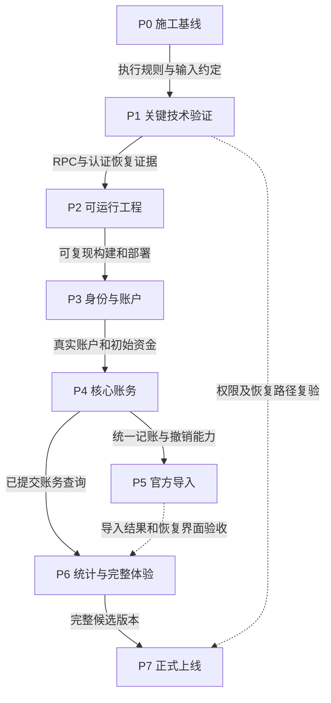
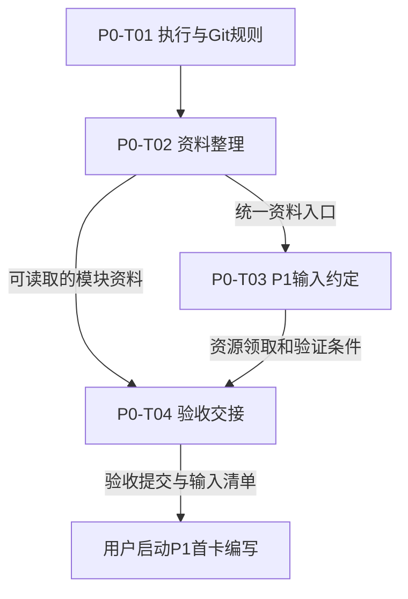

# 星账｜P0–P7 阶段交付与依赖

编制依据：`main@c2f85a8e710aa55acd4da82dd5f3616e5b605500` 的实施计划与契约。业务冻结基线仍为 `524f2da`。本文件定义施工交付和依赖；阶段的实际状态统一记录在[实施计划§2.6](IMPLEMENTATION_PLAN.md#26-阶段控制与当前进度)。文中的产物路径表示计划交付位置，是否已生成以验收记录为准。

## 1. 文件分工与使用顺序

| 需要回答的问题 | 唯一维护位置 | 使用方法 |
|---|---|---|
| 产品行为、页面、实体、接口、模块分别怎样工作 | [业务规则](BUSINESS_RULES_DISCUSSION.md)、[产品功能](PRODUCT_FUNCTION_MAP.md)、[逻辑模型](LOGICAL_DATA_MODEL.md)、[API契约](API_CONTRACT.md)、[模块边界](ENGINEERING_MODULE_BOUNDARIES.md) | 依各文件职责查对应模块；严格字段结构读取 [OpenAPI](../openapi.yaml) |
| 技术组合、部署环境、RPC、备份选什么方案 | [实施计划§7](IMPLEMENTATION_PLAN.md#7-当前选定技术组合与最小验证) | 任务卡引用具体小节；需改变选型时由用户决定 |
| 每阶段接收什么、交付什么、受什么阻塞 | 本文件 | 从阶段关系定位当前阶段，再进入该阶段任务卡 |
| 当前已完成到哪里，哪些测试实际运行过 | [实施计划](IMPLEMENTATION_PLAN.md) | §2.6存进度及交付提交；§3–4存验证事实及尚欠证据 |
| 这一个AI对话执行哪些操作 | `docs/tasks/` 下的一张任务卡 | 读取卡内指定资料，按操作顺序执行并按卡交接 |

任务卡编写者负责把输入裁剪到任务范围，提供文件与章节、必要的操作条件和测试预期；执行者按卡领取资料。事实已有主责文档时，任务卡引用它的具体位置，不重新维护一套字段定义。跨模块任务要同时带上各输入的前提和原子提交边界。

## 2. 依赖登记规则

依赖包括资料、能力、资源、数据、权限、版本、用户决定和验证证据。下表的编号用于各阶段领取输入，实际值和证据由供给方交付。**任务执行者遇到未满足的开工条件时，按任务卡暂停并汇报。**用户可另行启动未受阻塞的任务；依赖图本身不授权AI切换任务。

| 编号 / 依赖 | 供给方与来源 | 领取时检查什么 | 最早阻塞点 / 重新检查时机 |
|---|---|---|---|
| D01 业务与接口资料 | 已冻结五份规格、OpenAPI；P0-T02整理读取入口 | 业务含义一致、章节可定位、接口字段及24个operationId齐全 | 编写/执行每张业务卡前；规格变更后重新核对受影响卡 |
| D02 Git基线与执行范围 | 用户指定任务；P0-T01建立规则；上游给交付提交 | 工作分支、基线提交、工作区差异、上游验收记录、允许改动路径 | 每张卡开工；恢复暂停任务或接收新提交时复查 |
| D03 运行与契约工具 | P1记录实测运行版本；P2锁定依赖及命令 | 同一版本可安装、启动、构建、执行契约/集成检查 | P1最小验证运行前；运行时或锁文件改变后复查 |
| D04 隔离环境与访问 | 用户提供可用资源和授权；P0-T03定义输入项；P1验证 | 环境/地域/用途、HTTP/RPC地址、受限后端身份、测试库、恢复目标、成本授权均可对应到证据 | P1第一次资源创建或云写入前；切换环境、变更权限或新增费用前复查 |
| D05 身份与数据权限 | 用户提供测试身份；P1验证Auth和数据库边界；P3形成业务权限 | 两个独立身份、token验证、内部User映射、本人写/对象只读、原文私有 | P1权限试验；P3–7每次新增资源入口时复查 |
| D06 账务能力与一致快照 | P3的账户/份额；P4的M2/M3能力；P1/P2的RPC适配 | 可调用的命令/查询位置、版本条件、同一提交边界、并发与回滚证据 | P4正式账务实现前；P5接入前；所有资金写入口变化后复查 |
| D07 样本与独立预期 | 合成数据由对应任务构造；真实官方XLSX由用户在私有位置提供；字段依据见模块文档 | 文件可读、平台/行数/来源说明、脱敏/私有存放、预期结果独立于待测实现 | P1用合成小样本；P4用隔离来源；P5真实338行和上限测试前 |
| D08 发布、恢复与运营 | P1给恢复路径及最小部署；P2给构建/迁移入口；用户给正式资源/域名/费用决定 | 构建提交与迁移版本、HTTPS与认证配置、私有备份、恢复权限、费用观察入口 | P1最小部署/恢复；P7正式发布前；迁移和权限变化后复查 |
| D09 验收与用户决定 | 各卡执行者提交证据；用户确认异常后的续做范围和上线操作 | 实际命令、输入、预期/实际、退出码、环境、产物提交及未完成项；授权内容可追溯 | 下游领取交付时；测试失败、冲突、范围外操作或未知结果出现时暂停 |

交付时提供“产物位置＋提交＋验证结果＋尚未满足的外部条件”。私有账单、密钥、token和备份只提供安全的访问方式或非敏感定位信息；仓库里保存配置项名称和脱敏证据。成功的文档检查、参考模型检查、实际HTTP测试和云端测试分别报告。

模块之间的数据与提交关系沿用[模块边界§8的Mermaid](ENGINEERING_MODULE_BOUNDARIES.md#8-程序中的数据依赖与提交位置)，前端/Auth/后端/数据库/备份关系沿用[实施计划§7.2的Mermaid](IMPLEMENTATION_PLAN.md#72-前后端认证与数据库关系)。本文件下图表达施工先后与产物交接。

## 3. 阶段关系

实线表示该阶段正式实现的开工依赖；虚线表示阶段整体验收或持续复验依赖。P6的统计实现可接收P4交付，完整体验验收还要接收P5。

页面随P3–P5各自的业务闭环一起交付；P6统一体验与跨页面刷新。最小部署从P1开始，P2形成可复用构建方式，P7发布正式版本。

## P0

**目标：**为下一次独立AI对话提供确定的任务入口、资料和执行边界。

输入：D01的现有规格与技术选择、D02的干净基线、用户本轮确定的“单卡执行，遇问题暂停汇报”规则。

| 交付编号 | 接收方拿到的产物 | 验收方法 | 下游 |
|---|---|---|---|
| P0-D1 执行基线 | 简短`AGENTS.md`、README任务入口、Git开工/交付规则 | 按P0-T01检查允许路径、基线识别及暂停协议能直接执行 | 全部任务卡 |
| P0-D2 资料入口 | 原六份核心入口保留；API按通用/M1–M5拆正文；官方字段独立正文；README模块读取表 | 按P0-T02核对迁移前后内容、相对链接、24个API和OpenAPI不变 | 后续任务卡编写者与执行者 |
| P0-D3 P1输入约定 | 实施计划新增的P1输入登记：所需资源、权限、私有数据、工具、费用/恢复条件及领取检查 | 按P0-T03区分已知事实、待提供项和首次使用关卡 | P1任务卡编写者 |
| P0-D4 验收交接 | 实施计划§2.6中的P0验收提交和首项P1施工输入说明 | 按P0-T04从卡到资料到产物走通引用，并核对全部P0检查结果 | 用户启动P1规划/首卡 |

P0退出条件是上述四项文档与工作规则可交接。外部资源的实际值可在P1领取时补齐，P0-D3必须明确每个未提供项会阻塞哪一个P1动作；P0验收不代表云端资源已就绪。

### 当前任务卡

| 卡 | 领取条件 | 本卡交付 | 交给谁 |
|---|---|---|---|
| [P0-T01 执行与Git规则](tasks/P0-T01_EXECUTION_BASELINE.md) | 当前固定文档基线可读取，用户启动本卡 | P0-D1 | P0-T02、P0-T03 |
| [P0-T02 文档职责与模块入口](tasks/P0-T02_DOCUMENT_ROUTING.md) | P0-D1验收提交可读取 | P0-D2 | P0-T04及P1后续卡 |
| [P0-T03 P1输入与隔离约定](tasks/P0-T03_P1_INPUTS.md) | P0-D1、P0-D2验收提交可读取 | P0-D3 | P0-T04及P1卡编写者 |
| [P0-T04 P0验收交接](tasks/P0-T04_HANDOFF.md) | P0-D2、P0-D3已集成到同一验收分支 | P0-D4 | 用户启动P1 |

P0按T01→T02→T03→T04顺序提交，后卡在前卡验收提交上执行；这样README和进度文件各次变动均有确定基线。每张卡结束后交接，下一卡由用户启动。任务实际状态仅写入实施计划§2.6。

## P1

**目标：**用隔离的小数据证明选定技术能承接账务、权限和恢复要求。

开工输入：P0-D1–D4；D03运行工具；D04/D05的测试资源和身份；D07合成数据；D08恢复目标。创建/写入资源前领取P0-D3中对应实值并验证授权。

| 操作与验证 | 产物及接收标准 | 下游 |
|---|---|---|
| 按实施计划§7.8的最小金额场景，建立最小表/快照读取/受限写RPC；通过Node HTTP调用，在来源关联提交前注错；再跑同时支出、旧计划、来源唯一和同键重放 | P1-D1：`experiments/p1/`中的最小客户端与合成场景、`db/migrations/`中的必要SQL及授权；数据库结果证明原子性和并发条件，保存复现命令 | P2持久化适配与迁移入口；P4资金提交 |
| 用两个测试身份验证Auth、后端身份、RPC EXECUTE/表权限和跨用户拒绝；部署最小Web与Node通信 | P1-D2：可重复的真实身份/权限/部署检查；记录环境、调用角色、拒绝结果及冷/热调用情况 | P2配置与部署；P3身份接入 |
| 按实施计划§7.6取得一致导出并恢复到独立目标；核对小数据的资金、来源、版本及用户映射，记录运行用量 | P1-D3：私有导出物、仓库内脱敏恢复步骤与比对结果；原数据与恢复数据一致，权限恢复可验证 | P2迁移/部署方式；P7完整演练 |

阶段验收：D1–D3均有实际HTTP/RPC与隔离恢复证据。用户接收报告时确认可复用的最小实现和仍待后续阶段验证的云限制。P5承担完整同步导入上限验收，P7承担全业务恢复和正式费用验收。

## P2

**目标：**把P1已经证明的访问路径装进可重复运行的正式工程。

开工输入：P1-D1–D3；D01契约；D03运行版本；D04隔离资源；D08构建/迁移方法。

| 操作与验证 | 产物及接收标准 | 下游 |
|---|---|---|
| 建立`apps/web`和`apps/api`，锁定依赖；为首次使用的模块建立实际入口；前端调用同一Node应用 | P2-D1：依赖锁文件、安装/开发/构建命令；新检出目录可按README启动，Web可调用API并显示真实响应 | P3所有业务页面和路由 |
| 接入OpenAPI引用或生成产物、统一网络输入/错误适配和必要日志；给迁移/RPC适配与测试配置设置真实入口 | P2-D2：`packages/contracts`（实际复用时）、迁移命令、契约和集成测试命令；真实HTTP正反例可执行，日志可定位请求且无敏感原文 | P3–P6接口实现及测试 |
| 用同一构建产物运行本地与隔离云测试，核对前后端配置、来源域名、Auth及权限；私有配置按约定注入 | P2-D3：脱敏配置示例和可复现部署/检查命令；第二个新工作目录重复安装、迁移和构建成功 | P3开发环境；P7候选版本构建 |

阶段验收：在新检出目录执行完整安装→启动→构建→必要测试→隔离部署检查，保存命令、版本和结果。P1有用产物迁入正式位置时更新引用，保留一个持续维护的实现。

## P3

**目标：**用户通过真实身份创建实际账户及初始资金，在手机和电脑可重新读取。

开工输入：P2-D1–D3；D01的M1/M2规格；D05两个真实测试身份；D04数据库权限；D07合成账户与份额。

| 操作与验证 | 产物及接收标准 | 下游 |
|---|---|---|
| 接入Auth验证、认证sub到User映射、绑定状态/发起/确认流程；让页面发起真实HTTP调用 | P3-D1：身份与关系闭环及对应迁移；凭据过期/重复消费/已绑定、错误token和跨用户访问按契约拒绝 | P4–P6所有资源授权 |
| 完成账户创建、列表、详情和初始份额持久化；写入opening记录后从数据库读取余额/份额 | P3-D2：实际账户和M2初始资金读取能力；未绑定对象份额、金额合计、未来起始日、同键重试和故障原子性按契约验证 | P4账务；P5账户选择与映射 |
| 交付登录/我的/绑定和账户页面；用两个身份及两端设备重复读取 | P3-D3：手机/电脑可用的最小页面；刷新或切设备读到已保存数据，对象只读；记录通过的API和UI场景 | P4编辑记账页面；P6体验整合 |

阶段验收：本阶段六个API全部经真实HTTP验证；两个身份在实际页面走完绑定与账户闭环。模型中的资金归属与账户写权限分别检查。

## P4

**目标：**形成M4可复用的完整账务创建、编辑与撤销能力。

开工输入：P3-D1–D3；D06账户和资金快照；P1/P2的原子RPC；D01的M2/M3规格；D07独立的资金预期和官方来源隔离样例。

| 操作与验证 | 产物及接收标准 | 下游 |
|---|---|---|
| 实现M2唯一纯资金函数和M3交易/effects生命周期，用例收集计划后原子提交；补齐手动分配、账户资料和起始状态修正 | P4-D1：正式命令、迁移和RPC保存能力；用业务规则及实施计划§3.1的独立预期验证跨份额、回补、历史端、双端转账、修改差额和撤销不安全 | P5逐行入账及重导；P6余额与消费查询 |
| 用隔离的已验证官方来源资格调用内部退款创建；逐项测试日期/抵减/金额修改及来源关联失败 | P4-D2：受控内部退款入口及撤销/关联意图接口；M3接收已验证资格，M4来源实体仍由M4管理；测试不需要手动refund公开路由 | P5真实官方退款接入 |
| 完成账户调整与账单列表/详情/筛选/记账/编辑/删除页面，接入版本、重试和结果未知处理；以两个并发请求验证写入 | P4-D3：九个API及最小UI闭环；实际HTTP、RPC、数据库重读结果一致，注错无半笔，旧版本拒绝，同键不重复扣款 | P5关联既有账单；P6交互整合 |

阶段验收：每种资金动作都有独立预期和真实保存/失败证据。交给P5的接口说明包含命令位置、所需身份/来源资格、输入结果、并发条件和失败约定；下一阶段接入这些能力。

## P5

**目标：**将官方文件证据接到已有账务能力，并让用户完成少量确认、恢复和核对。

开工输入：P4-D1–D3；P3-D1–D2；D01的M4规则与字段字典；D07两份各169行私有XLSX及合成边界样本；D04真实上传/执行环境。

| 操作与验证 | 产物及接收标准 | 下游 |
|---|---|---|
| 按已验证字段读取文件/头/所有行，保存观察；确定profile、映射及来源身份；逐行交给M3，统一提交资金与来源当前关联 | P5-D1：M4迁移、解析/规范化/提交及六个API；逐行比对原文、金额、账户、语义、分类、资金影响；七类结果合计等于实读数 | P6导入结果与统计联动 |
| 接好档案/角色/同事件确认、putMapping后resume、删除重导、旧观察/来源变化处理和缺失核对；通过同一结果页操作 | P5-D2：可用的导入恢复页面；复测同键重放与新键重导、补条件恢复、用户编辑保留、核对保留/删除及对象原文隔离 | P6完整用户流程；P7端到端验收 |
| 在真实云路径上传真实338行和合成边界文件，分别测接近10MiB、10000行及超限；记录冷/热耗时、内存、网关和逐行RPC结果 | P5-D3：同步上限与失败结果证据；413拒绝无写账，合法上限内按既有同步契约返回；超时的结果按契约确认 | P7运行限额与实际用量 |

阶段验收：真实文件的逐行结果可解释、可恢复；参考模型的162创建/50待处理等数字只作输入理解参照，实际结果由本次确认的账户映射和角色决定。上限测试未通过时按卡暂停，交用户决定后再续做。

## P6

**目标：**交付可连续使用的个人统计、预算及完整双端体验。

统计实现输入：P4-D1–D3、P3身份/关系和当前资金、D01的M5规则。完整体验验收追加P5-D1–D3；D07提供跨月、退款日期/抵减、零分母、负净额等独立统计预期。

| 操作与验证 | 产物及接收标准 | 下游 |
|---|---|---|
| 实现总览、个人预算读取/设置及双方四类资金展示；查询正式已提交结果 | P6-D1：三个API及首页/预算页面；使用独立算例验证月份、日均/预测、预算、舍入、对象资金与个人预算分离 | P7完整功能验收 |
| 贯通首页、账户、账单、导入、我的；对齐手机/桌面布局、分页、筛选、空/加载/失败/版本冲突和保存后的重新查询 | P6-D2：24个API的实际使用位置与完整操作链；保存成功但查询失败时，只重试查询且不重复写账 | P7候选构建 |
| 用两个身份分别从登录走到账户、记账、导入恢复、统计刷新；测试对象只读和移动端触摸输入 | P6-D3：端到端通过结果与可发布候选提交；可定位每个失败页及调用 | P7上线回归 |

阶段验收：接收P5结果后完成全部主路径及失败恢复路径；用户可在手机和电脑独立走完核心操作，所有24个API均由可见操作或明确读取行为使用。

## P7

**目标：**把已验收候选版本发布到正式入口，并证明它能维护、恢复和持续使用。

开工输入：P3–P6已验收交付；P1-D3恢复路径；P2-D3构建/部署流程；D08正式资源、域名/HTTPS、Auth配置、私有备份目标与费用决定；D09本次发布授权。

| 操作与验证 | 产物及接收标准 | 交给谁 |
|---|---|---|
| 固定候选提交/镜像和迁移版本，核对正式配置与权限，再发布Web和Node；由国内手机/电脑验证入口 | P7-D1：唯一正式入口、发布版本及可执行维护命令；登录、读写、对象权限和关键失败路径实际通过 | 用户日常使用 |
| 对完整业务数据执行一致导出，在独立库恢复表、函数、权限及数据；比对资金、来源关联、版本、幂等状态、User与Auth映射 | P7-D2：私有备份与真实恢复证据；实测恢复时间/数据窗口后评估实施计划§7.6的RPO/RTO目标 | 维护人员 |
| 记录实际计算/网络/存储/备份费用项和观察方式；交付备份频率、保留份数、故障联系/处理入口及发布回退顺序 | P7-D3：实施计划的正式验收摘要与README维护入口；操作方能按步骤重现，费用与授权对应 | 用户和后续维护任务 |

阶段验收：正式双端访问、核心权限/账务/导入、完整恢复和真实用量均有证据。用户接收P7-D1–D3后开放正式个人账本使用。应用回退和数据库迁移处理按已验证步骤分别执行。

## 4. 公开API交付归属

本表只分配首次交付阶段；结构与行为仍由API契约及OpenAPI维护。API验收记录包含该操作的请求/响应、权限、错误、重试或版本条件以及页面使用位置。

| 阶段 | 模块 | operationId |
|---|---|---|
| P3 | M1 | `getRelationship`、`createBindingInvitation`、`bindRelationship` |
| P3 | M2 | `listAccounts`、`getAccount`、`createAccount` |
| P4 | M2 | `patchAccount`、`putOpeningState`、`adjustFunds` |
| P4 | M3 | `listTransactions`、`getTransaction`、`createTransaction`、`patchTransaction`、`deleteTransaction`、`listCategories` |
| P5 | M4 | `uploadImport`、`getImport`、`resolveImport`、`listMappings`、`putMapping`、`reviewReconciliation` |
| P6 | M5 | `getOverview`、`getBudget`、`putBudget` |

认证签发/刷新/退出由CloudBase Auth承接，P3接入；M3内部退款能力在P4交付、P5接入真实来源。两者均沿用既有边界。
