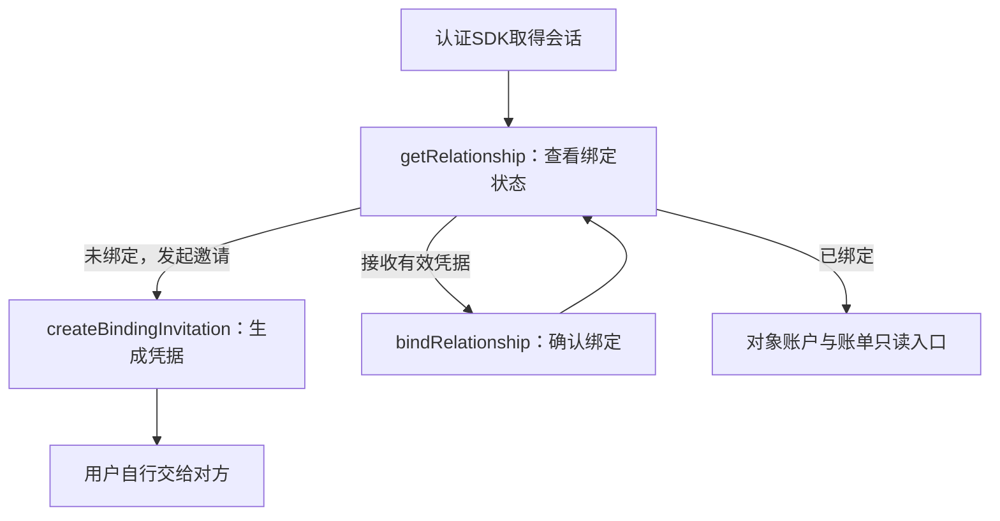
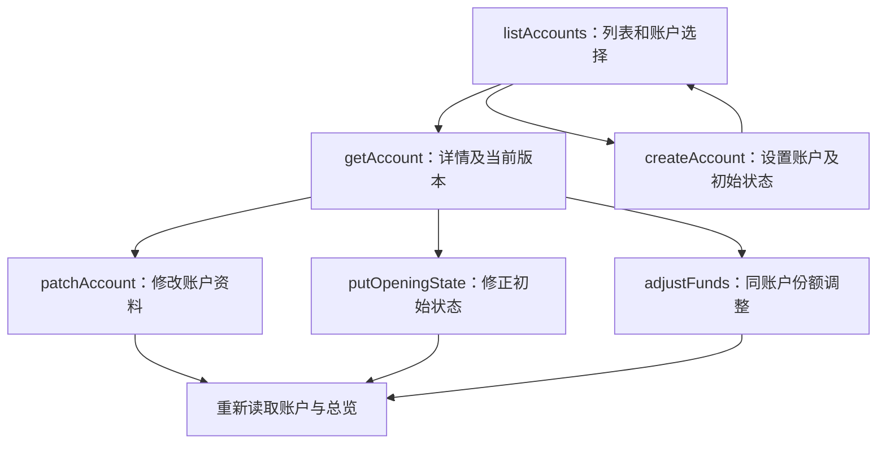
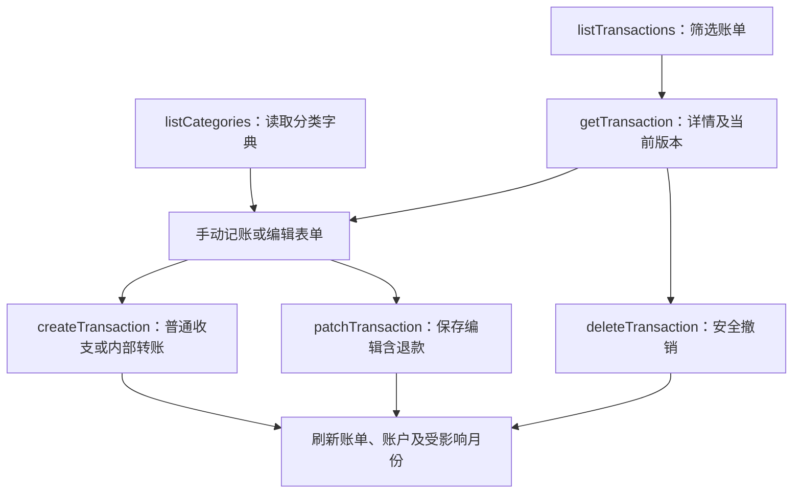
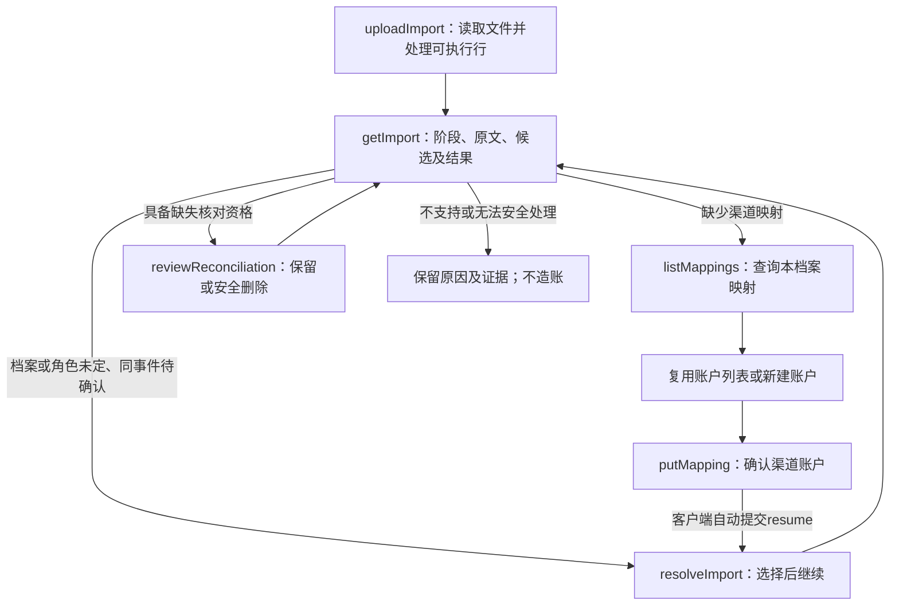
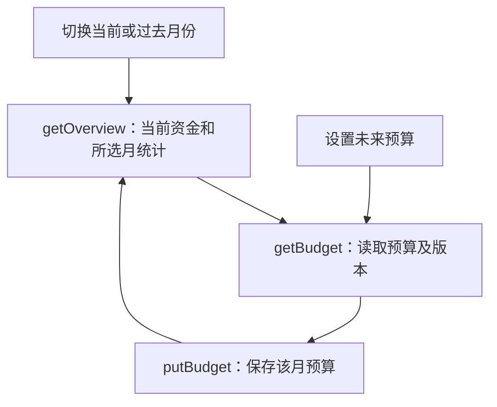

# 星账｜产品功能与交互

按用户任务划分页面，业务职责仍是M1–M5；规则以[业务规则](BUSINESS_RULES_DISCUSSION.md)为准。

| 产品区域 | 用户动作 | 业务模块/接口 |
|---|---|---|
| 首页 | 看四类资金、个人花销/日均/预测/预算，切换月份 | M5 GET overview；PUT budgets |
| 账户 | 新建、改名称、初始状态、调整资金归属/性质、看对象账户 | M2 accounts/opening-state/fund-adjustments；M1只读授权 |
| 账单 | 筛选、看详情、编辑保存、删除，切换本人/对象 | M3 transactions；对象仅查看 |
| 记账与导入 | 手动记账；选官方文件；看阶段结果、处理少数不明行 | M3手动创建；M4 imports/mappings/resolutions/reconciliation-reviews |
| 我的 | 看绑定状态、用有效凭据绑定、基本设置 | M1 relationship/binding |

## 首页

未绑定显示本人流动/存款；绑定后本人和对象各自流动/存款同屏，不把代管对象资金算成自己的。个人消费和预算分开于对象，日均比较用已确认的上月整月日均，不再保留“上月同期”另一套建议。

展示支出、抵减退款、净花销、日均、日均变化、预计花销、预算剩余/超支。净花销可负；无预算显示未设置；分母零变化率无值。切换历史月份看该月统计，资金卡明确是当前资金，不假装回到历史余额。

## 账户

实际银行卡/钱包/现金；初始余额与份额合计一致，各账户自己的起始日期。手动调整份额不能凭空改余额，不提供账户删除。对象存款仅绑定后可选，不提供对象流动份额。

存款基准/缺口可在需要解释回补时展示，不增设目标存款设置页。仅本人可写，对象账户只读。

## 账单与手动记账

手动类型只有收入、支出、本人内部转账；填金额、日期、账户、分类（可other）、商户/备注。转账选择两端，仅流动资金。银行卡账单如需官方缺失核对，可明确来源平台账号；不明确则不作该平台缺失结论。

退款不手动新建。官方退款详情显示到账账户、金额、记账日期、是否抵减、来源时间摘要；编辑日期和抵减沿用既有编辑页，无额外退款页面。只改抵减不动余额；跨账户起始日导致有效余额变化时明确反馈；无法安全撤销整笔失败。

删除消费不连带删除退款；删除后可通过新导入恢复。对象账单不显示编辑/删除，不显示整份来源原文。

## 官方导入

1. 选择微信/支付宝官方XLSX，自动读取文件头和所有行。
2. 自动复用明确档案；首次或多候选不明时在本次结果选择/创建，保留已上传文件，不反复上传。
3. 展示读取→标准化→账户/交易判断→正式处理各阶段及逐行内容。已明确消费直接处理，不要求全部逐笔确认。
4. 账户不明先设置已有渠道映射；回到同batch继续。普通转账角色不明仅选择收入/支出/内部转账；同事件候选仅必要时确认，退款不选原消费。
5. 成功行显示正式transaction_id，失败/待处理行显示具体缺什么与可做动作；不支持行说明范围并保留来源，不伪装为成功。
6. 七类行结果与总数一致。核对资格不足明确显示原因，不把“未运行缺失核对”说成全部对账完成。
7. 有资格时显示无官方来源的手动交易，提供保留已核对或删除；删除会改变账务，保留不会。重叠导入不反复提示同一新项。

解析失败分支仅保存证据和错误，不进入M3；可执行分支由应用用例协调M3交易、M2资金及M4来源关联一次提交。补映射后的官方refund可在现有导入结果继续创建；不新增手动退款入口、异常管理中心或独立退款模块。

截图分享/识别不开发；本期不支持的亲情卡、花呗、费用转账明确展示。页面不能直接改余额或自己实现资金计算。

## 完整API调用流程

以下是计划实现的客户端调用，不代表已有HTTP程序。每个框内使用契约operationId，完整参数和失败行为只在API契约维护。认证SDK负责登录/刷新/退出；401回到认证，恢复身份后使用原幂等键确认未知写入结果。成功写入后重新读取受影响详情、列表和总览；刷新失败只提示重试查询，不把已成功记账显示为保存失败，也不再次创建交易。不得通过GET顺便入账。

### M1 身份与关系

### M2 账户与资金

### M3 账单生命周期

### M4 官方导入与恢复

### M5 首页与预算

任何写操作失败：字段错误留在表单；412或版本409先刷新相应资源再由用户重做；资金不足/撤销不安全409保留原账并解释原因；超时不能当失败重新用新键提交。导入行失败通过同一个结果页查看原因，补条件后继续。对象视图隐藏写按钮，服务端仍检查权限。

所有24个operationId均在以上图中出现；列表分页、两个导入明细游标、筛选重置和预算未设置的空值边界见API契约，不另加分页或刷新接口。来源档案通过导入选择/创建，不另建档案管理模块。
