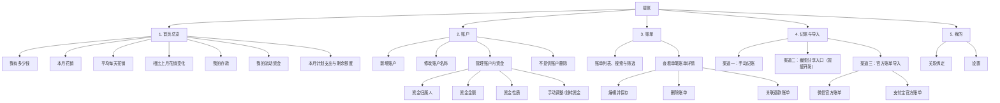
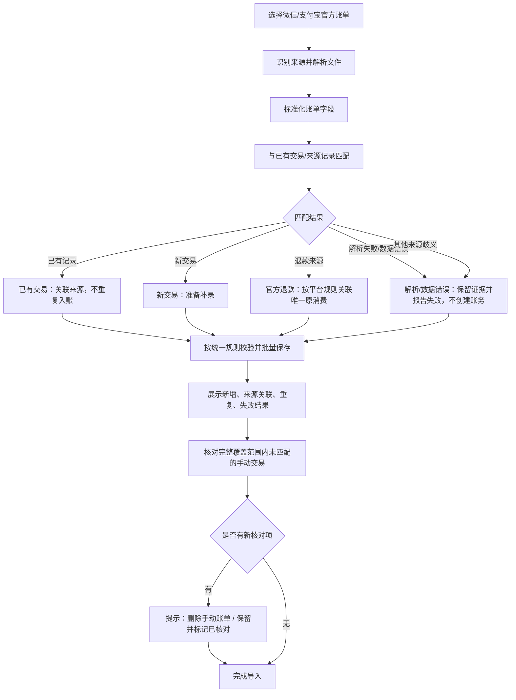

# 星账产品功能地图

版本：v0.3（讨论稿；已同步业务规则 v2.7 的退款约束、来源身份与核对项生命周期）  
阶段：产品功能规划。本文定义用户可见的产品区域、职责和主要输入渠道；不冻结物理数据库、具体框架或部署技术。

## 0. 首发产品约束

- **首发必须保证移动端可以顺畅完成核心记账任务。** 不能只把桌面布局缩小到手机屏幕；移动端需要可用的账户选择、手动记账、账单查看和关键反馈。
- **桌面端与 Android 端共享统一业务能力、API 契约和数据规则。** 两端的差异主要在客户端适配与交互，不得各自实现不同的账务算法。
- 首期具体采用响应式 Web、PWA、Android 壳或其他客户端形式，仍属于 D1 技术/产品形态决策；本条锁定的是移动体验与共享业务规则，不是提前锁定技术栈。
- 双人使用是基础能力：数据归属、关系绑定、服务端只读权限和双方资金份额从数据模型与后端设计第一天就要考虑。首发验收不能把双人支持默认为可有可无的远期功能。
- 截图分享/识别仍按本文件第 3.2 节暂缓；不能以截图识别尚未实现为理由，推迟移动端的手动记账体验。

## 1. 一级产品区域

分类依据是“用户要完成什么任务，以及在哪个产品区域完成”，不把 API、数据库或 OCR 等技术组件混入产品层级。

五个一级区域的职责边界：
- **首页总览**：展示资金与支出结果。
- **账户**：管理实际账户及账户内资金的归属、金额和性质。
- **账单**：查看和管理已经形成的交易记录。
- **记账与导入**：通过不同输入渠道形成或关联账单。
- **我的**：承接关系绑定和应用设置。

双人协作贯穿账户和账单；“谁有权限操作”与“钱属于谁、由谁保管”是不同问题。

## 2. 首页总览、账户与账单的职责

### 2.1 首页总览

首页回答：“我的钱现在是什么情况？”

展示：
- 我有多少钱；
- 本月花销；
- 平均每天花销；
- 相比上月的花销变化幅度；
- 我的存款；
- 我的流动资金；
- 本月计划支出，以及当前剩余额度。

待后续确认的统计口径：
- “相比上月”建议比较本月至今与上月同期，避免将不完整的本月和完整的上月直接比较。
- “我有多少钱”不能简单把所有账户余额相加；需要区分归自己所有的资金与由自己保管的他人资金。
- 本月计划支出需要一个简单的设置/修改入口，优先考虑在首页卡片中完成，不先扩展为复杂预算模块。

### 2.2 账户

账户区域负责管理实际账户及账户内资金情况：
- 新增账户；
- 修改账户名称；
- 查看账户内资金；
- 编辑资金归属人；
- 编辑资金金额；
- 编辑资金性质；
- 手动调整或划转资金；
- 不提供账户删除。

概念区分：
- **账户**：钱放在哪里。
- **资金归属人**：钱属于谁。
- **保管人**：谁实际持有或管理这笔钱。
- **资金性质**：这笔钱在个人资金管理中的用途。
- **关系成员权限**：谁可以查看或执行某个操作，不等同于资金所有权。

本稿不决定具体数据字段，也不擅自增加账户归档或停用功能。

### 2.3 账单

账单区域负责查看与管理已经形成的交易记录：
- 展示账单列表；
- 搜索与筛选；
- 点击单笔账单查看详情；
- 编辑账单并保存；
- 删除账单；
- 关联退款账单。

截图或文件解析出来的“候选信息”不自动等同于正式账单。只有经过必要校验并成功保存后，才显示为已入账。

## 3. 记账与导入：三个输入渠道

三个渠道是不同的输入方式，不是三套独立的记账规则。最终应遵循一致的账务规则，并向用户明确反馈成功或失败。

### 3.1 渠道一：手动记账

候选流程：

基础信息字段作为后续讨论项：
- 金额；
- 日期与时间；
- 收入、支出或转账类型；
- 分类；
- 关联账户；
- 商户/账单名称或备注。

手动记账只提供收入、支出和转账，不提供用户手动新建退款的入口。退款仍可在账单中查看和按既有规则编辑/删除，但退款交易由官方账单导入识别和创建。

不要为了统一入口而强迫手动记账调用视觉模型；用户直接输入的信息应进入正常的记账流程。

### 3.2 渠道二：截图分享入口（暂缓开发）

当前只保留产品入口规划：
- 用户从微信、支付宝或相册中选择/分享截图；
- 通过系统分享方式把图片交给星账；
- 识别能力经真实样例验证后，再决定如何展示候选信息、需要哪些确认，以及何时入账。

**当前状态：暂不开发截图识别和自动入账。**

暂不决定：
- 使用 OCR 还是视觉模型；
- 使用本地还是云端识别；
- 是否自动保存；
- 具体模型、API 和费用。

原因：此前测试显示，本地 OCR 在金额、日期、字段对应和退款语义上存在问题；少量视觉模型体验也不足以证明可用于真实记账。模型输出格式正确，不代表账务内容正确。

### 3.3 渠道三：官方账单导入

首期范围：
- 微信官方账单文件导入；
- 支付宝官方账单文件导入。

候选流程：

产品目标：
- 对已知官方格式尽量自动识别，避免用户反复选择类型或映射字段；
- 不把文件里的每一行都无条件新增成账单；
- 区分新增交易、已有交易的来源关联、退款、疑似重复和无法判断的异常；
- 汇报成功、失败及需要用户处理的记录；
- 官方退款按微信/支付宝平台规则关联唯一原消费；退款到账账户与原消费账户相同，首期不支持信用消费退款。解析器无法建立唯一关联时，该行报错且不创建退款交易。
- 文件平台、导出账户元数据、起止日期、全量导出标记和声明记录数由系统自动读取；覆盖范围完整性校验失败时，不执行“未找到官方来源”核对。
- 导入完成后，检查完整覆盖范围内、同一来源账户档案与行级支付渠道映射下未找到官方来源的手动交易。
- 新发现的核对项提供“删除这笔手动账单”和“保留并标记已核对”；系统不自动删除。
- 每个来源账户档案与手动交易只有一个核对项。重叠导入更新原项，不重复创建或重复弹出新提示；后续成功匹配来源时自动结案。
- 官方交易单号用于来源去重；每次导出对同一交易的状态观察独立保存，较新导出更新当前来源状态而不重复入账。

上图表达产品行为；平台字段映射仍需在 M4 通过真实文件逐行验收。
